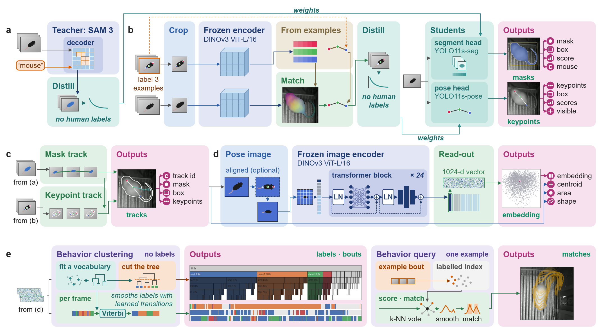
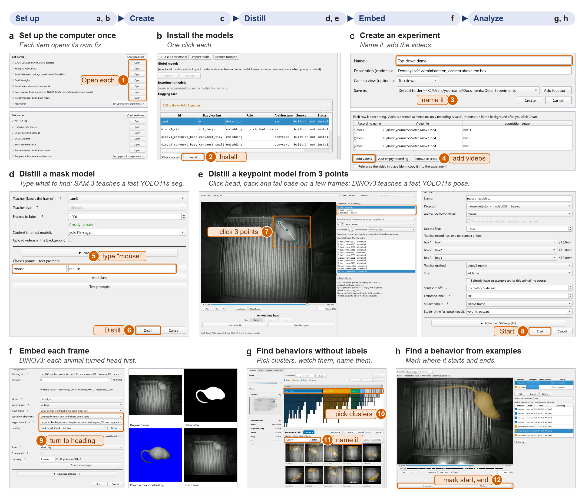

# Detail: species-agnostic, generalizable animal behavior analysis using foundation model embeddings

[](https://github.com/detail-embedding/detail/actions/workflows/ci.yml)
[](https://detail-embedding.github.io/detail/)

[](LICENSE)
<!-- TODO(release): add when each exists.
[](https://github.com/detail-embedding/detail/releases)
[](PREPRINT_URL)
-->

**[Install](https://detail-embedding.github.io/detail/getting-started.html) · [Documentation](https://detail-embedding.github.io/detail/) · [User guides](https://detail-embedding.github.io/detail/user-guides/index.html)**

> **Under active development.** Please report bugs and issues on the
> [issues page](https://github.com/detail-embedding/detail/issues).

Detail is a video analysis tool for species-agnostic, setting-agnostic analysis of animal
behavior. It detects and tracks animals with text-promptable foundation vision models (SAM 3,
DINOv3), with no manually labeled training data. Each frame becomes a pose embedding, a
high-dimensional representation of posture used in place of keypoints for behavior clustering,
querying, and comparison.

<!-- TODO(release): link the preprint in the paragraph above. -->


## How it works

The pipeline turns a video into pose embeddings in four steps:

1. **Segment** the animal from a text prompt such as "rat" (SAM 3).
2. **Track** it across frames.
3. **Detect keypoints** by patch matching from as little as one marked frame (DINOv3), to align
   the animal egocentrically.
4. **Embed** the aligned pose image (DINOv3).

SAM 3 and patch matching can be distilled into small YOLO models that run faster than real time
on a consumer GPU. Two analysis modules use the embeddings: **temporal clustering** finds
behaviors without labels, and **behavior querying** finds a behavior from one or more examples.
Results can be audited for precision, compared between groups, and exported.



## In the app

The desktop app covers the whole workflow, from installation and model management through
processing, analysis, and export. A command line and a Python API cover the same steps on
servers and in scripts.



## Install

Detail needs Python 3.12 or newer. SAM 3 needs an NVIDIA GPU; everything else also runs on
Apple Silicon or a CPU. The docs hold the install steps, so that there is one copy to keep
current:

- [Install on Windows](https://detail-embedding.github.io/detail/user-guides/install-windows.html): every step, with screenshots
- [Install on Linux](https://detail-embedding.github.io/detail/user-guides/install-linux.html): every step, with screenshots
- [Getting started](https://detail-embedding.github.io/detail/getting-started.html): the short install for someone at ease in a terminal, on any system, with GPU, SAM 3 and Hugging Face setup

Already installed? See
[Launch it again later](https://detail-embedding.github.io/detail/getting-started.html#launch-it-again-later).

## Learn

The [documentation site](https://detail-embedding.github.io/detail/) is the authoritative
resource. The app also opens a copy that matches your install, offline: the Docs page, or
`detail docs`.

- [User guides](https://detail-embedding.github.io/detail/user-guides/index.html): step by step, from a new experiment to analyzed behavior (start here)
- [Concepts](https://detail-embedding.github.io/detail/concepts.html): how the tool and its data are organized
- [GUI](https://detail-embedding.github.io/detail/gui.html) and [CLI](https://detail-embedding.github.io/detail/cli.html): what every screen and every command does
- [Tools](https://detail-embedding.github.io/detail/tools.html): one-off runs like Quick segment, no experiment needed
- [Python API](https://detail-embedding.github.io/detail/reference/api.html): the reference for scripts and agentic tools
- [Known issues](https://detail-embedding.github.io/detail/known-issues.html): current limits and the workaround for each

## Citing Detail

If you use Detail in your research, please cite our preprint (bioRxiv link coming soon):

> Lurbur M, Iyer V, Just R, Coffey KR, Golden SA. Detail: species-agnostic,
> generalizable animal behavior analysis using foundation model embeddings. *bioRxiv*
> (2026).

```bibtex
@article{lurbur2026detail,
  title   = {Detail: species-agnostic, generalizable animal behavior analysis using foundation model embeddings},
  author  = {Lurbur, Moses and Iyer, Vikram and Just, Ren{\'e} and Coffey, Kevin R. and Golden, Sam A.},
  journal = {bioRxiv},
  year    = {2026}
}
```

The **Cite this repository** button on GitHub gives the same citation in APA and BibTeX.

<!-- TODO(release): add the preprint link and DOI above, and `doi:`/`url:` in CITATION.cff. -->

## Contributing

See [`CONTRIBUTING.md`](CONTRIBUTING.md) for setting up, running the tests, and opening a pull
request.

## License

Detail is free software under the [GNU Affero General Public License v3.0](LICENSE)
(AGPL-3.0-only). You may use, change and share it. If you share a changed version, or let
others use one over a network, you must offer them its source code under the same license.

The SAM 3 and DINOv3 model weights are not part of Detail. Detail downloads them from Hugging
Face, where Meta publishes each under its own license, which you accept when you request access
there. Those licenses include restrictions of their own, such as on military use.

<!-- TODO(release): add a Funding section. -->
