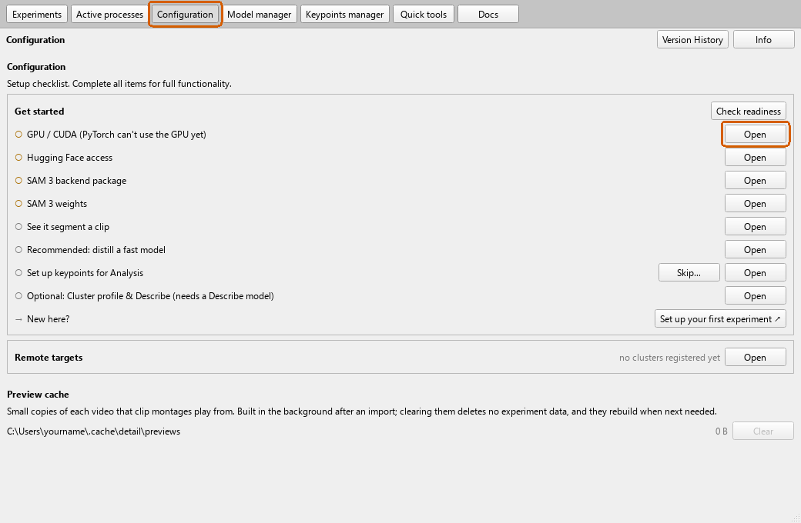
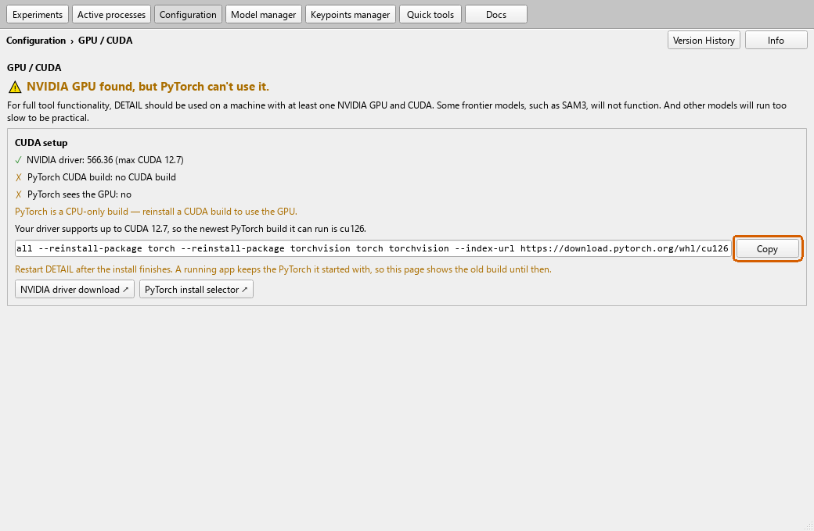
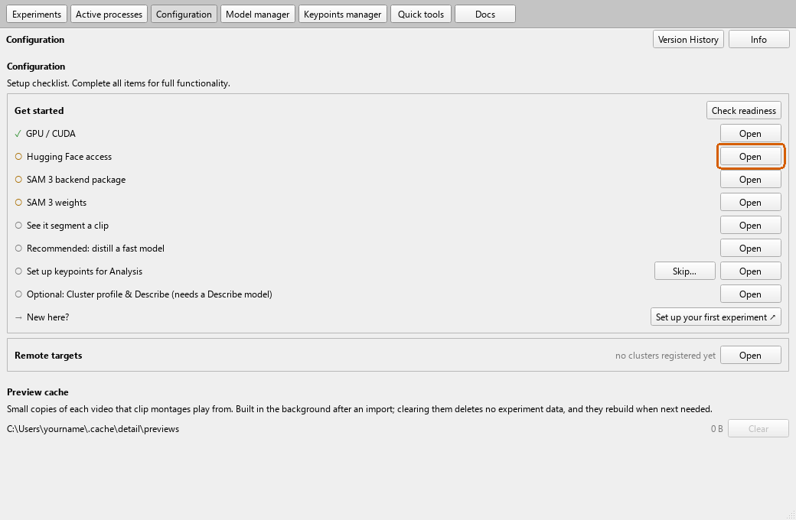
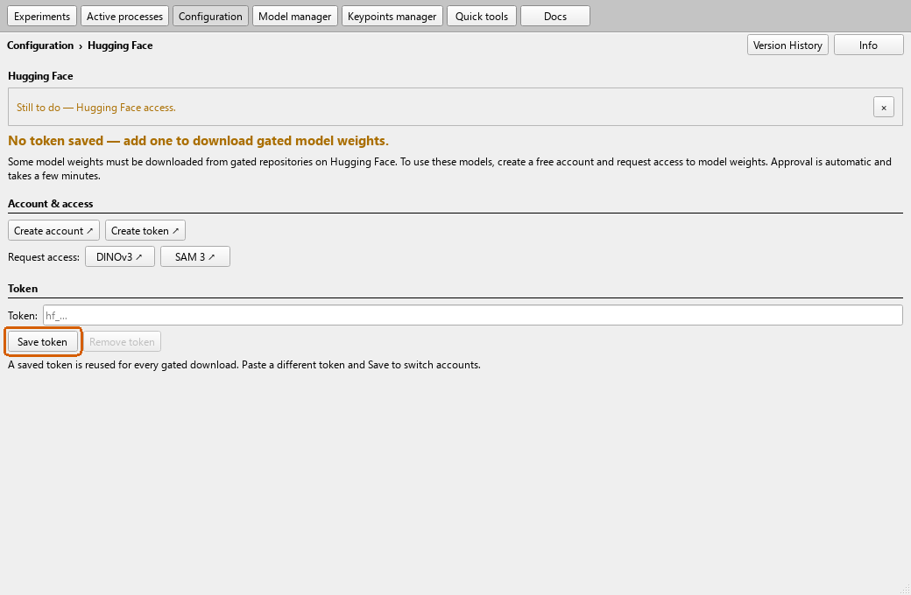
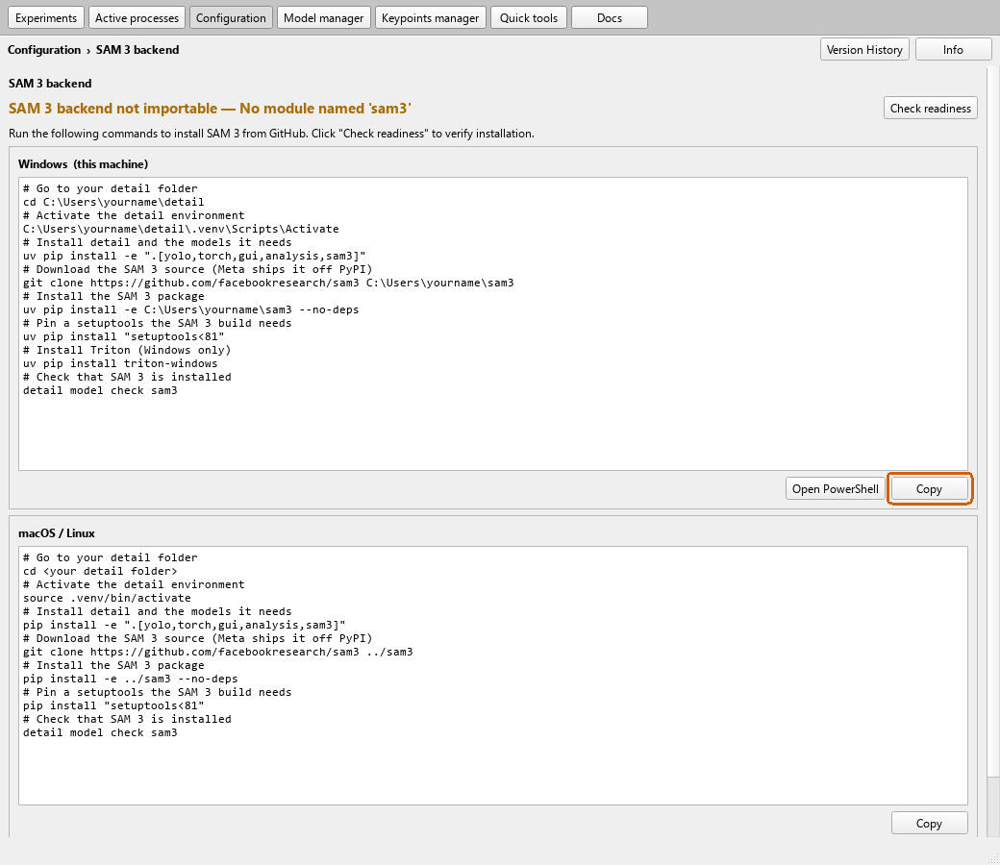
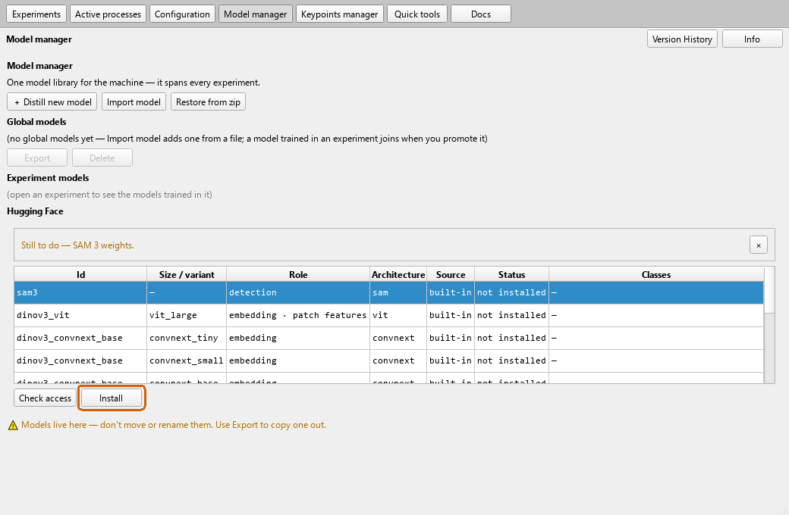
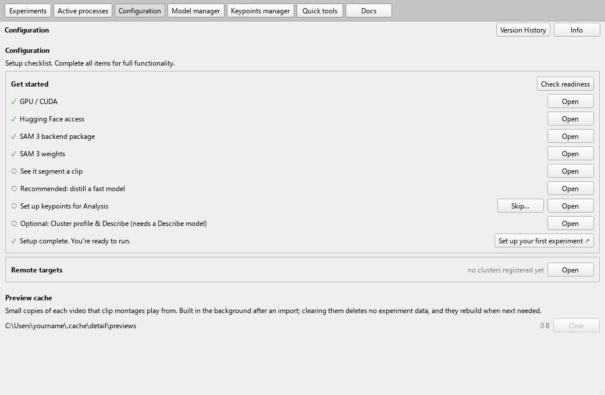

# Configure DETAIL

DETAIL's **Configuration** screen has a setup checklist. This page works through its first
four items: getting PyTorch to use the GPU, Hugging Face access, the SAM 3 detector, and the
model downloads. The other items need an experiment, and later chapters cover them.

Start with DETAIL open, as the install page left it.

!!! note "On a Mac, do step 2 only"
    A Mac has no NVIDIA GPU, so SAM 3 and the GPU models run on Tillicum and are set up
    there. On a Mac, do [step 2](#2-set-up-hugging-face-access) (your Hugging Face token is
    copied to Tillicum later), skip the rest, and go on to [Set up Tillicum](tillicum.md).

## Open the Configuration checklist

Click **Configuration** in the row of buttons along the top of the DETAIL window:



Each row is one setup item. A ✓ means it is done, an orange circle marks an item to do now,
and **Open** goes to the screen that does it. On a new Windows install the first row says
**PyTorch can't use the GPU yet**. That is expected: step 1 fixes it.

??? info "About this step: why PyTorch can't use the GPU yet"
    PyTorch is the library DETAIL's AI models run on. The first install on Windows gets a
    version of PyTorch without GPU support, because that is the version the installer picks
    by default. DETAIL sees that your computer has an NVIDIA GPU, and step 1 swaps in the
    version that can use it.

    On Linux and WSL the first install usually gets PyTorch with GPU support, so the first row
    may already show ✓.

    If the row says **no NVIDIA GPU detected** instead, DETAIL cannot find an NVIDIA GPU or
    its driver at all. Check that the NVIDIA driver step on your install page worked
    (`nvidia-smi` prints a table).

## 1. Get PyTorch to use the GPU

In the checklist, click **Open** on the **GPU / CUDA** row.



- **The top line says the GPU is ready**, in green: nothing to do. Skip to step 2.
- **It says NVIDIA GPU found, but PyTorch can't use it:** the screen shows a command that
  installs the right PyTorch for your driver. Do the following.

1. Click **Copy** beside the command.
2. **Close DETAIL.**
3. Go to the terminal window DETAIL was running in: **PowerShell** if you installed on
   Windows without WSL, the **WSL terminal** (the window named **Ubuntu**) if you installed
   with WSL, **Terminal** on Linux. Now that DETAIL is closed, its
   prompt is back, still starting with `(detail)`. Paste the command there and press
   ++enter++. It downloads a few gigabytes. Wait for the prompt.
4. When the prompt comes back, launch DETAIL again (`detail-gui`) and open **Configuration**.

**Check:** the **GPU / CUDA** row shows ✓, and the checklist now looks like this:



??? info "About this step"
    PyTorch is built separately for each version of NVIDIA's CUDA software, and your driver
    supports CUDA only up to a certain version. The screen reads that version from the driver
    and picks the newest PyTorch build that can run on it. You close DETAIL first because a
    running DETAIL keeps the old PyTorch loaded, and on Windows a file that is in use cannot
    be replaced.

??? warning "If this doesn't work"
    - **The command fails with "Access is denied":** DETAIL, or another Python program, is
      still running. Close it and run the command again.
    - **The terminal says `uv` or the command is not recognized:** the environment is not on.
      Go to the DETAIL folder and switch it on (the first two commands under **Launch it
      again later** on your install page), then run the command again.
    - **After the restart it still says PyTorch can't use the GPU, and names the driver:**
      the driver is too old for any PyTorch build. Update it (the **NVIDIA driver download**
      button), restart the computer, and open this screen again.

## 2. Set up Hugging Face access

DETAIL's AI models download from Hugging Face, a website that hosts AI models. Two of them,
SAM 3 and DINOv3, are free but *gated*: you agree to their terms once, and then download them
with a personal access key, called a token.

### Create an account

If you do not have one, create a free account at [Hugging Face sign-up](https://huggingface.co/join)
and confirm your email address.

### Request access to the models

While signed in to Hugging Face, open each model's page and request access. Each page shows a
short form or an **Agree and access repository** button.

1. [SAM 3](https://huggingface.co/facebook/sam3): fill in the form and submit it.
2. [DINOv3](https://huggingface.co/facebook/dinov3-vitl16-pretrain-lvd1689m): fill in the form
   and submit it. This one request covers every size of DINOv3.

Approval usually arrives within minutes, by email. You can carry on while you wait.

### Create a token

1. Open your [Hugging Face token settings](https://huggingface.co/settings/tokens) and click
   **Create new token**.
2. Choose the **Fine-grained** token type, and give it a name such as `detail`.
3. Under **Repositories**, tick **Read access to contents of all public gated repos you can
   access**.
4. Click **Create token** at the bottom.
5. Copy the token. It starts with `hf_`. Hugging Face shows it only once, so keep the page
   open until you have pasted it into DETAIL.

### Give the token to DETAIL

In the checklist, click **Open** on the **Hugging Face access** row.



Paste the token into the **Token** box and click **Save token**.

**Check:** the top line turns green and says **Token saved**, with your Hugging Face username.

??? info "About this step"
    The token is like a password that only allows downloading. DETAIL keeps it on your
    computer, in your user settings folder, and never puts it inside an experiment. The
    **Create account**, **Create token** and **Request access** buttons on this screen open
    the same web pages as the links above.

??? warning "If this doesn't work"
    - **"Invalid token" or similar:** the token was not copied whole. Create a new one and
      paste it again.
    - **The token saves, but a model download later fails with a 403 or "access" error:**
      either the token lacks the gated-repos permission (item 3 of *Create a token*), or your
      access request for that model has not been approved yet. Check your requests under
      [Gated repositories](https://huggingface.co/settings/gated-repos) in your Hugging Face
      settings.

## 3. Install the SAM 3 backend

SAM 3 is the model DETAIL uses to find animals in video. Its software is installed from its
own source code, so it gets its own step.

In the checklist, click **Open** on the **SAM 3 backend package** row.



The first block, marked **(this machine)**, is the list of commands for your computer, with
your own folders already filled in. Lines starting with `#` describe the command below them.

1. Click **Copy** under the first block.
2. Open a new terminal window, leaving DETAIL open in the first: **PowerShell** if you installed on
   Windows without WSL, the **WSL terminal** (the window named **Ubuntu**) if you installed
   with WSL, **Terminal** on Linux. Paste the commands there. They
   start by going to the DETAIL folder and switching on its environment, so the new window
   needs nothing else first. They run one after another. Wait for the prompt.
3. Back in DETAIL, click **Check readiness**.

**Check:** the top line turns green and says **SAM 3 backend package is importable**. The
last command, `detail model check sam3`, may report that the weights are not installed yet:
step 4 installs them.

??? info "About this step: what the commands do"
    The commands go to the DETAIL folder, switch on its environment, download SAM 3's source
    code from GitHub into a `sam3` folder beside `detail`, and install it into DETAIL's
    environment. The other lines add a few libraries SAM 3 needs, and, on Windows, `triton`,
    a GPU library SAM 3 uses.

    This step installs SAM 3's *software*. Its *weights*, the trained model itself, are a
    separate download (step 4).

??? warning "If this doesn't work"
    - **In WSL or on Linux, the commands start with `pip` instead of `uv pip`:** your block
      shows whichever installer your environment has, and either works.
    - **A command fails with "Access is denied" on Windows:** close DETAIL, run the commands
      again, then launch DETAIL and click **Check readiness**.
    - **It still says not importable after the commands finished without errors:** close
      DETAIL and launch it again.

## 4. Download the models

Click **Model manager** in the row of buttons along the top. The **Hugging Face** table lists
the models DETAIL can download.



Install SAM 3:

1. Click the **sam3** row.
2. Click **Check access**. It confirms your token and your approved request.
3. Click **Install**. A progress line under the table shows the file and how much has
   downloaded, about 3.4 GB in all.

Then install DINOv3, the model DETAIL uses to describe what the animal looks like:

1. Click the **dinov3_vit** row whose size is **vit_large**.
2. Click **Install**. It is about 1.2 GB.

**Check:** both rows show **installed** in the **Status** column.

??? info "About this step"
    These downloads are the trained models themselves, which is why they are large. They are
    stored once per computer and shared by every experiment. DINOv3 comes in several sizes,
    each a separate download. `vit_large` is the one DETAIL uses unless you choose another.

??? warning "If this doesn't work"
    - **Check access says no access, or the install fails with 403:** see the last item under
      [step 2's troubleshooting](#2-set-up-hugging-face-access).
    - **The download stops partway:** click **Install** again. It continues from where it
      stopped.

## Check: setup is done

Click **Configuration** again. The first four rows show ✓, and the last line says **Setup
complete**:



The same checks run in a terminal, which is useful when asking for help. Open a new
terminal window, run the first two commands under **Launch it again later** on your
install page (they go to the DETAIL folder and switch on its environment), then:

```
detail doctor
```

### The rest of the checklist

The other rows are set up later, once you have an experiment:

| Row | Where |
|-----|-------|
| See it segment a clip | Optional: **Quick tools** tries SAM 3 on one video, without an experiment. |
| Recommended: distill a fast model | [Single animal](single-animal/index.md), detection chapter |
| Set up keypoints for Analysis | [Single animal](single-animal/index.md), keypoints chapter |
| Optional: Cluster profile | [Single animal](single-animal/index.md), clustering chapter |
| Remote targets | [Set up Tillicum](tillicum.md) |

## Next

- **With Tillicum:** [Set up Tillicum](tillicum.md).
- **Without:** [Single animal](single-animal/index.md).
