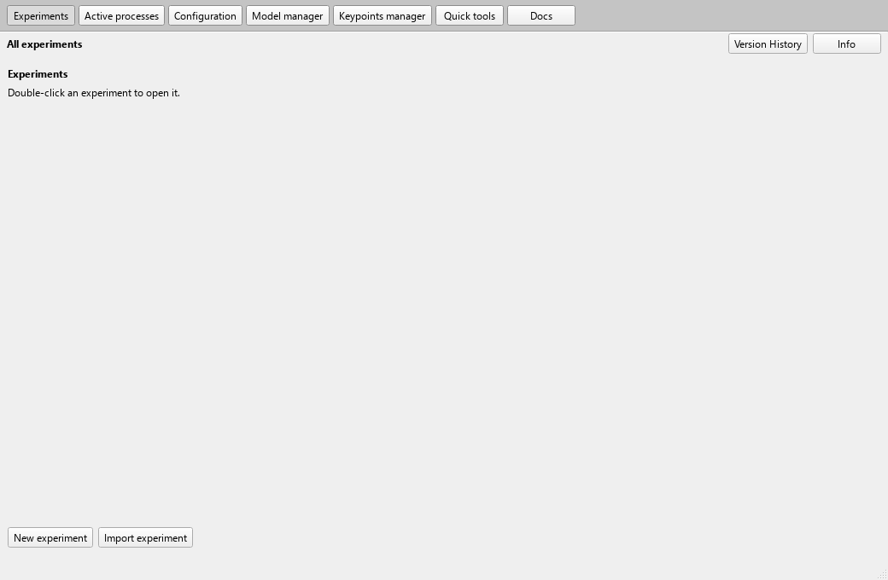

# Install on Linux

This page installs DETAIL on a Linux computer with an NVIDIA GPU. The commands are for Ubuntu
22.04 or newer. Other Linux systems work too, with their own commands for installing system
software in steps 3 and 4.

DETAIL runs everything on your computer's NVIDIA GPU.

!!! note "Your computer needs an NVIDIA GPU"
    Check before you start: open a terminal (see below) and run `lspci | grep -i nvidia`. A
    line naming an NVIDIA device must print. If nothing prints, DETAIL cannot run on
    your computer.

    Check the [hardware and disk space](index.md#hardware-and-disk-space) DETAIL needs, too.
    The installation needs at least 25 GB free in your home folder.

## The steps at a glance

Each box is one step on this page. Click a box to go to that step. The tags say where the step happens.

<div class="guide-flow" markdown>

1. [Create a GitHub account and get access](#1-create-a-github-account-and-get-access-to-detail) <span class="where where-web">Browser</span> <span class="note">Wait for the invitation email from GitHub.</span>
1. [Install the NVIDIA driver](#2-install-the-nvidia-driver) <span class="where where-terminal">Terminal</span> <span class="note">Skip if nvidia-smi already shows your GPU.</span>
1. [Install the tools DETAIL needs](#3-install-the-tools-detail-needs) <span class="where where-terminal">Terminal</span>
1. [Install Python 3.12](#4-install-python-312) <span class="where where-terminal">Terminal</span>
1. [Sign in to GitHub](#5-sign-in-to-github-from-your-computer) <span class="where where-terminal">Terminal</span> <span class="where where-web">Browser</span>
1. [Download DETAIL](#6-download-detail) <span class="where where-terminal">Terminal</span>
1. [Create the environment and install DETAIL](#7-create-the-environment-and-install-detail) <span class="where where-terminal">Terminal, same window</span>
1. [Launch DETAIL](#8-launch-detail) <span class="where where-terminal">Terminal, same window</span> <span class="where where-detail">DETAIL window</span> <span class="note">Then go on to Configure DETAIL.</span>

</div>

## Before you start: open a terminal

Every command on this page runs in a terminal. On Ubuntu, press ++ctrl+alt+t++, or open
**Terminal** from the applications menu. The prompt looks like `yourname@computer:~$`.

??? info "About this step: running a command"
    To run a command from this page:

    1. Click the copy button at the right edge of the command's grey box.
    2. Click inside the terminal and press ++ctrl+shift+v++ to paste. (++ctrl+v++ does not
       paste in a Linux terminal.)
    3. Press ++enter++.
    4. Wait for the prompt, ending in `$`, to come back before running the next command.

    Some commands start with `sudo`, which runs them as administrator. The first `sudo` in a
    while asks for your password. Nothing appears while you type it, not even dots. Type it
    and press ++enter++.

## 1. Create a GitHub account and get access to DETAIL

DETAIL is shared through GitHub, a website for sharing software, in a private repository that
only invited accounts can open.

1. If you do not have a GitHub account, create one at [GitHub sign-up](https://github.com/signup).
   It is free.
2. Send your GitHub username to the DETAIL team and ask for access to the DETAIL repository.
3. GitHub emails you an invitation. Open it and click **Accept invitation**.

**Check:** while signed in to GitHub, open [the DETAIL repository](https://github.com/detail-embedding/detail).
You see a list of folders and files.

??? warning "If this doesn't work"
    - **"404 This is not the web page you are looking for":** your invitation has not been
      accepted yet, or you are signed in as a different account. Check your email (and spam
      folder) for the invitation, or open
      [your GitHub invitations](https://github.com/detail-embedding/detail/invitations).

## 2. Install the NVIDIA driver

In the terminal, first check whether a working driver is already installed:

```
nvidia-smi
```

- **A table prints with your GPU's name** and a `CUDA Version` on its top line: the driver
  works. Skip to step 3.
- **`nvidia-smi` is not found, or prints an error:** install the driver.

Ubuntu picks and installs the right driver for your GPU:

```
sudo ubuntu-drivers install
```

**Restart the computer**, open a terminal again, and check:

```
nvidia-smi
```

A table prints with your GPU's name. Its top line includes `CUDA Version`.

??? info "About this step"
    The driver is the software that lets Linux use the GPU. DETAIL's AI models use NVIDIA's
    CUDA software, which comes with it. An old driver supports only old versions of CUDA, and
    so only old versions of PyTorch, the library the models run on.

    You can also install the driver from **Software & Updates ▸ Additional Drivers**: pick the
    newest entry marked **proprietary, tested**.

??? warning "If this doesn't work"
    - **The computer asks you to "Enroll MOK" or set a Secure Boot password during the
      install:** choose a password and write it down. After the restart a blue screen appears:
      choose **Enroll MOK**, then **Continue**, and type that password. Without this, Secure
      Boot stops the driver from loading.
    - **`ubuntu-drivers` is not found:** run `sudo apt install -y ubuntu-drivers-common`
      first.
    - **`nvidia-smi` still fails after the restart:** ask your IT support. Some computers
      need the driver installed a different way.

## 3. Install the tools DETAIL needs

In the terminal, bring the list of available software up to date:

```
sudo apt update
```

Install Git, the GitHub CLI, and the display libraries DETAIL's window needs:

```
sudo apt install -y git gh curl libxcb-cursor0 libxcb-icccm4 libxcb-image0 libxcb-keysyms1 libxcb-render-util0 libxcb-shape0 libxcb-xkb1 libxcb-util1 libxkbcommon-x11-0
```

Install **uv**, the tool that installs Python and DETAIL:

```
curl -LsSf https://astral.sh/uv/install.sh | sh
```

**Close the terminal and open it again**, so it finds uv. Then check each tool:

```
git --version
```

```
gh --version
```

```
uv --version
```

Each prints a version number.

??? info "About this step: what each tool is"
    - **Git** downloads DETAIL and later fetches its updates.
    - **The GitHub CLI** (`gh`) signs your computer in to your GitHub account, so Git can
      download the private DETAIL repository.
    - **The `libxcb` and `libxkbcommon` libraries** let DETAIL's window open. Most desktop
      installs have them already, and `apt` skips any that are.
    - **uv** installs Python, DETAIL, and the libraries DETAIL uses, into a separate folder
      (its *environment*) so they cannot clash with the system's own software.

## 4. Install Python 3.12

DETAIL needs Python version **3.12** exactly. Linux comes with its own Python, which may be a
different version. Leave it alone: the system's own tools use it. uv installs a separate
Python 3.12 next to it.

In the terminal:

```
uv python install 3.12
```

**Check:**

```
uv python find 3.12
```

It prints the path of a Python 3.12 program.

??? info "About this step: why 3.12, and having several versions"
    DETAIL is built and tested on Python 3.12. Some libraries it depends on, PyTorch and
    SAM 3 among them, are slow to support each new Python, so a newer version can fail
    partway through the install.

    The Python uv installs lives in uv's own folder. It does not replace the system's
    `python3`, and nothing else uses it unless asked. If `uv python find 3.12` finds a
    Python 3.12 that was already installed, that is fine too.

??? warning "If this doesn't work"
    - **You use Anaconda or Miniconda,** and the prompt starts with `(base)` or another name
      in brackets: run `conda deactivate` before step 7, so the environment is made from
      Python 3.12 rather than from conda's Python.

## 5. Sign in to GitHub from your computer

In the terminal:

```
gh auth login --hostname github.com --git-protocol https --web
```

1. If it asks **Authenticate Git with your GitHub credentials?**, press ++enter++ for yes.
2. It prints a one-time code, such as `1A2B-3C4D`, and a web address. Press ++enter++ to open
   your browser.
3. Sign in to GitHub if asked, type the code, and click **Authorize**.

**Check:** the terminal prints `Logged in as` followed by your GitHub username.

??? info "About this step"
    This links Git on your computer to your GitHub account, so it can download the private
    DETAIL repository. You do it once per computer.

## 6. Download DETAIL

In the terminal, go to your home folder:

```
cd ~
```

Download DETAIL into a new folder there, named `detail`:

```
gh repo clone detail-embedding/detail detail
```

Go into it:

```
cd detail
```

**Check:** the prompt now ends in `~/detail$`.

??? info "About this step"
    Your home folder is `/home/yourname`, so DETAIL ends up in `/home/yourname/detail`.

??? warning "If this doesn't work"
    - **"Could not resolve to a Repository":** your GitHub account does not have access yet.
      Go back to step 1.
    - **"destination path 'detail' already exists":** DETAIL was downloaded before. Run
      `cd detail` and go on to step 7.

## 7. Create the environment and install DETAIL

In the same terminal window, still inside the `detail` folder (the prompt ends in
`~/detail$`), create the environment, using the Python 3.12 from step 4:

```
uv venv --seed --python 3.12
```

Switch it on:

```
source .venv/bin/activate
```

**Check:** the prompt now starts with `(detail)`.

Install DETAIL and everything it needs into the environment:

```
uv pip install -e ".[yolo,torch,gui,analysis,sam3]"
```

This downloads several gigabytes and can take ten minutes or more. Wait for the prompt.

**Check:**

```
detail --help
```

A list of DETAIL commands prints.

??? info "About this step"
    The environment is the `.venv` folder inside `detail`. Everything DETAIL installs goes
    there and nowhere else, so removing that folder removes it all.

    You switch the environment on (activate it) every time you open a new terminal to use
    DETAIL. While it is on, the prompt starts with `(detail)`.

    The words in brackets are optional parts of DETAIL to include: `yolo` and `sam3` for
    detection models, `torch` for the AI libraries, `gui` for the desktop app, and `analysis`
    for clustering.

??? warning "If this doesn't work"
    - **`detail` is not found:** the environment is not on. Run `source .venv/bin/activate`
      from inside the `detail` folder.
    - **The install stops with an error:** run the same install command again. A dropped
      download is the usual cause, and uv keeps the files it already downloaded.

## 8. Launch DETAIL

In the same terminal window, with the environment on (the prompt starts with
`(detail)`):

```
detail-gui
```

The DETAIL window opens on **Experiments**, which is empty for now:



Leave it open and go on to [Configure DETAIL](configure.md).

??? info "About this step"
    The terminal stays busy while DETAIL is open, and closing it closes DETAIL. Open a second
    terminal for any other commands.

## Launch it again later

Open a terminal, then run these three commands:

```
cd ~/detail
```

```
source .venv/bin/activate
```

```
detail-gui
```

## Update DETAIL

Close DETAIL first. Then, in a terminal, go to the DETAIL folder and switch on its
environment (the first two commands under [Launch it again later](#launch-it-again-later)).
Download the latest version:

```
git pull
```

If it printed a list of changed files, reinstall so any new libraries arrive:

```
uv pip install -e ".[yolo,torch,gui,analysis,sam3]"
```

Then launch DETAIL again.

## Next

[Configure DETAIL](configure.md).
