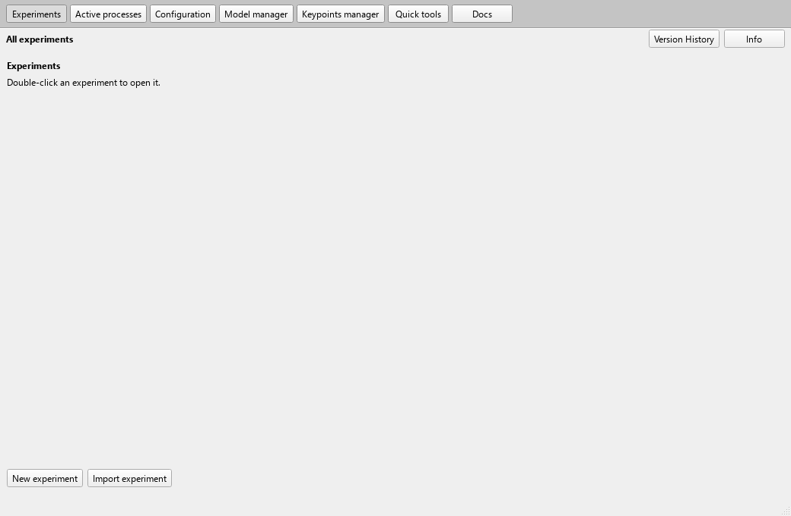

# Install on macOS

This page installs DETAIL on a Mac, for someone with Tillicum access. You use DETAIL on the
Mac, and it sends the work that needs an NVIDIA GPU (finding the animal, its body points, and
what it looks like in each frame) to Tillicum. Analysis of the results runs on the Mac.

!!! note "A Mac needs Tillicum"
    Macs do not have NVIDIA GPUs, and DETAIL's detection model, SAM 3, runs only on one. On a
    Mac, DETAIL needs Tillicum for that work. Ask for access in step 2, because it can take a
    few days.

    Check the [hardware and disk space](index.md#hardware-and-disk-space) DETAIL needs, too.
    The models live on Tillicum, so the Mac needs less space: about 10 GB free is enough for
    the installation.

## The steps at a glance

Each box is one step on this page. Click a box to go to that step. The tags say where the step happens.

<div class="guide-flow" markdown>

1. [Create a GitHub account and get access](#1-create-a-github-account-and-get-access-to-detail) <span class="where where-web">Browser</span> <span class="note">Wait for the invitation email from GitHub.</span>
1. [Request Tillicum access](#2-request-tillicum-access) <span class="where where-web">Email</span> <span class="note">Can take a few days. Carry on while you wait.</span>
1. [Install Homebrew](#3-install-homebrew) <span class="where where-terminal">Terminal</span> <span class="note">Skip if you already have Homebrew.</span>
1. [Install Git, the GitHub CLI and uv](#4-install-git-the-github-cli-and-uv) <span class="where where-terminal">Terminal</span>
1. [Install Python 3.12](#5-install-python-312) <span class="where where-terminal">Terminal</span>
1. [Sign in to GitHub](#6-sign-in-to-github-from-this-mac) <span class="where where-terminal">Terminal</span> <span class="where where-web">Browser</span>
1. [Download DETAIL](#7-download-detail) <span class="where where-terminal">Terminal</span>
1. [Create the environment and install DETAIL](#8-create-the-environment-and-install-detail) <span class="where where-terminal">Terminal, same window</span>
1. [Launch DETAIL](#9-launch-detail) <span class="where where-terminal">Terminal, same window</span> <span class="where where-detail">DETAIL window</span> <span class="note">Then go on to Configure DETAIL, then Set up Tillicum.</span>

</div>

## Before you start: open Terminal

Every command on this page runs in **Terminal**, the Mac's command window. Press
++cmd+space++, type `Terminal`, and press ++enter++. The prompt ends in `%`.

??? info "About this step: running a command"
    To run a command from this page:

    1. Click the copy button at the right edge of the command's grey box.
    2. Click inside Terminal and press ++cmd+v++ to paste.
    3. Press ++enter++.
    4. Wait for the `%` prompt to come back before running the next command.

    Some commands ask for your Mac password, the one you log in with. Nothing appears while you
    type it, not even dots. Type it and press ++enter++.

## 1. Create a GitHub account and get access to DETAIL

DETAIL is shared through GitHub, a website for sharing software, in a private repository that
only invited accounts can open.

1. If you do not have a GitHub account, create one at [GitHub sign-up](https://github.com/signup).
   It is free.
2. Send your GitHub username to the DETAIL team and ask for access to the DETAIL repository.
3. GitHub emails you an invitation. Open it and click **Accept invitation**.

**Check:** while signed in to GitHub, open [the DETAIL repository](https://github.com/detail-embedding/detail).
You see a list of folders and files.

??? warning "If this doesn't work"
    - **"404 This is not the web page you are looking for":** your invitation has not been
      accepted yet, or you are signed in as a different account. Check your email (and spam
      folder) for the invitation, or open
      [your GitHub invitations](https://github.com/detail-embedding/detail/invitations).

## 2. Request Tillicum access

Do this now, because UW-IT can take a few days to set up your account. Follow
[Request access and storage](tillicum.md#1-request-access-and-storage) on the Set up Tillicum
page, then come back here. The rest of this page does not need Tillicum, so carry on while you
wait.

## 3. Install Homebrew

Homebrew is the usual way to install free command-line tools on a Mac. In **Terminal**, check whether
you already have it:

```
brew --version
```

- **A version number prints:** you have Homebrew. Skip to step 4.
- **`command not found: brew`:** install it as below.

```
/bin/bash -c "$(curl -fsSL https://raw.githubusercontent.com/Homebrew/install/HEAD/install.sh)"
```

1. It asks for your Mac password, then asks you to press ++enter++ to continue. Do both.
2. If a window asks to install the **Command Line Developer Tools**, click **Install** and
   wait for it to finish.
3. When it finishes, it prints **Next steps** with two or three commands to run. Copy and run
   each of them, in order. They let Terminal find Homebrew.

**Close Terminal and open it again.** Then check:

```
brew --version
```

A version number prints.

??? info "About this step"
    Homebrew installs and updates tools like Git with one command each. The Command Line
    Developer Tools are Apple's own basic tools, which Homebrew needs. The **Next steps**
    commands add Homebrew to the list of places Terminal looks for programs. They differ
    between Macs, which is why you copy them from Homebrew's own output.

??? warning "If this doesn't work"
    - **`brew` is still not found after reopening Terminal:** you skipped the **Next steps**
      commands. Run the install command again: Homebrew notices it is already installed and
      prints them again.

## 4. Install Git, the GitHub CLI and uv

In **Terminal**:

```
brew install git gh uv
```

**Check** each tool:

```
git --version
```

```
gh --version
```

```
uv --version
```

Each prints a version number.

??? info "About this step: what each tool is"
    - **Git** downloads DETAIL and later fetches its updates.
    - **The GitHub CLI** (`gh`) signs this Mac in to your GitHub account, so Git can download
      the private DETAIL repository.
    - **uv** installs Python, DETAIL, and the libraries DETAIL uses, into a separate folder
      (its *environment*) so they cannot clash with other software on the Mac.

## 5. Install Python 3.12

DETAIL needs Python version **3.12** exactly. Your Mac may already have Python, possibly a
different version. Leave it alone: uv installs a separate Python 3.12 next to it.

In **Terminal**:

```
uv python install 3.12
```

**Check:**

```
uv python find 3.12
```

It prints the path of a Python 3.12 program.

??? info "About this step: why 3.12, and having several versions"
    DETAIL is built and tested on Python 3.12. Some libraries it depends on, PyTorch among
    them, are slow to support each new Python, so a newer version can fail partway through the
    install.

    The Python uv installs lives in uv's own folder. It does not replace any other Python on
    the Mac, and nothing else uses it unless asked. If `uv python find 3.12` finds a Python
    3.12 that was already installed, that is fine too.

??? warning "If this doesn't work"
    - **You use Anaconda or Miniconda,** and the prompt starts with `(base)` or another name
      in brackets: run `conda deactivate` before step 8, so the environment is made from
      Python 3.12 rather than from conda's Python.

## 6. Sign in to GitHub from this Mac

In **Terminal**:

```
gh auth login --hostname github.com --git-protocol https --web
```

1. If it asks **Authenticate Git with your GitHub credentials?**, press ++enter++ for yes.
2. It prints a one-time code, such as `1A2B-3C4D`. Press ++enter++ to open your browser.
3. Sign in to GitHub if asked, type the code, and click **Authorize**.

**Check:** Terminal prints `Logged in as` followed by your GitHub username.

??? info "About this step"
    This links Git on this Mac to your GitHub account, so it can download the private DETAIL
    repository. You do it once per computer.

## 7. Download DETAIL

In **Terminal**, go to your home folder:

```
cd ~
```

Download DETAIL into a new folder there, named `detail`:

```
gh repo clone mlurbur/detail detail -- --branch remote-detail
```

Go into it:

```
cd detail
```

**Check:** the prompt now shows `detail` before the `%`.

??? info "About this step"
    Your home folder is `/Users/yourname`, so DETAIL ends up in `/Users/yourname/detail`.
    `--branch remote-detail` picks the version of DETAIL that can use Tillicum.

??? warning "If this doesn't work"
    - **"Could not resolve to a Repository":** your GitHub account does not have access yet.
      Go back to step 1.
    - **"destination path 'detail' already exists":** DETAIL was downloaded before. Run
      `cd detail` and go on to step 8.

## 8. Create the environment and install DETAIL

In the same **Terminal** window, still inside the `detail` folder (the prompt shows
`detail` before the `%`), create the environment, using the Python 3.12 from step 5:

```
uv venv --seed --python 3.12
```

Switch it on:

```
source .venv/bin/activate
```

**Check:** the prompt now starts with `(detail)`.

Install DETAIL and everything it needs into the environment:

```
uv pip install -e ".[yolo,torch,gui,analysis]"
```

This downloads a few gigabytes and can take several minutes. Wait for the prompt.

**Check:**

```
detail --help
```

A list of DETAIL commands prints.

??? info "About this step"
    The environment is the `.venv` folder inside `detail`. Everything DETAIL installs goes
    there and nowhere else, so removing that folder removes it all.

    You switch the environment on (activate it) every time you open a new Terminal window to
    use DETAIL. While it is on, the prompt starts with `(detail)`.

    The words in brackets are optional parts of DETAIL to include: `yolo` for trained
    detection models, `torch` for the AI libraries, `gui` for the desktop app, and `analysis`
    for clustering. The other install pages also add `sam3`, the libraries for the SAM 3
    detector. A Mac leaves it out: SAM 3 cannot run on a Mac, and runs on Tillicum instead.

??? warning "If this doesn't work"
    - **`detail` is not found:** the environment is not on. Run `source .venv/bin/activate`
      from inside the `detail` folder.
    - **The install stops with an error:** run the same install command again. A dropped
      download is the usual cause, and uv keeps the files it already downloaded.

## 9. Launch DETAIL

In the same **Terminal** window, with the environment on (the prompt starts with
`(detail)`):

```
detail-gui
```

The DETAIL window opens on **Experiments**, which is empty for now:



Leave it open and go on to [Configure DETAIL](configure.md).

??? info "About this step"
    Terminal stays busy while DETAIL is open, and closing that Terminal window closes DETAIL.
    Open a second window (++cmd+n++) for any other commands.

    The first time, macOS may ask whether Terminal or Python may access a folder such as
    Documents or Desktop. Click **Allow**: DETAIL keeps your experiments in
    `Documents/DetailExperiments`.

## Launch it again later

Open Terminal, then run these three commands:

```
cd ~/detail
```

```
source .venv/bin/activate
```

```
detail-gui
```

## Update DETAIL

Close DETAIL first. Then, in Terminal, go to the DETAIL folder and switch on its environment
(the first two commands under [Launch it again later](#launch-it-again-later)). Download the
latest version:

```
git pull
```

If it printed a list of changed files, reinstall so any new libraries arrive:

```
uv pip install -e ".[yolo,torch,gui,analysis]"
```

Then launch DETAIL again. Tillicum has its own copy of DETAIL, which needs updating too
([Set up Tillicum](tillicum.md)).

## Next

1. [Configure DETAIL](configure.md).
2. [Set up Tillicum](tillicum.md).
