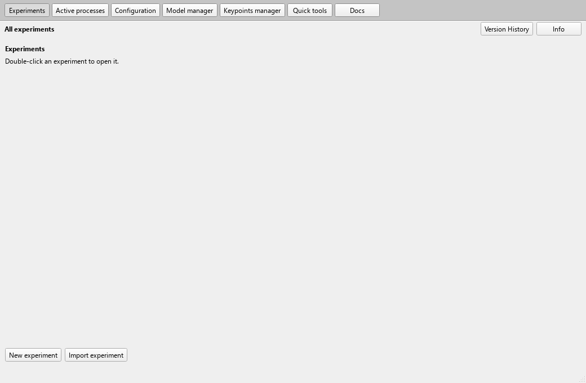

# Install on Windows with WSL

This page installs DETAIL on a Windows 10 or Windows 11 computer that has an NVIDIA GPU, for
someone who also has Tillicum access. DETAIL runs inside **WSL**, a Linux system built into
Windows, and can send work either to your computer's GPU or to Tillicum.

If you will never use Tillicum, [Install on Windows](install-windows.md) is simpler.

!!! note "Your computer needs an NVIDIA GPU"
    Check before you start: press ++ctrl+shift+esc++ to open Task Manager, click **More
    details** if you see it, then the **Performance** tab. One of the **GPU** entries on the
    left must say **NVIDIA**. If none does, see [Choose your setup](index.md#choose-your-setup).

    Check the [hardware and disk space](index.md#hardware-and-disk-space) DETAIL needs, too.
    The installation needs at least 25 GB free on drive `C:`.

??? info "About WSL: why DETAIL runs in Linux here"
    Tillicum asks for your password and a Duo approval each time something connects to it.
    DETAIL avoids asking you hundreds of times by keeping one connection open and sharing it,
    a feature of the Linux connection program (SSH) that the Windows one does not reliably
    support. So on Windows, DETAIL runs inside WSL (Windows Subsystem for Linux).

    WSL is part of Windows. It runs an Ubuntu Linux system alongside Windows, with its own
    files and programs. DETAIL's window still appears on your desktop like any other app, and
    WSL can use your NVIDIA GPU through the Windows driver.

## The steps at a glance

Each box is one step on this page. Click a box to go to that step. The tags say where the step happens.

<div class="guide-flow" markdown>

1. [Create a GitHub account and get access](#1-create-a-github-account-and-get-access-to-detail) <span class="where where-web">Browser</span> <span class="note">Wait for the invitation email from GitHub.</span>
1. [Request Tillicum access](#2-request-tillicum-access) <span class="where where-web">Email</span> <span class="note">Can take a few days. Carry on while you wait.</span>
1. [Update the NVIDIA driver](#3-update-the-nvidia-driver) <span class="where where-web">Browser</span>
1. [Install WSL](#4-install-wsl) <span class="where where-powershell">PowerShell, as administrator</span> <span class="note">Restart the computer afterwards. Every later step is in the WSL terminal.</span>
1. [Open the WSL terminal and update it](#5-open-the-wsl-terminal-and-update-it) <span class="where where-wsl">WSL terminal</span>
1. [Install the tools DETAIL needs](#6-install-the-tools-detail-needs) <span class="where where-wsl">WSL terminal</span>
1. [Install Python 3.12](#7-install-python-312) <span class="where where-wsl">WSL terminal</span>
1. [Sign in to GitHub](#8-sign-in-to-github-from-wsl) <span class="where where-wsl">WSL terminal</span> <span class="where where-web">Browser</span>
1. [Download DETAIL](#9-download-detail) <span class="where where-wsl">WSL terminal</span>
1. [Create the environment and install DETAIL](#10-create-the-environment-and-install-detail) <span class="where where-wsl">WSL terminal, same window</span>
1. [Launch DETAIL](#11-launch-detail) <span class="where where-wsl">WSL terminal, same window</span> <span class="where where-detail">DETAIL window</span> <span class="note">Then go on to Configure DETAIL, then Set up Tillicum.</span>

</div>

## Before you start: two terminals

This page uses two terminals:

- **PowerShell**, the Windows terminal, for step 4 only. Open it from the Start menu.
- **The WSL terminal**, a window named **Ubuntu**, for every other command. Step 4
  installs it.

Each step says which one to use.

??? info "About this step: running a command"
    To run a command from this page:

    1. Click the copy button at the right edge of the command's grey box.
    2. Click inside the terminal window and right-click to paste. In the WSL terminal,
       ++ctrl+shift+v++ also pastes.
    3. Press ++enter++.
    4. Wait for the prompt to come back before running the next command. In Ubuntu the prompt
       ends in `$`.

    Some commands start with `sudo`, which runs them as administrator. The first `sudo` in a
    while asks for your Linux password (the one you make in step 4). Nothing appears while you
    type it, not even dots. Type it and press ++enter++.

## 1. Create a GitHub account and get access to DETAIL

DETAIL is shared through GitHub, a website for sharing software, in a private repository that
only invited accounts can open.

1. If you do not have a GitHub account, create one at [GitHub sign-up](https://github.com/signup).
   It is free.
2. Send your GitHub username to the DETAIL team and ask for access to the DETAIL repository.
3. GitHub emails you an invitation. Open it and click **Accept invitation**.

**Check:** while signed in to GitHub, open [the DETAIL repository](https://github.com/detail-embedding/detail).
You see a list of folders and files.

??? warning "If this doesn't work"
    - **"404 This is not the web page you are looking for":** your invitation has not been
      accepted yet, or you are signed in as a different account. Check your email (and spam
      folder) for the invitation, or open
      [your GitHub invitations](https://github.com/detail-embedding/detail/invitations).

## 2. Request Tillicum access

Do this now, because UW-IT can take a few days to set up your account. Follow
[Request access and storage](tillicum.md#1-request-access-and-storage) on the Set up Tillicum
page, then come back here. The rest of this page does not need Tillicum, so carry on while you
wait.

## 3. Update the NVIDIA driver

The driver is the Windows software that lets Windows, and WSL, use the GPU.

1. Open [NVIDIA drivers](https://www.nvidia.com/download/index.aspx).
2. Choose your GPU (its name is in Task Manager's GPU entry), download the driver, and run the
   installer with its default choices.
3. Restart the computer when it asks.

You check the driver from inside WSL in step 5.

??? info "About this step"
    DETAIL's AI models use NVIDIA's CUDA software, which comes with the driver. An old driver
    supports only old versions of CUDA, and so only old versions of PyTorch, the library the
    models run on. Updating first avoids a mismatch later.

    WSL uses this Windows driver directly. **Never install an NVIDIA driver inside Ubuntu**:
    it would replace the link to the Windows driver and break GPU access in WSL.

## 4. Install WSL

In **PowerShell, run as administrator**: click the Start menu, type `PowerShell`, right-click
**Windows PowerShell** and choose **Run as administrator**. Click **Yes** when Windows asks.

```
wsl --install
```

It downloads and installs WSL and Ubuntu. **Restart the computer** when it finishes.

After the restart, an Ubuntu window opens by itself and asks for a new **username** and
**password**. These are for Linux only, separate from your Windows login. Choose a short
lowercase username, and a password you will remember: `sudo` asks for it.

**Check:** in PowerShell (it need not be administrator now), run:

```
wsl --list --verbose
```

A row for `Ubuntu` shows `2` in the `VERSION` column.

??? info "About this step"
    `wsl --install` turns on the Windows features WSL needs and installs Ubuntu, the most
    common Linux. Version 2 of WSL is the one that can use the GPU.

??? warning "If this doesn't work"
    - **No Ubuntu window opened after the restart:** open **Ubuntu** from the Start menu. It
      finishes setting up and asks for the username and password then.
    - **The `VERSION` column shows `1`:** run `wsl --set-version Ubuntu 2` in PowerShell.
    - **An error mentions virtualization:** virtualization is switched off in the computer's
      firmware (BIOS or UEFI) settings. Ask your IT support to turn it on.

## 5. Open the WSL terminal and update it

From now on, every command runs in the **WSL terminal**. Open it from the Start menu: type
`Ubuntu` and click it. The prompt looks like `yourname@COMPUTER:~$`.

In the **WSL terminal**, bring Ubuntu's own software up to date:

```
sudo apt update
```

```
sudo apt upgrade -y
```

**Check** that WSL sees the GPU:

```
nvidia-smi
```

A table prints with your GPU's name. Its top line includes `CUDA Version`.

??? info "About this step"
    `apt` is Ubuntu's program installer. `apt update` fetches the list of current versions,
    and `apt upgrade` installs them.

??? warning "If this doesn't work"
    - **`nvidia-smi` is not found, or says it cannot communicate with the driver:** update the
      Windows driver (step 3), restart Windows, and open Ubuntu again.

## 6. Install the tools DETAIL needs

In the **WSL terminal**, install Git, the GitHub CLI, and the display libraries
DETAIL's window needs in WSL:

```
sudo apt install -y git gh curl libxcb-cursor0 libxcb-icccm4 libxcb-image0 libxcb-keysyms1 libxcb-render-util0 libxcb-shape0 libxcb-xkb1 libxcb-util1 libxkbcommon-x11-0
```

Install **uv**, the tool that installs Python and DETAIL:

```
curl -LsSf https://astral.sh/uv/install.sh | sh
```

**Close the WSL terminal and open it again**, so it finds uv. Then check each tool:

```
git --version
```

```
gh --version
```

```
uv --version
```

Each prints a version number.

??? info "About this step: what each tool is"
    - **Git** downloads DETAIL and later fetches its updates.
    - **The GitHub CLI** (`gh`) signs WSL in to your GitHub account, so Git can download the
      private DETAIL repository.
    - **The `libxcb` and `libxkbcommon` libraries** let DETAIL's window use the X11 display
      in WSL. Without them DETAIL falls back to another display (Wayland), where opening some
      drop-down menus has crashed it.
    - **uv** installs Python, DETAIL, and the libraries DETAIL uses, into a separate folder
      (its *environment*) so they cannot clash with Ubuntu's own software.

## 7. Install Python 3.12

DETAIL needs Python version **3.12** exactly. Ubuntu comes with its own Python, which may be
a different version. Leave it alone: Ubuntu's own tools use it. uv installs a separate
Python 3.12 next to it.

In the **WSL terminal**:

```
uv python install 3.12
```

**Check:**

```
uv python find 3.12
```

It prints the path of a Python 3.12 program.

??? info "About this step: why 3.12, and having several versions"
    DETAIL is built and tested on Python 3.12. Some libraries it depends on, PyTorch and
    SAM 3 among them, are slow to support each new Python, so a newer version can fail
    partway through the install.

    The Python uv installs lives in uv's own folder. It does not replace Ubuntu's `python3`,
    and nothing else on the system uses it unless asked. If `uv python find 3.12` finds a
    Python 3.12 that was already installed, that is fine too.

## 8. Sign in to GitHub from WSL

In the **WSL terminal**:

```
gh auth login --hostname github.com --git-protocol https --web
```

1. If it asks **Authenticate Git with your GitHub credentials?**, press ++enter++ for yes.
2. It prints a one-time code, such as `1A2B-3C4D`, and a web address. Press ++enter++.
3. If no browser opens, open [GitHub's device sign-in page](https://github.com/login/device) in
   your Windows browser yourself.
4. Sign in to GitHub if asked, type the code, and click **Authorize**.

**Check:** the terminal prints `Logged in as` followed by your GitHub username.

??? info "About this step"
    WSL has its own programs and settings, so it signs in to GitHub separately from Windows.
    You do it once.

## 9. Download DETAIL

In the **WSL terminal**, go to your Linux home folder:

```
cd ~
```

Download DETAIL into a new folder there, named `detail`:

```
gh repo clone mlurbur/detail detail -- --branch remote-detail
```

Go into it:

```
cd detail
```

**Check:** the prompt now ends in `~/detail$`.

??? info "About this step"
    Your Linux home folder is `/home/yourname`, inside WSL, so DETAIL ends up in
    `/home/yourname/detail`. Keep it there rather than in a Windows folder (`/mnt/c/...`):
    Python installs need file permissions that Windows folders do not support from WSL, and
    WSL reads its own files much faster.

    `--branch remote-detail` picks the version of DETAIL that can use Tillicum and has the
    newest features.

??? warning "If this doesn't work"
    - **"Could not resolve to a Repository":** your GitHub account does not have access yet.
      Go back to step 1.
    - **"destination path 'detail' already exists":** DETAIL was downloaded before. Run
      `cd detail` and go on to step 10.

## 10. Create the environment and install DETAIL

In the same **WSL terminal**, still inside the `detail` folder (the prompt ends in
`~/detail$`), create the environment, using the Python 3.12 from step 7:

```
uv venv --seed --python 3.12
```

Switch it on:

```
source .venv/bin/activate
```

**Check:** the prompt now starts with `(detail)`.

Install DETAIL and everything it needs into the environment:

```
uv pip install -e ".[yolo,torch,gui,analysis,sam3]"
```

This downloads several gigabytes and can take ten minutes or more. Wait for the prompt.

**Check:**

```
detail --help
```

A list of DETAIL commands prints.

??? info "About this step"
    The environment is the `.venv` folder inside `detail`. Everything DETAIL installs goes
    there and nowhere else, so removing that folder removes it all.

    You switch the environment on (activate it) every time you open a new WSL terminal to
    use DETAIL. While it is on, the prompt starts with `(detail)`.

    The words in brackets are optional parts of DETAIL to include: `yolo` and `sam3` for
    detection models, `torch` for the AI libraries, `gui` for the desktop app, and `analysis`
    for clustering.

??? warning "If this doesn't work"
    - **`detail` is not found:** the environment is not on. Run `source .venv/bin/activate`
      from inside the `detail` folder.
    - **The install stops with an error:** run the same install command again. A dropped
      download is the usual cause, and uv keeps the files it already downloaded.

## 11. Launch DETAIL

In the same **WSL terminal**, with the environment on (the prompt starts with
`(detail)`):

```
detail-gui
```

The DETAIL window opens on your Windows desktop, on **Experiments**, which is empty for now:



Leave it open and go on to [Configure DETAIL](configure.md).

??? info "About this step"
    The WSL terminal stays busy while DETAIL is open, and closing it closes DETAIL. Open a
    second WSL terminal for any other commands.

    Links in DETAIL, such as **Open full docs**, open in your Windows browser.

??? info "Where your videos are, as seen from WSL"
    WSL sees your Windows drives under `/mnt`: drive `C:` is `/mnt/c`, so
    `C:\Users\yourname\Videos` is `/mnt/c/Users/yourname/Videos`. When DETAIL asks for a
    video, you can pick it there.

    A network drive mapped to a letter in Windows, such as `Y:`, does not appear by itself.
    Make it visible each time WSL starts, for example after restarting Windows. In the
    **WSL terminal**, before launching DETAIL, run these two commands (replace `y` and
    `Y:` with your drive's letter):

    ```
    sudo mkdir -p /mnt/y
    ```

    ```
    sudo mount -t drvfs Y: /mnt/y
    ```

    Reading video from a Windows drive is slower than from WSL's own files, which matters most
    for long recordings.

## Launch it again later

Open the WSL terminal, then run these three commands:

```
cd ~/detail
```

```
source .venv/bin/activate
```

```
detail-gui
```

## Update DETAIL

Close DETAIL first. Then, in the WSL terminal, go to the DETAIL folder and switch on its
environment (the first two commands under [Launch it again later](#launch-it-again-later)).
Download the latest version:

```
git pull
```

If it printed a list of changed files, reinstall so any new libraries arrive:

```
uv pip install -e ".[yolo,torch,gui,analysis,sam3]"
```

Then launch DETAIL again. Tillicum has its own copy of DETAIL, which needs updating too
([Set up Tillicum](tillicum.md)).

## Next

1. [Configure DETAIL](configure.md).
2. [Set up Tillicum](tillicum.md).
