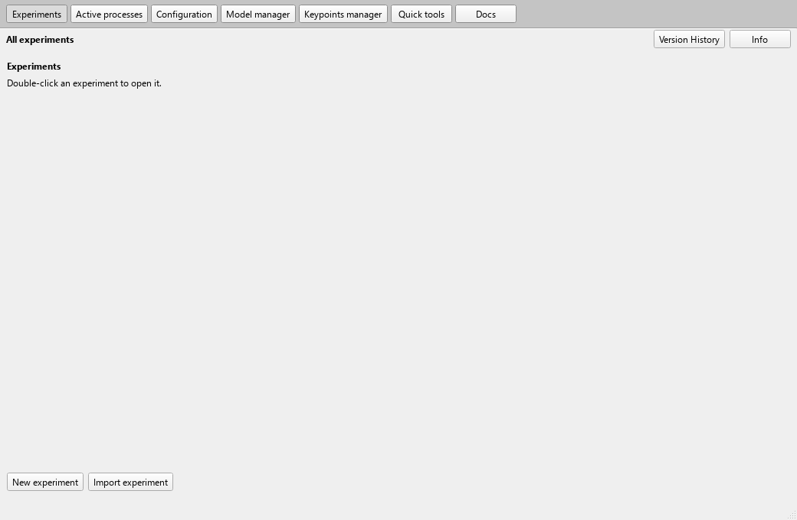

# Install on Windows

This page installs DETAIL on a Windows 10 or Windows 11 computer and runs everything on that
computer. If you also have Tillicum access and want to send work there, use
[Install on Windows with WSL](install-windows-wsl.md) instead.

!!! note "Your computer needs an NVIDIA GPU"
    Check before you start: press ++ctrl+shift+esc++ to open Task Manager, click **More
    details** if you see it, then the **Performance** tab. One of the **GPU** entries on the
    left must say **NVIDIA**. If none does, this setup will not work. See
    [Choose your setup](index.md#choose-your-setup).

    Check the [hardware and disk space](index.md#hardware-and-disk-space) DETAIL needs, too.
    The installation needs at least 25 GB free on drive `C:`.

## The steps at a glance

Each box is one step on this page. Click a box to go to that step. The tags say where the step happens.

<div class="guide-flow" markdown>

1. [Create a GitHub account and get access](#1-create-a-github-account-and-get-access-to-detail) <span class="where where-web">Browser</span> <span class="note">Wait for the invitation email from GitHub.</span>
1. [Update the NVIDIA driver](#2-update-the-nvidia-driver) <span class="where where-web">Browser</span> <span class="where where-powershell">PowerShell</span>
1. [Install Python 3.12](#3-install-python-312) <span class="where where-powershell">PowerShell</span> <span class="note">Skip the install if you already have Python 3.12.</span>
1. [Install Git, the GitHub CLI and uv](#4-install-git-the-github-cli-and-uv) <span class="where where-powershell">PowerShell</span>
1. [Allow PowerShell to run scripts](#5-allow-powershell-to-run-scripts) <span class="where where-powershell">PowerShell</span>
1. [Sign in to GitHub](#6-sign-in-to-github-from-your-computer) <span class="where where-powershell">PowerShell</span> <span class="where where-web">Browser</span>
1. [Download DETAIL](#7-download-detail) <span class="where where-powershell">PowerShell</span>
1. [Create the environment and install DETAIL](#8-create-the-environment-and-install-detail) <span class="where where-powershell">PowerShell, same window</span>
1. [Turn on Developer Mode](#9-turn-on-developer-mode) <span class="where where-settings">Windows Settings</span>
1. [Launch DETAIL](#10-launch-detail) <span class="where where-powershell">PowerShell, same window</span> <span class="where where-detail">DETAIL window</span> <span class="note">Then go on to Configure DETAIL.</span>

</div>

## Before you start: open PowerShell

Every command on this page runs in **PowerShell**, the Windows terminal.

1. Click the Start menu and type `PowerShell`.
2. Click **Windows PowerShell**. Do not choose the one marked **ISE** or **(x86)**.

A window opens with a prompt like `PS C:\Users\yourname>`. Keep it open while you work through
this page.

??? info "About this step: running a command"
    To run a command from this page:

    1. Click the copy button at the right edge of the command's grey box.
    2. Click inside the PowerShell window and right-click. PowerShell pastes on right-click
       (++ctrl+v++ also works on Windows 11).
    3. Press ++enter++.
    4. Wait for the `PS ...>` prompt to come back before running the next command.

    If you close PowerShell partway through, open it again the same way. Steps 8 and later
    also need you to go back into the DETAIL folder and switch on its environment. The
    commands for that are under [Launch it again later](#launch-it-again-later).

## 1. Create a GitHub account and get access to DETAIL

DETAIL is shared through GitHub, a website for sharing software, in a private repository that
only invited accounts can open.

1. If you do not have a GitHub account, create one at [GitHub sign-up](https://github.com/signup).
   It is free.
2. Send your GitHub username to the DETAIL team and ask for access to the DETAIL repository.
3. GitHub emails you an invitation. Open it and click **Accept invitation**.

**Check:** while signed in to GitHub, open [the DETAIL repository](https://github.com/detail-embedding/detail).
You see a list of folders and files.

??? warning "If this doesn't work"
    - **"404 This is not the web page you are looking for":** your invitation has not been
      accepted yet, or you are signed in as a different account. Check your email (and spam
      folder) for the invitation, or open
      [your GitHub invitations](https://github.com/detail-embedding/detail/invitations).

## 2. Update the NVIDIA driver

The driver is the software that lets Windows use the GPU.

1. Open [NVIDIA drivers](https://www.nvidia.com/download/index.aspx).
2. Choose your GPU (its name is in Task Manager's GPU entry), download the driver, and run the
   installer with its default choices.
3. Restart the computer when it asks.

**Check:** in PowerShell, run:

```
nvidia-smi
```

A table prints with your GPU's name. Its top line includes `CUDA Version`.

??? info "About this step"
    DETAIL's AI models use NVIDIA's CUDA software, which comes with the driver. An old driver
    supports only old versions of CUDA, and so only old versions of PyTorch, the library the
    models run on. Updating the driver first avoids a mismatch later.

??? warning "If this doesn't work"
    - **`nvidia-smi` is not recognized:** the driver is not installed, or Windows has not
      restarted since you installed it. Restart and try again.
    - **"NVIDIA-SMI has failed because it couldn't communicate with the NVIDIA driver":**
      reinstall the driver, then restart.

## 3. Install Python 3.12

DETAIL needs Python version **3.12** exactly. Your computer may already have Python, possibly a
newer version. A newer version is not enough, but you can keep it: Python 3.12 installs next
to it without changing it.

In **PowerShell**, see which versions your computer has:

```
py --list
```

- **A line containing `3.12`:** Python 3.12 is installed. Skip to step 4.
- **Only other versions, such as `3.13` or `3.14`:** install 3.12 as below. Your other
  versions stay as they are.
- **`py` is not recognized:** your computer has no Python from python.org. Install 3.12 as
  below.

Install Python 3.12 with **winget**, the program installer built into Windows:

```
winget install --id Python.Python.3.12 -e
```

The first time, winget asks you to agree to its source terms: type `Y` and press ++enter++.
Windows may ask whether to allow an app to make changes to your device: click **Yes**.

**Close PowerShell and open it again**, so it finds the new Python. Then check:

```
py -3.12 --version
```

It prints a version starting with `Python 3.12`.

??? info "About this step: why 3.12, and having several versions"
    Python is the programming language DETAIL is written in. DETAIL is built and tested on
    Python 3.12. Some libraries it depends on, PyTorch and SAM 3 among them, are slow to
    support each new Python, so a newer version can fail partway through the install.

    Several Python versions can be installed on one computer, and each program picks the one
    it asks for. The `py` launcher that comes with Python from python.org lists them all and
    starts whichever you name: `py -3.12` runs 3.12 even when a newer one is the default.
    DETAIL's environment (step 8) asks for 3.12 by name, so your other versions, and anything
    that uses them, are not affected.

??? warning "If this doesn't work"
    - **`winget` is not recognized:** install **App Installer** from the Microsoft Store,
      then reopen PowerShell.
    - **`py -3.12 --version` says Python 3.12 was not found, or opens the Microsoft Store:**
      run the install command again and watch for an error. Use `py -3.12`, not `python`:
      Windows includes a `python` shortcut that opens the Store, and on a computer with
      several versions `python` may start a different one.
    - **You use Anaconda or Miniconda,** and the prompt starts with `(base)` or another name
      in brackets: run `conda deactivate` before step 8, so the environment is made from
      Python 3.12 rather than from conda's Python.

## 4. Install Git, the GitHub CLI and uv

These are three more free tools DETAIL needs. Install them with winget, one at a time, in **PowerShell**:

```
winget install --id Git.Git -e
```

```
winget install --id GitHub.cli -e
```

```
winget install --id astral-sh.uv -e
```

If winget asks you to agree to its source terms, type `Y` and press ++enter++. Windows may ask
whether to allow an app to make changes to your device: click **Yes**. If a tool is already
installed, winget says so and changes nothing.

**Close PowerShell and open it again**, so it finds the new tools. Then check each one:

```
git --version
```

```
gh --version
```

```
uv --version
```

Each prints a version number.

??? info "About this step: what each tool is"
    - **Git** downloads DETAIL and later fetches its updates.
    - **The GitHub CLI** (`gh`) signs your computer in to your GitHub account, so Git can
      download the private DETAIL repository.
    - **uv** installs DETAIL and the libraries it uses into a separate folder, its
      *environment*, so they cannot clash with other Python software on the computer.

    PowerShell only looks for new programs when it starts, which is why you reopen it.

??? warning "If this doesn't work"
    - **`winget` is not recognized:** install **App Installer** from the Microsoft Store,
      then reopen PowerShell.
    - **A tool is not recognized after reopening PowerShell:** close every PowerShell window
      and open a new one. If it is still not found, restart the computer.

## 5. Allow PowerShell to run scripts

Windows blocks PowerShell scripts by default, and switching on DETAIL's environment runs one.
In **PowerShell**, allow scripts for your own account. You do this once, and it needs no administrator:

```
Set-ExecutionPolicy -Scope CurrentUser -ExecutionPolicy RemoteSigned
```

If it asks whether to change the execution policy, type `Y` and press ++enter++.

??? info "About this step"
    `RemoteSigned` lets scripts made on your computer run, and still blocks unsigned scripts
    downloaded from the internet. It changes the setting only for your Windows account.

## 6. Sign in to GitHub from your computer

In **PowerShell**:

```
gh auth login --hostname github.com --git-protocol https --web
```

1. If it asks **Authenticate Git with your GitHub credentials?**, press ++enter++ for yes.
2. It prints a one-time code, such as `1A2B-3C4D`. Press ++enter++ to open your browser.
3. Sign in to GitHub if asked, type the code, and click **Authorize**.

**Check:** PowerShell prints `Logged in as` followed by your GitHub username.

??? info "About this step"
    This links Git on your computer to your GitHub account, so it can download the private
    DETAIL repository. You do it once per computer.

## 7. Download DETAIL

In **PowerShell**, go to your home folder:

```
cd $HOME
```

Download DETAIL into a new folder there, named `detail`:

```
gh repo clone mlurbur/detail detail -- --branch remote-detail
```

Go into it:

```
cd detail
```

**Check:** the prompt now ends in `\detail>`.

??? info "About this step"
    Your home folder is `C:\Users\yourname`, so DETAIL ends up in `C:\Users\yourname\detail`.
    `--branch remote-detail` picks the version of DETAIL that can use Tillicum and has the
    newest features.

??? warning "If this doesn't work"
    - **"Could not resolve to a Repository":** your GitHub account does not have access yet.
      Go back to step 1.
    - **"destination path 'detail' already exists":** DETAIL was downloaded before. Run
      `cd detail` and go on to step 8.

## 8. Create the environment and install DETAIL

In the same **PowerShell** window, still inside the `detail` folder (the prompt ends
in `\detail>`), create the environment, using the Python 3.12 from step 3:

```
uv venv --seed --python 3.12
```

Switch it on:

```
.venv\Scripts\Activate
```

**Check:** the prompt now starts with `(detail)`.

Install DETAIL and everything it needs into the environment:

```
uv pip install -e ".[yolo,torch,gui,analysis,sam3]"
```

This downloads several gigabytes and can take ten minutes or more. Wait for the prompt.

**Check:**

```
detail --help
```

A list of DETAIL commands prints.

??? info "About this step"
    The environment is the `.venv` folder inside `detail`. Everything DETAIL installs goes
    there and nowhere else, so removing that folder removes it all.

    You switch the environment on (activate it) every time you open a new PowerShell window
    to use DETAIL. While it is on, the prompt starts with `(detail)`.

    The words in brackets are optional parts of DETAIL to include: `yolo` and `sam3` for
    detection models, `torch` for the AI libraries, `gui` for the desktop app, and `analysis`
    for clustering.

??? warning "If this doesn't work"
    - **Activate is not recognized, or "running scripts is disabled":** do step 5, then try
      again.
    - **`detail` is not recognized:** the environment is not on. Run
      `.venv\Scripts\Activate` from inside the `detail` folder.
    - **The install stops with an error:** run the same install command again. A dropped
      download is the usual cause, and uv keeps the files it already downloaded.

## 9. Turn on Developer Mode

Developer Mode lets the model downloads save space. Without it, Windows stores each
multi-gigabyte model file twice.

- **Windows 11:** open Settings ▸ **System** ▸ **For developers** and switch **Developer
  Mode** on.
- **Windows 10:** open Settings ▸ **Update & Security** ▸ **For developers** and switch
  **Developer Mode** on.

??? info "About this step"
    The model downloader keeps one copy of each file and links to it from where it is used.
    Windows only allows those links (symlinks) in Developer Mode. Developer Mode changes nothing
    else about how Windows works for you.

## 10. Launch DETAIL

In the same **PowerShell** window, with the environment on (the prompt starts with
`(detail)`):

```
detail-gui
```

The DETAIL window opens on **Experiments**, which is empty for now:



Leave it open and go on to [Configure DETAIL](configure.md).

??? info "About this step"
    PowerShell stays busy while DETAIL is open, and closing PowerShell closes DETAIL. Use a
    second PowerShell window for any other commands.

    The PyTorch installed in step 8 cannot use the GPU yet, because Windows downloads get a
    version without GPU support. The first step of [Configure DETAIL](configure.md) replaces
    it.

## Launch it again later

Open PowerShell, then run these three commands:

```
cd $HOME\detail
```

```
.venv\Scripts\Activate
```

```
detail-gui
```

## Update DETAIL

Close DETAIL first. Then, in PowerShell, go to the DETAIL folder and switch on its
environment (the first two commands under [Launch it again later](#launch-it-again-later)).
Download the latest version:

```
git pull
```

If it printed a list of changed files, reinstall so any new libraries arrive:

```
uv pip install -e ".[yolo,torch,gui,analysis,sam3]"
```

Then launch DETAIL again.

## Next

[Configure DETAIL](configure.md).
