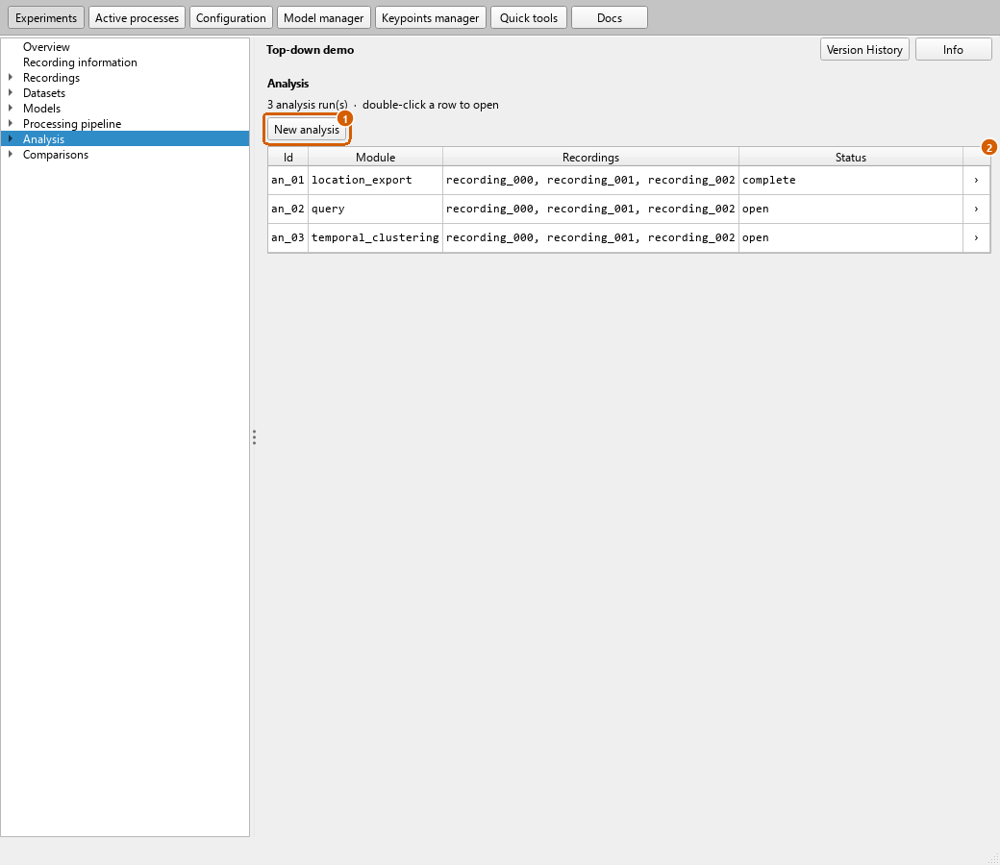
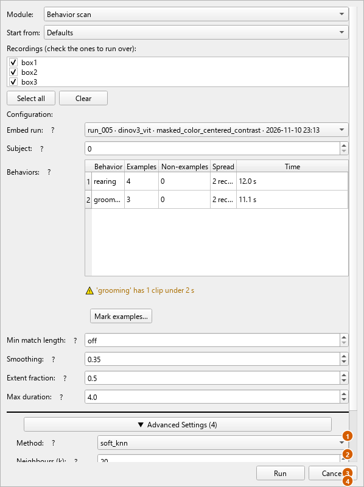
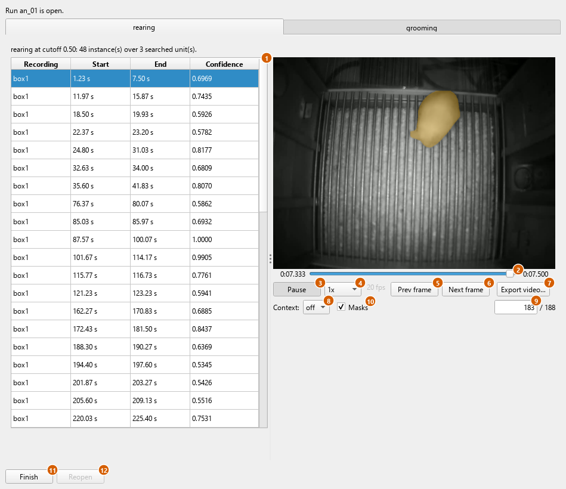
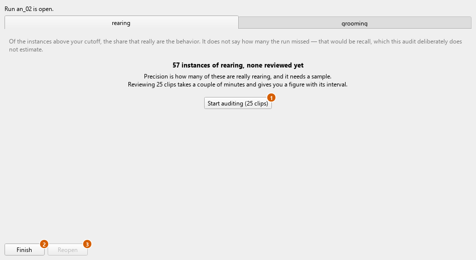

# 7. Behavior scan

A **behavior scan** finds a behavior you can already name, such as rearing or grooming, in
every video. You show it a few **example clips** of each behavior. It then looks through
every frame of every recording for stretches whose embedding (chapter 5) is like your
examples, and gives each a **confidence** from 0 to 1. You choose a **cut-off**: matches
above it count as the behavior. DETAIL then counts bouts, time spent and so on, per
recording.

No model is trained. A scan takes seconds, and changing the cut-off afterwards costs
nothing: the scan is not run again.

## The steps at a glance

Each box is one step on this page. Click a box to go to that step. The first tag says where
the step is in DETAIL.

1. [Start a behavior scan](#1-start-a-behavior-scan) Experiments › Analysis › New analysis Choose the recordings and the embedding.
2. [Mark example clips](#2-mark-example-clips) Experiments › Analysis › New analysis › Mark examples About 10 minutes: three or four clips per behavior.
3. [Run the scan](#3-run-the-scan) Experiments › Analysis › New analysis Under a minute, on the processor.
4. [Choose the cut-off](#4-choose-the-cut-off) Experiments › Analysis › the run › Calibrate Watch the clips near the line, and move it.
5. [Check the matches](#5-check-the-matches) Experiments › Analysis › the run › Browse, Audit Look through what was kept, and measure how often it is right.
6. [Read the measures](#6-read-the-measures) Experiments › Analysis › the run › Measures Bouts, rate and time, per recording.

!!! note "The examples and cut-offs in this chapter are ours"
    The demo's example clips were picked for this guide by eye from the top-down videos,
    and its cut-offs (0.5 for both behaviors) were chosen by looking at matches either side
    of the line. They show how the steps work. They have not been checked against careful
    scoring, so the numbers on this page are not findings about these mice.

## 1. Start a behavior scan

Click **Analysis** in the list on the left, then **New analysis**.

??? info "What everything on this screen does"
    1. **New analysis**: starts a behavior scan, a clustering, or another analysis.
    2. **The runs**: every analysis in the experiment, with its module, recordings and
       status. Double-click a row, or click **›**, to open it. A behavior scan's status
       stays **open** while you are still choosing its cut-offs.

In the **Launch an analysis run** dialog:

1. **Module:** **Behavior scan**.
2. Click **Select all**.
3. **Embed run:** the embedding from chapter 5, here **run_005**.
4. Click **Mark examples…** (step 2).

??? info "What everything on this screen does"
    1. **Module**: what to run, here **Behavior scan**.
    2. **Start from**: fills the form from a previous run's settings, examples included.
    3. **Recordings**: the recordings to search. They must all be in the embed run.
    4. **Select all**: ticks every recording.
    5. **Clear**: unticks them.
    6. **Embed run**: which embedding to search.
    7. **Subject**: which tracked animal to search. One animal is **0**.
    8. **Behaviors**: each behavior's name, how many example and non-example clips it
       has, how they spread over recordings and animals, and their total time. Empty until
       you mark examples.
    9. **Mark examples…**: opens the video to mark each behavior's clips (step 2).
    10. **Min match length**: the shortest match to return, in seconds. **off** returns
        every length.
    11. **Smoothing**: how much the score is smoothed over time before matches are formed,
        as a share of the example clips' length. Higher joins brief matches into one.
    12. **Extent fraction**: where a match ends: it grows out from its best frame while the
        score stays above this share of the best. Lower gives longer matches.
    13. **Max duration**: the longest match, as a multiple of the example clips' length.
    14. **Advanced Settings**: opens 4 more settings, shown below.
    15. **Run**: starts the scan (step 3).
    16. **Cancel**: closes the dialog without starting anything.
    17. **?**: a short explanation of the setting beside it.

    An orange line under the table, when there is one, is advice, not an error: for
    example, that a clip is under 2 seconds, since longer clips give a steadier result.

??? info "What the Advanced Settings do"
    1. **Method**: how frames are scored. **soft_knn** compares each frame with its 20
       closest frames among your examples and a random sample of the rest. Leave it.
    2. **Neighbours (k)**: how many of those closest frames vote on each frame's score.
    3. **Temperature**: lower lets the very closest frames count for more.
    4. **Trajectory split gap**: a break in tracking longer than this splits a recording
       into separate stretches, and an example clip has to sit inside one. **auto** is
       about 4 frames.

## 2. Mark example clips

The **Mark examples** window opens on the first recording. For each behavior:

1. On the right, click **Add**, and type the behavior's name, such as `rearing`. The name
   appears under **Annotating:** under the video.
2. Find a clear example in the video: play it, or drag the slider.
3. At the first frame of the behavior, click **Mark start**. At the last, click **Mark
   end**. The clip appears in the list on the right, and as a coloured mark on the slider.
4. Mark two or three more, from **other recordings** if you can: choose them in
   **Recording** at the top left.

Then click **Add** again for the next behavior, such as `grooming`, and do the same. When
every behavior has a tick in **Examples**, click **Use these clips**.

??? info "What everything on this screen does"
    1. **Recording**: which recording to show, and how many clips it has already.
    2. **Track**: which tracked animal. One animal is track **0**.
    3. **Behaviors**: the behaviors, with a bar toward three examples that turns into a tick
       at three, and how many recordings and animals they come from. Click one to mark
       clips for it.
    4. **Add**: adds a behavior.
    5. **Rename**: renames the chosen behavior.
    6. **Remove**: removes the chosen behavior and its clips.
    7. **Balance samples across**: pick a Recording information column, such as **drug**,
       and the line under it names the first gap: for example, every clip from one
       recording, or none from one value of the column.
    8. **Clips**: every clip you have marked, with its behavior, kind, time and recording.
       Click one to go to it.
    9. **The slider**: moves through the video. Marked clips are drawn on it in their
       behavior's colour. The **tracked** strip under it shades where the animal was
       tracked.
    10. **Play**: plays the video.
    11. **Speed**: how fast **Play** plays.
    12. **Prev frame**: steps one frame back.
    13. **Next frame**: steps one frame forward.
    14. **Masks**: tints the tracked animal's outline on the video. Untick it to play
        faster.
    15. **Frame number**: the frame shown. Type a number and press ++enter++ to go there.
    16. **example**: the next clip marked is an example of the behavior.
    17. **non-example**: the next clip marked is something that is **not** the behavior
        but looks like it. Optional; it makes the scan stricter.
    18. **Mark start**: the clip starts at this frame. The button stays green until you
        mark the end.
    19. **Mark end**: the clip ends at this frame.
    20. **Delete clip**: removes the chosen clip. The ++delete++ key does the same.
    21. **Use these clips**: closes the window and fills the **Behaviors** table.
    22. **Cancel**: closes the window and forgets every change made in it.

The scan can only find what your clips show it, so the clips you choose matter more than any
setting in this chapter.

### Choosing examples

An **example** is a clip of the behavior. The scan scores every other frame by how much it
looks like your example frames, so:

- **Three or more per behavior, each 2 seconds or longer.** One works, but more and longer
  clips steady the result. The **Examples** column shows a bar that turns into a tick at
  three.
- **From several recordings, animals and groups.** Clips all from one animal teach the scan
  that animal as much as the behavior. Choose a column such as **drug** in **Balance samples
  across**, and the line under it names what is missing, such as no example from one group.
- **The behavior and nothing else.** Mark start where the behavior starts and end where it
  ends: the frames either side, the animal walking up to the wall, say, teach the scan
  something else.
- **The whole range of the behavior.** A rear against the wall and a rear in the open, a
  short groom and a long one. Clips that are all alike find only that one version.

### Choosing non-examples

A **non-example** is a clip of something that is **not** the behavior but looks like it: the
mistakes you expect the scan to make. To mark one, choose **non-example** under the video
before you click **Mark start**; it is drawn as an outline on the slider rather than filled.

The scan compares every frame with your examples and with a random sample of the rest of
the video. Non-examples are added to that sample, labelled as not the behavior, so the scan
learns where the line between the two lies. Choose them for exactly the confusions that
matter:

- **The look-alike behavior.** From above, a mouse rearing and a mouse grooming are both a
  small, round outline. Mark grooming clips as non-examples of rearing, and rearing clips as
  non-examples of grooming.
- **The near miss.** The animal pausing at the wall without rearing; sitting still without
  grooming.
- **After a first scan,** the wrong matches you find in **Browse** (step 5). Mark a few of
  them as non-examples and run the scan again: that is the quickest way to make it stricter
  where it was wrong.

Non-examples are optional, and a few well-chosen ones do more than many random ones. A side
camera tells some look-alikes apart with no non-examples at all (see [Side-view and isometric
recordings](keypoints.md#side-view-and-isometric-recordings) in chapter 4).

## 3. Run the scan

Click **Run**. The run's page opens; the scan of the three demo videos took about 10
seconds. Its **Status** stays **open**: a behavior scan is finished only when you say so,
after choosing the cut-offs.

??? info "What everything on this screen does"
    1. **Calibrate ›**: choose each behavior's cut-off (step 4). It says how many behaviors
       the scan has.
    2. **Audit ›**: measure how often a kept match is really the behavior (step 5).
    3. **Browse ›**: look through every kept match (step 5).
    4. **Measures ›**: bouts, rate and time, per recording (step 6).
    5. **Open output folder**: opens the folder that holds the run's files.
    6. **Delete analysis**: deletes the run and its files, after asking.
    7. **Start new analysis**: opens **New analysis** again.

Click a card to open it: it fills the window. Along its top are the four views as tabs, to
switch between them, and under those the behaviors, here **rearing** and **grooming**: click
one to work on it. To go back to the run's page, click its id, here **an_02**, in the line at
the top of the window.

## 4. Choose the cut-off

The scan does not decide what is the behavior. It gives every stretch of every video a
**confidence**, from 0 to 1, of how much it looks like your examples, and it keeps them all.
The **cut-off** is where you draw the line: matches above it count as the behavior, and
everything the later steps report, bouts, time and rate, is counted from them.

There is no right cut-off that DETAIL could choose for you. A confidence says how alike two
stretches look, not whether the animal is rearing, and how alike is alike enough depends on
the behavior, the camera and your examples. Too low a cut-off counts things that are not the
behavior; too high, and real bouts are missed. Only you can tell which, by watching the clips
either side of the line. That is what this step is for: looking at the matches where the
scan is least sure, and putting the line where they stop being the behavior.

Moving the cut-off costs nothing: the scan is not run again, so you can try several. One
cut-off applies to every recording in the scan, which is what keeps them comparable, so
choose it before reading the measures, and report it with them: it is part of the result.

The **Calibrate** view is where the cut-off is set, one behavior at a time.

??? info "What everything on this screen does"
    The line at the top counts the matches kept at the cut-off: here 57 rearing matches at
    0.5. The curve top right shows how many would be kept at every cut-off: left is loose,
    right is strict. **Kept per recording** under it shows how many each recording keeps.

    1. **Cut-off**: the cut-off, to type in. Beside it, how many matches it keeps.
    2. **Cut-off slider**: moves the cut-off. The curve's line and the counts follow.
    3. **The slider**: moves through the clip playing above it.
    4. **Play**: plays the clip.
    5. **Speed**: how fast **Play** plays.
    6. **Prev frame**: steps one frame back.
    7. **Next frame**: steps one frame forward.
    8. **Export video…**: saves the clip as a video file.
    9. **Context**: plays a few seconds before and after the clip too. **off** plays the
       clip alone.
    10. **Masks**: tints the animal's outline on the video.
    11. **Frame number**: the frame of the clip shown.
    12. **Clips**: folds the row of clips away or opens it again. The row is every match
        in order of confidence, least confident on the left. The grey divider is the
        cut-off: clips right of it are kept. Click a clip to play it above. Drag the
        divider to move the cut-off.
    13. **◀**: moves the cut-off one clip to the left, keeping one more.
    14. **▶**: moves it one clip to the right, keeping one fewer.
    15. **Scrollbar**: scrolls the row of clips.
    16. **⤒ centre on cutoff**: scrolls the row back to the divider.
    17. **Cut here**: puts the cut-off at the clip you last clicked, so it is the least
        confident one kept. It says what that would keep before you press it.
    18. **Ethograms**: folds away or opens one strip per recording, marking where in the
        video the kept matches fall. Scroll over them to zoom.
    19. **Locations**: folds away or opens one square per recording, with a dot where each
        kept match happened in the field of view. Click a dot to play it beside them.
    20. **The slider**: moves through the match playing beside the squares.
    21. **Play**: plays that match.
    22. **Speed**: how fast **Play** plays.
    23. **Prev frame**: steps one frame back.
    24. **Next frame**: steps one frame forward.
    25. **Export video…**: saves that match as a video file.
    26. **Context**: plays a few seconds either side too.
    27. **Masks**: tints the animal's outline.
    28. **Frame number**: the frame of the match shown.
    29. **Interpretation**: folds away or opens the measures of the kept matches, such as
        how fast the animal moved during them.
    30. **Measure this run**: works those measures out. It reads every match's tracking,
        which can take a minute on a long run.
    31. **Finish**: says you are done with the run. It can be reopened.
    32. **Reopen**: opens a finished run again, to change a cut-off. Greyed out while the
        run is open.

To choose the cut-off:

1. Click the clips just **right** of the divider, the least confident ones kept, and watch
   them. Are they the behavior?
2. Click the clips just **left** of it, the most confident ones dropped. Are they?
3. If most kept clips near the line are wrong, press **▶** or drag the divider right. If
   most dropped clips are right, move it left.
4. Do the same for each behavior, chosen under the tabs.

The cut-off is saved as you let go of the divider. There is no Save button.

??? info "About this step: reading the ethograms and locations"
    These show **where** the kept matches fall, which the clips cannot. A cut-off that
    keeps a behavior only in the first minute of every video, or only in one corner of one
    box, is worth a second look. On the demo, the orange note under the locations says all
    of box1's rearing matches are in the top third of the box: that mouse rears against one
    wall, which may be true, and is worth checking in the clips.

??? warning "If this doesn't work"
    - **No cut-off keeps the behavior without also keeping something else:** the examples
      are too like the other behavior. Add non-examples (step 2) of what is being wrongly
      kept, and run the scan again.
    - **One recording keeps far fewer matches than the rest:** its lighting or camera may
      differ. Mark an example from that recording and run again.

## 5. Check the matches

**Browse** lists every match above the cut-off, by recording and time. Click a row to play
it. Read it in order: a mistake the scan makes again and again, such as a mouse leaning on
one wall counted as rearing, stands out in a list.

??? info "What everything on this screen does"
    1. **The matches**: every match above the cut-off. Click a column's heading to sort by
       it, such as **Confidence**. Click a row to play it.
    2. **The slider**: moves through the match playing.
    3. **Play**: plays or pauses the match.
    4. **Speed**: how fast **Play** plays.
    5. **Prev frame**: steps one frame back.
    6. **Next frame**: steps one frame forward.
    7. **Export video…**: saves the match as a video file.
    8. **Context**: plays a few seconds either side too.
    9. **Masks**: tints the animal's outline.
    10. **Frame number**: the frame shown.
    11. **Finish**: says you are done with the run.
    12. **Reopen**: opens a finished run again.

**Audit** puts a number on how often the kept matches are really the behavior: the
**precision**. It plays a random sample of clips one at a time, **without** showing their
confidence, and you answer **Yes**, **No** or **Unclear** (or press ++s++, ++d++ or ++f++).
25 clips take a couple of minutes.

??? info "What everything on this screen does"
    1. **Start auditing (25 clips)**: starts the review. Once begun, it reads **Review N
       more**.
    2. **Finish**: says you are done with the run.
    3. **Reopen**: opens a finished run again.

    Once you have answered some clips, the right of the tab shows the precision for each
    behavior and each recording, written like **0.88 (0.78–0.97, n=35)**: the share that
    were right, the range it is likely to be in, and how many clips it rests on. Changing
    the cut-off afterwards re-reads the precision from the clips already answered: you do
    not answer them again.

??? info "About this step: why audit"
    The cut-off you chose by eye is a judgment. The audit is what turns it into a figure
    you can report: "of the matches kept, 88% were rearing". It does not say how many
    rearing bouts the scan **missed**; that needs the behavior scored by hand through the
    whole video.

    The demo run in this guide has not been audited.

## 6. Read the measures

**Measures** gives, for each recording and behavior, the number of bouts, the rate, the
total time, the share of time, the bout lengths, the time to the first bout, and the gap
between bouts.

??? info "What everything on this screen does"
    1. **The measures**: one row per recording, behavior and measure, with its value, unit
       and how many bouts it comes from (**n**). Click a heading to sort.
    2. **Finish**: says you are done with the run.
    3. **Reopen**: opens a finished run again.

    The **Export…** button at the top of the window saves every kept match with its times
    (**Behavior instances**), the ethograms, the per-frame behavior labels, or the clips, for
    your own analysis in a spreadsheet, R or Python.

??? warning "If the numbers look too large"
    On the demo, rearing takes 34% of box1's time and grooming 30%. Both are much more
    than these mice really spend, and many of the same stretches are counted as both. That
    is what the top-down view does to two behaviors that look alike from above (see step
    2). Raising both cut-offs, adding non-examples, and auditing are how you bring them
    down to what is true. A side camera tells them apart far better.

When every behavior's cut-off is chosen and checked, click **Finish**.

??? info "About this step: Snapshots"
    After you click **Finish**, export something, or use the run in a comparison, a
    **Snapshots** table appears on the run's page. Each snapshot is a frozen copy of the
    run's results at the moment a number left it. You can reopen a finished run and change
    its cut-offs, and a number you already reported still has the snapshot it came from.

    Double-click a snapshot to see the run as it was then. The page shows a banner, **Viewing
    … Read-only**, and every control that would change the run is greyed out. Click **Back to
    live run** in the banner to return.

??? warning "If this doesn't work"
    - **Every control is greyed out, under an amber banner:** you are looking at a snapshot.
      Click **Back to live run**.
    - **The page says "These results are out of date":** the last change to the run, such
      as a new cut-off, stopped before it had finished rewriting the results, for example on
      a network drive or when the computer slept. Click **Rebuild results**, under that line.
      A bar shows its progress.

## Next

[8. Clustering](clustering.md).
