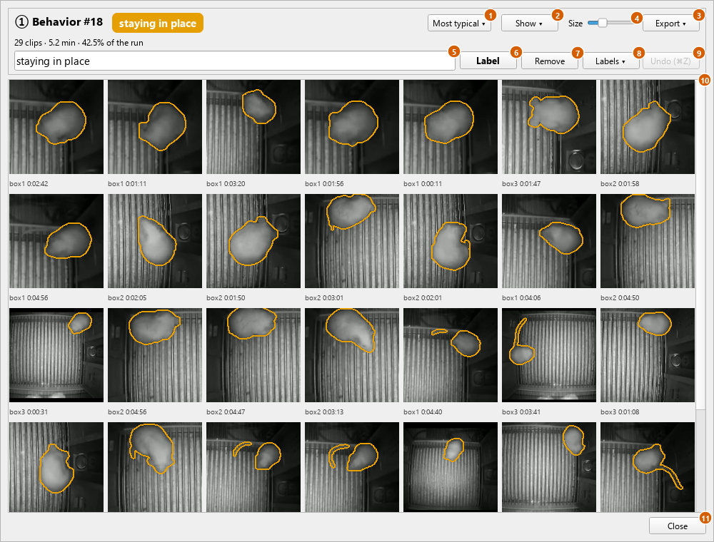
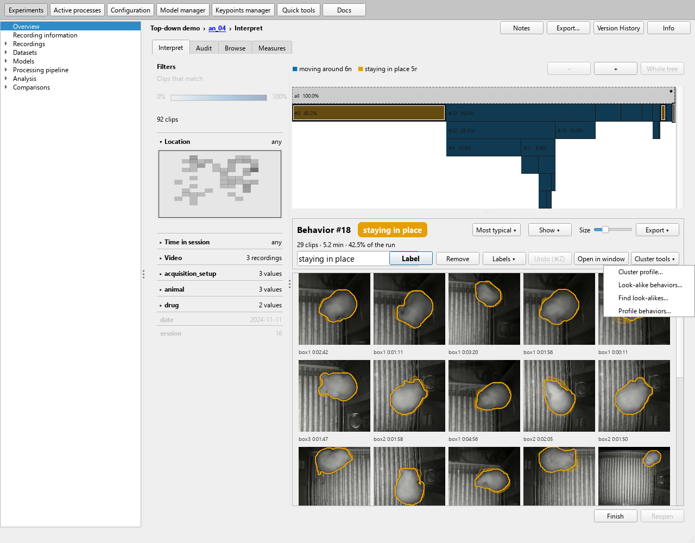
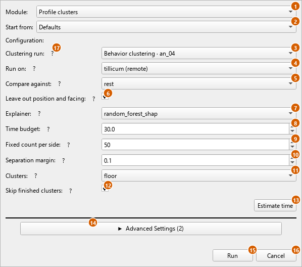
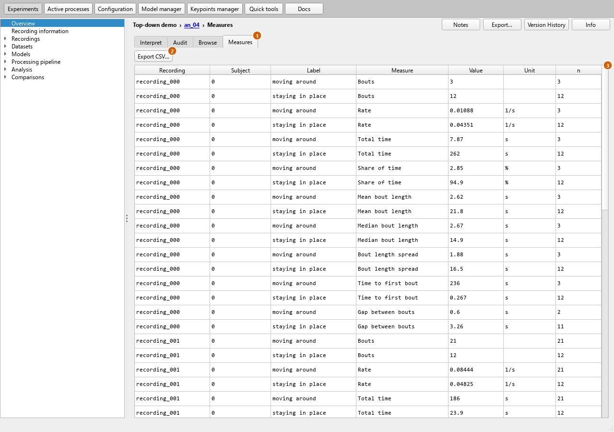

# 8. Clustering

The behavior scan (chapter 7) finds behaviors you name in advance. **Clustering** works the
other way round: DETAIL sorts the videos into groups that look alike, with nothing to point
at, and you then look at the groups and name the ones that mean something.

The groups form a **tree**. The top of the tree is everything. It splits in two, each half
splits again, and so on, down to small groups that are nearly identical. You open any block
of the tree, watch what is in it, and give it a **label** such as `rearing`. A label covers
everything under it. DETAIL then counts bouts and time for each label, as it does for a
behavior scan.

## What behavior clustering groups

**Behavior clustering** reads the embedding from chapter 5 and groups **stretches of
movement**. It cuts each video into **bouts** wherever the animal's pose changes, then
compares every bout with every other, allowing for one being done faster or slower than the
other, and groups the bouts that match. A cluster is something the animal **does**, such as
walking to the wall and rearing, and each instance has a real start and end you can play. It
answers "what does the animal do, and for how long?"

Its bouts, durations and rates read directly as behavior, and a slow and a fast version of
the same action land together. The time it takes grows with the square of the number of
bouts.

## The steps at a glance

Each box is one step on this page. Click a box to go to that step. The first tag says where
the step is in DETAIL.

1. [Run a behavior clustering](#1-run-a-behavior-clustering) Experiments › Analysis › New analysis Under a minute for the demo, on the processor.
2. [Look through the tree](#2-look-through-the-tree) Experiments › Analysis › the run › Interpret Open a cluster, see its members, where and when it happens.
3. [Watch a cluster's clips](#3-watch-a-clusters-clips) Interpret › the montage The montage and the clip window: the way to judge a cluster.
4. [Profile a cluster](#4-profile-a-cluster) Interpret › Cluster tools ▾ › Cluster profile Which measures set it apart, for one cluster or every cluster at once.
5. [Label clusters](#5-label-clusters) Experiments › Analysis › the run › Interpret Name the clusters that mean something, and label look-alikes as one.
6. [Audit the labels](#6-audit-the-labels) Experiments › Analysis › the run › Audit How often each label is right: the figure to report.
7. [Browse and measure the labels](#7-browse-and-measure-the-labels) Experiments › Analysis › the run › Browse, Measures Every bout of every label, and the numbers per recording.

!!! note "The labels in this chapter are ours"
    The demo's two labels, `moving around` and `staying in place`, were given for this guide
    from each cluster's clips and profile. They describe how the animal moves, not a named
    behavior. Naming clusters for your own study is your judgment, made from the clips.

## 1. Run a behavior clustering

Click **Analysis** in the list on the left, then **New analysis**. In the **Launch an
analysis run** dialog:

1. **Module:** **Behavior clustering**.
2. Click **Select all**.
3. **Embedding run:** the embedding from chapter 5, here **run_009**. It is ticked already
   when every recording has it.
4. Click **Run**.

??? info "What everything on this screen does"
    1. **Module**: what to run, here **Behavior clustering**.
    2. **Start from**: fills the form from a previous run's settings.
    3. **Filter**: shows only recordings whose name or information contains what you type.
    4. **acquisition_setup**: shows only recordings with the value you pick.
    5. **drug**: the same, for the drug column.
    6. **animal**: the same, for the animal column.
    7. **Recordings**: the recordings to cluster together. They share one tree, so every
       label means the same thing in every recording.
    8. **Select all**: ticks every recording the filters show.
    9. **Clear**: unticks them.
    10. **Embedding run**: which embedding to cluster, with how many of the ticked
        recordings have it.
    11. **Per recording…**: names the exact embedding run one recording reads, for a
        recording whose tracking was redone (see below).
    12. **Track**: which tracked animal. One animal is **0**.
    13. **Run on**: **This computer**, or a remote target such as **tillicum (remote)**,
        which fits there and frees this computer for a large study (see the box below).
    14. **Method**: how bouts are found and grouped. Choose **dtw_finch**: it cuts the video
        into bouts and compares every pair, which suits a study this size.
        **codebook_viterbi**, the default, is faster on a very large study, and shows its
        own settings in place of 15 to 18.
    15. **Detector**: how the cuts between bouts are found. **binseg** cuts best.
    16. **Min bout length**: bouts shorter than this many seconds are dropped as too short
        to be a behavior.
    17. **DTW band**: how much faster or slower, in seconds, one bout may be than another and
        still match. Larger merges more bouts into fewer, coarser clusters.
    18. **Window**: how many seconds of pose are smoothed together before cutting, to take
        out frame-to-frame jitter.
    19. **Advanced Settings**: opens 10 more settings, such as **Max bouts**, which caps the
        bouts compared on a large study. Leave them.
    20. **Run**: starts the clustering.
    21. **Cancel**: closes the dialog without starting anything.
    22. **?**: a short explanation of the setting beside it.

??? info "About Per recording…: a recording whose tracking was redone"
    If one recording's tracking was redone with different settings, and that recording was
    embedded again from the new tracking, it has two embedding runs: one with the settings
    every other recording used, made from the bad tracking, and one of its own. Ticking the
    shared settings reads the bad one there, and ticking both is refused.

    Click **Per recording…** under the list, choose that recording's new embedding run, and
    leave the others on **(as the chosen settings resolve)**. The line beside the button
    names the recordings you chose a run for. [Chapter
    6](location-export.md#2-run-the-export) has the same button for the tracking run.

The run's page opens. On the demo, the clustering took 27 seconds. Like a behavior scan,
its **Status** stays **open** until you say you are done.

??? info "About this step: the cost of a large study"
    Comparing every bout with every other is what lets a slow and a fast performance match,
    and it grows with the square of the number of bouts: ten times the video is a hundred
    times the comparisons. On a large study, set **Max bouts** under **Advanced Settings**:
    the clusters are learned from that many bouts, evenly sampled, and every other bout is
    then matched to its nearest cluster, so nothing goes unlabelled. Or run it on Tillicum:
    choose **tillicum (remote)** under **Run on**. Each recording's embedding and video are
    sent there first (the videos once; later runs reuse them), and the run comes back here,
    open, when the fit is done. Active processes shows it while it is away.

## 2. Look through the tree

The run's page lists what the run made as cards. Click **Interpret**.

??? info "What everything on this screen does"
    1. **Meta-information…**: the settings the run was made with, and what it read.
    2. **Interpret**: the tree, the filters and every clip of a cluster: where you label.
    3. **Audit**: watch every clip of each labelled cluster and take out the wrong ones
       (step 6).
    4. **Browse**: every bout the labels give (step 7).
    5. **Measures**: the numbers per recording and label (step 7).
    6. **Open output folder**: the run's folder on your computer.
    7. **Duplicate analysis…**: a copy of the run, with its labels, to try something
       without changing this one.
    8. **Delete analysis**: deletes the run, after asking.
    9. **Start new analysis**: opens the **Launch an analysis run** dialog.

**Interpret** fills the window. The tabs above it switch to **Audit**, **Browse** and
**Measures**, and the run's name in the line at the top (**an_04**) goes back to the run's
page.

**The tree** is at the top, right of the filters. Every block is a cluster, and its width is
how much of the time it holds. The row under **all** is the first split, and each row down
shows what a block divides into. Click a block to open it. Scroll the mouse wheel over the
tree to zoom in.

**The label bar**, under the tree, names the cluster you opened, with how many clips, how much
time and what share of the run it holds, and the box to label it (step 5). Hover its figures:
when one recording or group holds more of the cluster than chance would give, they say so.

**The montage**, under the label bar, plays every clip of the cluster you opened (step 3).

**The filters**, in the column on the left, shade every block by the share of its clips that
match: a place in the frame (**Location**), a stretch of each session (**Time in session**),
the recordings (**Video**) and each column of your Recording information.

??? info "What everything on this screen does"
    1. **The view tabs**: **Interpret**, **Audit**, **Browse** and **Measures**.
    2. **Filters**: shade the tree by what a cluster's clips are made of. Click a section's
       name to open it; on **Location**, drag a box on the map. Drag the edge beside the
       column to make it wider, or past its narrowest to fold it away.
    3. **−**: zooms the tree out.
    4. **+**: zooms the tree in, toward the cluster you opened.
    5. **Whole tree**: zooms back out to all of it.
    6. **The tree**: click a block to open it; right-click it for **Label…**, **Remove
       label**, **Open in window**, **Cluster profile…** and **Zoom to this**. The line above
       it names each label with its colour and time. Drag the dotted handle under it to give
       the tree more room, or the montage.
    7. **Most typical ▾**: the order of the montage: **Most typical**, **Least typical**
       (where clips that do not belong collect) or **Random**.
    8. **Show ▾**: what every tile draws (the video, the masks, the keypoints and their
       trails), which way it faces (**As recorded** or **Aligned**), and how much video
       either side of the clip it plays.
    9. **Size**: how large the tiles are.
    10. **Export ▾**: saves the clips (below).
    11. **Label box**: type a label for the cluster you opened, and press ++enter++.
    12. **Label**: gives the cluster the label typed.
    13. **Remove**: takes the label off the cluster you opened.
    14. **Labels ▾**: every label, with its time. Hover one to give it to this cluster
        (**Label as**), open its cluster (**Go to**), rename it, or merge it into another.
    15. **Undo (⌘Z)**: undoes the last label change.
    16. **Open in window**: the cluster in a window of its own, beside the page (step 3).
    17. **Cluster tools ▾**: the cluster profile and the look-alike tools (steps 4 and 5).
    18. **The montage**: every clip of the cluster, each on its own loop. Double-click one
        for the clip window (step 3).
    19. **Finish**: says you are done with the run. It can be reopened.
    20. **Reopen**: opens a finished run again.

How to read the tree:

1. Look at the **first split**, the row under **all**. On the demo, its two halves hold 42.5%
   and 57.5% of the time.
2. Open each half and watch its clips (step 3).
3. Open the blocks under it, and so on down. Stop when a cluster's clips all show the same
   thing, and the blocks under it are the same thing too.

A cluster that only sheds a small piece at each split gets no row of its own: the pieces it
is made of stand in for it, side by side. On the demo, the 42.5% half is drawn as its
largest piece, **#0** (40.2%), with two slivers at the right end of the row; opened, all
three are outlined, as in the picture. To open a labelled cluster that has no block of its
own, choose its label in **Labels ▾**, then **Go to**.

??? info "About this step: what the demo's first split shows"
    On the demo, the 57.5% half is the mouse **moving around** the box, its tail showing; the
    42.5% half is the mouse **staying in place**, curled into a round shape: from above,
    that is resting, grooming and rearing alike. Box1's mouse spends almost all of its time
    in place, by the right wall; box2's and box3's mostly move. Further down, each half
    splits into smaller groups.

## 3. Watch a cluster's clips

**The montage**, under the label bar, plays every clip of the cluster you opened, side by
side, each cropped to the animal and on its own loop. It is the main way to judge a cluster: a
cluster is what its clips show, whatever its numbers say, and one odd tile among 25 stands out
in a way it never does one clip at a time.

Its toolbar is at the right end of the label bar's first line: **Most typical ▾**, **Show ▾**,
**Size** and **Export ▾** (see the legend above). The clips play from small copies of the
videos that DETAIL keeps on your computer. The first time you open a run on a computer, a bar
at the right of the status bar, at the bottom of the window, shows them being made, and the
montage says it is waiting for them. **Configuration** › **Preview cache** shows where they
are kept and how much room they take.

**Export ▾** saves the clips as the montage shows them:

- **Video of N clips…**, **GIF of N clips…**, **One file per clip…** and **CSV list of
  clips…**: one file of every clip, as the tiles show them, or a list of them. The greyed
  line at the bottom says what is drawn. A video is H.264, which PowerPoint plays, unless
  you choose MPEG-4 Part 2 as the file type when you save.
- **Export clips…**: the clips as videos or GIFs, in several looks at once: one montage
  file, one file per clip, or both.
- **Export overlay…**: the clips, or the first 12, drawn on top of each other in one
  picture, each outline in its own colour, turned to face up and centred, with its skeleton
  and a key; as an MP4 or GIF, or a PNG for a pose cluster's single frames.
- **New Query from N clips…**: starts a behavior scan (chapter 7) with the clips as one
  behavior's examples.
- **Pick clips to export…**, at the top of the menu: click the clips
  to export, in the order you want them; a bar over the montage counts them and exports
  them.

### A cluster in its own window

**Open in window**, on the label bar or on a block's right-click menu, opens the cluster in a
window of its own, beside the page, so you can keep several clusters in view while you move
around the tree. Each window has a number, shown in its title and on its cluster's block in
the tree. Labels given in a window are the page's: the tree and the label bar follow.

??? info "What everything on this screen does"
    1. **Most typical ▾**: the order of the clips, as on **Interpret**.
    2. **Show ▾**: what every tile draws. Kept for every cluster window.
    3. **Export ▾**: saves the clips, as on **Interpret**.
    4. **Size**: how large the tiles are.
    5. **Label box**: type a label for this cluster, and press ++enter++.
    6. **Label**: gives the cluster the label typed.
    7. **Remove**: takes the label off this cluster.
    8. **Labels ▾**: every label, as on **Interpret**.
    9. **Undo (⌘Z)**: undoes the last label change, wherever it was made.
    10. **The clips**: double-click one for the clip window.
    11. **Close**: closes the window. Nothing in it is lost: labels are saved as you give
        them.

### The clip window

Double-click a clip in the montage to open it in the clip window, whole frame and from the full
video. **next ▶** steps to the next clip in the montage's order, so a few clicks show whether
the cluster is one thing. You can label the cluster, and say whether each clip fits it, without
leaving the window. The window stays open beside the page, and the next clip you double-click
shows in it.

??? info "What everything on this screen does"
    With **Advanced view** on, the outline and the keypoints are drawn beside the video,
    and the measures run under the slider: **speed**, **area**, **length**, **bend**,
    **turning** and the **clusters** lane, with the clip itself marked.

    1. **◀ previous**: the previous clip.
    2. **next ▶**: the next clip, less typical. Beside it, which clip this is and the order.
    3. **Advanced view**: shows the panes and traces. Untick for the video alone.
    4. **Blind mode**: names recordings A, B, C instead, so you judge clips without knowing
       which group they are from.
    5. **As recorded**: or **Aligned**, which turns the video, with the masks and keypoints,
       so the animal's body points up.
    6. **Export ▾**: saves what the window shows as a video or a GIF, or the frame as a PNG.
    7. **The slider**: moves through the clip.
    8. **Play**: plays or pauses the clip.
    9. **Speed**: how fast **Play** plays.
    10. **Prev frame**: steps one frame back.
    11. **Next frame**: steps one frame forward.
    12. **Context**: plays a few seconds before and after the clip too.
    13. **Trail points**: which keypoints leave a trail, with **Trail** on.
    14. **Frame number**: the frame shown.
    15. **Masks**: draws the animal's outline on the video.
    16. **Keypoints**: draws the keypoints on the video.
    17. **Trail**: the last half second of the keypoints, fading.
    18. **Mask trail**: the last half second of the outline, fading.
    19. **Align pose**: turns the keypoints pane so the animal always faces up, so postures
        compare from clip to clip whichever way the animal faced.
    20. **Loop clip**: plays the clip again and again.
    21. **Label**: the label to give the cluster.
    22. **Label cluster**: gives it that label.
    23. **Fits (Y)**: this clip is the cluster's behavior. Beside the buttons, your answers
        add up to the share of the clips you watched that fit: a quick check on the
        cluster's typical clips. For a figure to report, use **Audit** (step 6), which
        reviews every clip.
    24. **Doesn't (N)**: this clip is not.
    25. **Unclear (U)**: you cannot tell.
    26. **Cluster details**: what sets the cluster apart, a clip of its sibling to compare,
        and a grid of 9 clips.
    27. **Close**: closes the window.

??? info "About this step: judging a cluster from its clips"
    - **Look at the least typical too.** Choose **Least typical** in **Most typical ▾**. If
      those still show the same behavior, the cluster is one thing; if not, open its halves.
    - **Watch it blind.** The clip window's **Blind mode** hides which recording each clip is
      from, so what you expect of a group does not decide what you see.
    - **Compare postures, not directions.** With **Show ▾** › **Aligned**, or **Export
      overlay…**, every animal faces the same way, so two clips differ only in what the body
      does.
    - **Ask whether it is one place, not one behavior.** A cluster can collect one corner or
      one box. Hover the label bar's figures, or shade the tree with the **Video** and
      **Location** filters, to see.

## 4. Profile a cluster

A **cluster profile** says which measures of the body and its movement, such as speed,
roundness or how far the animal travels, set the cluster apart, and how far to trust that.
Open the cluster, then choose **Cluster tools ▾** › **Cluster profile…** (or right-click its
block and choose **Cluster profile…**), and click **Profile this cluster**. It takes about 15
seconds.

??? info "What everything on this screen does"
    The green line is the verdict: a model told the cluster from the comparison correctly
    98% of the time, on recordings it had not seen, against 53% by chance. **What sets it
    apart** draws one bar per measure: to the right, higher values push toward the cluster.
    Beside each name is the cluster's median against the comparison's. **In plain rules**
    gives the same answer as conditions to check against the clips. **Context** says what
    usually comes before and after it, how long it lasts, and when in the session it
    happens.

    1. **Compare against**: what to tell the cluster apart from: **Rest of the run**, **Its
       sibling** (the other half of its split, often more useful for naming, used here), or
       **Another cluster**.
    2. **Other cluster**: the cluster's number, for **Another cluster**.
    3. **Explainer**: the model that does the telling apart. **Logistic regression**, used
       here, shows a clear direction for each measure on a small cluster; the default,
       **Random forest + SHAP**, finds more complex differences on a large one.
    4. **Time budget**: about how long the profile may take, in seconds.
    5. **Separation margin**: how far above chance the verdict must be to say the measures
       tell the cluster apart.
    6. **Fixed count per side**: compare this many members of each side, instead of what
       fits in the time budget.
    7. **Seed**: the random draw of members. The same seed gives the same profile.
    8. **Leave out position and facing**: on, where the animal is and which way it faces do
       not count, so the same behavior in two corners reads as one.
    9. **Recompute**: makes the profile again with these settings.

**Check:** the verdict is green, and the top bars make sense against the clips. For
**staying in place**, the animal has fewer protrusions (the tail tucked in), is rounder and
more solid, and moves at under a third of the speed of **moving around**.

### Profile every cluster at once

**Profile behaviors…**, in **Cluster tools ▾** on the label bar, profiles many clusters as one
job: every cluster with clips, the tree's leaves, or a list you give. It can run overnight, on
your computer or on Tillicum, and it is safe to stop: run it again and the clusters already
profiled with the same settings are skipped.

1. On **Interpret**, choose **Cluster tools ▾** › **Profile behaviors…**. The **Launch an
   analysis run** dialog opens on **Profile clusters**, with this run chosen.
2. **Run on:** **This computer**, or **tillicum (remote)** to leave your computer free.
3. **Clusters:** **floor**, every cluster with clips, is the usual choice.
4. Click **Estimate time**, then **Run**. The job shows in **Active processes**.

??? info "What everything on this screen does"
    1. **Module**: what to run, here **Profile clusters**.
    2. **Start from**: fills the form from a previous run's settings.
    3. **Clustering run**: the clustering whose clusters to profile.
    4. **Run on**: **This computer**, or a remote target such as **tillicum (remote)**.
       On Tillicum, the job profiles there, so your computer is free.
    5. **Compare against**: what each cluster is profiled against: **rest** of the run, or
       its **sibling**.
    6. **Leave out position and facing**: as in the profile window.
    7. **Explainer**: the model that weighs the measures.
    8. **Time budget**: about how long each profile may take, in seconds.
    9. **Fixed count per side**: how many members of each side to measure.
    10. **Separation margin**: how far above chance a profile must be to count.
    11. **Clusters**: which clusters: **floor** (every cluster with clips), **all** (every
        cluster), **leaves** (the smallest ones), or **ids** (a list you give).
    12. **Skip finished clusters**: leaves out clusters already profiled with these
        settings, so a stopped job can be run again.
    13. **Estimate time**: how long the job should take.
    14. **Advanced Settings**: opens more settings. Leave them.
    15. **Run**: starts the job.
    16. **Cancel**: closes the dialog without starting anything.
    17. **?**: a short explanation of the setting beside it.

When the job is done, each cluster's profile is in its **Cluster profile…** window, exactly as
if you had made it one at a time. To run it on Tillicum, log in first (see
[Every day: log in before you run](../tillicum.md#every-day-log-in-before-you-run)).

## 5. Label clusters

To label the cluster you opened, type a name in the label bar's box, under the tree, such as
`staying in place`, and press ++enter++. Or right-click its block and choose **Label…**, or
label it from a cluster window or the clip window. Open the next cluster and do the same.
**Undo (⌘Z)** undoes the last label change.

The tree colours each block by its label: solid where you put it, pale below it, grey where
there is none. The line above the tree names each label with how much of the time it covers.

??? info "About this step: how labels work"
    - **A label covers everything under it**, unless a cluster inside has its own. So
      labelling the 42.5% half `staying in place` labels all of it, and labelling one small
      cluster inside it `grooming` takes just that part.
    - **One label can have many clusters.** The same behavior often sits in two branches,
      for example facing two ways. Give the second the same name, or choose it in **Labels ▾**
      (**Label as**): the two count as one behavior everywhere.
    - **Label only what you have watched.** Clusters you leave unlabelled are counted as
      unlabelled, not as nothing.
    - Labels can be changed or removed at any time; nothing is clustered again.

### Label look-alike behaviors as one

A tree often splits one behavior by **where** the animal is or **which way it faces**:
rearing toward the back wall and rearing toward the right can sit in different branches,
far apart. **Look-alike behaviors…**, in **Cluster tools ▾**, finds such clusters and lets you give
them one label.

Two clusters **look alike** when the body measures cannot tell them apart once position and
facing are left out: a cluster profile of one against the other (step 4) finds no
difference beyond where and which way. Pairs that look alike chain into **groups**: if A
looks like B and B looks like C, all three are one group. The comparisons come from **Find
look-alike clusters** (below), and from any pair you compare yourself in **Cluster
profile…** with **Compare against** › **Another cluster**.

Choose **Cluster tools ▾** › **Look-alike behaviors…**. The window opens beside the tree. The picture below is
from a clustering of the isometric hot plate experiment, whose clusters have been
compared: the demo's clusters all tell apart (see the note below).

??? info "What everything on this screen does"
    Each group is listed with the name it proposes, then its clusters, largest first: its
    share of the run, what its label **would also label**, and your label if it has one. **Why they are grouped** gives, for every pair, how well the body
    measures told it apart against chance (*body measures 51% (floor 51%)*: no better than
    chance, so alike) and how well position and facing alone did (*100%*: they differ only
    in where and which way).

    1. **Refresh**: reads the comparisons again, while a **Find look-alike clusters** job is
       running.
    2. **Find look-alikes…**: opens the **Find look-alike clusters** job (below).
    3. **The groups**: click a group to choose it; click a cluster to open it in the
       tree, so its clips show. Untick a cluster to leave it out of the label.
    4. **Label**: the name to give the group, filled in with its proposal: the label most of
       its clusters already carry. Empty when none has one: type a name.
    5. **Label as one…**: shows what each ticked cluster would do, a new label, joining an
       existing one, or why it is skipped, and labels them only when you agree.
    6. **Close**: closes the window.

??? warning "Check what a label would also take"
    Clusters sit inside one another, and a label covers everything under its cluster that
    has no label of its own. So a look-alike cluster can hold clusters that are a different
    behavior: a rearing cluster holding a walking one. **Would also label** names those,
    and a cluster that would take any starts **unticked**. Label those inner clusters first
    (their own name, such as `walking`), and they are no longer taken; or tick the cluster
    anyway if they really are the same behavior.

Then watch the group's clips (step 3) before you accept: a group is a suggestion until you
label it.

### Find look-alikes across the tree

**Find look-alike clusters** is the batch job behind the window: it compares pairs of the
run's **branch tops** (the two halves of every split where both have clips), each a cluster
profile of one against the other, and saves every comparison beside the run. It is safe to
stop: run it again and the pairs already compared are skipped.

1. In the **Look-alike behaviors** window, click **Find look-alikes…** (or choose **Cluster
   tools ▾** › **Find look-alikes…**). The **Launch an analysis run** dialog opens on **Find look-alike clusters**, with this run chosen.
2. **Pairs to compare:** **all** compares every pair, or **labelled** each cluster you have
   labelled against every other: far fewer pairs, and it finds clusters that look like ones you
   have named.
3. **Run on:** **This computer**, or **tillicum (remote)** on a large run: comparing every
   pair takes many hours there.
4. Click **Run**. With **all**, a question first says how many pairs it will compare, about how
   long, and how many **labelled** would compare. Click **Run every pair**, or **Cancel**. The job
   shows in **Active processes**. **Refresh** in the window shows the groups as pairs finish.

??? info "What everything on this screen does"
    1. **Module**: what to run, here **Find look-alike clusters**.
    2. **Start from**: fills the form from a previous run's settings.
    3. **Clustering run**: the clustering whose clusters to compare.
    4. **Run on**: **This computer**, or a remote target such as **tillicum (remote)**. Its
       comparisons are copied back and placed beside the run when it finishes.
    5. **Pairs to compare**: **all**, every pair, or **labelled**, each labelled cluster
       against every other. Two clusters under one label are not compared.
    6. **Skip compared pairs**: leaves out pairs already compared with these settings,
       including pairs you compared by hand.
    7. **Explainer**: the model that does each comparison.
    8. **Fixed count per side**: how many members of each cluster in a pair to measure.
    9. **Separation margin**: how far above chance the body measures must tell a pair apart
       for it **not** to count as alike.
    10. **Advanced Settings**: opens 2 more settings, the time budget and the seed. Leave
       them.
    11. **Run**: starts the job. With **all**, it asks first.
    12. **Cancel**: closes the dialog without starting anything.
    13. **?**: a short explanation of the setting beside it.

??? info "About this step: on the demo"
    On the demo, the job compared 139 pairs in about 8 minutes, and
    found none alike: every pair of the demo's clusters differs in what the body does, not
    only in where it is. That is a real result, not a failure. A run over more video, where
    the tree splits a behavior by place or direction, is where look-alikes show up, as in
    the hot plate example above.

## 6. Audit the labels

A label is your judgment of a cluster's typical clips. **Audit** turns it into a figure you
can report: you watch **every clip** of each cluster you labelled, remove the ones that are not
the label, and finish. The cluster's **precision** is then the exact share of its clips that
really were the label.

Click the **Audit** tab, above **Interpret** (or the **Audit** card on the run's page). The
list on the left holds each label, with the clusters it was given under it. Click a label to open its first cluster nobody has reviewed:

1. The clips play in one scroll, **least typical first**, so the ones most likely to be wrong
   come first.
2. Click a clip that is not the label to **remove** it: it fades, with a ✕ and *not moving
   around* along its bottom. Click it again to put it back. Drag from one clip to another to
   remove every clip between them. Right-click a clip to **Move to** another label.
3. Double-click a clip, or press ++space++ over it, to watch it whole in the clip window.
4. Scroll to the last clip, then click **✓ Finish review** (or press ++enter++). The cluster
   shows **✓ Reviewed** and its precision, and **Next cluster** opens the next one.

A label's figure appears once every cluster under it is reviewed. Whether a figure is good
enough is yours to decide. [The interpretation
workspace](../../gui.md#interpretation-workspace) describes every control.

??? info "What everything on this screen does"
    Above the clips: the cluster, its label, and how far your scroll has reached.

    1. **The view tabs**: **Interpret**, **Audit**, **Browse** and **Measures**.
    2. **The labels**: each label with its clips and how many of its clusters are reviewed,
       and under it each cluster, with how far its review has got and how many clips were
       removed. Click a row to open it. Right-click a cluster for **Open in INTERPRET**. Drag
       the edge beside the list to make it wider.
    3. **✓ Finish review**: ends the cluster's review, once you have scrolled to its last
       clip. The line under it counts the clips kept and removed.
    4. **Undo (⌘Z)**: puts back the last clip you removed or moved.
    5. **Show ▾**: what every tile draws, as on **Interpret**.
    6. **Export ▾**: saves the clips, as on **Interpret**.
    7. **Size**: how large the tiles are.
    8. **The clips**: every clip of the cluster, least typical first. Click one to remove it,
       click it again to put it back.

### Act on what the audit found

Open a reviewed cluster on **Interpret**: the label bar gets an **AUDIT** line with its
precision and how many clips it rests on, and an **Act on it ▾** menu. Its three choices act
on the cluster; which is right is your call:

- **Move to…**: give the cluster another label, when its clips were mostly that other
  behavior.
- **Remove from the label**: take the label off the cluster, when its clips were nothing in
  particular.
- **Look at its halves**: zoom the tree onto the cluster's two halves and open the first,
  when it may be two things, one of which is worth keeping. Label the good half, and
  audit again.

The line is not shown on a cluster nobody has reviewed. On a finished run, or a snapshot,
the choices are greyed out, with the reason.

??? info "About this step: what the audit does and does not say"
    The precision says how often a label is right where it says the behavior is. It does
    not say how many bouts of the behavior the label **missed**. On the demo, no cluster
    has been reviewed to the end: the picture shows a review under way.

## 7. Browse and measure the labels

**Browse** lists every bout of every label, by recording and time. Click one to play it.

??? info "What everything on this screen does"
    1. **The view tabs**: **Interpret**, **Audit**, **Browse** and **Measures**.
    2. **Clear filters**: shows every bout again.
    3. **Ethogram**: folds the ethogram away or opens it again. Click a bout to play it.
    4. **Labels**: each label, with its number of bouts and its time. Untick one to hide
       its bouts.
    5. **Search recordings**: shows only recordings whose name contains what you type.
    6. **Recordings**: untick one to hide its bouts.
    7. **The bouts**: every bout, with its label, recording, start, length and what its
       audit found. Click a heading to sort. Click a row to play it.
    8. **Metadata**: shows only recordings with one value of a Recording information
       column, such as **drug: on**.
    9. **The slider**: moves through the bout playing.
    10. **Play**: plays or pauses the bout.
    11. **Speed**: how fast **Play** plays.
    12. **Prev frame**: steps one frame back.
    13. **Next frame**: steps one frame forward.
    14. **Export video…**: saves the bout as a video file.
    15. **Context**: plays a few seconds either side too.
    16. **Masks**: tints the animal's outline.
    17. **Frame number**: the frame shown.
    18. **Export 1 selected**: opens the export window for the bouts you selected: their
        list as a spreadsheet, an ethogram picture, or their clips.
    19. **Export all 92**: the same, for every bout the filters show.

**Measures** is the same table as a behavior scan's: bouts, rate, total time, share of time,
bout lengths, time to the first bout and gap between bouts, per recording and label.

??? info "What everything on this screen does"
    1. **The view tabs**: **Interpret**, **Audit**, **Browse** and **Measures**.
    2. **Export CSV…**: saves the measures as `measures.csv` in a folder you choose, as in
       [chapter 7](behavior-scan.md#6-read-the-measures).
    3. **The measures**: one row per recording, label and measure, with its value, unit
       and how many bouts it comes from (**n**). Click a heading to sort.

    Bouts do not cover every frame: stretches shorter than the minimum bout length, and gaps
    in tracking, belong to no bout. On the demo, 86% to 98% of each video's analysed time is
    in a bout, so the labels' shares add up to a little under 100%.

When every cluster you care about is labelled, click **Finish**, at the foot of
**Interpret**.

??? warning "If this doesn't work"
    - **Every control is greyed out, under an amber banner:** you are looking at a snapshot
      of the run (see *Snapshots*, at the end of chapter 7 [step 6](behavior-scan.md#6-read-the-measures)).
      Click **Back to live run**.
    - **The page says "These results are out of date":** the last change to the labels
      stopped before it had finished rewriting the results, for example on a network drive
      or when the computer slept. Click **Rebuild results**, under that line.
    - **A line over the tree says the clips were prepared from another fit, or by an older
      version, with a Rebuild clips button:** click **Rebuild clips**. It takes seconds to
      minutes, and nothing is clustered again.
    - **The montage says it is waiting for previews:** the small copies of the videos it
      plays are being made on this computer, with a bar at the right of the status bar.
      Wait, or click **Build previews** beside the note.

## Next

That is the whole Single animal guide: from videos to named behaviors, counted in every
recording. To go further:

- [Concepts](../../concepts.md) explains what each step does and why.
- [The GUI guide](../../gui.md) describes every screen in full.
- Run the heavy steps on Tillicum: [Set up Tillicum](../tillicum.md).
