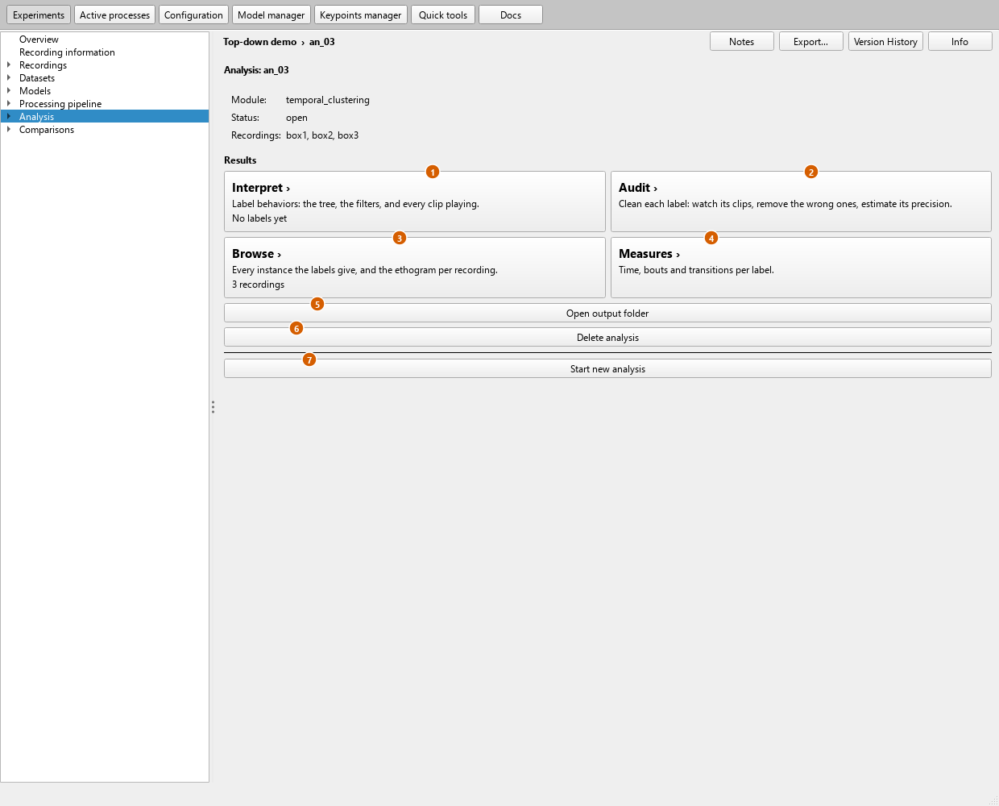
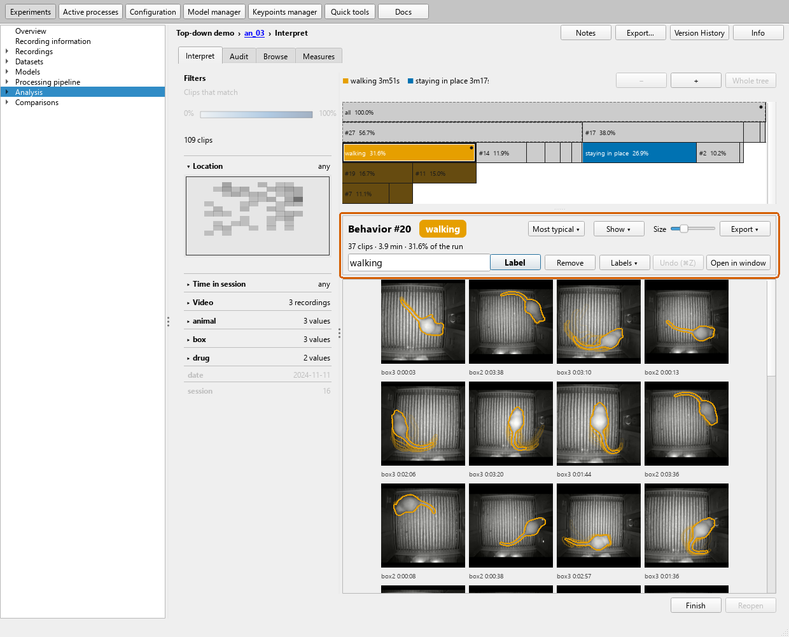

# 8. Clustering

A **behavior scan** (chapter 7) finds behaviors you can already name. **Clustering** finds the
ones you have not named yet. DETAIL cuts every recording into short **bouts**, stretches where
the animal's posture changes in one way, and groups bouts that look alike, from the embedding
(chapter 5). It builds the groups into a **tree**: the whole run at the top, splitting into
smaller and smaller groups, each a candidate behavior.

You then look through the tree, watch each group's clips, and **label** the groups that are a
behavior you recognise. The labels are what the rest of DETAIL counts: how often, for how
long, in which recordings.

## The steps at a glance

Each box is one step on this page. Click a box to go to that step. The first tag says where
the step is in DETAIL.

1. [Run a behavior clustering](#1-run-a-behavior-clustering) Experiments › Analysis › New analysis About 2 minutes for the demo, on the processor.
2. [Look through the tree](#2-look-through-the-tree) the run › Interpret The groups, and every clip of the one you choose, playing.
3. [Narrow with filters](#3-narrow-with-filters) the run › Interpret › Filters Which groups come from one drug, one box, one part of the arena.
4. [Watch a cluster's clips](#4-watch-a-clusters-clips) the run › Interpret › Open in window A cluster in its own window; one clip at full size.
5. [Label clusters](#5-label-clusters) the run › Interpret Name the clusters that are a behavior.
6. [Audit the labels](#6-audit-the-labels) the run › Audit Watch every clip of each label and take out the wrong ones.
7. [Browse and measure](#7-browse-and-measure) the run › Browse, Measures Every labelled bout, and bouts, rate and time per recording.

!!! note "The labels in this chapter are ours"
    The demo's two labels, **walking** and **staying in place**, were put on for this guide by
    looking at each cluster's clips quickly. They show how the steps work. They have not been
    checked against careful scoring, so the numbers on this page are not findings about these
    mice.

## 1. Run a behavior clustering

Click **Analysis** in the list on the left, then **New analysis**. In the **Launch an
analysis run** dialog:

1. **Module:** **Behavior clustering**.
2. Click **Select all**.
3. **Embedding run:** check that the embedding from chapter 5 is ticked. With one embedding,
   it is ticked for you.
4. **Method:** **dtw_finch**. Leave its settings as they are.
5. Click **Run**.

??? info "What everything on this screen does"
    1. **Module**: what to run, here **Behavior clustering**.
    2. **Start from**: fills the form from a previous run's settings.
    3. **Recordings**: the recordings to cluster together. Their bouts are grouped into one
       tree, so the same behavior gets the same group in every recording.
    4. **Select all**: ticks every recording.
    5. **Clear**: unticks them.
    6. **Embedding run**: which embedding to read, with how many of the ticked recordings it
       covers.
    7. **Track**: which tracked animal. One animal is **0**.
    8. **Method**: how bouts are found and grouped. **dtw_finch** cuts each recording into
       bouts where the posture changes, compares every pair of bouts, and groups them into a
       tree. It is the one this guide uses.
    9. **Detector**: how the cuts between bouts are found. **binseg** is the default.
    10. **Min bout length**: the shortest bout, in seconds.
    11. **DTW band**: how far, in seconds, two bouts may be stretched against each other in
        time when they are compared, so a quick and a slow version of one movement still
        match.
    12. **Window**: how much time, in seconds, is pooled into each step of a bout.
    13. **Advanced Settings**: opens 10 more settings, shown below.
    14. **Run**: starts the clustering.
    15. **Cancel**: closes the dialog without starting anything.
    16. **?**: a short explanation of the setting beside it.

??? info "What the Advanced Settings do"
    Settings 1 to 9 are how each recording is cut into bouts. Leave them as they are.

    1. **Window pooling**: how the frames in each window are combined.
    2. **Window stride**: how many windows to step at a time.
    3. **binseg penalty**: how readily a cut is made. Higher makes fewer, longer bouts.
    4. **Peak percentile**: how sharp a change must be to count as a cut.
    5. **Novelty window**: how much time either side of a moment is compared to find a
       change.
    6. **abd smoothing**: how much the change signal is smoothed first.
    7. **abd spacing**: how close two changes may be and still both count.
    8. **Min cut spacing**: the closest two cuts may be, in seconds.
    9. **Max tracking gap**: a gap in the tracking longer than this ends a bout.
    10. **Max bouts**: the most bouts to compare. Comparing every pair of bouts takes time
        that grows with the square of their number, so a run on many long recordings can set
        this to bound it. The run then says what it left out.

The run's page opens. On the demo, the clustering took about 2 minutes, on the processor.
When its **Status** says **open**, it is ready to label.

??? info "What everything on this screen does"
    1. **Interpret ›**: the tree and its clips, where you label (steps 2 to 5). It says how
       many labels the run has.
    2. **Audit ›**: watch every clip of a label and take out the wrong ones (step 6).
    3. **Browse ›**: every labelled bout, by recording (step 7).
    4. **Measures ›**: bouts, rate and time per label and recording (step 7).
    5. **Open output folder**: opens the folder that holds the run's files.
    6. **Delete analysis**: deletes the run and its files, after asking.
    7. **Start new analysis**: opens **New analysis** again.

Click a card to open it: it fills the window, with the four views as tabs along its top. To
go back to the run's page, click its id, here **an_03**, in the line at the top of the
window.

## 2. Look through the tree

Click **Interpret ›**. The tree is at the top, the clips of the chosen cluster below it, and
the filters on the left (step 3).

**The tree** reads from the top down. The top block, **all**, is every bout. Each block below
splits its parent into two or more clusters, each marked with its number and its share of the
run's time, such as **#20 31.6%**. A wide block is a common behavior; a narrow one a rare one.
Click a block to choose it.

**The montage** under it plays every clip of the chosen cluster at once, the most typical
first. Hover over a clip to pause the others; double-click it to open it at full size
(step 4).

??? info "What everything on this screen does"
    1. **−**: zooms the tree out.
    2. **+**: zooms the tree in, to tell small clusters apart. Scrolling over the tree does
       the same.
    3. **Whole tree**: shows the whole tree again.
    4. **The tree**: every cluster, as a block under its parent. Click a block to choose it;
       right-click it for **Label…**, **Remove label**, **Open in window** and **Zoom to
       this**. Drag the dotted handle under the tree to give it more or less height.
    5. **Most typical ▾**: the order of the clips: **Most typical** first, **Least typical**
       first, or **Random**. The least typical ones show where a cluster's edges are.
    6. **Show ▾**: what the clips show: the video, the animal's outline, a trail of where the
       outline has been, the keypoints, **As recorded** or **Aligned** (turned the way the
       embedding saw them), and how much footage either side.
    7. **Export ▾**: saves the clips (see *Save the clips*, below).
    8. **Size**: how big the clips are.
    9. **Label this behavior**: type a label for the chosen cluster (step 5).
    10. **Label**: puts the label typed beside it on the cluster. ++enter++ does the same.
    11. **Remove**: takes the chosen cluster's label off.
    12. **Labels ▾**: the labels you have used, to put one on with a click, and to rename or
        merge labels.
    13. **Undo (⌘Z)**: undoes the last label change. On Windows and Linux the key is
        ++ctrl+z++.
    14. **Open in window**: opens the chosen cluster in a window of its own (step 4).
    15. **Scrollbar**: scrolls the clips.
    16. **Finish**: says you are done labelling. It can be reopened.
    17. **Reopen**: opens a finished run again, to change its labels. Greyed out while the
        run is open.

    The line under the cluster's name gives its clips, its total time, and its share of
    the run.

How to read the tree:

1. Start at the top. Click each block in the second row and watch its clips: is it one
   behavior, or a mix?
2. A mix splits further down. Click its children until each one looks like one behavior.
3. Stop going down when the children look the same as their parent: splitting further
   only divides one behavior in two.

On the demo, **#20** is mice moving across the floor with the body stretched out and the
tail trailing: walking. **#1** is mice staying in one spot for a long time, the body
bunched up.

??? info "About this step: clips and bouts"
    Each clip is one bout: a stretch of video where the animal's posture changed in one
    way, from a fraction of a second to a minute. The cluster's **time** is the sum of its
    bouts. A cluster can hold few clips but much time, when its bouts are long, as **#1**
    does on the demo.

## 3. Narrow with filters

The **Filters** on the left pick out some of the clips: those from one group of recordings,
one part of the session, or one part of the arena. Filters never hide anything. The tree
shades each block by how many of its clips match, and the montage draws the clips that do
not match in grey.

For example, to see which clusters come from drug-on recordings: under **drug**, tick **on**.

What the filters are:

- **Clips that match**: how many clips the filters let through, of all of them. Beside the
  bar, **selected** is the chosen cluster's share that matches and **run** the whole run's;
  a cluster much above or below the run is one the filter picks out. **Reset all** clears
  every filter.
- **Location**: a map of where the animal was, over the whole field of view. Drag a box on
  it to keep clips from that part of the arena.
- **Time in session**: drag its two handles to keep clips from part of each recording,
  such as the first minute.
- **Video**: tick the recordings to keep.
- **One line per Recording information column**, here **animal**, **box** and **drug**:
  tick the values to keep. Columns with one value only, such as **date**, are greyed out.

Click a section's name to open or fold it. The filter dock itself folds to a narrow strip
when you drag its edge to the left.

## 4. Watch a cluster's clips

To look at one cluster closely, choose it and click **Open in window**. The window holds the
same label bar and clips as the Interpret view, for that cluster only. Several can be open
at once, each numbered, and the same number marks its block in the tree.

??? info "What everything on this screen does"
    1. **Most typical ▾**: the order of the clips.
    2. **Show ▾**: what the clips show.
    3. **Export ▾**: saves the clips.
    4. **Size**: how big the clips are.
    5. **Label this behavior**: type a label for this cluster.
    6. **Label**: puts the label on.
    7. **Remove**: takes the label off.
    8. **Labels ▾**: the labels you have used.
    9. **Undo (⌘Z)**: undoes the last label change.
    10. **Scrollbar**: scrolls the clips.
    11. **Close**: closes the window.

Double-click a clip, in the window or on the Interpret view, to open it at full size in the
**clip window**. It plays the clip from the original video, and **◀ previous** and **next ▶**
step through the cluster's clips in the montage's order.

??? info "What everything on this screen does"
    The line at the top says which clip this is: its recording, its length, where it
    starts, and its place in the order.

    1. **◀ previous**: the clip before, in the montage's order.
    2. **next ▶**: the clip after.
    3. **Advanced view**: shows the outline and the keypoints on their own beside the video,
       and traces of the animal's speed, size, length, bend and turning under it.
    4. **Blind mode**: hides which cluster and recording the clip is from, to judge it
       without knowing.
    5. **As recorded**: **As recorded** plays the video as filmed; **Aligned** turns it the
       way the embedding saw it, the head pointing right.
    6. **Export ▾**: saves what you see as a video or a GIF, or this frame as a picture.
    7. **The slider**: moves through the clip.
    8. **Pause**: pauses or plays the clip.
    9. **Speed**: how fast it plays.
    10. **Prev frame**: steps one frame back.
    11. **Next frame**: steps one frame forward.
    12. **Context**: plays a few seconds before and after the clip too.
    13. **Masks**: draws the animal's outline.
    14. **Trail points**: which keypoints leave a trail.
    15. **Frame number**: the frame shown, of the whole video.
    16. **Keypoints**: draws the keypoints.
    17. **Trail**: draws a trail of where the keypoints have been.
    18. **Mask trail**: draws a trail of where the outline has been.
    19. **Align pose**: turns the keypoints the way the embedding saw them.
    20. **Loop clip**: plays the clip again from the start when it ends.
    21. **Close**: closes the window.

### Save the clips

**Export ▾**, on the Interpret view or a cluster window, saves the cluster's clips, drawn as
**Show ▾** draws them:

- **Video of N clips…**: one video of all the clips side by side, as the grid shows them.
- **GIF of N clips…**: the same, as one GIF.
- **One file per clip…**: a GIF of each clip, into a folder.
- **CSV list of clips…**: a spreadsheet with one row per clip: its recording, start and end.
- **Pick clips to export…**: click the clips you want, in the order you want them; a bar
  over the grid counts them, with **Pick all**, **Clear**, **Export N ▾** to save them and
  **Quit**.

## 5. Label clusters

When a cluster is one behavior you recognise, give it a label:

1. Choose the cluster in the tree.
2. Type the behavior's name in **Label this behavior**, such as `walking`, and press
   ++enter++ (or click **Label**).

The label goes on at once; there is no Save button. The block in the tree takes the label's
colour, and the key above the tree lists every label with its total time.

Other ways to label:

- **Right-click a block** and choose **Label…**. Or double-click a block to type its label
  where it is.
- **Labels ▾** lists the labels you have used. Click one to put it on the chosen cluster, or
  press its number, ++1++ to ++9++. It also renames a label everywhere, or merges two into
  one.
- **A label covers everything under it.** Labelling a block labels all its children too,
  unless a child has a label of its own. Two clusters that are the same behavior get the
  same label.
- **Labels can nest**: a label typed as `climb › left` is a kind of `climb`.
- **Undo** (++ctrl+z++) takes back the last change.

??? info "About this step: what not to label"
    Leave a cluster unlabelled when its clips are a mix, or when you cannot say what the
    animal is doing. An unlabelled cluster is counted as nothing, which is honest; a wrong
    label is counted as that behavior. You do not need to label the whole tree: label only
    the behaviors you want to measure.

## 6. Audit the labels

A label is a judgment about a cluster, made from its most typical clips. **Audit** checks
it against every clip, and takes out the ones that are not the behavior. Click the **Audit**
tab.

??? info "What everything on this screen does"
    1. **The labels**: each label with its clusters. Each cluster says how many clips it
       has, and whether it has been reviewed and how many clips were taken out. Click a
       cluster to review it. Right-click one to open it on the Interpret view.
    2. **✓ Finish review**: says you have looked at every clip of the cluster. Greyed out
       until the last clip has been on screen.
    3. **Undo (⌘Z)**: puts back the last clip you took out (++ctrl+z++).
    4. **Show ▾**: what the clips show.
    5. **Export ▾**: saves the clips.
    6. **Size**: how big the clips are.
    7. **Scrollbar**: scrolls the clips.

To review a cluster:

1. Click it in the list. All of its clips play on the right, the **least typical first**:
   the ones most likely to be wrong are at the top.
2. Watch them, scrolling down. **Click a clip that is not the behavior** to take it out of
   the label. Drag across several, or hold ++shift++, to take out a run of them. Right-click
   a clip to move it to another label instead.
3. When you have scrolled to the last clip, click **✓ Finish review**.

The review then says how many clips stayed: the label's **precision**, the share of its
clips that are really the behavior. A label's figure appears once all its clusters are
reviewed.

Back on the **Interpret** view, a reviewed cluster's label bar shows what the review found,
with **Act on it ▾**: move the taken-out clips to another label, remove them from the label,
or look at the cluster's two halves, when the review found the cluster is two behaviors.

??? info "About this step: why audit"
    The precision is what lets you report a label's counts: "of the bouts labelled walking,
    95% were walking". It does not say how many walking bouts were left in unlabelled
    clusters; that needs the behavior scored by hand through the whole video.

    The demo's labels in this guide have not been audited.

## 7. Browse and measure

**Browse** lists every labelled bout, by recording and time, with an ethogram of each
recording: where in the video each label falls.

??? info "What everything on this screen does"
    1. **Clear filters**: ticks every label and recording again.
    2. **Ethogram**: folds the ethogram away or opens it. Each row is a recording, coloured
       by label along the video. Click a bout to play it. Scroll over it to zoom.
    3. **Labels**: each label with its bouts and time. Untick a label to leave it out.
    4. **Search recordings**: shows only recordings whose name contains what you type.
    5. **Recordings**: untick a recording to leave it out.
    6. **The bouts**: every labelled bout, with its behavior, recording, start, duration,
       and what its review found. Click a heading to sort; click a row to play it.
    7. **Metadata**: keeps only the recordings in one group, such as drug on.
    8. **The slider**: moves through the bout playing.
    9. **Play**: plays the bout.
    10. **Speed**: how fast it plays.
    11. **Prev frame**: steps one frame back.
    12. **Next frame**: steps one frame forward.
    13. **Export video…**: saves the bout as a video file.
    14. **Context**: plays a few seconds either side too.
    15. **Masks**: draws the animal's outline.
    16. **Frame number**: the frame shown.
    17. **Export selected**: saves the selected bouts as clips.
    18. **Export all**: saves every bout shown as clips. It says how many.

**Measures** gives, for each recording and label, the number of bouts, the rate, the total
time, the share of time, the bout lengths, the time to the first bout, the gap between
bouts, and the transitions between labels.

??? info "What everything on this screen does"
    1. **The measures**: one row per recording, label and measure, with its value, unit and
       how many bouts it comes from (**n**). Click a heading to sort.

    The **Export…** button at the top of the window saves the labelled bouts (**Behavior
    instances**), the ethograms, the per-frame labels, or the clips, for your own analysis
    in a spreadsheet, R or Python.

When every behavior you want is labelled and audited, go back to **Interpret** and click
**Finish**.

??? info "About this step: Snapshots"
    After you click **Finish**, export something, or use the run in a comparison, a
    **Snapshots** table appears on the run's page. Each snapshot is a frozen copy of the
    run's results at the moment a number left it. You can reopen a finished run and change
    its labels, and a number you already reported still has the snapshot it came from.

    Double-click a snapshot to see the run as it was then. The page shows a banner, **Viewing
    … Read-only**, and every control that would change the run is greyed out. Click **Back to
    live run** in the banner to return.

## What next

You have been through the whole of DETAIL on one experiment. From here:

- **Compare groups**: the **Comparisons** section of an experiment compares the measures of
  a scan or a clustering between groups of recordings, such as drug on against drug off.
- **Your own experiment**: start again at [chapter 1](create-an-experiment.md) with your
  videos. Chapters 1 to 3 are the same for every experiment; choose the analyses (chapters 6
  to 8) your question needs.
