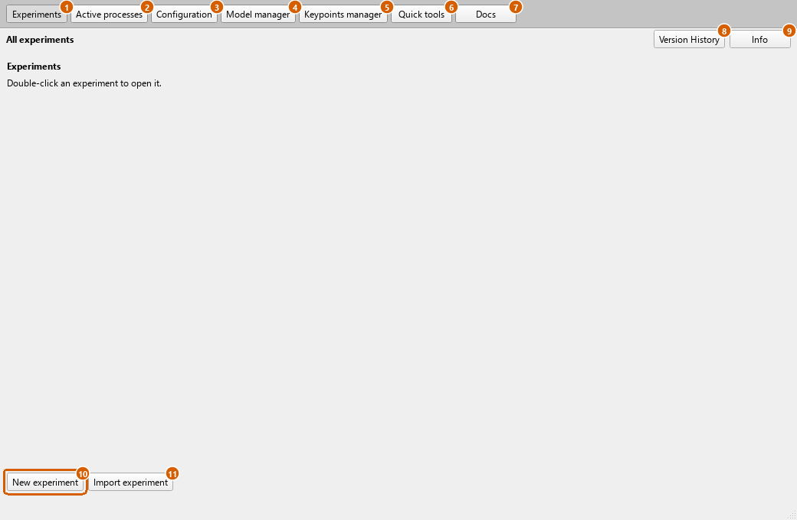
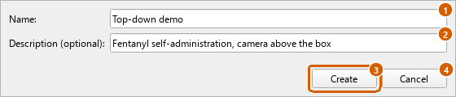
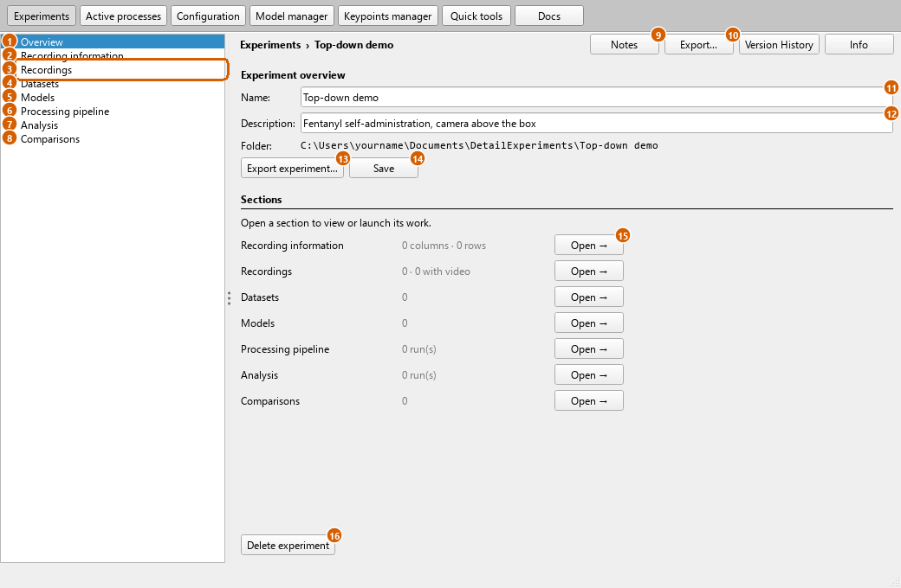
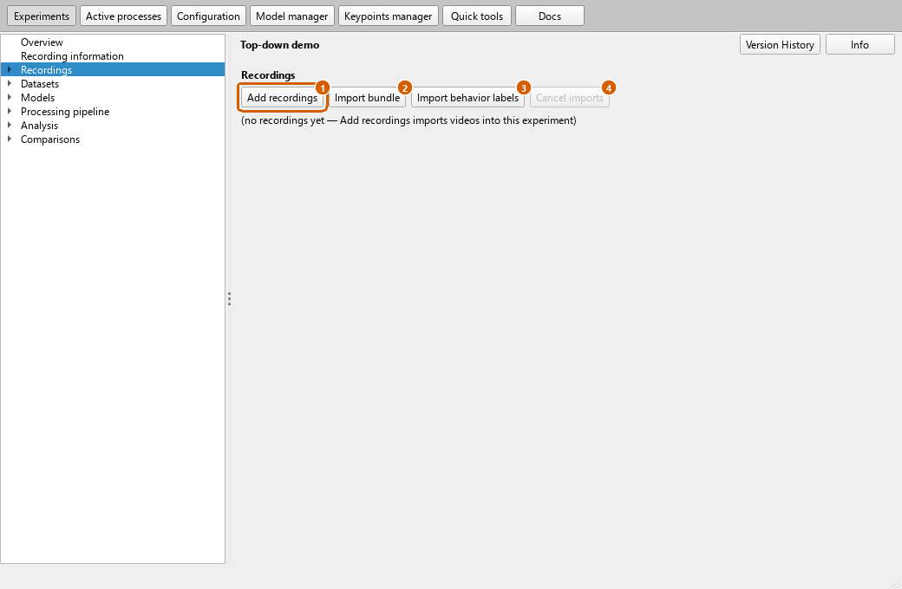
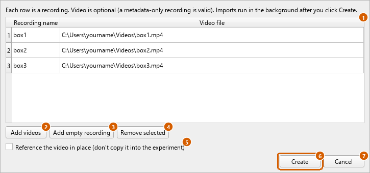
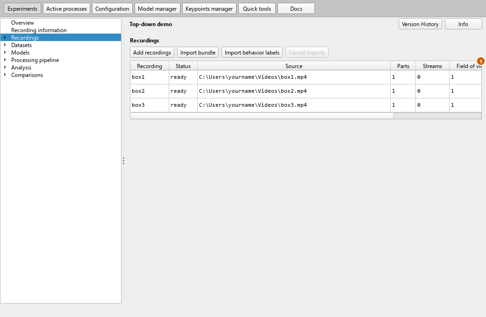
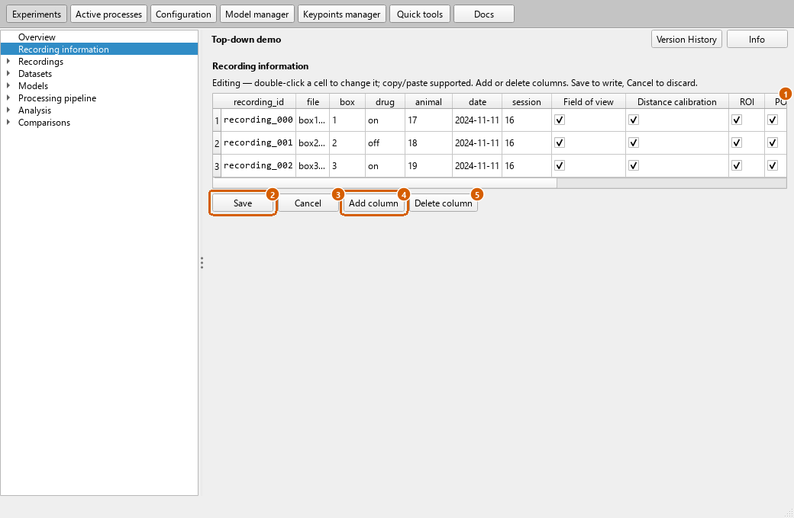
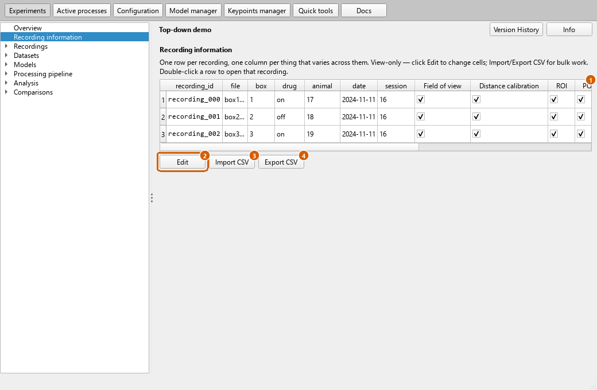
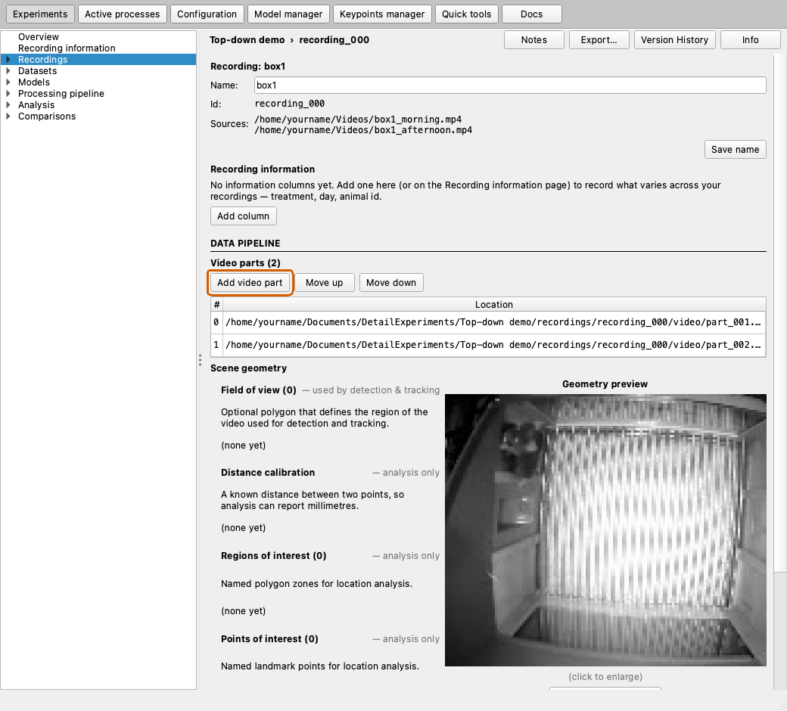
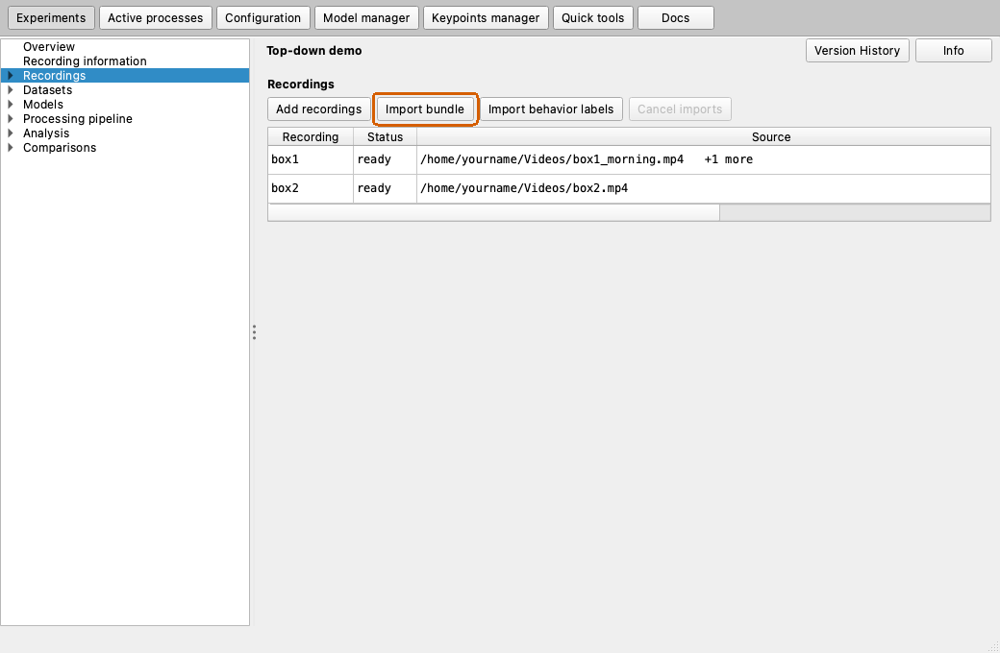

# 1. Create an experiment and add recordings

An **experiment** holds your recordings and every result DETAIL makes from them. In this
chapter you create one, bring your videos into it, and tell DETAIL a little about each
recording. Everything here happens in the DETAIL window.

The example is the top-down experiment: three 5-minute videos of one mouse each, filmed from
above in three operant boxes.

## The steps at a glance

Each box is one step on this page. Click a box to go to that step. The tag says where the
step is in DETAIL: the button along the top, then the page in the list on the left, then
the dialog that opens.

<div class="guide-flow" markdown>

1. [Create the experiment](#1-create-the-experiment) <span class="where where-app">Experiments › New experiment</span> <span class="note">A name, and a sentence about the study.</span>
2. [Add the recordings](#2-add-the-recordings) <span class="where where-app">Experiments › Recordings › Add recordings</span> <span class="note">One recording per video.</span>
3. [Fill in Recording information](#3-fill-in-recording-information) <span class="where where-app">Experiments › Recording information</span> <span class="note">Every piece of information about each recording: box, dose, sex, date, trial.</span>
4. [Optional: a recording in several files](#4-optional-a-recording-in-several-files) <span class="where where-app">Experiments › Recordings › a recording › Add video part</span> <span class="note">For a session the camera saved as more than one video.</span>
5. [Optional: many recordings at once](#5-optional-many-recordings-at-once) <span class="where where-app">Experiments › Recordings › Import bundle</span> <span class="note">For a large experiment, from one file that lists every recording.</span>

</div>

## 1. Create the experiment

Click **Experiments** in the row of buttons along the top, then **New experiment**.



??? info "What everything on this screen does"
    The buttons along the top (1 to 9) are on every screen, so this is the only place they are described.

    1. **Experiments**: this screen. Every experiment shows as a card. Double-click a card to open it.
    2. **Active processes**: everything running now in any experiment, such as a detection run or a video import, and anything that failed.
    3. **Configuration**: the setup checklist from [Configure DETAIL](../configure.md).
    4. **Model manager**: every model on your computer: the downloaded ones, such as SAM 3 and DINOv3, and the ones you train.
    5. **Keypoints manager**: the skeletons, the sets of body points chapter 4 places on the animal.
    6. **Quick tools**: tools that need no experiment, such as trying SAM 3 on one video.
    7. **Docs**: **User guides ↗** opens these guides in your browser, and **Open full docs ↗** the rest of DETAIL's documentation. Both work without the internet.
    8. **Version History**: which version of DETAIL you are running, what changed, and **Check for updates**.
    9. **Info**: a short explanation of the screen you are on.
    10. **New experiment**: makes a new experiment. This step.
    11. **Import experiment**: opens an experiment someone exported to a file (a `.tar` archive), for example to move it from another computer. A bar shows how far it has got, and **Cancel** stops it with nothing placed. Video kept outside the experiment is looked for where the other computer had it; any recording whose video is still not found is named at the end.

Fill in the dialog:

- **Name:** a name you will recognize, such as `Top-down demo`.
- **Description:** optional. A sentence about the study helps when you come back to it later.



??? info "What everything on this screen does"
    1. **Name**: what the experiment is called everywhere in DETAIL. Required. You can change it later on the Overview.
    2. **Description**: a sentence about the study. Optional.
    3. **Create**: makes the experiment and opens it.
    4. **Cancel**: closes the dialog without making anything.

Click **Create**.

**Check:** the experiment opens on its **Overview**, with its sections listed down the left
side.



??? info "What everything on this screen does"
    Numbers 1 to 8 are the experiment's sections, in the list on the left. They are the same in every experiment.

    1. **Overview**: this page.
    2. **Recording information**: one row per recording, with what differs between them. Step 3.
    3. **Recordings**: add recordings and open each one's page. Step 2.
    4. **Datasets**: frames with labels that DETAIL makes when it trains a model (chapter 3).
    5. **Models**: the models trained for this experiment, such as a fast detector (chapter 3) and a keypoint model (chapter 4).
    6. **Processing pipeline**: start and follow detection, tracking and embedding runs (chapters 3 to 5).
    7. **Analysis**: behavior scan, clustering and the other analyses (chapters 6 to 8).
    8. **Comparisons**: compare behavior between groups of recordings, such as drug on against drug off.
    9. **Notes**: shows or hides a box for anything you want to remember about the screen you are on. It saves by itself. Every page opens with its notes folded away, and the button reads **Notes ●** when the page has a note.
    10. **Export…**: writes this screen's data to a file. On the Overview: the whole experiment as one file, or the Recording information table as a CSV.
    11. **Name**: change it here, then click **Save**.
    12. **Description**: change it here, then click **Save**.
    13. **Export experiment…**: packs the whole experiment into one archive file, to back it up or move it to another computer. You choose whether to include the videos. It runs in the background, with a bar and the time left, and stays listed under **Active processes** until it is done.
    14. **Save**: saves a changed name or description.
    15. **Open →**: opens that section. The text beside each one counts what is in it.
    16. **Delete experiment**: deletes the experiment and everything in its folder, after asking. It cannot be undone. Videos you referenced in place stay where they are.

??? info "About this step"
    DETAIL keeps each experiment in its own folder, inside a folder named
    `DetailExperiments` in your Documents folder. The **Folder** line on the Overview shows
    where.

    The list on the left can be folded to a narrow strip, to give the page more room: drag
    its edge to the left, or double-click the dotted handle beside it, or press
    ++ctrl+backslash++. Do the same again to bring it back.

## 2. Add the recordings

Click **Recordings** in the list on the left, then **Add recordings**.



??? info "What everything on this screen does"
    1. **Add recordings**: adds recordings from video files. This step.
    2. **Import bundle**: adds many recordings at once, with their information and extra data files, from a folder prepared for it (see the [Manifest reference](../../reference/manifest.md)).
    3. **Import behavior labels**: brings in behavior you scored by hand, such as BORIS exports, for many recordings at once.
    4. **Cancel imports**: stops video imports that are still running. It is greyed out when nothing is importing.

In the **Add recordings** dialog:

1. Click **Add videos** and choose your video files. To choose several, hold ++ctrl++ and
   click each one. Click **Open**. Each video becomes one row, named after its file.
2. **Recording name:** double-click a name to change it to something you will recognize.
   Each name must be different.
3. Leave **Reference the video in place** unticked, unless your videos are too large to copy
   (see the box below).



??? info "What everything on this screen does"
    1. **The table**: one row per recording. **Recording name** is yours to change; **Video file** is the video it imports. If the experiment already has Recording information columns (step 3), each gets a column here too. Double-click a cell to type in it.
    2. **Add videos**: choose video files. Each becomes a row.
    3. **Add empty recording**: a row with no video, for a recording whose video you add later.
    4. **Remove selected**: takes the selected rows out of the list. It deletes no files.
    5. **Reference the video in place**: use each video where it is instead of copying it (see the box below).
    6. **Create**: makes the recordings and starts importing their videos.
    7. **Cancel**: closes the dialog without adding anything.

Click **Create**. The dialog closes and the videos import in the background. A bar at the
bottom of the window shows which video is importing and how long is left.

**Check:** when the import is done, each recording's **Status** says **ready**. Leave DETAIL
open until then: closing it stops the imports.



??? info "What everything on this screen does"
    1. **The recordings table**: one row per recording. **Status** says whether its video has finished importing (**ready**). **Source** is where the video came from. **Parts** is how many video files the recording has. **Streams** counts other data lined up with the video, such as operant-box events. **Field of view** and **Detections** fill in as you work through the next chapters. Double-click a row to open that recording's page.

After the import, DETAIL also makes small copies of each video in the background, for the
clip previews in chapters 7 and 8. A second bar at the bottom of the window, **Previews**,
shows how far it has got. You can carry on while it works.

??? info "About this step: copying or referencing the video"
    By default DETAIL **copies** each video into the experiment folder. The experiment then
    has everything it needs, and you can move or delete the original. It needs as much free
    space as the videos take.

    **Reference the video in place** uses each video where it is, without a copy. Use it for
    large libraries you cannot duplicate, such as hours of video on a network drive. The
    videos must then stay where they are: if one moves, its recording says so, and **Locate
    video** on the recording's page points it at the new place.

??? info "About this step: names and ids"
    A recording's **name** is yours to choose and change. DETAIL also gives each recording an
    **id**, such as `recording_000`, which never changes. You can rename a recording later on
    its own page.

??? warning "If this doesn't work"
    - **"These names are already used":** another recording in the experiment has that name.
      Change the name in that row.
    - **"Video not found":** the file moved after you chose it. Remove the row with **Remove
      selected**, then add the video again.
    - **A recording's status stays on importing:** the import is still going. The bar at the
      bottom of the window shows its progress. Large videos, and videos on a network drive,
      take longer.
    - **A recording's status says failed:** DETAIL was closed, or the computer shut down,
      while it imported. An import cannot carry on where it stopped: double-click the
      recording to open its page, click **Delete recording** at the bottom, then add the
      video again with **Add recordings**.

## 3. Fill in Recording information

Click **Recording information** in the list on the left. It is a table with one row per
recording, with no columns of your own yet.

**Give every piece of information about your recordings its own column**, whatever you might
want to group, filter or compare by later. For example:

| Column | Example values |
|--------|----------------|
| `box` | which camera, box or rig filmed it: `1`, `2`, `3` |
| `animal` | `M17`, `M18` |
| `sex` | `male`, `female` |
| `drug` | `on`, `off` |
| `dose` | `0`, `10`, `30` |
| `date` | `2024-11-11` |
| `session` or `trial` | `1`, `2`, `3` |
| `group` | `control`, `treated` |

Information that is not in a column cannot be used to compare groups, so add it now even if
you are not sure you will need it.

1. Click **Edit**.
2. Click **Add column**, type the column's name, such as `drug`, and click **OK**. Do this
   once for each column.
3. Double-click each cell and type its value, such as `on` or `off`.
4. Click **Save**.



??? info "What everything on this screen does"
    1. **The table**: double-click a cell to change it. You can copy and paste cells, including from a spreadsheet. **recording_id** and **file** are filled in by DETAIL. Your columns follow. The tick-box columns after them fill in by themselves as you work on each recording.
    2. **Save**: saves every change you made since **Edit**.
    3. **Cancel**: throws away every change you made since **Edit**.
    4. **Add column**: adds a column. It asks for the name.
    5. **Delete column**: removes a column and its values. It asks which one.

**Check:** after **Save**, the table shows your columns and values, and the **Edit** button
is back.



??? info "What everything on this screen does"
    1. **The table**: one row per recording. Double-click a row to open that recording's page.
    2. **Edit**: lets you change the table. Nothing is saved until you click **Save**.
    3. **Import CSV**: fills in the table from a spreadsheet saved as CSV, matching rows by recording id, name or video file name. A column the table does not have yet is added.
    4. **Export CSV**: saves the table as a CSV, to fill in in a spreadsheet and import back.

**You can change this at any time.** Click **Edit** again to add a column, fix a value or
fill in one you skipped, then **Save**. Each recording's own page has the same information:
click the recording under **Recordings** in the list on the left, and its **Recording
information** section shows one box per column, with **Add column** and **Save metadata**.
A column added there appears on every recording, empty on the others until you fill it in.

??? info "About this step"
    Later chapters use these columns: to compare groups, such as drug on against drug off,
    and to narrow what you look at in chapter 8. The tick-box columns on the right fill in by
    themselves as you work on each recording, so you can see at a glance how far each one has
    got.

    For many recordings, copy the values from a spreadsheet and paste them into the table
    while editing, or use **Import CSV**. **Export CSV** writes a table to fill in, with one
    row per recording.

## 4. Optional: a recording in several files

Some cameras save one session as several video files, one after another. Keep them as **one
recording with several parts**, not as separate recordings: DETAIL then plays and analyzes
them as one video, on one clock. Skip this step if each session is one file.

1. Add the session's **first** file as a recording ([step 2](#2-add-the-recordings)) and wait
   until its **Status** says **ready**.
2. Click **Recordings** in the list on the left, and double-click the recording to open its
   page.
3. Click **Add video part** and choose the next file. Do this once for each remaining file,
   in the order they were filmed.



**Check:** the recording's page lists every part under **Video parts**, in the order they
were filmed, and the heading counts them, such as **Video parts (2)**. If two are the wrong way round, choose one and click **Move up** or **Move down**.

??? info "About this step"
    Every part of a recording must have the same picture size and the same frame rate, which
    is the case for files one camera saved in one session. DETAIL refuses a part that differs.

    Set the order before you go on. Once the recording has a run, such as a detection run in
    chapter 3, the order is fixed, because the run's results are tied to it.

    The rest of the recording's page is described in [chapter 2, step
    1](set-up-recordings.md#1-open-a-recording).

## 5. Optional: many recordings at once

For a large experiment, adding recordings one dialog at a time is slow. Instead you can list
every recording in one text file, called a **manifest**, and import them together: their
videos, their Recording information, and their streams. Skip this step if **Add recordings**
is enough for you.

1. Put the videos in one folder. This folder is the **bundle**.
2. In the same folder, make a text file named `manifest.yaml` that lists the recordings. This
   one makes two recordings, the first in two parts:

    ```yaml
    recordings:
      - id: box1
        video:
          - box1_morning.mp4
          - box1_afternoon.mp4
        metadata:
          animal: 17
          dose: 10
      - id: box2
        video: [box2.mp4]
        metadata:
          animal: 18
          dose: 0
    ```

3. In DETAIL, click **Recordings** in the list on the left, then **Import bundle**, and choose
   the bundle folder.
4. DETAIL checks the whole manifest, then asks **Import 2 recording(s) from this bundle?**
   Click **Yes**. The videos import in the background, as in step 2.



**Check:** every recording in the manifest is listed, and its **Status** says **ready** when
its import is done. Each `metadata` entry is a column on **Recording information**.

??? info "About this step"
    The file names in the manifest are looked for inside the bundle folder. `metadata` takes
    any names you like: each becomes a Recording information column, as in [step
    3](#3-fill-in-recording-information). A recording can also list its streams
    ([chapter 2, step 6](set-up-recordings.md#6-optional-add-streams)).

    Every field the manifest takes is in the [Manifest reference](../../reference/manifest.md).
    The same import can be run from a terminal: see [Bulk importing
    recordings](../../cli.md#bulk-importing-recordings) in the manual.

??? warning "If this doesn't work"
    DETAIL checks the whole manifest before it creates anything. If it finds a problem it
    lists every one in a window titled **Import bundle** and imports nothing, so you can fix
    the file and try again. The usual problems:

    - **A file is missing:** a name in the manifest does not match a file in the folder.
      Check the spelling, and upper and lower case.
    - **An id is already used:** a recording with that id is in the experiment, or the
      manifest lists it twice.
    - **Parts disagree:** the parts of one recording have different picture sizes or frame
      rates, so they are not one session from one camera.

## Next

[2. Set up each recording](set-up-recordings.md).
