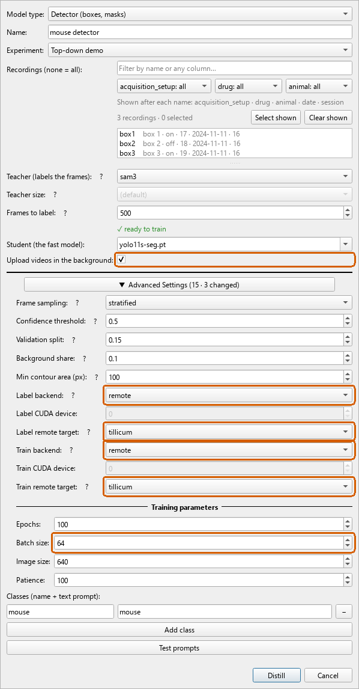
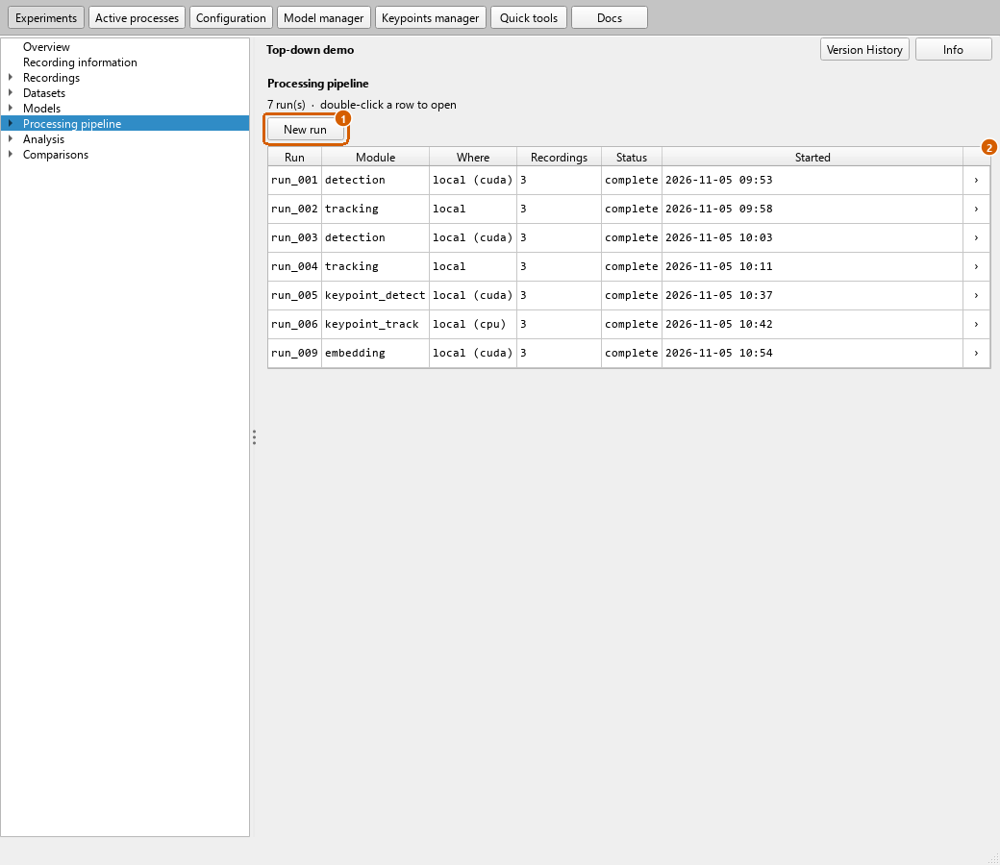
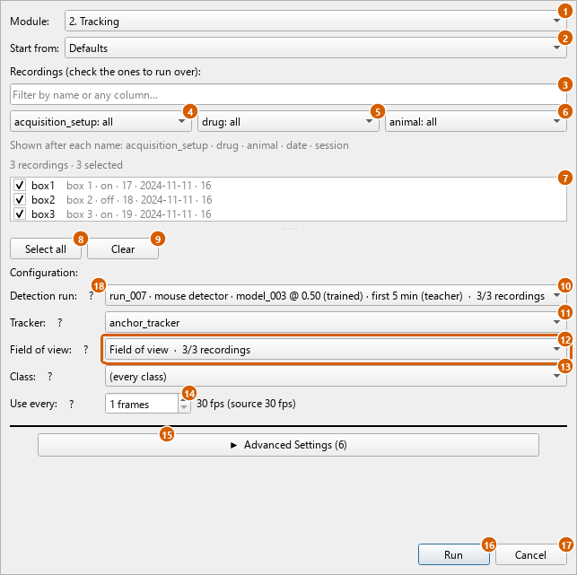
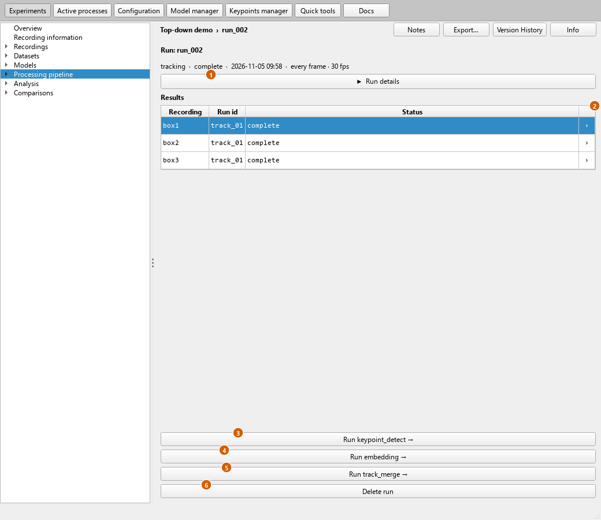
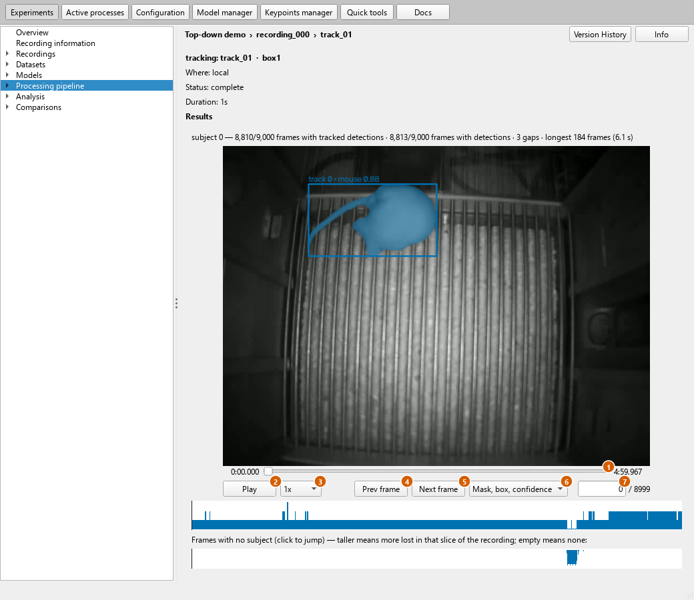
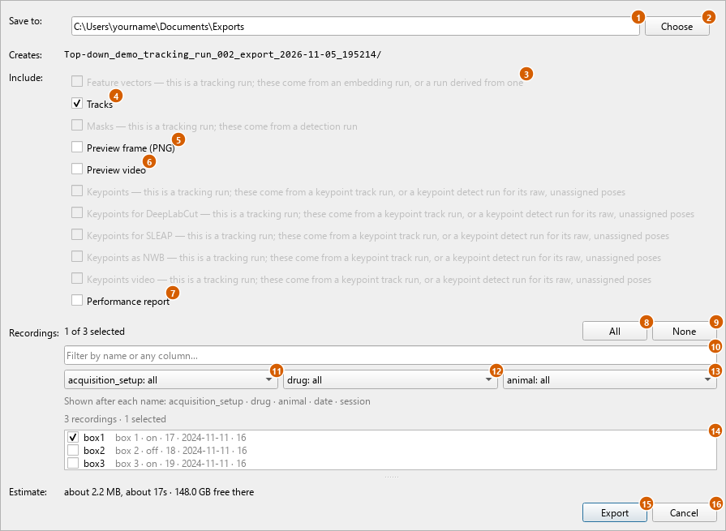

# 3. Detect and track

**Detection** finds the animal in every frame: a box around it and an outline of its body,
called a **mask**. **Tracking** then joins those frame by frame into one animal followed
through the whole video. Everything after this chapter works from the tracking.

The way to detect, in DETAIL, is to **distill a fast detector**. SAM 3, the model you set up
in [Configure DETAIL](../configure.md), finds animals from a few words, such as `mouse`, but
it is slow. So SAM 3 labels a few hundred frames, a small fast model learns from them, and
that fast model detects every frame. Chapter 4 needs that fast model too.

## The steps at a glance

Each box is one step on this page. Click a box to go to that step. The first tag says where
the step is in DETAIL. A **GPU** tag means the step's work can run on your computer or on
Tillicum.

1. [Test the prompt](#1-test-the-prompt) Experiments › Models › Distill new model › Test prompts Check SAM 3 finds your animal from a few words.
2. [Distill a fast detector](#2-distill-a-fast-detector) Experiments › Models › Distill new model GPU: your computer or Tillicum About 20 to 30 minutes on an 8 GB GPU.
3. [Detect every frame](#3-detect-every-frame) Experiments › Processing pipeline › New run GPU: your computer or Tillicum About 5 minutes for the three demo videos.
4. [Track the animal](#4-track-the-animal) Experiments › Processing pipeline › New run Seconds. Runs on the processor, not the GPU.

## 1. Test the prompt

Click **Models** in the list on the left, then **＋ Distill new model**.

??? info "What everything on this screen does"
    1. **×**: hides the reminder above the buttons. The reminder names the next setup step
       the experiment still needs, here setting up keypoints (chapter 4).
    2. **＋ Distill new model**: makes a fast model, by labelling frames with a teacher and
       training on them. This step and step 2.
    3. **Set up keypoints…**: makes the experiment's keypoint model (chapter 4).
    4. **Train from dataset…**: trains a model again from frames already labelled, for
       example with a smaller **Batch size** (see [Batch size and your
       GPU](#batch-size-and-your-gpu)). Greyed out until a distill has labelled frames.
    5. **Background uploads…**: shows videos being copied to Tillicum while a remote run
       works, and lets you stop or resume the copy.

The **Distill new model** dialog opens. Fill in the top part:

- **Model type:** **Detector (boxes, masks)**.
- **Name:** a name for the model, such as `mouse detector`.
- **Recordings:** leave none ticked to use every recording.
- **Frames to label:** leave **500** for a GPU in your own computer. With a very good GPU, or
  on Tillicum, set **1000**.
- **Classes:** in the first box type the name to give what it finds, such as `mouse`. In the
  second, type the words SAM 3 should look for, the **text prompt**, such as `mouse`.

??? info "What everything on this screen does"
    1. **Model type**: **Detector** finds the animal and outlines it. **Keypoints** makes a
       keypoint model instead (chapter 4 does that for you).
    2. **Name**: the new model's name.
    3. **Experiment**: which experiment's recordings to learn from.
    4. **Filter**: shows only recordings whose name or information contains what you type.
    5. **acquisition_setup**: shows only recordings with the value you pick. There is one
       of these for each Recording information column with a few values.
    6. **drug**: the same, for the drug column.
    7. **animal**: the same, for the animal column.
    8. **Select shown**: ticks the recordings the filters show.
    9. **Clear shown**: unticks them.
    10. **Recordings**: the recordings to label frames from. None ticked means all.
    11. **Teacher**: the model that labels the frames. `sam3` is the one that finds an
        animal from words.
    12. **Teacher size**: a size of the teacher, for a teacher that comes in sizes. SAM 3
        has one, so this is greyed out.
    13. **Frames to label**: how many frames the teacher labels, spread across all the
        recordings. The default, 500, suits a typical GPU in your own computer. With a very
        good GPU, or on Tillicum, set 1000.
    14. **Student**: the fast model that learns from the labels. `yolo11s-seg.pt` is a small
        one that outlines as well as boxes.
    15. **Upload videos in the background**: for a run on Tillicum, copies the videos there
        while the distill works, so the detection run after it does not wait for them.
        Greyed out unless a stage runs on Tillicum.
    16. **Advanced Settings**: opens 15 more settings, shown in step 2. Their values work as
        they are, except **Batch size** on some GPUs.
    17. **Class name**: the label stored on each animal found, such as `mouse`.
    18. **Text prompt**: the words SAM 3 searches for. Often the same as the class name.
    19. **−**: removes this class.
    20. **Add class**: adds another class, for a second kind of thing to find.
    21. **Test prompts**: tries the prompt on a few frames, without starting anything.
    22. **Distill**: starts the distill (step 2).
    23. **Cancel**: closes the dialog without starting anything.
    24. **?**: a short explanation of the setting beside it.

Click **Test prompts**. In the window that opens, click **Run prompt test**. SAM 3 looks for
the prompt on six frames of the first recording and shows what it found.

??? info "What everything on this screen does"
    1. **Recording**: which recording to take frames from.
    2. **Candidate prompts**: the words to try, one set per line. Several lines are tested
       side by side, to compare them.
    3. **Sample frames**: how many frames to try.
    4. **Only from**: tick it to take frames only from part of the recording.
    5. **From**: where in the recording the frames start, in seconds.
    6. **To**: where they end, in seconds.
    7. **Run prompt test**: runs SAM 3 on the frames. It takes a minute the first time,
       while SAM 3 loads.
    8. **The results**: each frame with what SAM 3 found outlined, and how many it found.
       Scroll for more frames.
    9. **Confidence**: hides what SAM 3 found below this confidence, to see which cut-off
       leaves only the animal.
    10. **Close**: closes the window. Nothing is saved.

**Check:** on every frame, the animal is outlined, and nothing else is.

??? warning "If this doesn't work"
    - **The animal is missed on some frames:** try other words, each on its own line, such
      as `white mouse` or `rodent`, and run again to compare. Use the line that finds the
      animal on the most frames in **Text prompt**.
    - **Something else is outlined too,** such as a reflection or a lever: raise the
      confidence (9) until only the animal is left. Use that value as the distill's
      **Confidence threshold** under **Advanced Settings**.

## 2. Distill a fast detector

Click **▶ Advanced Settings** to see the rest of the settings. Leave them as they are,
unless your GPU has more than 8 GB of memory (see [Batch size and your
GPU](#batch-size-and-your-gpu) below), or you are using Tillicum (see the box after it).

??? info "What everything on this screen does"
    1. **Frame sampling**: how the frames to label are picked. **stratified** spreads them
       evenly through each video; **uniform** picks them at random.
    2. **Confidence threshold**: how sure SAM 3 must be to keep what it found.
    3. **Validation split**: the share of labelled frames kept back to test the trained
       model on, rather than trained on.
    4. **Background share**: the largest share of frames where SAM 3 found nothing that are
       kept, so the model learns what an empty frame looks like.
    5. **Min contour area**: outlines smaller than this many pixels are dropped as noise.
    6. **Label backend**: where SAM 3 labels the frames: **cuda** is your computer's GPU,
       **remote** is Tillicum.
    7. **Label CUDA device**: which GPU, on a computer with more than one. 0 is the first.
    8. **Label remote target**: which cluster, when **Label backend** is **remote**.
    9. **Train backend**: where the fast model trains.
    10. **Train CUDA device**: which GPU trains it.
    11. **Train remote target**: which cluster, when **Train backend** is **remote**.
    12. **Epochs**: how many times the training goes through all the labelled frames, at
        most.
    13. **Batch size**: how many frames it trains on at once. See below.
    14. **Image size**: the size, in pixels, frames are shrunk to for training.
    15. **Patience**: stop early if the model has not improved for this many epochs.
    16. **?**: a short explanation of the setting beside it.

### Batch size and your GPU

**Batch size** is how many frames the model trains on at once. A bigger batch trains faster
but needs more GPU memory. The default, **8**, fits an 8 GB GPU, the smallest DETAIL
supports. On a bigger GPU, raise it:

| GPU | Batch size |
|---|---|
| 8 GB | 8 (the default) |
| 12 GB | 16 |
| 16 GB | 32 |
| 24 GB or more | 48 |
| Tillicum (H200, 141 GB) | 64 |

These are for the default **Student** (`yolo11s-seg.pt`) and **Image size** (640). A larger
student or image size needs more memory for the same batch, so use a smaller batch with
them.

??? info "About this: where these numbers come from"
    On an 8 GB GPU, a batch of 8 used about 4 GB of GPU memory, and a batch of 32 needed
    about 9.3 GB: about a quarter of a gigabyte more for each frame in the batch. The table
    keeps a third or more of each GPU's memory spare, because your screen and other
    programs use some too.

    With a few hundred labelled frames, a batch bigger than about 32 makes little
    difference, because one pass through the frames is only a handful of batches. That is
    why even Tillicum's row stops at 64.

??? warning "If training is very slow, or stops with out of memory"
    The batch is too big for your GPU. Stop the run with **Cancel model**, then train again
    from the frames it already labelled: on the **Models** page, click **Train from
    dataset…** and set a smaller **Batch size**. The labelling does not need to run again.

    On Windows a batch that does not fit does not stop with an error. Training slows to a
    crawl instead, minutes per batch, because Windows moves the overflow into ordinary
    memory. Task Manager's **Performance** tab shows it: the GPU's **Dedicated GPU memory**
    is full and **Shared GPU memory** fills up.

??? info "On Tillicum: the settings to change"
    To label and train on Tillicum, set **Frames to label** to 1000, above **Advanced
    Settings**, and under **Advanced Settings**:

    - **Label backend** and **Train backend:** **remote**.
    - **Label remote target** and **Train remote target:** **tillicum**.
    - **Batch size:** 64, from the table above. Tillicum's GPUs are much larger than a
      desktop's.

    Then tick **Upload videos in the background**, above **Advanced Settings**, so the videos
    are on Tillicum by the time you detect with the new model there (step 3). Log in first
    (see [Every day: log in before you run](../tillicum.md#every-day-log-in-before-you-run)).

    

Click **Distill**. The dialog closes and the distill's own page opens. It labels the frames
first, then trains. On the demo, with an 8 GB GPU, labelling took 7 minutes and
training 16.

??? info "What everything on this screen does"
    1. **Training curve**: folds the curve away or opens it again. The curve shows how well
       the model does on the held-back frames after each epoch; the circle marks the best.
    2. **Open trained model →**: opens the model's own page: its name, its classes, and how
       well it did.
    3. **Delete distill run**: deletes this run's record. The trained model stays.

    While the run is going, the page also shows a progress bar for each stage, and, once
    training starts, **Stop and keep**: it finishes the current epoch and keeps the best
    model so far, for when the curve has flattened out.

**Check:** the status says **complete**, and the line under the curve says the best mAP50 is
high, above about 0.9.

??? info "About this step: what mAP50 means"
    mAP50 says how often the model's box matches the teacher's on the frames kept back from
    training: 1.0 is always. Above about 0.9, the model finds the animal as well as SAM 3
    did. The curve rising quickly, then flattening, is normal. The model kept is the one
    from the best epoch, not the last.

??? warning "If this doesn't work"
    - **The best mAP50 stays low, under about 0.7:** the labels were poor. Go back to
      step 1, find a better prompt, and distill again.
    - **The run stops with an error during labelling:** SAM 3 is not set up. See
      [Configure DETAIL](../configure.md#3-install-the-sam-3-backend).
    - **The distill stopped partway** (an error, or your computer slept during a local
      run): open it from **Models** › **Distill runs** and click **Resume distill**. A
      finished labelling stage is kept, and a training that stopped carries on from its
      last checkpoint.

??? tip "Use this detector in other experiments"
    A trained model belongs to the experiment it was trained in. To use it in another
    experiment filmed on the same setup, without distilling again: click **Open trained
    model →**, then **Promote to global**, and give it a name. It is then in the **Model**
    list (step 3) of every experiment on your computer, and in the Model manager's
    **Global models** table.

## 3. Detect every frame

Click **Processing pipeline** in the list on the left, then **New run**.

??? info "What everything on this screen does"
    1. **New run**: starts a detection, tracking or embedding run.
    2. **The runs**: every run in the experiment, with its module, where it ran, how many
       recordings, its status and when it started. Double-click a row, or click **›**, to
       open the run.

In the **Launch a processing run** dialog:

1. **Module:** **1. Detection**.
2. Click **Select all** to tick every recording.
3. **Model:** your new detector, here **mouse detector · model_003 · trained**.
4. Leave the rest as it is, and click **Run**.

??? info "What everything on this screen does"
    1. **Module**: what to run. They are listed in order: detection, tracking, embedding,
       and the keypoint steps (chapter 4).
    2. **Start from**: fills the form from a previous run's settings, to run again with the
       same settings or a small change. **Defaults** is the usual settings.
    3. **Filter**: shows only recordings whose name or information contains what you type.
    4. **acquisition_setup**: shows only recordings with the value you pick.
    5. **drug**: the same, for the drug column.
    6. **animal**: the same, for the animal column.
    7. **Recordings**: the recordings to run on. A recording a module cannot run on yet is
       greyed out.
    8. **Select all**: ticks every recording the filters show.
    9. **Clear**: unticks them.
    10. **Model**: the detector. Your distilled model, or `sam3` to detect every frame with
        SAM 3 itself, which is much slower.
    11. **Confidence threshold**: how sure the model must be to keep a detection.
    12. **Use every**: detect every frame (1), or every second frame (2), and so on. Every
        frame is best: later steps can use fewer, but never more.
    13. **Test detection**: tries the model on a few frames first, like **Test prompts**.
    14. **Advanced Settings**: opens 5 more settings, shown below.
    15. **Run**: starts the run.
    16. **Cancel**: closes the dialog without starting anything.
    17. **?**: a short explanation of the setting beside it.

??? info "What the Advanced Settings do"
    1. **Per-class confidence**: a confidence threshold for each class, for a model that
       finds several kinds of thing.
    2. **Batch size**: how many frames the model looks at at once. 4 fits an 8 GB GPU; it
       only changes the speed.
    3. **Backend**: where it runs: **cuda** on your computer's GPU, **remote** on Tillicum.
    4. **CUDA device**: which GPU, on a computer with more than one.
    5. **Remote target**: which cluster, when **Backend** is **remote**.

    **On Tillicum:** set **Backend** to **remote** and **Remote target** to **tillicum**,
    and raise **Batch size** to 32.

The run's page opens. On the demo, the three 5-minute videos took about 5 minutes on an
8 GB GPU.

??? info "What everything on this screen does"
    1. **Run details**: opens the settings the run was made with, and where it ran.
    2. **Results**: one row per recording, with its own id for this run, its status, and
       **Frames with detections**: how many of the frames the run looked at had at least
       one detection. It fills in a moment after the page opens. Click a row to see its
       detections underneath; double-click it, or click **›**, to open that recording's
       detections on a page of their own.
    3. **The chosen recording's detections**: the video with what was found outlined, and
       the same player as on the recording's own page (below). **Export frame…** saves the
       frame on screen as a picture, and **Export video…** the whole recording as a video,
       both drawn as shown.
    4. **Run tracking →**: opens the launch dialog for tracking, with this run chosen
       (step 4).
    5. **Delete run**: deletes the run and its results, after asking. A run that a later
       run was made from cannot be deleted until that one is.

    While the run is going, **Cancel run** takes the place of **Delete run**: it stops the
    run, and recordings already finished keep their results. If a recording failed or was
    cancelled, **Retry 1 incomplete recording** (or **Retry 2 …**) appears above **Delete
    run** (see *If this doesn't work*, below).

**Check:** every recording's **Status** says **complete**, and **Frames with detections** is
close to every frame for each one (on the demo, 8,469 to 8,813 of 9,000). A recording with
far fewer than the others needs a look: click **›** on it to see its detections on the
video.

??? info "What everything on this screen does"
    The line above the video counts what the run found: here 10,195 detections, on 8,813
    of the recording's 9,000 frames, at most 3 on one frame. The strip under the controls
    shows how many were found along the whole recording.

    1. **The slider**: moves through the video.
    2. **Play**: plays the video with its detections drawn on.
    3. **Speed**: how fast **Play** plays.
    4. **Prev frame**: steps one frame back.
    5. **Next frame**: steps one frame forward.
    6. **Overlay**: what to draw on the animal: the mask, the box and the confidence, or
       fewer of them.
    7. **Frame number**: the frame shown. Type a number and press ++enter++ to go there.

## 4. Track the animal

On the detection run's page, click **Run tracking →**. The launch dialog opens with
**2. Tracking** and the detection run chosen.

1. Click **Select all**.
2. **Field of view:** choose the field of view you drew in [chapter
   2](set-up-recordings.md#2-draw-the-field-of-view). Left on **(whole frame)**, tracking
   ignores it.
3. Leave the rest as it is, and click **Run**.

??? info "What everything on this screen does"
    1. **Module**: what to run, here **2. Tracking**.
    2. **Start from**: fills the form from a previous run's settings.
    3. **Filter**: shows only recordings whose name or information contains what you type.
    4. **acquisition_setup**: shows only recordings with the value you pick.
    5. **drug**: the same, for the drug column.
    6. **animal**: the same, for the animal column.
    7. **Recordings**: the recordings to track.
    8. **Select all**: ticks every recording the filters show.
    9. **Clear**: unticks them.
    10. **Detection run**: which detection to track. It shows how many of the ticked
        recordings that run covers.
    11. **Tracker**: how detections are joined into an animal. **anchor_tracker** follows
        one animal per video, the right choice for this guide.
    12. **Field of view**: keep only what is inside this field of view. **(whole frame)**
        keeps everything.
    13. **Class**: which class to track, for a detector that finds several. **(every
        class)** is right for one.
    14. **Use every**: track every frame the detection run detected, or fewer.
    15. **Advanced Settings**: opens the tracker's 6 settings, shown below.
    16. **Run**: starts the run.
    17. **Cancel**: closes the dialog without starting anything.
    18. **?**: a short explanation of the setting beside it.

??? info "What the Advanced Settings do"
    1. **Number of subjects**: how many animals to follow. This tracker follows one.
    2. **Min detection confidence**: the lowest confidence a detection needs to be the
       animal.
    3. **Secondary confidence**: the lowest confidence for a smaller piece of the same
       animal, such as a tail found on its own, to be joined to it.
    4. **Fragment overlap**: how much a piece must overlap the animal to be joined to it.
    5. **Max secondary detections**: the most pieces joined to the animal on one frame.
    6. **Require contiguous mask**: only accept an animal whose outline is one piece.
       Usually leave this off.

    The two notes say these confidences are below the detection run's own (0.5), so
    lowering them adds nothing: the detection run already dropped everything under 0.5.
    That is expected with the defaults, and you can leave them.

Tracking takes seconds, on the processor rather than the GPU. Its page looks like the detection
run's:

??? info "What everything on this screen does"
    1. **Run details**: opens the settings the run was made with.
    2. **Results**: one row per recording. Click **›** to see that recording's track on
       the video.
    3. **Run keypoint_detect →**: starts keypoint detection from this tracking. Chapter 4
       does this through **Set up keypoints…** instead.
    4. **Run embedding →**: starts embedding from this tracking (chapter 5).
    5. **Run track_merge →**: joins tracks of different classes into one run, such as an
       animal and an object (see the [example](#example-a-mouse-and-a-novel-object)). Not
       needed when the detector finds only the animal.
    6. **Delete run**: deletes the run and its results, after asking.

**Check:** every recording's status says **complete**. Click **›** on a recording: the animal
is outlined on every frame where it is inside the field of view.

??? info "What everything on this screen does"
    The line above the video says how much of the recording the animal was followed: here
    8,810 of 9,000 frames, with 3 gaps, the longest 184 frames (6.1 seconds). The strip
    under it marks the frames with no animal: taller means more lost in that part of the
    recording. Click it to jump there.

    1. **The slider**: moves through the video.
    2. **Play**: plays the video with the track drawn on.
    3. **Speed**: how fast **Play** plays.
    4. **Prev frame**: steps one frame back.
    5. **Next frame**: steps one frame forward.
    6. **Overlay**: what to draw on the animal: the mask, the box and the confidence, or
       fewer of them.
    7. **Frame number**: the frame shown. Type a number and press ++enter++ to go there.

??? warning "If this doesn't work"
    - **A recording failed:** open the run, and the row says why. **Run details** has the
      full error. Fix the cause, then click **Retry N incomplete recordings** on the run's
      page. It runs only the recordings that did not finish, into the same run, and leaves
      the finished ones alone. Each one starts again from its beginning. This works the
      same for detection and tracking, and for a run on Tillicum (see
      [Add Tillicum to DETAIL](../tillicum.md#5-add-tillicum-to-detail)).
    - **You closed DETAIL while a run was going:** the run carried on. Open the experiment
      again and the run's page shows where it stands.
    - **The animal is missing from stretches of the video:** it was outside the field of
      view, or the detector missed it there. Check the field of view covers everywhere the
      animal goes, including when it rears against a wall.

### Optional: save the tracks, or a video of them

To take the tracking out of DETAIL, for a talk or your own analysis, open the tracking run's
page and click **Export…**, at the top right. It writes this run's results to a folder you
choose.

1. **Save to:** click **Choose** and pick a folder. DETAIL makes a new folder inside it for
   this export, named under **Creates**, so one export never overwrites another.
2. Tick what you want: **Tracks** for the animal's position on every frame, **Preview
   video** for the video with the animal's outline drawn on.
3. **Recordings:** the recording selected on the run's page is ticked. Click **All** for
   every recording.
4. Click **Export**.

??? info "What everything on this screen does"
    1. **Save to**: the folder the export goes in.
    2. **Choose**: picks that folder.
    3. **The greyed-out rows**: what other kinds of run write, such as keypoints. Each says
       which run it comes from.
    4. **Tracks**: one spreadsheet per recording, a row per frame, with the box around the
       animal and the centre of its outline. It is the same `tracks.csv` as chapter 6 writes,
       without the region and point files.
    5. **Preview frame (PNG)**: one frame, as a picture, with the outline drawn on.
    6. **Preview video**: the whole recording as one video, with the outline, the box and
       the confidence drawn on.
    7. **Performance report**: which computer the run ran on, and how long each part took.
    8. **All**: ticks every recording.
    9. **None**: unticks them.
    10. **Filter**: shows only recordings whose name or information contains what you type.
    11. **acquisition_setup**: shows only recordings with the value you pick.
    12. **drug**: the same, for the drug column.
    13. **animal**: the same, for the animal column.
    14. **Recordings**: the recordings to export. A video is one file per recording, so
        tick only the ones you need.
    15. **Export**: starts the export.
    16. **Cancel**: closes the dialog without exporting anything.

    **Estimate** says how big the export will be, how long it will take, and how much
    space is free in the folder you chose.

    **Video codec** appears when a ticked row writes video. Leave it on **H.264**: that is
    the video PowerPoint plays. **MPEG-4 Part 2 (mp4v)** is the older format.

The export runs in the background, so you can keep working. A strip under the top bar says it
started; click **Show Active processes →** on it to follow the export. When it is done, its page
in **Active processes** has **Open folder**.

## Example: a mouse and a novel object

A detector can find more than one kind of thing. Open the example for how two classes, an animal and an object, carry through the rest of DETAIL.

??? example "Example: a mouse and a novel object"
    This example is described rather than drawn from the demo. It follows an open field with a
    novel object in it, to show how a detector that finds two kinds of thing carries through
    DETAIL.

    **The question:** how close does the mouse come to the object, and when? A mouse can push
    or roll the object, so a region drawn around it once (chapter 2) can go out of date.
    Detecting the object on every frame measures the mouse against where the object actually
    is.

    **1. One detector, two classes.** In **Distill new model** (step 2), click **Add class** to
    give the detector a second class: `mouse` with the prompt `mouse`, and `object` with a
    prompt that describes it, such as `plastic block`. Check both prompts first in **Test
    prompts** (step 1). The distilled detector then finds both on every frame.

    **2. Detect.** Run detection as in step 3. **Per-class confidence**, in the Advanced
    Settings, sets a threshold for each class, so the object and the mouse can each have their
    own.

    **3. Track each class on its own.** Run tracking twice on the same detection run: once
    with **Class** set to `mouse`, once with **Class** set to `object`. Each run follows one
    thing. Do not use **(every class)** here: it would follow the mouse and the object as if
    they were one animal.

    **4. Merge the two tracks.** On either tracking run's page, click **Run track_merge →**.
    Choose the mouse's tracking run as **Track A** and the object's as **Track B**. The merged
    run holds both: the mouse is track 0 and the object is track 1, and each is labelled with
    its class name.

    **5. Keypoints, embedding, behavior scan and clustering: the mouse only.** These describe
    what an animal does, so they read the mouse's own tracking run from step 3, not the merged
    run:

    - **Set up keypoints…** (chapter 4): set **Animal (detector class)** to `mouse`, and leave
      **Two or more animals** unticked. That option is for videos with more than one animal.
    - **Embedding** (chapter 5): set **Tracking run** to the mouse's tracking run, track 0.
    - **Behavior scan** and **Clustering** (chapters 7 and 8) read that embedding, so they see
      only the mouse.

    **6. Location export: the mouse and the object together.** Run **Location export**
    (chapter 6) with **Tracking run** set to the merged run.

    - `tracks.csv` has rows for both, by `object_id`: the mouse's path, and where the object
      is on every frame.
    - `pair_relations.csv` has the distance between them on every frame: between the centres
      of their outlines, between the centres of their boxes and, if you tick **Distance
      between mask edges** in the Advanced Settings, between the nearest edges of their
      outlines (0 when the mouse touches the object).
    - Leave **Keypoint track run** empty: the keypoints belong to the mouse's own tracking
      run, not the merged one. For `keypoints.csv`, run a second export on the mouse's
      tracking run.
    - On the **Plots** tab, **distance** draws the distance over time and **distance_hist**
      its histogram. **Distance between** chooses which of the three distances they show.

    **7. Put it together.** Every file is timed by `t_ns`, so a distance on one frame lines up
    with a behavior bout from step 5 at the same time. For example: how long the mouse spends
    within 2 cm of the object's edge, or which bouts of a cluster happen next to the object.

    Regions and points you draw in chapter 2 still work alongside all of this:
    `roi_relations.csv` and `point_relations.csv` measure the mouse against them as before.

## Next

[4. Keypoints](keypoints.md).
