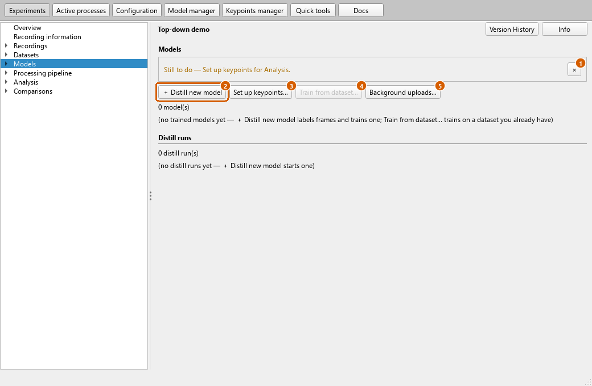
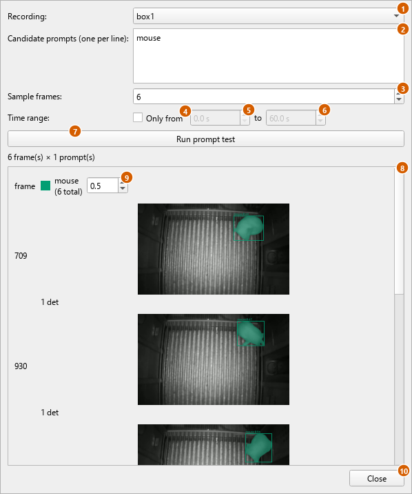
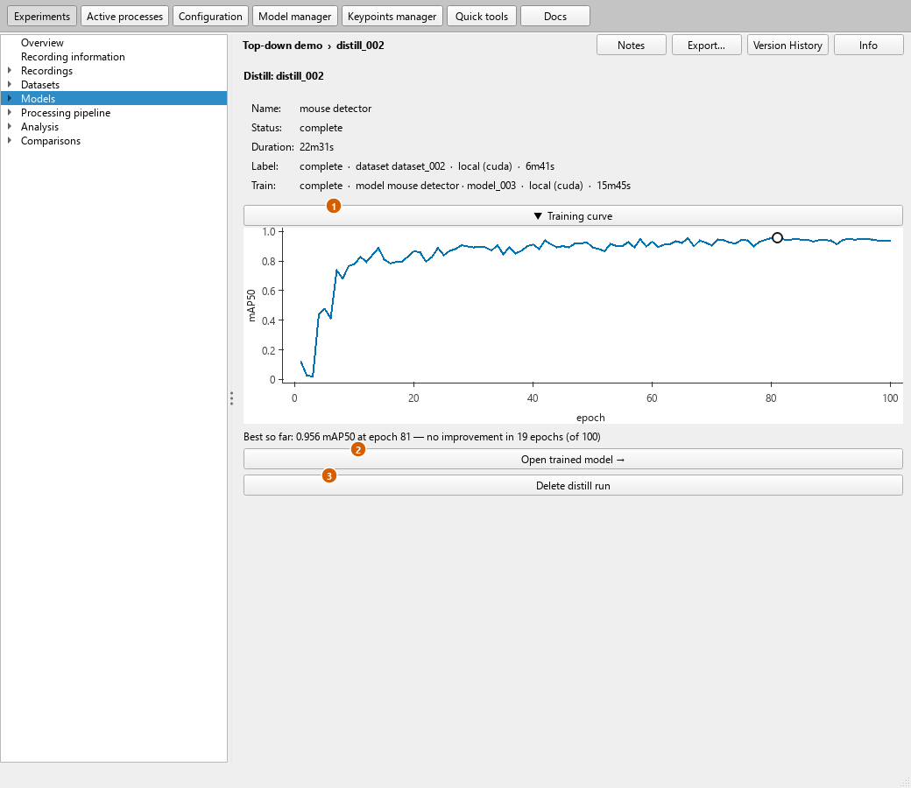
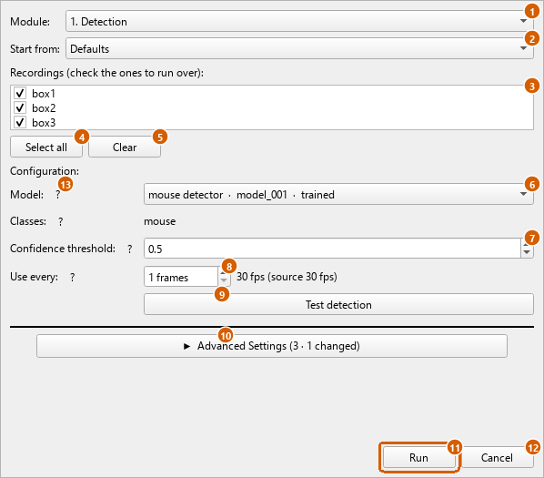
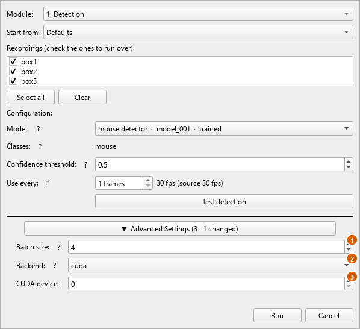
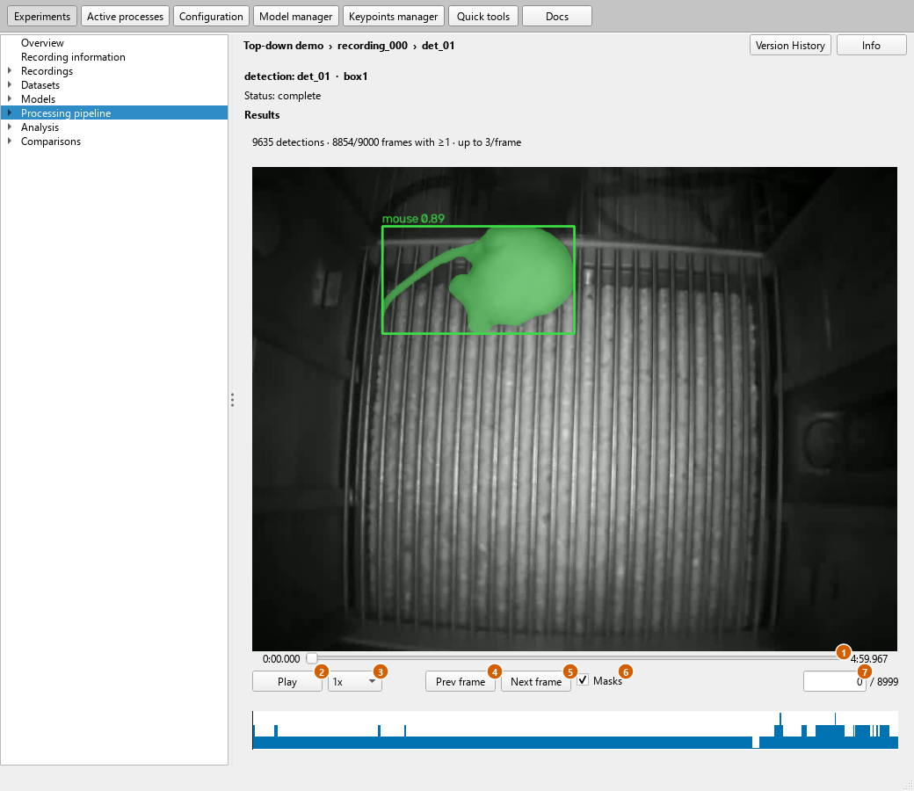
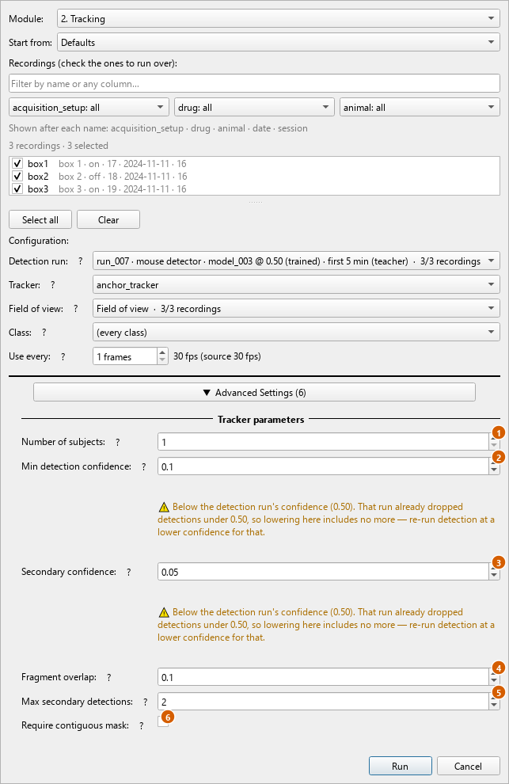

# 3. Detect and track

**Detection** finds the animal in every frame: a box around it and an outline of its body,
called a **mask**. **Tracking** then joins those frame by frame into one animal followed
through the whole video. Everything after this chapter works from the tracking.

The way to detect, in Detail, is to **distill a fast detector**. SAM 3, the model you set up
in [Configure Detail](../configure.md), finds animals from a few words, such as `mouse`, but
it is slow. So SAM 3 labels a few hundred frames, a small fast model learns from them, and
that fast model detects every frame.

## The steps at a glance

Each box is one step on this page. Click a box to go to that step. The first tag says where
the step is in Detail. A **GPU** tag means the step's work runs on your computer's GPU.

1. [Test the prompt](#1-test-the-prompt) Experiments › Models › Distill new model › Test prompts Check SAM 3 finds your animal from a few words.
2. [Distill a fast detector](#2-distill-a-fast-detector) Experiments › Models › Distill new model GPU About 25 minutes on an 8 GB GPU.
3. [Detect every frame](#3-detect-every-frame) Experiments › Processing pipeline › New run GPU About 5 minutes for the three demo videos.
4. [Track the animal](#4-track-the-animal) Experiments › Processing pipeline › New run Seconds. Runs on the processor, not the GPU.

## 1. Test the prompt

Click **Models** in the list on the left, then **＋ Distill new model**.

??? info "What everything on this screen does"
    1. **＋ Distill new model**: makes a fast model, by labelling frames with a teacher and
       training on them. This step and step 2. Chapter 4 uses it again, for keypoints.
    2. **Train from dataset…**: trains a model again from frames already labelled, for
       example with a smaller **Batch size** (see [Batch size and your
       GPU](#batch-size-and-your-gpu)). Greyed out until a distill has labelled frames.

The **Distill new model** dialog opens. Fill in the top part:

- **Model type:** **Detector (boxes, masks)**.
- **Name:** a name for the model, such as `mouse detector`.
- **Recordings:** leave none selected to use every recording that has video. A recording
  without video is greyed out, and the label says how many have video.
- **Frames to label:** set **500** for a GPU in your own computer. It starts at 1000, which
  takes twice as long to label for little gain on a few short videos.
- **Classes:** in the first box type the name to give what it finds, such as `mouse`. In the
  second, type the words SAM 3 should look for, the **text prompt**, such as `mouse`.

??? info "What everything on this screen does"
    1. **Model type**: **Detector** finds the animal and outlines it. **Keypoints** makes a
       keypoint model instead (chapter 4).
    2. **Name**: the new model's name.
    3. **Experiment**: which experiment's recordings to learn from.
    4. **Recordings**: the recordings to label frames from. Click to select some; none
       selected means every recording with video. A recording without video is greyed out.
    5. **Teacher**: the model that labels the frames. `sam3` is the one that finds an
       animal from words.
    6. **Teacher size**: a size of the teacher, for a teacher that comes in sizes. SAM 3
       has one, so this is greyed out.
    7. **Frames to label**: how many frames the teacher labels, spread across all the
       recordings. 500 suits a typical GPU in your own computer. The line under it says
       whether the dialog is ready to start.
    8. **Student**: the fast model that learns from the labels. `yolo11s-seg.pt` is a small
       one that outlines as well as boxes.
    9. **Advanced Settings**: opens the rest of the settings, shown in step 2. Their values
       work as they are, except **Batch size** (see step 2).
    10. **Class name**: the label stored on each animal found, such as `mouse`.
    11. **Text prompt**: the words SAM 3 searches for. Often the same as the class name.
    12. **−**: removes this class.
    13. **Add class**: adds another class, for a second kind of thing to find.
    14. **Test prompts**: tries the prompt on a few frames, without starting anything.
    15. **Distill**: starts the distill (step 2).
    16. **Cancel**: closes the dialog without starting anything.
    17. **?**: a short explanation of the setting beside it.

Click **Test prompts**. In the window that opens, click **Run prompt test**. SAM 3 looks for
the prompt on six frames of the first recording and shows what it found.

??? info "What everything on this screen does"
    1. **Recording**: which recording to take frames from.
    2. **Candidate prompts**: the words to try, one set per line. Several lines are tested
       side by side, to compare them.
    3. **Sample frames**: how many frames to try.
    4. **Run prompt test**: runs SAM 3 on the frames. It takes a minute the first time,
       while SAM 3 loads.
    5. **Detection confidence threshold**: hides what SAM 3 found below this confidence, to
       see which cut-off leaves only the animal. Beside it, how many are shown.
    6. **Threshold**: the same cut-off, to type in.
    7. **Scrollbar**: scrolls the results: each frame with what SAM 3 found outlined, and
       how many it found.
    8. **Close**: closes the window. Nothing is saved.

**Check:** on every frame, the animal is outlined, and nothing else is.

??? warning "If this doesn't work"
    - **The animal is missed on some frames:** try other words, each on its own line, such
      as `white mouse` or `rodent`, and run again to compare. Use the line that finds the
      animal on the most frames in **Text prompt**.
    - **Something else is outlined too,** such as a reflection or a lever: raise the
      **Detection confidence threshold** (5) until only the animal is left. Use that value as the distill's
      **Confidence threshold** under **Advanced Settings**.

??? tip "If your animal wears a tether, cable or patch cord"
    A detector can learn the cable as a faint piece of the animal, and tracking then adds it
    to the animal's outline. To prevent that, type `cable` in **Negative prompt** under
    **Advanced Settings**. SAM 3 then labels the cable as something else, the detector
    learns it apart from the animal, and it never reports it.

    Click **Test prompts** again: a second column shows what `cable` finds. **Check:** it
    outlines the cable and no part of the animal, such as its tail. With SAM 3, `cable`
    finds a tether where `tether` finds nothing.

## 2. Distill a fast detector

Click **▶ Advanced Settings** to see the rest of the settings. Set **Batch size** for your
GPU (see [Batch size and your GPU](#batch-size-and-your-gpu) below), and leave the others as
they are.

??? info "What everything on this screen does"
    1. **Frame sampling**: how the frames to label are picked. **stratified** spreads them
       evenly through each video; **uniform** picks them at random.
    2. **Confidence threshold**: how sure SAM 3 must be to keep what it found.
    3. **Validation split**: the share of labelled frames kept back to test the trained
       model on, rather than trained on.
    4. **Background share**: the largest share of frames where SAM 3 found nothing that are
       kept, so the model learns what an empty frame looks like.
    5. **Min contour area**: outlines smaller than this many pixels are dropped as noise.
    6. **Negative prompt**: something touching the animal that is not the animal, such as a
       tether's cable. Empty for none. See the tip in step 1.
    7. **Label backend**: where SAM 3 labels the frames: **cuda** is your computer's GPU.
    8. **Label CUDA device**: which GPU, on a computer with more than one. 0 is the first.
    9. **Train backend**: where the fast model trains.
    10. **Train CUDA device**: which GPU trains it.
    11. **Epochs**: how many times the training goes through all the labelled frames, at
        most.
    12. **Batch size**: how many frames it trains on at once. See below.
    13. **Image size**: the size, in pixels, frames are shrunk to for training.
    14. **Patience**: stop early if the model has not improved for this many epochs.
    15. **?**: a short explanation of the setting beside it.

### Batch size and your GPU

**Batch size** is how many frames the model trains on at once. A bigger batch trains faster
but needs more GPU memory. It starts at **32**, which needs a GPU of about 16 GB. On a
smaller GPU, lower it:

| GPU | Batch size |
|---|---|
| 8 GB | 8 |
| 12 GB | 16 |
| 16 GB | 32 (the default) |
| 24 GB or more | 48 |

These are for the default **Student** (`yolo11s-seg.pt`) and **Image size** (640). A larger
student or image size needs more memory for the same batch, so use a smaller batch with
them.

??? info "About this: where these numbers come from"
    On an 8 GB GPU, a batch of 8 used about 4 GB of GPU memory, and a batch of 32 needed
    about 9.3 GB: about a quarter of a gigabyte more for each frame in the batch. The table
    keeps a third or more of each GPU's memory spare, because your screen and other
    programs use some too.

    With a few hundred labelled frames, a batch bigger than about 32 makes little
    difference, because one pass through the frames is only a handful of batches.

??? warning "If training is very slow, or stops with out of memory"
    The batch is too big for your GPU. Stop the run with **Cancel distill**, then train
    again from the frames it already labelled: on the **Models** page, click **Train from
    dataset…** and set a smaller **Batch size**. The labelling does not need to run again.

    On Windows a batch that does not fit does not stop with an error. Training slows to a
    crawl instead, minutes per batch, because Windows moves the overflow into ordinary
    memory. Task Manager's **Performance** tab shows it: the GPU's **Dedicated GPU memory**
    is full and **Shared GPU memory** fills up.

Click **Distill**. The dialog closes and the distill's own page opens. It labels the frames
first, then trains. On the demo, with an 8 GB GPU, labelling took 9 minutes and
training 17.

??? info "What everything on this screen does"
    1. **Training curve**: folds the curve away or opens it again. The curve shows how well
       the model does on the held-back frames after each epoch; the circle marks the best.
    2. **Open trained model →**: opens the model's own page: its name, its classes, and how
       well it did.
    3. **Delete distill run**: deletes this run's record. The trained model stays.

    While the run is going, the page also shows a progress bar for each stage, **Cancel
    distill**, and, once training starts, **Stop and keep**: it finishes the current epoch
    and keeps the best model so far, for when the curve has flattened out. The **Notes**
    button at the top of the window opens a notes box for the run.

**Check:** the status says **complete**, and the line under the curve says the best mAP50 is
high, above about 0.9.

??? info "About this step: what mAP50 means"
    mAP50 says how often the model's box matches the teacher's on the frames kept back from
    training: 1.0 is always. Above about 0.9, the model finds the animal as well as SAM 3
    did. The curve rising quickly, then flattening, is normal. The model kept is the one
    from the best epoch, not the last.

??? warning "If this doesn't work"
    - **The best mAP50 stays low, under about 0.7:** the labels were poor. Go back to
      step 1, find a better prompt, and distill again.
    - **The run stops with an error during labelling:** SAM 3 is not set up. See
      [Configure Detail](../configure.md#3-install-the-sam-3-backend).
    - **The distill stopped partway** (an error, or your computer slept): open it from
      **Models** › **Distill runs** and click **Resume distill**. A finished labelling stage
      is kept, and a training that stopped carries on from its last checkpoint.

??? tip "Use this detector in other experiments"
    A trained model belongs to the experiment it was trained in. To use it in another
    experiment filmed on the same setup, without distilling again: click **Open trained
    model →**, then **Promote to global**, and give it a name. It is then in the **Model**
    list (step 3) of every experiment on your computer, and in the Model manager's
    **Global models** table.

## 3. Detect every frame

Click **Processing pipeline** in the list on the left, then **New run**.

??? info "What everything on this screen does"
    1. **New run**: starts a detection, tracking, keypoint or embedding run.
    2. **The runs**: every run in the experiment, with its module, how many recordings, its
       status and when it started. Double-click a row, or click **›**, to open the run.

In the **Launch a processing run** dialog:

1. **Module:** **1. Detection**.
2. Click **Select all** to tick every recording.
3. **Model:** your new detector, here **mouse detector · model_001 · trained**.
4. Leave the rest as it is, and click **Run**.

??? info "What everything on this screen does"
    1. **Module**: what to run. They are listed in order: detection, tracking, the keypoint
       steps (chapter 4), and embedding (chapter 5).
    2. **Start from**: fills the form from a previous run's settings, to run again with the
       same settings or a small change. **Defaults** is the usual settings.
    3. **Recordings**: the recordings to run on. A recording a module cannot run on yet is
       greyed out.
    4. **Select all**: ticks every recording.
    5. **Clear**: unticks them.
    6. **Model**: the detector. Your distilled model, or `sam3` to detect every frame with
       SAM 3 itself, which is much slower.
    7. **Confidence threshold**: how sure the model must be to keep a detection.
    8. **Use every**: detect every frame (1), or every second frame (2), and so on. Every
       frame is best: later steps can use fewer, but never more.
    9. **Test detection**: tries the model on a few frames first, like **Test prompts**.
    10. **Advanced Settings**: opens 3 more settings, shown below.
    11. **Run**: starts the run.
    12. **Cancel**: closes the dialog without starting anything.
    13. **?**: a short explanation of the setting beside it.

??? info "What the Advanced Settings do"
    1. **Batch size**: how many frames the model looks at at once. 4 fits an 8 GB GPU; it
       only changes the speed.
    2. **Backend**: where it runs: **cuda** on your computer's GPU.
    3. **CUDA device**: which GPU, on a computer with more than one.

The run's page opens. On the demo, the three 5-minute videos took about 5 minutes on an
8 GB GPU.

??? info "What everything on this screen does"
    The line over the video counts what the run found in the chosen recording: here 9,635
    detections, on 8,854 of box1's 9,000 frames, at most 3 on one frame. The strip under the
    controls shows how many were found along the whole recording.

    1. **Run details**: opens the settings the run was made with, and where it ran.
    2. **Results**: one row per recording, with its own id for this run and its status.
       Click a row to see its detections underneath; double-click it, or click **›**, to
       open that recording's detections on a page of their own.
    3. **The slider**: moves through the chosen recording's video.
    4. **Play**: plays the video with its detections drawn on.
    5. **Speed**: how fast **Play** plays.
    6. **Prev frame**: steps one frame back.
    7. **Next frame**: steps one frame forward.
    8. **Masks**: draws each detection's outline. Untick it to see the boxes alone, and to
       play faster.
    9. **Frame number**: the frame shown. Type a number and press ++enter++ to go there.
    10. **Run tracking →**: opens the launch dialog for tracking, with this run chosen
        (step 4).
    11. **Delete run**: deletes the run and its results, after asking. A run that a later
        run was made from cannot be deleted until that one is.

    While the run is going, **Cancel run** takes the place of **Delete run**: it stops the
    run, and recordings already finished keep their results. If a recording failed or was
    cancelled, **Retry 1 incomplete recording** (or **Retry 2 …**) appears above **Delete
    run** (see *If this doesn't work*, below).

**Check:** every recording's **Status** says **complete**. Click each row and read the line
over the video: the animal should be found on nearly every frame (on the demo, box1 had
detections on 8,854 of 9,000). A recording with far fewer than the others needs a look:
click **›** on it to see its detections on the video.

??? info "What everything on this screen does"
    The same player as on the run's page, on a page of its own.

    1. **The slider**: moves through the video.
    2. **Play**: plays the video with its detections drawn on.
    3. **Speed**: how fast **Play** plays.
    4. **Prev frame**: steps one frame back.
    5. **Next frame**: steps one frame forward.
    6. **Masks**: draws each detection's outline.
    7. **Frame number**: the frame shown. Type a number and press ++enter++ to go there.

## 4. Track the animal

On the detection run's page, click **Run tracking →**. The launch dialog opens with
**2. Tracking** and the detection run chosen.

1. Click **Select all**.
2. **Field of view:** choose the field of view you drew in [chapter
   2](set-up-recordings.md#2-draw-the-field-of-view), here **field of view 1**. Left on
   **(whole frame)**, tracking ignores it.
3. Leave the rest as it is, and click **Run**.

??? info "What everything on this screen does"
    1. **Module**: what to run, here **2. Tracking**.
    2. **Start from**: fills the form from a previous run's settings.
    3. **Recordings**: the recordings to track.
    4. **Select all**: ticks every recording.
    5. **Clear**: unticks them.
    6. **Detection run**: which detection to track. It shows how many of the ticked
       recordings that run covers.
    7. **Tracker**: how detections are joined into an animal. **anchor_tracker** follows
       one animal per video, the right choice for this guide.
    8. **Field of view**: keep only what is inside this field of view, with how many of the
       ticked recordings have it. **(whole frame)** keeps everything.
    9. **Use every**: track every frame the detection run detected, or fewer.
    10. **Advanced Settings**: opens the tracker's 6 settings, shown below.
    11. **Run**: starts the run.
    12. **Cancel**: closes the dialog without starting anything.
    13. **?**: a short explanation of the setting beside it.

??? info "What the Advanced Settings do"
    1. **Number of subjects**: how many animals to follow. This tracker follows one.
    2. **Min detection confidence**: the lowest confidence a detection needs to be the
       animal.
    3. **Secondary confidence**: the lowest confidence for a smaller piece of the same
       animal, such as a tail found on its own, to be joined to it.
    4. **Fragment overlap**: how much a piece must overlap the animal to be joined to it.
    5. **Max secondary detections**: the most pieces joined to the animal on one frame.
    6. **Require contiguous mask**: only accept an animal whose outline is one piece.
       Usually leave this off.

    These confidences are below the detection run's own (0.5), so lowering them adds
    nothing: the detection run already dropped everything under 0.5. That is expected with
    the defaults, and you can leave them.

Tracking takes seconds, on the processor rather than the GPU. Its page looks like the
detection run's:

??? info "What everything on this screen does"
    1. **Run details**: opens the settings the run was made with.
    2. **Results**: one row per recording. Click a row to see its track underneath; click
       **›** to open it on a page of its own.
    3. **The slider**: moves through the chosen recording's video.
    4. **Play**: plays the video with the track drawn on.
    5. **Speed**: how fast **Play** plays.
    6. **Prev frame**: steps one frame back.
    7. **Next frame**: steps one frame forward.
    8. **Masks**: draws the animal's outline.
    9. **Frame number**: the frame shown.
    10. **Run keypoint_detect →**: starts keypoint detection from this tracking (chapter 4).
    11. **Run embedding →**: starts embedding from this tracking (chapter 5).
    12. **Delete run**: deletes the run and its results, after asking.

**Check:** every recording's status says **complete**. Click **›** on a recording: the animal
is outlined on every frame where it is inside the field of view.

??? info "What everything on this screen does"
    The line above the video says how much of the recording the animal was followed: here
    8,854 of 9,000 frames, with 19 gaps, the longest 109 frames (3.6 seconds). The lower
    strip under the controls marks the frames with no animal: taller means more lost in that
    part of the recording. Click it to jump there.

    1. **The slider**: moves through the video.
    2. **Play**: plays the video with the track drawn on.
    3. **Speed**: how fast **Play** plays.
    4. **Prev frame**: steps one frame back.
    5. **Next frame**: steps one frame forward.
    6. **Masks**: draws the animal's outline.
    7. **Frame number**: the frame shown. Type a number and press ++enter++ to go there.

??? warning "If this doesn't work"
    - **A recording failed:** open the run, and the row says why. **Run details** has the
      full error. Fix the cause, then click **Retry N incomplete recordings** on the run's
      page. It runs only the recordings that did not finish, into the same run, and leaves
      the finished ones alone. Each one starts again from its beginning. This works the
      same for detection and tracking.
    - **You closed Detail while a run was going:** the run carried on. Open the experiment
      again and the run's page shows where it stands.
    - **The animal is missing from stretches of the video:** it was outside the field of
      view, or the detector missed it there. Check the field of view covers everywhere the
      animal goes, including when it rears against a wall.

### Optional: save the tracks

To take the tracking out of Detail, for your own analysis, open the tracking run's page and
click **Export…**, at the top right. It writes this run's results to a folder you choose.

1. **Save to:** click **Choose** and pick a folder. Detail makes a new folder inside it for
   this export, named under **Creates**, so one export never overwrites another.
2. Tick **Tracks**, the animal's position on every frame. (The animal's outlines, **Masks**,
   are exported the same way from the detection run's page.)
3. **Recordings:** the recording selected on the run's page is ticked. Click **All** for
   every recording.
4. Click **Export**.

??? info "What everything on this screen does"
    1. **Save to**: the folder the export goes in.
    2. **Choose**: picks that folder.
    3. **The greyed-out rows**: what other kinds of run write, such as keypoints. Each says
       which run it comes from.
    4. **Tracks**: one spreadsheet per recording, a row per frame, with the box around the
       animal and the centre of its outline. It is the same `tracks.csv` as chapter 6 writes,
       without the region and point files.
    5. **Performance report**: which computer the run ran on, and how long each part took.
    6. **All**: ticks every recording.
    7. **None**: unticks them.
    8. **Recordings**: the recordings to export.
    9. **Export**: starts the export.
    10. **Cancel**: closes the dialog without exporting anything.

    **Estimate** says how big the export will be, how long it will take, and how much
    space is free in the folder you chose.

The export runs in the background, so you can keep working. A strip under the top bar says it
started; click **Show Active processes →** on it to follow the export. When it is done, its page
in **Active processes** has **Open folder**.

## Next

[4. Keypoints](keypoints.md).
