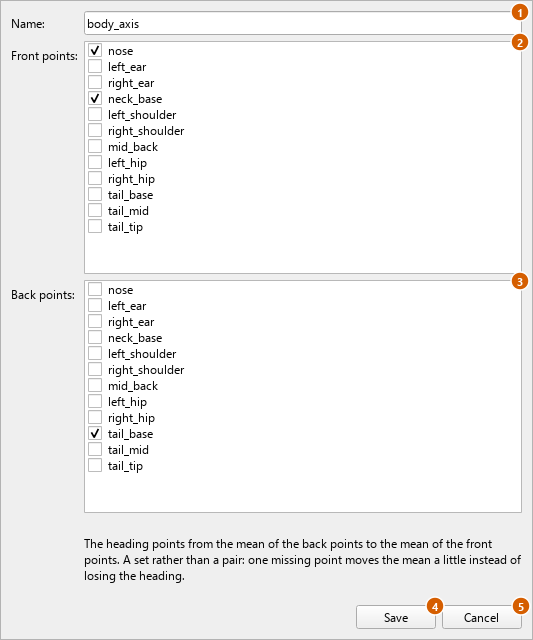

# 5. Embedding

An **embedding** turns each frame's animal into a list of numbers, a **vector**, that
describes its posture. Two frames where the animal is posed alike get vectors that are close
together; two different poses get vectors far apart. The behavior scan (chapter 7) and
clustering (chapter 8) both work by comparing these vectors.

DETAIL makes the vector with **DINOv3**, an image model you downloaded in [Configure
DETAIL](../configure.md). It does not look at the whole video frame. For each frame, it cuts
out the tracked animal by its outline, centres it, and turns it so its head points right,
using the keypoints from chapter 4. Every animal is then seen the same way round, so a
mouse grooming facing the door and one grooming facing the wall give the same vector.

## The steps at a glance

Each box is one step on this page. Click a box to go to that step. The first tag says where
the step is in DETAIL. A **GPU** tag means the step's work runs on your computer's GPU.

1. [Choose what to embed](#1-choose-what-to-embed) Experiments › Processing pipeline › New run The tracking, the model, and how to turn the animal.
2. [Define the heading](#2-define-the-heading) Experiments › Processing pipeline › New run › Define Once per experiment: which points are the front and the back.
3. [Run and check the embedding](#3-run-and-check-the-embedding) Experiments › Processing pipeline › the run's page GPU About 2 minutes per 5-minute video on an 8 GB GPU.

## 1. Choose what to embed

Click **Processing pipeline** in the list on the left, then **New run**. (Or, on the
keypoint track run's page from chapter 4, click **Run embedding →**: the dialog opens with
that run already chosen.) In the **Launch a processing run** dialog:

1. **Module:** **3. Embedding**.
2. Click **Select all**.
3. **Tracking run:** the tracking from chapter 3. It is already chosen when there is one.
4. **Model:** **dinov3_vit**, and **Size / variant:** **vit_large**. These are already
   chosen.
5. **Egocentric alignment:** **Overhead camera: turn so the head points right**.
6. **Keypoint track run:** the keypoint track run from chapter 4.
7. **Heading:** the first time, there is none to choose. Click **Define…** (step 2).

??? info "What everything on this screen does"
    1. **Module**: what to run, here **3. Embedding**.
    2. **Start from**: fills the form from a previous run's settings.
    3. **Recordings**: the recordings to embed.
    4. **Select all**: ticks every recording.
    5. **Clear**: unticks them.
    6. **Tracking run**: which tracking to embed, and on how many of the ticked recordings it
       is. The line under it lists the tracks it has.
    7. **Track ids**: which tracked animals to embed, by number. One animal is track **0**.
    8. **All tracks**: embed every track instead.
    9. **Model**: the image model that makes the vectors. **dinov3_vit** is the one to use.
    10. **Size / variant**: the model's size. **vit_large** is the most accurate, and the
        one downloaded in Configure DETAIL.
    11. **Input image**: what the model is shown for each frame. See **Input image: the
        choices** below.
    12. **Egocentric alignment**: turn every animal the same way before the model sees it.
        **Overhead camera** turns it so its head points right. **Side camera** flips it so
        it faces right. **None** leaves it as filmed.
    13. **Keypoint track run**: the keypoints the turning reads. It must be on the same
        tracking as (6).
    14. **Heading**: which keypoints mark the front and the back of the animal (step 2).
    15. **Define…**: makes a new heading (step 2).
    16. **Use every**: embed every tracked frame (1), or fewer. Every frame is best for the
        behavior scan.
    17. **Preview input images**: shows the images the model will see, frame by frame, to
        check the cut-out and the turning before running.
    18. **Advanced Settings**: opens 9 more settings, shown below.
    19. **Run**: starts the run.
    20. **Cancel**: closes the dialog without starting anything.
    21. **?**: a short explanation of the setting beside it.

??? info "Input image: the choices"
    **Input image** decides what DETAIL shows DINOv3 for each frame. The cut-out choices are
    turned so the head points right; **Full frame** cannot be turned, because it is not cut
    to the animal.

    - **Silhouette (cropped, true scale).** The outline, filled white on black: shape and
      nothing else. It suits behaviors told apart by body shape, and recordings whose
      lighting or animals' coats differ, since brightness does not enter. It is the worst at
      movements inside the outline, such as paws at the face while grooming, and a mistake
      in the outline is the whole picture.
    - **Color (cropped, true scale).** The animal cut out in its own colours, on black. It
      keeps the shading and texture inside the outline, so it sees more than a silhouette. A
      dark animal blends into the black background at its edges, and differences in
      lighting between boxes come through.
    - **Color on max-contrast bg (cropped, true scale)** (the default, used in this guide).
      The same, on the solid colour that differs most from the animal's own: blue for a dark
      or grey animal. It keeps the inside detail and a clear edge for any coat colour, which
      makes it the best general choice.
    - **Full frame (no mask).** The whole video frame, neither cut out nor turned. It suits
      behavior that depends on what is around the animal, such as an object, a lever or a
      corner, and it still works where the outlines are poor. It is the worst at comparing
      the animal itself: the animal is a small part of the picture, and frames group by box,
      camera and where the animal stands as readily as by what it is doing.

Click **▶ Advanced Settings** to see the rest. Leave them as they are.

??? info "What the Advanced Settings do"
    1. **Read-out**: how the model's output becomes one vector. Leave it on the model's
       default.
    2. **Input size**: the size, in pixels, of the square image the model sees. The model's
       own default is 224.
    3. **Canvas scope**: how big the cut-out animal is drawn. **Per recording** sizes it to
       each recording's own largest outline, so a small mouse and a large one fill the
       image alike. **Shared across selection** keeps their true sizes.
    4. **Fill heading gaps up to**: a frame with no heading of its own takes one from the
       frames either side, when they are no more than this many seconds apart. Frames in a
       longer gap are not embedded.
    5. **Mirror hold**: for **Side camera** only: how long, in seconds, the animal must face
       the new way before the image flips.
    6. **Facing-camera ratio**: when the head-to-tail line is shorter than this share of its
       usual length, the heading counts as unknown. From above, that happens when the
       animal rears.
    7. **Batch size**: how many images the model looks at at once. 32 fits an 8 GB GPU; it
       only changes the speed.
    8. **Backend**: where it runs: **cuda** on your computer's GPU.
    9. **CUDA device**: which GPU, on a computer with more than one.

## 2. Define the heading

A **heading** says which way the animal faces: the direction from its back to its front.
You choose which keypoints are the front and which the back. You do this once; every later
embedding run can choose the same heading.

Next to **Heading**, click **Define…**. In the **Define a heading** dialog:

1. **Name:** `body_axis`. Use letters, digits, `-` and `_` only.
2. **Front points:** tick **nose** and **neck_base**.
3. **Back points:** tick **tail_base**.
4. Click **Save**.

??? info "What everything on this screen does"
    1. **Name**: the heading's name, as the **Heading** list shows it.
    2. **Front points**: the points whose middle is the front of the animal.
    3. **Back points**: the points whose middle is the back.
    4. **Save**: saves the heading and chooses it in the **Heading** list.
    5. **Cancel**: closes the dialog without saving.

??? info "About this step: why these points"
    The heading runs from the middle of the back points to the middle of the front points.
    Using two front points rather than one means that when the nose is hidden for a frame,
    the neck still gives a heading. The tail tip and tail middle are left out because the
    tail swings on its own; the base of the tail stays in line with the body.

The dialog closes, and **Heading** shows **body_axis (nose, neck_base ← tail_base)**.

## 3. Run and check the embedding

Click **Run**. The run's page opens. On the demo, the three 5-minute videos took about 5
minutes on an 8 GB GPU.

When it is complete, the page shows a **PCA** cloud: every embedded frame as a dot, placed
so that frames with close vectors are close together. Click a dot to see that frame, and the
image the model was shown, beside the cloud.

??? info "What everything on this screen does"
    The lines under the table are for the recording chosen in the table. The strip marks
    where frames were lost because the heading was unknown; the line under it counts them.

    1. **Run details**: opens the settings the run was made with.
    2. **Results**: one row per recording. Click a row to show its cloud below. Click **›**
       to open the same view on the recording's own page.
    3. **Delete run**: deletes the run and its results, after asking.

**Check:**

- Every recording's **Status** says **complete**.
- Click a few dots in the cloud. In **Model input**, the animal is cut out cleanly and its
  head points right.
- The heading line says most frames were covered, about 90% or more.

??? info "About this step: the orange warning"
    DETAIL warns when the heading was known on fewer than 95% of the tracked frames, or was
    lost for more than 2 seconds at a time. On the demo, box1 was covered on 96% of its
    frames, and its longest gap was 3.3 seconds, so the warning shows. Those frames are left
    out rather than embedded the wrong way round.

    A short gap like that is fine to carry on with. Much less coverage means the keypoints
    are often unsure of the nose or tail: mark a few more example frames, especially of the
    poses where the heading was lost, and distill the keypoint model again (chapter 4).

??? warning "If this doesn't work"
    - **The run stops saying the model is not installed:** download **dinov3_vit
      vit_large** in the **Model manager** (see [Configure DETAIL](../configure.md)).
    - **The head points left or up in Model input on many frames:** the heading's front and
      back points are swapped, or the keypoints put the nose at the tail. Check the
      keypoints on the video (chapter 4, step 5).
    - **Very few frames are embedded:** the **Keypoint track run** does not match the
      **Tracking run**. Choose the keypoint track run made from this tracking.

## Next

[6. Location export](location-export.md).
