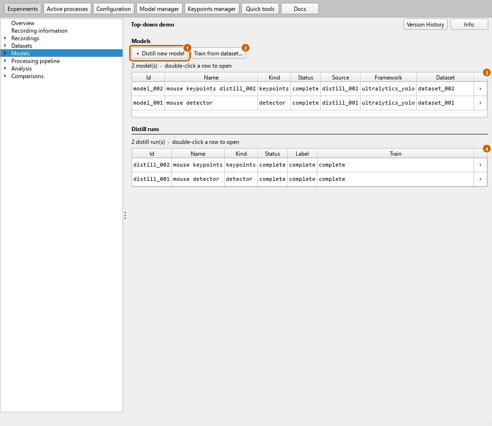
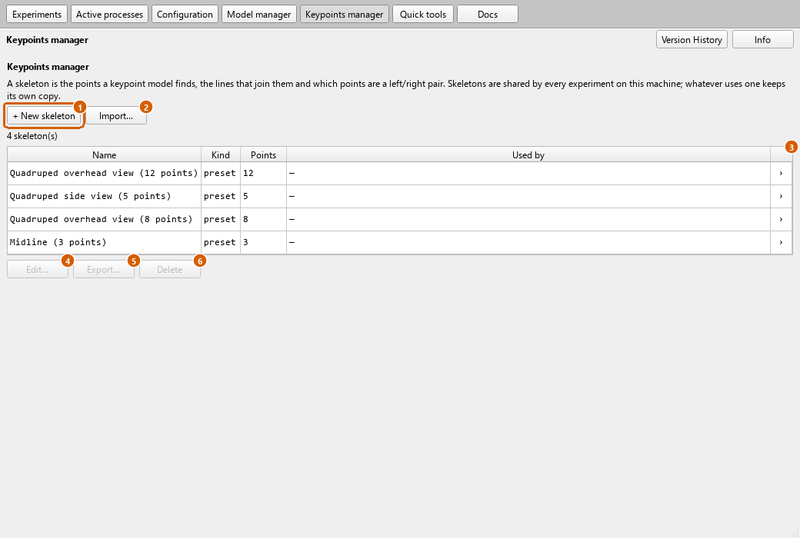
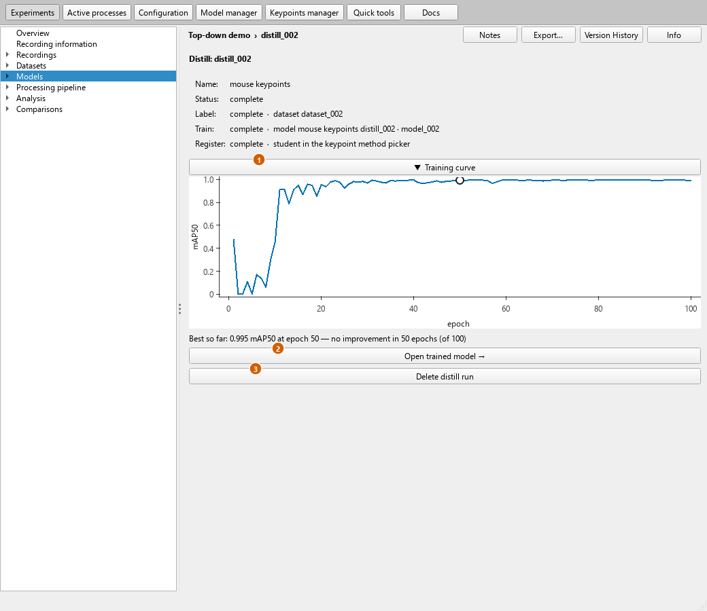
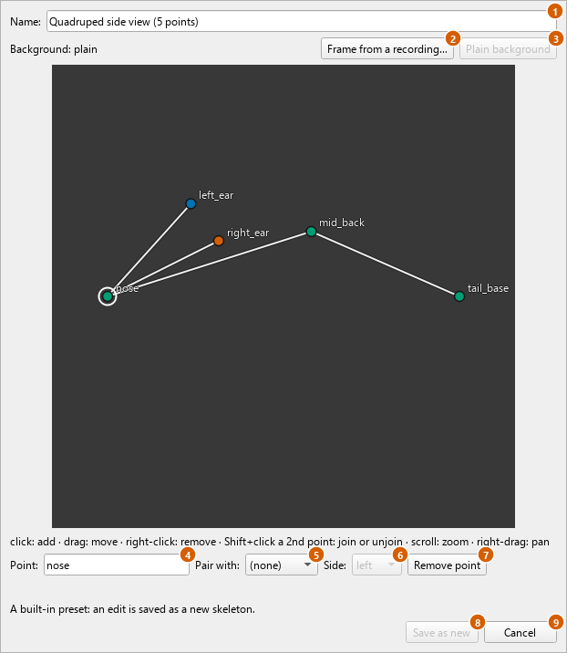

# 4. Keypoints

**Keypoints** are named points on the body: the nose, the ears, the base of the tail and so
on. Tracking (chapter 3) says where the animal is; keypoints say how it is posed, which way it
faces, and what its head and tail are doing. The embedding (chapter 5) uses them to turn
every animal the same way before comparing postures.

Detail makes a keypoint model the same way it made the fast detector in chapter 3: by
distilling. You mark the points by hand on about ten frames, an **example set**. A slow,
careful **teacher** uses those to place the points on a few hundred more frames. A small fast
**student** model then trains on the teacher's frames, and the student places keypoints on
every frame of every video.

Filmed from the side, or at an angle? Follow the steps here, then read [Side-view and
isometric recordings](#side-view-and-isometric-recordings) at the end of the chapter.

## How this differs from SLEAP or DeepLabCut

In SLEAP or DeepLabCut, you mark the points by hand on hundreds of frames, and a network
trains on your marks. A new camera or setup usually needs more frames marked.

In Detail, from top-down or side-view recordings, you mark about ten (although more examples
do generally improve outcomes slightly). Isometric recordings, or recordings with many
occlusions, may need upwards of 50 examples. The teacher, **dinov3_match**, a large image
model that has already learned what images look like, needs no training: on a new frame it
puts each point where the picture looks most like the spot you marked. It does that on a few
hundred frames, and the student trains on those, so the hundreds of frames are marked for
you. If all you want is the nose, back and tail base from top-down recordings without
occlusions, 5 frames is typically enough.

| | SLEAP or DeepLabCut | Detail |
|---|---|---|
| Frames you mark | Hundreds | About ten; 5 for nose, back and tail base from above; 50 or more for isometric or heavily occluded views |
| What trains on them | A network, on your marks | Nothing: the teacher matches them, and the student trains on the teacher's frames |
| Your time | Hours of marking | About 20 minutes |
| Points | As precise as your marking and training | Close, not exact |

Detail uses keypoints mainly to find which way the animal faces, for its egocentric
alignment (chapter 5), where close is enough. If you need exact positions, for joint angles
say, check them against frames you marked yourself, as step 3 does. True pose estimation will
generally give more accurate keypoints, so choose your approach based on what your experiment
needs. Detail's points can be taken into SLEAP, DeepLabCut and the tools that read their
files: see [Take the keypoints to DeepLabCut, SLEAP or
NWB](#optional-take-the-keypoints-to-deeplabcut-sleap-or-nwb), at the end of step 5.

## The steps at a glance

Each box is one step on this page. Click a box to go to that step. The first tag says where
the step is in Detail. A **GPU** tag means the step's work runs on your computer's GPU.

<div class="guide-flow" markdown>

1. [Start a keypoint distill](#1-start-a-keypoint-distill) <span class="where where-app">Experiments › Models › Distill new model › Keypoints</span> <span class="note">The teacher, and which tracking to read.</span>
2. [Mark an example set](#2-mark-an-example-set) <span class="where where-app">Distill new model › New example set</span> <span class="note">About 20 minutes of clicking. To use your own points, first [make a skeleton](#make-your-own-skeleton) in the Keypoints manager.</span>
3. [Check the cut-off and distill](#3-check-the-cut-off-and-distill) <span class="where where-app">Distill new model › Test cut-off</span> <span class="where where-gpu">GPU</span> <span class="note">About 10 minutes on an 8 GB GPU.</span>
4. [Place keypoints on every frame](#4-place-keypoints-on-every-frame) <span class="where where-app">Experiments › Processing pipeline › New run</span> <span class="where where-gpu">GPU</span> <span class="note">About a minute per 5-minute video.</span>
5. [Track the keypoints](#5-track-the-keypoints) <span class="where where-app">Experiments › Processing pipeline › New run</span> <span class="note">Seconds. Runs on the processor, not the GPU.</span>

</div>

!!! note "The example marks in this chapter are ours"
    The demo's example set was marked for this guide by eye, quickly. The points are close
    but not exact, which is why the numbers in step 3 are as large as they are. Your own,
    marked with care, will do better.

## 1. Start a keypoint distill

Click **Models** in the list on the left. The detector from chapter 3 is listed, with its
distill run under it. Click **＋ Distill new model** again.



??? info "What everything on this screen does"
    1. **＋ Distill new model**: makes a fast model. This time, a keypoint model.
    2. **Train from dataset…**: trains a model again from frames already labelled, for
       example with a smaller **Batch size**.
    3. **The models**: every model trained in this experiment. Double-click one to open it.
    4. **Distill runs**: every distill, with its kind and status. Double-click one to open
       its page.

In the **Distill new model** dialog:

1. **Model type:** **Keypoints**. The dialog changes to the keypoint settings.
2. **Name:** a name for the model, such as `mouse keypoints`.
3. **Teacher:** **Patch method + example set**, with **Method** **dinov3_match** and
   **Size** **vit_large**. These are already chosen.
4. **Tracking:** the tracking from chapter 3. It is already chosen when there is one, and
   says on how many recordings it is.
5. **Frames to label:** **300**. It starts at 1000; 300 is plenty for a few short videos,
   and labels three times faster.
6. **Examples:** the example set, which you make next (step 2).


??? info "What everything on this screen does"
    1. **Model type**: **Keypoints** makes a keypoint model.
    2. **Name**: the new model's name. The student is named after it.
    3. **Experiment**: which experiment's recordings to learn from.
    4. **Teacher**: what labels the frames. **Patch method + example set** places the points
       from your example set. **Finished keypoint detect run** uses a keypoint run you already
       have instead.
    5. **Method**: the patch method. **dinov3_match** is the one to use.
    6. **Size**: the method's size. **vit_large** is the most accurate, and the one
       downloaded in Configure Detail.
    7. **Skeleton**: the points to mark and the lines joining them. The demo uses
       **mouse overhead**, 12 points made for a four-legged animal seen from above. Your own
       skeletons are listed here ([Make your own skeleton](#make-your-own-skeleton)), after
       the two presets, **Midline (3 points)** and **Midline (2 points)**.
    8. **Example set**: which example set the teacher learns from. The count beside it says
       how many of its frames are fully marked.
    9. **New example set…**: makes an empty example set and opens it for marking (step 2).
    10. **Mark frames…**: opens the chosen example set for marking, to add or fix frames.
    11. **Delete set…**: deletes the chosen example set, after asking.
    12. **Tracking**: which tracking the teacher's frames are taken from, and on how many
        recordings it is.
    13. **Frames to label**: how many frames the teacher labels, spread across the
        recordings and over time.
    14. **Score cut-off**: how sure the teacher must be of a point to teach it to the
        student. dinov3_match has no default, so you set one (step 3).
    15. **Test cut-off…**: shows the teacher's points on a few frames at a cut-off (step 3).
    16. **Student**: the fast model that learns from the teacher's frames.
        `yolo11s-pose.pt` is a small one.
    17. **Advanced Settings**: opens 11 more settings, shown in step 3.
    18. **Distill**: starts the distill. Greyed out until the form is complete; the line at
        the bottom left says what is missing.
    19. **Cancel**: closes the dialog without starting anything.
    20. **?**: a short explanation of the setting beside it.

Leave the dialog open: steps 2 and 3 work from it.

## 2. Mark an example set

### Make your own skeleton

A **skeleton** is the list of points to mark, the lines joining them, and which points are a
left/right pair. Detail comes with two presets: **Midline (3 points)** (head, midpoint and
tail) and **Midline (2 points)** (head and tail). For anything more, such as ears or a tail
tip, make a skeleton before you make the example set. The demo's skeleton, **mouse
overhead**, has 12 points: the nose, both ears, the base of the neck, both shoulders, the
middle of the back, both hips, and the base, middle and tip of the tail. This example makes
a smaller one the same way, with 6 points: nose, left ear, right ear, neck, back and tail
base.

Click **Keypoints manager** in the bar along the top of the window, then **+ New
skeleton**.



??? info "What everything on this screen does"
    Skeletons are shared by every experiment on your computer. An example set, a keypoint
    run or a model that uses one keeps its own copy, so changing a skeleton later never
    changes work already done.

    1. **+ New skeleton**: opens an empty skeleton to draw.
    2. **Import…**: adds a skeleton from a `.yaml` file, for example one a colleague
       exported.
    3. **The skeletons**: every skeleton, with how many points it has and what uses it.
       **preset** ones come with Detail and cannot be changed; editing one saves a copy.
       Double-click a row to open it.
    4. **Edit…**: opens the chosen skeleton. A skeleton something uses keeps its points:
       an edit is saved as a new skeleton.
    5. **Export…**: saves the chosen skeleton to a file, to share it.
    6. **Delete**: deletes the chosen skeleton, after asking. Greyed out for a preset or a
       skeleton something uses.

In the **New skeleton** window:

1. **Name:** `mouse 6-point`.
2. Click the canvas six times, once for each point, in roughly where it sits on an animal
   seen from above: the nose at the top, the ears either side behind it, then the neck, the
   back and the tail base down the middle.
3. After each click the new point is chosen. Type its name in **Point**, and press
   ++enter++: `nose`, `left_ear`, `right_ear`, `neck`, `back`, `tail_base`.
4. Join the points with lines: click a point, then hold ++shift++ and click the next. Join
   each ear to the nose, then nose to neck, neck to back, and back to tail base.
5. Click `left_ear`, set **Pair with** to `right_ear`, and **Side** to `left`.
6. Click **Save**.


??? info "What everything on this screen does"
    The canvas shows the skeleton as you draw it. Click to add a point, drag one to move
    it, right-click one to remove it, and ++shift++-click a second point to join or unjoin
    the two. Scroll to zoom. Points are coloured by side: blue for left, orange for right,
    green for the middle of the body.

    1. **Name**: the skeleton's name, as the **Skeleton** lists show it.
    2. **Point**: the chosen point's name. Each name is used once. Lowercase with `_`
       instead of spaces, such as `tail_base`, keeps names easy to read in other screens.
    3. **Pair with**: the point's partner on the other side of the body, such as the other
       ear. **(none)** for a point on the middle of the body.
    4. **Side**: which side of the body the point is on, for a paired point.
    5. **Remove point**: removes the chosen point.
    6. **Save**: saves the skeleton. Greyed out until it is valid, for example while two
       points share a name; the line above says what is wrong.
    7. **Cancel**: closes the window. With unsaved changes, it asks first.

??? info "About this step: which points to choose"
    - **Pairs matter.** Marking the ears as a pair is how Detail keeps the left ear and
      the right ear apart, rather than letting them swap.
    - **Choose points you can see.** A point hidden on most frames, such as a paw from
      above, gives the teacher little to match. For the nose, back and tail base from above,
      5 example frames is typically enough (see the top of this chapter).
    - **Plan for the heading.** Chapter 5 turns every animal by a heading made from front
      and back points. With this skeleton, use `nose` and `neck` as the front and
      `tail_base` as the back.

Your skeleton is now in the **Skeleton** list of the Distill dialog and of **New example
set…**. Choose it there.

### Make the example set

In the **Distill new model** dialog, click **New example set…**. Give the set a name, such
as `mouse overhead`, choose your skeleton in **Skeleton**, and click
**Create and mark frames**.


??? info "What everything on this screen does"
    1. **Name**: the example set's name.
    2. **Skeleton**: which points to mark. It can be changed until the first point is
       placed, and is fixed after that.
    3. **Create and mark frames**: makes the set and opens the marking window.
    4. **Cancel**: closes the dialog without making a set.

The marking window opens on the first recording. To fill the set:

1. Next to **Add frames**, set **12** and leave **Varied frames**, and click **Add frames**.
   It picks twelve frames, across all the recordings, where the animal is posed
   differently, and lists them under **Example frames**.
2. Click the first frame in **Example frames**. The video goes to it.
3. **Click the animal's nose.** The point is placed, and the next point in **Keypoints** is
   highlighted.
4. Click each point in turn, down the list. When a point cannot be seen on this frame, such
   as an ear hidden by the head, press ++n++ (**Not visible**) instead.
5. When all 12 are done, press ++d++ to go to the next example frame, and do the same.

Every click saves by itself, in the background. Closing the window while clicks are still
being saved loses nothing: they finish behind it. Quitting Detail first asks you to wait for
them. Points are coloured by side: blue for left, orange for right,
green for the middle of the body. **Left and right are the animal's own**, not the
picture's: from above, with the nose pointing up the screen, the animal's left ear is on the
left of the picture.


??? info "What everything on this screen does"
    1. **Video**: which recording to show.
    2. **Track**: which tracked animal the frame's points belong to. One animal: **track 0**.
    3. **Skeleton**: the set's skeleton. Greyed out once a point is placed.
    4. **Keypoints**: the points to place, and whether each is placed on this frame. Click
       one, or press its number, to place or move it next.
    5. **Frames to add**: how many frames **Add frames** picks, across all the recordings.
    6. **How to pick**: **Varied frames** picks postures that differ, the typical ones first.
       **Spread over time** picks frames evenly through the recordings.
    7. **Add frames**: adds that many frames to the set.
    8. **Example frames**: the set's frames, and how much of each is marked. Click one to
       go to it, or press ++d++ and ++a++ for the next and previous.
    9. **The slider**: moves through the video. The orange marks are the set's frames.
    10. **Play**: plays the video.
    11. **Speed**: how fast **Play** plays.
    12. **Prev frame**: steps one frame back.
    13. **Next frame**: steps one frame forward.
    14. **Frame number**: the frame shown. Type a number and press ++enter++ to go there.
    15. **Remove frame**: takes the highlighted frame out of the set.
    16. **Point**: clicking the video places a point. The only mark used today.
    17. **Region**: a mark for later versions. Greyed out.
    18. **Box**: a mark for later versions. Greyed out.
    19. **Not visible (N)**: the highlighted point cannot be seen on this frame.
    20. **Clear (Backspace)**: removes the highlighted point from this frame.
    21. **Use these frames**: closes the window and chooses this set in the Distill dialog.
    22. **Close**: closes the window. The marks are already saved.

**Check:** every frame in **Example frames** says **all marked**, and the line under the
video says **12 of 12 keypoints marked**.

??? info "About this step: what makes a good example set"
    - **Ten to fifteen frames** is enough. More frames of the same pose add little; frames
      of different poses add a lot. That is why **Varied frames** picks them.
    - **Every box.** Lighting and camera angle differ between boxes, so take frames from
      each. **Varied frames** picks from every recording; check the list names each box.
    - **Mark what you see.** If a point is hidden, mark it **Not visible** rather than
      guessing where it would be. The teacher learns from both.
    - **To move a point,** drag it, or click it in **Keypoints** and click again on the
      video.

Click **Use these frames**. The marking window closes and you are back in the Distill dialog,
with the set chosen under **Example set** and **11 / 11 frames** (or however many you
marked) beside it.

## 3. Check the cut-off and distill

The teacher gives each point it places a **score**: how much the spot looks like your
examples. Points under the **Score cut-off** are taught to the student as not visible.
dinov3_match has no default cut-off, so **Distill** stays greyed out until you set one.

Click **Test cut-off…**, beside **Score cut-off**. The **Test cut-off** window opens and the
teacher places points on 12 frames. That can take a few minutes, most of it loading the
teacher. Move the slider to **0.75**, as for the demo.


??? info "What everything on this screen does"
    The teacher places points on 12 frames, the way the distill will. A filled point is
    taught as visible; a hollow one is under the cut-off. The text under the slider checks
    the teacher against your own marks: each example frame is placed from the others, and
    the distance to your click is measured, for all the points and for each one.

    1. **Scrollbar**: scrolls the frames up and down.
    2. **The slider**: moves the cut-off. The frames update as you slide.
    3. **Score cut-off**: the cut-off, to type in. Beside it, how many points are taught.
    4. **Use this cut-off**: closes the window and puts this cut-off in the Distill dialog.
    5. **Another sample**: draws 12 other frames.
    6. **Close**: closes the window without changing the cut-off.

**Check:** on most frames, most points are filled and sit on the right part of the body.
Hollow points should be mostly the hard ones: the tail tip, or an ear turned away.

??? info "About this step: reading the numbers"
    **Median 38.8 px (21.6% of body size)** says how far, typically, the teacher's point
    was from the click you made. On the demo it is large because the example marks were
    quick ones (see the note at the top of the chapter). The student only needs the
    teacher to be close, often: it learns from 300 frames, and the errors average out.

    If the points at or above the cut-off are much closer than those below it, the cut-off
    is doing its job: raising it keeps fewer, better points.

??? warning "If this doesn't work"
    - **Left and right are swapped on many frames:** check the example set. A swap in your
      marks teaches the teacher a swap. Open it with **Mark frames…**, and look for frames
      where the blue points are on the animal's right.
    - **Points are far off on one box only:** add two or three frames from that box to the
      example set.

Click **Use this cut-off**. The window closes and the dialog shows that cut-off in **Score
cut-off**. Then click **▶ Advanced Settings**, and set **Batch size** as for the detector
(chapter 3, [Batch size and your GPU](detect-and-track.md#batch-size-and-your-gpu)): 8 on
an 8 GB GPU.


??? info "What the Advanced Settings do"
    1. **Validation split**: the share of labelled frames kept back to test the student on,
       rather than trained on.
    2. **Keep clear of audit frames**: frames this many seconds from a keypoint audit frame
       are not labelled, so an audit stays a fair test. With no audit, it changes nothing.
    3. **Candidate stride**: which frames may be labelled: every frame (1), or every second
       (2), and so on.
    4. **Label backend**: where the teacher labels the frames: **cuda** is your computer's
       GPU.
    5. **Label CUDA device**: which GPU, on a computer with more than one.
    6. **Train backend**: where the student trains.
    7. **Train CUDA device**: which GPU trains it.
    8. **Epochs**: how many times the training goes through all the labelled frames, at
       most.
    9. **Batch size**: how many frames it trains on at once. 8 fits an 8 GB GPU.
    10. **Image size**: the size, in pixels, frames are shrunk to for training.
    11. **Patience**: stop early if the student has not improved for this many epochs.
    12. **?**: a short explanation of the setting beside it.

Click **Distill**. The dialog closes and the distill's page opens. The teacher labels 300
frames, the student trains, and the student is registered as a keypoint method. On the demo,
labelling took about a minute and training 9.



??? info "What everything on this screen does"
    1. **Training curve**: folds the curve away or opens it again. The curve shows how well
       the student does on the held-back frames after each epoch; the circle marks the best.
    2. **Open trained model →**: opens the student's own page.
    3. **Delete distill run**: deletes this distill's record. The trained model stays.

**Check:** the status says **complete**, and **Register** says **student in the keypoint
method picker**: the student is now a keypoint method for this experiment, named after the
distill, here **mouse keypoints distill_002**.

??? info "About this step: what mAP50 means here"
    mAP50 says how often the student finds the animal's pose where the teacher put it, on
    frames kept back from training: 1.0 is always. It measures the student against the
    teacher, not against you, so a high value says the student learned the teacher well.
    How good the teacher is, is what the cut-off test measures.

## 4. Place keypoints on every frame

Click **Processing pipeline** in the list on the left, then **New run**. In the **Launch a
processing run** dialog:

1. **Module:** **Keypoint detect**.
2. Click **Select all**.
3. **Detection run:** the detection from chapter 3. It is already chosen when there is one.
4. **Method:** your student, here **mouse keypoints distill_002 (model_002) · trained in
   this experiment**.
5. Leave the rest as it is, and click **Run**.


??? info "What everything on this screen does"
    1. **Module**: what to run, here **Keypoint detect**.
    2. **Start from**: fills the form from a previous run's settings.
    3. **Recordings**: the recordings to run on.
    4. **Select all**: ticks every recording.
    5. **Clear**: unticks them.
    6. **Detection run**: which detection to place keypoints on, and on how many of the
       ticked recordings it is.
    7. **Method**: what places the points. Your student is fast. The teacher,
       **dinov3_match**, is also listed, and is much slower.
    8. **Size / variant**: a size of the method, for a method that comes in sizes. Empty
       for a student.
    9. **Minimum pose confidence**: keep a pose only if the student is at least this sure
       of the whole animal. The default, 0.25, is right for one animal.
    10. **Use every**: place keypoints on every frame (1), or fewer.
    11. **Batch size**: how many frames go through the GPU at once. It changes only the
        speed. Lower it if the run stops with out of memory.
    12. **Test keypoints**: tries a teacher method, such as **dinov3_match**, on a few
        frames first. Greyed out for a student: run it, and look at its points on the video.
    13. **Advanced Settings**: opens 5 more settings, including where the run works. Leave
        them as they are.
    14. **Run**: starts the run.
    15. **Cancel**: closes the dialog without starting anything.
    16. **?**: a short explanation of the setting beside it.

On the demo, the three 5-minute videos took about 3 and a half minutes on an 8 GB GPU.

## 5. Track the keypoints

Keypoint detect places each frame's points on their own. **Keypoint track** settles them
over time: it removes points that jump away for a frame or two, smooths the small jitter,
and gives each pose to the tracked animal from chapter 3.

Click **New run** again. In the dialog:

1. **Module:** **Keypoint track**.
2. Click **Select all**.
3. **Keypoint detect run:** the run from step 4. It is already chosen when there is one.
4. Leave the rest as it is, and click **Run**.


??? info "What everything on this screen does"
    1. **Module**: what to run, here **Keypoint track**.
    2. **Start from**: fills the form from a previous run's settings.
    3. **Recordings**: the recordings to run on.
    4. **Select all**: ticks every recording.
    5. **Clear**: unticks them.
    6. **Keypoint detect run**: which keypoints to settle.
    7. **Tracking run**: which tracked animal each pose is given to. The default, the
       tracking on the same detection run, is the one from chapter 3.
    8. **Method**: how the points are settled. **despike_smooth** removes jumps, then
       smooths, and is the default.
    9. **Advanced Settings**: opens 11 more settings, shown below.
    10. **Run**: starts the run.
    11. **Cancel**: closes the dialog without starting anything.
    12. **?**: a short explanation of the setting beside it.


??? info "What the Advanced Settings do"
    1. **Match: share inside mask**: the least share of a pose's points that must fall inside
       the tracked animal's outline for the pose to be given to it.
    2. **Match: mask grow**: how far the outline is grown first, as a share of the body's
       size, so a nose or tail tip just outside it still counts.
    3. **Despike**: replace a point that jumps away from where it was just before and just
       after.
    4. **Despike window (s)**: how far either side, in seconds, a point is compared.
    5. **Despike threshold (MADs)**: how far from its neighbours a point may sit before it
       counts as a jump. Higher removes fewer.
    6. **Despike floor (body fraction)**: the smallest move that can count as a jump, as a
       share of the body's size, so a still animal's tiny jitter is left alone.
    7. **Smooth**: smooth each point's path over time.
    8. **Smooth window (s)**: how much time the smoothing averages over. Higher is smoother,
       and blurs quick moves.
    9. **Smooth kernel**: how the smoothing fits the path. **local_quadratic** is the one
       measured.
    10. **Smooth reach (windows)**: how many windows either side the smoothing reaches.
    11. **Smooth minimum neighbours**: how many nearby frames a point needs to be smoothed.
        With fewer, it is averaged instead.

Tracking keypoints takes seconds, on the processor rather than the GPU. When the run's page
says **complete**, click **›** on a recording to see its keypoints on the video.


??? info "What everything on this screen does"
    The lines above the video say how many of the tracked frames were given a pose: here
    8,851 of 8,854. The strips under the controls mark the frames with no animal and the
    frames with an animal but no keypoints; the last line gives each point's coverage.

    1. **The slider**: moves through the video.
    2. **Play**: plays the video with the keypoints drawn on.
    3. **Speed**: how fast **Play** plays.
    4. **Prev frame**: steps one frame back.
    5. **Next frame**: steps one frame forward.
    6. **Masks**: draws the animal's outline under the points.
    7. **Frame number**: the frame shown. Type a number and press ++enter++ to go there.

**Check:** play a few seconds of each recording. The points stay on the body as the animal
moves, and the nose stays at the front.

??? warning "If this doesn't work"
    - **Points flicker between two places:** raise **Smooth window (s)** a little under
      **Advanced Settings**, and run keypoint track again. It takes seconds.
    - **Most frames have no pose:** the student was not sure enough. Lower **Minimum pose
      confidence** in step 4 and run keypoint detect again. If that does not help, add
      frames to the example set and distill again.
    - **The points are on the wrong animal or off the body:** check the **Tracking run** is
      the one from chapter 3.

### Optional: take the keypoints to DeepLabCut, SLEAP or NWB

Detail can write its keypoints in the formats other pose tools read. Open the keypoint track
run's page and click **Export…**, at the top right.

1. **Save to:** click **Choose** and pick a folder. Detail makes a new folder inside it for
   this export, named under **Creates**.
2. Tick the format you want.
3. **Recordings:** the recording selected on the run's page is ticked. Click **All** for
   every recording.
4. Leave the rest as it is, and click **Export**.


??? info "What everything on this screen does"
    1. **Save to**: the folder the export goes in.
    2. **Choose**: picks that folder.
    3. **The greyed-out rows**: what other kinds of run write, such as tracks. Each says
       which run it comes from.
    4. **Keypoints**: Detail's own table, one spreadsheet per recording: a row per frame per
       point, with its position, its score, and whether it is visible.
    5. **Keypoints for DeepLabCut**: DeepLabCut's table, one spreadsheet per video. It is
       also what keypoint-MoSeq, VAME, B-SOiD, SimBA and movement read.
    6. **Keypoints for SLEAP**: SLEAP's analysis file (`.analysis.h5`), one per video.
    7. **Keypoints as NWB**: one NWB file per video, for DANDI and other NWB tools.
    8. **Keypoints video**: the video with the points drawn on, one per video, with the
       points beside it as a spreadsheet.
    9. **Performance report**: which computer the run ran on, and how long each part took.
    10. **All**: ticks every recording.
    11. **None**: unticks them.
    12. **Recordings**: the recordings to export.
    13. **Points from**: **Tracking** is this run's final points. The other choice is the
        points as keypoint detect placed them, before tracking and smoothing; export both to
        see what tracking changed.
    14. **Score threshold**: a point scoring under this is written as not visible, and the
        video does not draw it. Leave it at the method's default.
    15. **Omit points below score threshold**: off, a point under the threshold keeps its
        position and is marked not visible. On, it is written as empty. Tick it for a tool
        that cannot read a visible column.
    16. **Video: show masks and boxes**: with **Keypoints video**, draws the tracked
        animal's outline and box under the points.
    17. **Export**: starts the export.
    18. **Cancel**: closes the dialog without exporting anything.

    **Estimate** says how big the export will be, how long it will take, and how much
    space is free in the folder you chose.

Beside the files it writes `coverage.csv`, how many frames of each recording have a pose,
and, for DeepLabCut and SLEAP, `timestamps.csv`, the time of every frame. The export runs in
the background; follow it under **Active processes**, where its page has **Open folder** when
it is done.

??? warning "If this doesn't work"
    **Keypoints for SLEAP** or **Keypoints as NWB** is greyed out, and says *needs h5py* or
    *needs pynwb*: the install pages leave out the libraries those two formats need. Close
    Detail. In the terminal you installed Detail from (**PowerShell** on Windows,
    **Terminal** on Linux), go to the Detail folder and switch on its environment, the first
    two commands under *Launch it again later* on your install page
    ([Windows](../install-windows.md#launch-it-again-later),
    [Linux](../install-linux.md#launch-it-again-later)). Then run:

    ```
    uv pip install -e ".[keypoints_export]"
    ```

    Launch Detail again. The same libraries also make **Keypoints for DeepLabCut** write
    each table as an `.h5` file beside the spreadsheet, as DeepLabCut does itself.

## Side-view and isometric recordings

The demo is filmed from above. If your camera looks at the animal from the side, the steps
in this chapter are the same, with three differences. The same goes for an **isometric**
recording, filmed from above at an angle. There the differences matter even more: from an
angle the animal is seen in many more orientations, so the example set has to cover them all.

**1. Choose the skeleton.** [Make one](#make-your-own-skeleton) for the view. From the side,
5 points is a good start: nose, left ear, right ear, middle of the back and tail base, with
the ears as a left/right pair. An isometric view often sees more of the body than a side
view, such as the paws. If only the body's line matters, the preset **Midline (3 points)**
needs no skeleton of your own.



??? info "What everything on this screen does"
    The **New skeleton** window from [Make your own skeleton](#make-your-own-skeleton),
    with the five points drawn from the side: the nose at the left, the tail base at the
    right.

    1. **Name**: the skeleton's name, here `mouse side`.
    2. **Point**: the chosen point's name.
    3. **Pair with**: the chosen point's partner on the other side of the body.
       **(none)** for the nose, which is on the middle of the body.
    4. **Side**: the side of the body, for a paired point. Greyed out for the nose.
    5. **Remove point**: removes the chosen point.
    6. **Save**: saves the skeleton.
    7. **Cancel**: closes the window.

    From the side, one ear is usually hidden behind the head. Mark it **Not visible** (++n++)
    on those frames: the teacher learns which ear is in view from that.

**2. Cover every direction in the example set.** From the side or at an angle, the animal
looks very different facing the camera, facing away and side on, so the example set needs
each. Add more frames than from above, about 30, or 50 for an isometric view, with **Varied
frames**. Then look down **Example frames**: if the animal faces the same way in most of
them, add frames from moments it faces the other ways, by going to them on the slider and
marking them there. A frame you mark is added to the set.

**3. In the later chapters.** In chapter 5, set **Egocentric alignment** to **Side camera:
flip so the animal faces right**, and define the heading with `nose` as the front and
`tail_base` as the back.

## Next

[5. Embedding](embedding.md).
