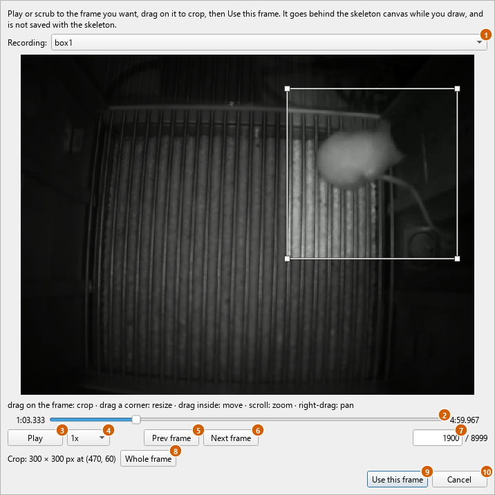
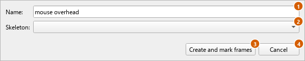
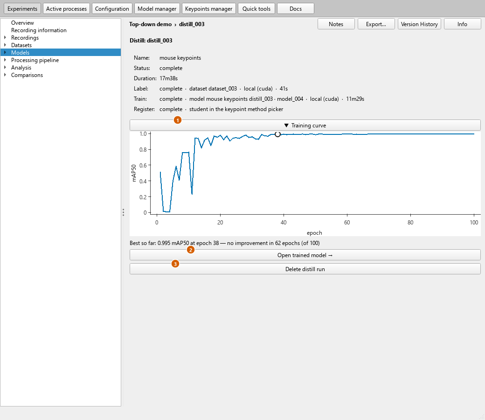
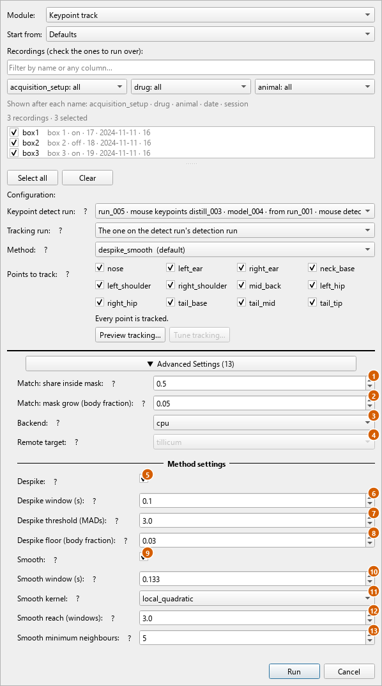
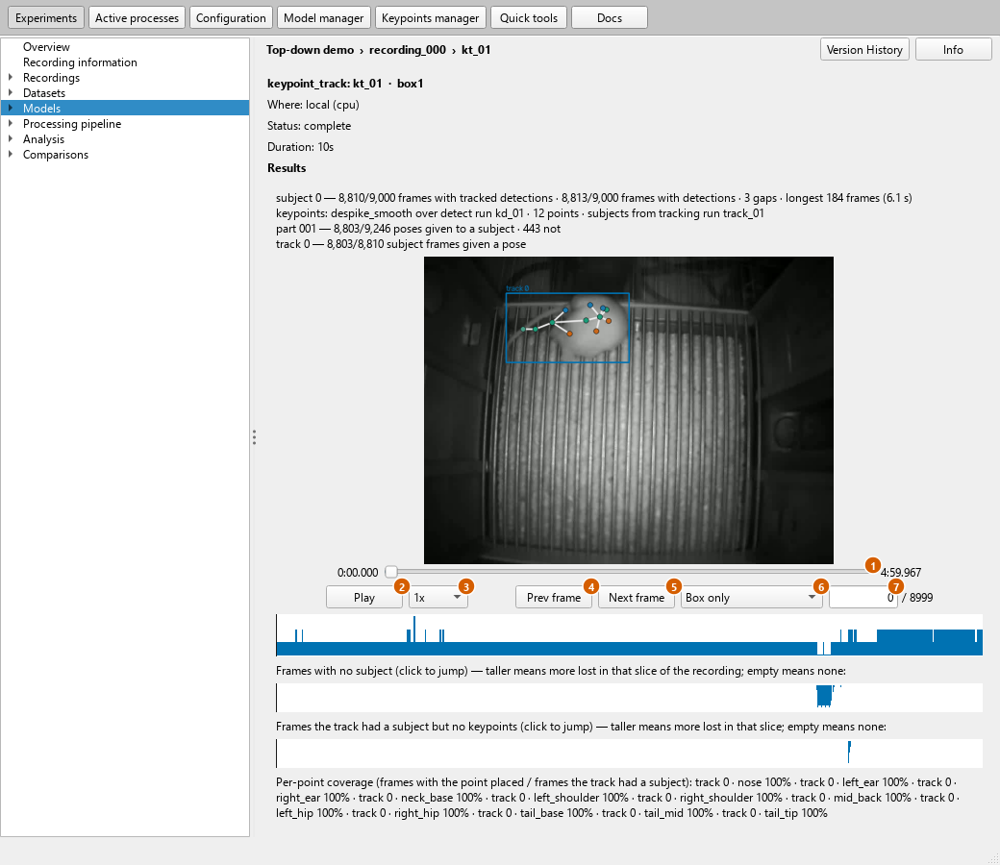

# 4. Keypoints

**Keypoints** are named points on the body: the nose, the ears, the base of the tail and so
on. Tracking (chapter 3) says where the animal is; keypoints say how it is posed, which way it
faces, and what its head and tail are doing. The embedding (chapter 5) uses them to turn
every animal the same way before comparing postures.

DETAIL makes a keypoint model for the whole experiment in one setup. You mark the points by
hand on about ten frames, an **example set**. A slow, careful **teacher** uses those to place
the points on a few hundred more frames. A small fast **student** model then trains on the
teacher's frames, and the student places keypoints on every frame of every video.

Filmed from the side, or at an angle? Follow the steps here, then read [Side-view and
isometric recordings](#side-view-and-isometric-recordings) at the end of the chapter.

## How this differs from SLEAP or DeepLabCut

In SLEAP or DeepLabCut, you mark the points by hand on hundreds of frames, and a network
trains on your marks. A new camera or setup usually needs more frames marked.

In DETAIL, from top-down or side-view recordings, you mark about ten (although more examples
do generally improve outcomes slightly). Isometric recordings, or recordings with many
occlusions, may need upwards of 50 examples. For those, DETAIL provides a tool that picks
suitable example frames for you (**Add frames**, in [step 2](#2-mark-an-example-set)). From
these example frames, the teacher, **dinov3_match**, a large image model that has already
learned what images look like, needs no training: on a new frame it puts each point where
the picture looks most like the spot you marked. It does that on a few hundred frames, and
the student trains on those, so the hundreds of frames are marked for you. If all you want is
the nose, back and tail base from top-down recordings without occlusions, 5 frames is
typically enough.

| | SLEAP or DeepLabCut | DETAIL |
|---|---|---|
| Frames you mark | Hundreds | About ten; 5 for nose, back and tail base from above; 50 or more for isometric or heavily occluded views |
| What trains on them | A network, on your marks | Nothing: the teacher matches them, and the student trains on the teacher's frames |
| Your time | Hours of marking | About 20 minutes |
| Points | As precise as your marking and training | Close, not exact |

DETAIL uses keypoints mainly to find which way the animal faces, for its egocentric
alignment, and they can be used to describe its posture (chapter 5), where close is enough.
If you need exact positions, for joint angles say, check them against frames you marked
yourself, as step 3 does. True pose estimation will generally give more accurate keypoints,
so choose your approach based on what your experiment needs. DETAIL's points can be taken
into SLEAP, DeepLabCut and the tools that read their files: see [Take the keypoints to
DeepLabCut, SLEAP or NWB](#optional-take-the-keypoints-to-deeplabcut-sleap-or-nwb), at the
end of step 5.

## The steps at a glance

Each box is one step on this page. Click a box to go to that step. The first tag says where
the step is in DETAIL. A **GPU** tag means the step's work can run on your computer or on
Tillicum.

<div class="guide-flow" markdown>

1. [Start the keypoint setup](#1-start-the-keypoint-setup) <span class="where where-app">Experiments › Models › Set up keypoints</span> <span class="where where-gpu">GPU: your computer or Tillicum</span> <span class="note">About 5 minutes, then it waits for you.</span>
2. [Mark an example set](#2-mark-an-example-set) <span class="where where-app">Experiments › Models › the setup's page › Mark frames</span> <span class="note">About 20 minutes of clicking. To use your own points, first [make a skeleton](#make-your-own-skeleton) in the Keypoints manager.</span>
3. [Check the cut-off and continue](#3-check-the-cut-off-and-continue) <span class="where where-app">Experiments › Models › the setup's page › Test cut-off</span> <span class="where where-gpu">GPU: your computer or Tillicum</span> <span class="note">About 15 minutes on an 8 GB GPU.</span>
4. [Place keypoints on every frame](#4-place-keypoints-on-every-frame) <span class="where where-app">Experiments › Processing pipeline › New run</span> <span class="where where-gpu">GPU: your computer or Tillicum</span> <span class="note">About a minute and a half per 5-minute video.</span>
5. [Track the keypoints](#5-track-the-keypoints) <span class="where where-app">Experiments › Processing pipeline › New run</span> <span class="note">Seconds. Runs on the processor, not the GPU.</span>

</div>

!!! note "The example marks in this chapter are ours"
    The demo's example set was marked for this guide by eye, quickly. The points are close
    but not exact, which is why the numbers in step 3 are as large as they are. Your own,
    marked with care, will do better.

## 1. Start the keypoint setup

Click **Models** in the list on the left, then **Set up keypoints…**.


The **Set up keypoints** dialog opens. Most of it fills itself in from chapter 3:

- **Name:** a name for the keypoint model, such as `mouse keypoints`.
- **Detector:** your detector from chapter 3, here **mouse detector · model_003 · trained**.
- **Teacher recordings:** one recording per camera or box, chosen for you. The setup learns
  from the first 5 minutes of each.
- Leave the rest as it is, and click **Start**.


??? info "What everything on this screen does"
    1. **Name**: the keypoint model's name.
    2. **Detector**: which detector finds the animal on the teacher recordings. Your
       distilled detector from chapter 3.
    3. **Animal (detector class)**: which of the detector's classes is the animal, for a
       detector that finds several kinds of thing.
    4. **Two or more animals**: for videos with more than one animal: each is tracked, then
       the tracks are joined. Greyed out with a one-animal detector.
    5. **Use the first**: how much of each teacher recording the setup reads, from the
       start. 5 minutes is plenty.
    6. **box 1**: the teacher recording for the first box. One recording per value of
       **acquisition_setup** (chapter 1), so every camera is seen. The time beside it is
       how much of the recording that is.
    7. **box 2**: the same, for box 2.
    8. **box 3**: the same, for box 3.
    9. **Teacher method**: how the teacher places points. **dinov3_match** compares every
       frame with your example frames, patch by patch.
    10. **Size**: the size of the teacher's model. **vit_large** is the most accurate; it
        needs the download from [Configure DETAIL](../configure.md).
    11. **I already have an example set**: tick it when an example set for this animal is
        already marked, for example from an earlier setup. The setup then runs to the end
        without stopping for you.
    12. **Score cut-off**: how sure the teacher must be of a point to teach it to the
        student. Step 3 helps you choose it.
    13. **Frames to label**: how many frames the teacher places points on, spread across
        the teacher recordings. 300 is plenty for one kind of animal.
    14. **Student input**: what the student sees. **whole_frame**, the whole video frame, is
        right for one animal. **crop** is a square around each animal, for animals that
        overlap or are small in the frame.
    15. **Student (the fast pose model)**: the fast model that learns from the teacher.
        `yolo11s-pose.pt` is a small one.
    16. **Advanced Settings**: opens 16 more settings, shown below. Their values work as
        they are, except **Batch size** on a bigger GPU.
    17. **Start**: starts the setup.
    18. **Cancel**: closes the dialog without starting anything.
    19. **?**: a short explanation of the setting beside it.


??? info "What the Advanced Settings do"
    1. **Detect backend**: where the teacher recordings are detected and the teacher's
       frames are tracked: **cuda** is your computer's GPU, **remote** is Tillicum.
    2. **Detect CUDA device**: which GPU, on a computer with more than one. 0 is the first.
    3. **Detect remote target**: which cluster, when **Detect backend** is **remote**.
    4. **Label backend**: where the teacher places its points. It always runs on your
       computer, where the videos are.
    5. **Label CUDA device**: which GPU the teacher uses.
    6. **Validation split**: the share of labelled frames kept back to test the student on,
       rather than trained on.
    7. **Keep clear of audit frames**: never use a frame within this many seconds of a frame
       kept for scoring keypoint methods, so the frames that score a method never help
       build it. Nothing to do unless you make audit sets.
    8. **Candidate stride**: consider only every so many frames, so two frames of the same
       moment are not both picked. 1 considers every frame.
    9. **Crop size**: for **Student input** **crop** only: the size, in pixels, of the
       square around the animal. Greyed out with **whole_frame**.
    10. **Train backend**: where the student trains.
    11. **Train CUDA device**: which GPU trains it.
    12. **Train remote target**: which cluster, when **Train backend** is **remote**.
    13. **Epochs**: how many times the training goes through all the labelled frames, at
        most.
    14. **Batch size**: how many frames it trains on at once. The same table as for the
        detector applies: see [Batch size and your
        GPU](detect-and-track.md#batch-size-and-your-gpu).
    15. **Image size**: the size, in pixels, frames are shrunk to for training.
    16. **Patience**: stop early if the student has not improved for this many epochs.

??? info "On Tillicum: the settings to change"
    To detect and train on Tillicum, set under **Advanced Settings**:

    - **Detect backend** and **Train backend:** **remote**.
    - **Detect remote target** and **Train remote target:** **tillicum**.
    - **Batch size:** 64, from the [batch size table](detect-and-track.md#batch-size-and-your-gpu).

    **Label backend** has no **remote**: the teacher places its points on your computer,
    where the videos are. On the demo that took under a minute. Log in to Tillicum first
    (see [Every day: log in before you run](../tillicum.md#every-day-log-in-before-you-run)).

The dialog closes and the setup's page opens. It detects and tracks the teacher recordings,
which took about 5 minutes on the demo, then stops and waits for you.

## 2. Mark an example set

The setup's page now says **waiting for your example set**. Its **Status** is
**awaiting_references**.


??? info "What everything on this screen does"
    The **Stages** at the top are the setup's steps, ticked as each finishes. **Mark
    examples** is the one waiting for you. This picture is of a second setup made for the
    guide, which is why its name is **mouse keypoints 2**.

    1. **Skeleton**: the set of points to mark and the lines joining them. **Quadruped
       overhead view (12 points)** is made for a four-legged animal seen from above. The
       **Keypoints manager** tab, at the top of the window, edits skeletons and makes new
       ones.
    2. **Example set**: which example set the teacher learns from. The count beside it says
       how many of its frames are fully marked.
    3. **New example set…**: makes an empty example set and opens it for marking.
    4. **Mark frames…**: opens the chosen example set for marking, to add or fix frames.
    5. **Delete set…**: deletes the chosen example set, after asking.
    6. **Score cut-off**: how sure the teacher must be of a point to teach it to the
       student. A point under it is taught as not visible.
    7. **Test cut-off…**: shows the teacher's points on a few frames at this cut-off
       (step 3).
    8. **Continue setup**: goes on with the chosen example set and cut-off: the teacher
       labels the frames, and the student trains.
    9. **Cancel setup**: stops the setup. The teacher recordings' detection and tracking are
        kept.
    10. **Delete distill run**: deletes this setup's record.

### Make your own skeleton

A **skeleton** is the list of points to mark, the lines joining them, and which points are a
left/right pair. The demo uses the preset **Quadruped overhead view (12 points)**. If you
want fewer points, or different ones, make a skeleton before you make the example set. This
example makes a 6-point skeleton: nose, left ear, right ear, neck, back and tail base.

Click **Keypoints manager** in the bar along the top of the window, then **+ New
skeleton**.


??? info "What everything on this screen does"
    Skeletons are shared by every experiment on your computer. An example set, a keypoint
    run or a model that uses one keeps its own copy, so changing a skeleton later never
    changes work already done.

    1. **+ New skeleton**: opens an empty skeleton to draw.
    2. **Import…**: adds a skeleton from a `.yaml` file, for example one a colleague
       exported.
    3. **The skeletons**: every skeleton, with how many points it has and what uses it.
       **preset** ones come with DETAIL and cannot be changed; editing one saves a copy.
       Double-click a row to open it.
    4. **Edit…**: opens the chosen skeleton. A skeleton something uses keeps its points:
       an edit is saved as a new skeleton.
    5. **Export…**: saves the chosen skeleton to a file, to share it.
    6. **Delete**: deletes the chosen skeleton, after asking. Greyed out for a preset or a
       skeleton something uses.

In the **New skeleton** window:

1. **Name:** `mouse 6-point`.
2. Click the canvas six times, once for each point, in roughly where it sits on an animal
   seen from above: the nose at the top, the ears either side behind it, then the neck, the
   back and the tail base down the middle.
3. After each click the new point is chosen. Type its name in **Point**, and press
   ++enter++: `nose`, `left_ear`, `right_ear`, `neck`, `back`, `tail_base`.
4. Join the points with lines: click a point, then hold ++shift++ and click the next. Join
   each ear to the nose, then nose to neck, neck to back, and back to tail base.
5. Click `left_ear`, set **Pair with** to `right_ear`, and **Side** to `left`.
6. Click **Save**.


??? info "What everything on this screen does"
    The canvas shows the skeleton as you draw it. Click to add a point, drag one to move
    it, right-click one to remove it, and ++shift++-click a second point to join or unjoin
    the two. Scroll to zoom. Points are coloured by side: blue for left, orange for right,
    green for the middle of the body.

    1. **Name**: the skeleton's name, as the **Skeleton** lists show it.
    2. **Frame from a recording…**: puts a frame from one of the open experiment's videos
       behind the canvas, to draw on the animal (see below). Greyed out with no experiment
       open.
    3. **Plain background**: takes the frame away again. Greyed out while the background is
       plain.
    4. **Point**: the chosen point's name. Each name is used once. Lowercase with `_`
       instead of spaces, such as `tail_base`, keeps names easy to read in other screens.
    5. **Pair with**: the point's partner on the other side of the body, such as the other
       ear. **(none)** for a point on the middle of the body.
    6. **Side**: which side of the body the point is on, for a paired point.
    7. **Remove point**: removes the chosen point.
    8. **Save**: saves the skeleton. Greyed out until it is valid, for example while two
       points share a name; the line above says what is wrong.
    9. **Cancel**: closes the window. With unsaved changes, it asks first.

**Optional: draw over a frame.** To place the points on a real animal, click **Frame from a
recording…** before step 2. Choose the **Recording**, find a frame with the animal in clear
view, drag a box around the animal, and click **Use this frame**. The frame is only a guide
while you draw: it is not saved with the skeleton, and the skeleton opens on the plain
canvas next time.



??? info "What everything on this screen does"
    1. **Recording**: which recording's video to take the frame from.
    2. **Slider**: drag to move through the video.
    3. **Play**: plays the video.
    4. **Speed**: how fast **Play** goes.
    5. **Prev frame**: one frame back. The ++left++ arrow key does the same.
    6. **Next frame**: one frame on. The ++right++ arrow key does the same.
    7. **Frame number**: type a frame number to go straight to it.
    8. **Whole frame**: removes the box, to use the whole frame. Drag a box's corner to
       resize it, or drag inside it to move it.
    9. **Use this frame**: puts the part inside the box behind the canvas, and closes the
       window.
    10. **Cancel**: closes the window and keeps the background as it was.

??? info "About this step: which points to choose"
    - **Pairs matter.** Marking the ears as a pair is how DETAIL keeps the left ear and
      the right ear apart, rather than letting them swap.
    - **Choose points you can see.** A point hidden on most frames, such as a paw from
      above, gives the teacher little to match. For the nose, back and tail base from above,
      5 example frames is typically enough (see the top of this chapter).
    - **Plan for the heading.** Chapter 5 turns every animal by a heading made from front
      and back points. With this skeleton, use `nose` and `neck` as the front and
      `tail_base` as the back.

Your skeleton is now in the **Skeleton** list of the setup's page and of **New example
set…**. Choose it there instead of the preset.

### Make the example set

Click **New example set…**. Give the set a name, such as `mouse overhead`, leave the
**Skeleton** as it is (or choose your own), and click **Create and mark frames**.



??? info "What everything on this screen does"
    1. **Name**: the example set's name.
    2. **Skeleton**: which points to mark. It can be changed until the first point is
       placed, and is fixed after that.
    3. **Create and mark frames**: makes the set and opens the marking window.
    4. **Cancel**: closes the dialog without making a set.

The marking window opens on the first teacher recording. To fill the set:

1. Next to **Add frames**, leave **5** and **Varied frames**, and click **Add frames**. It
   picks five frames from each teacher recording where the animal is posed differently,
   and lists them under **Example frames**.
2. Click the first frame in **Example frames**. The video goes to it.
3. **Click the animal's nose.** The point is placed, and the next point in **Keypoints** is
   highlighted.
4. Click each point in turn, down the list. When a point cannot be seen on this frame, such
   as an ear hidden by the head, press ++n++ (**Not visible**) instead.
5. When all 12 are done, press ++d++ to go to the next example frame, and do the same.

Every click saves by itself. Points are coloured by side: blue for left, orange for right,
green for the middle of the body. **Left and right are the animal's own**, not the
picture's: from above, with the nose pointing up the screen, the animal's left ear is on the
left of the picture.


??? info "What everything on this screen does"
    1. **Video**: which recording to show.
    2. **Track**: which tracked animal the frame's points belong to. One animal: **track 0**.
    3. **Skeleton**: the set's skeleton. Greyed out once a point is placed.
    4. **Scrollbar**: scrolls the side panel, on a small screen.
    5. **Keypoints**: the points to place, and whether each is placed on this frame. Click
       one, or press its number, to place or move it next.
    6. **Frames to add**: how many frames **Add frames** picks from each recording.
    7. **How to pick**: **Varied frames** picks postures that differ, the typical ones first.
       **Spread over time** picks one frame from each equal stretch of time.
    8. **Add frames**: adds that many frames to the set.
    9. **Recordings**: how many recordings **Add frames** reads. Fewer is faster.
    10. **Spread across**: shares those recordings out across a Recording information
        column, such as **acquisition_setup**, so every box is read. **recording order**
        takes them in the order they were added.
    11. **The slider**: moves through the video. The orange marks are the set's frames.
    12. **Example frames**: the set's frames, and how much of each is marked. Click one to
        go to it, or press ++d++ and ++a++ for the next and previous.
    13. **Play**: plays the video.
    14. **Speed**: how fast **Play** plays.
    15. **Prev frame**: steps one frame back.
    16. **Next frame**: steps one frame forward.
    17. **Frame number**: the frame shown. Type a number and press ++enter++ to go there.
    18. **Point**: clicking the video places a point. The only mark used today.
    19. **Region**: a mark for later versions. Greyed out.
    20. **Box**: a mark for later versions. Greyed out.
    21. **Not visible (N)**: the highlighted point cannot be seen on this frame.
    22. **Clear (Backspace)**: removes the highlighted point from this frame.
    23. **Remove frame**: takes the highlighted frame out of the set.
    24. **Use these frames**: closes the window and chooses this set on the setup's page.
    25. **Close**: closes the window. The marks are already saved.

**Check:** every frame in **Example frames** says **all marked**, and the line under the
video says **12 of 12 keypoints marked**.

??? info "About this step: what makes a good example set"
    - **Ten to fifteen frames** is enough. More frames of the same pose add little; frames
      of different poses add a lot. That is why **Varied frames** picks them.
    - **Every box.** Lighting and camera angle differ between boxes, so take frames from
      each. The setup's teacher recordings are one per box for this reason.
    - **Mark what you see.** If a point is hidden, mark it **Not visible** rather than
      guessing where it would be. The teacher learns from both.
    - **To move a point,** drag it, or click it in **Keypoints** and click again on the
      video.

Click **Use these frames**. The marking window closes and you are back on the setup's page
(**Models** › the setup), with the set chosen under **Example set** and **11 / 11 frames**
(or however many you marked) beside it. Nothing else opens by itself: the next step starts
from this page.

## 3. Check the cut-off and continue

The teacher gives each point it places a **score**: how much the spot looks like your
examples. Points under the **Score cut-off** are taught to the student as not visible.

This step is on the setup's page, where step 2 left you. If you have moved away, click
**Models** in the list on the left, then the setup's row under **Distill runs** (its status
is **awaiting_references**).

1. In **Score cut-off**, near the bottom of the page, leave the method's own default, or set
   **0.75** as for the demo.
2. Click **Test cut-off…**, beside it. The **Test cut-off** window opens and the teacher
   places points on 12 frames. That can take a few minutes, most of it loading the teacher.


??? info "What everything on this screen does"
    The teacher places points on 12 frames, the way the setup will. A filled point is taught
    as visible; a hollow one is under the cut-off. The text under the slider checks the
    teacher against your own marks: each example frame is placed from the others, and the
    distance to your click is measured.

    1. **Scrollbar**: scrolls the frames up and down.
    2. **Scrollbar**: scrolls the frames sideways.
    3. **Score cut-off**: the cut-off, to type in. Beside it, how many points are taught.
    4. **The slider**: moves the cut-off. The frames update as you slide.
    5. **Use this cut-off**: closes the window and puts this cut-off on the setup's page.
    6. **Another sample**: draws 12 other frames.
    7. **Close**: closes the window without changing the cut-off.

**Check:** on most frames, most points are filled and sit on the right part of the body.
Hollow points should be mostly the hard ones: the tail tip, or an ear turned away.

??? info "About this step: reading the numbers"
    **Median 38.8 px (21.6% of body size)** says how far, typically, the teacher's point
    was from the click you made. On the demo it is large because the example marks were
    quick ones (see the note at the top of the chapter). The student only needs the
    teacher to be close, often: it learns from 300 frames, and the errors average out.

    If the points at or above the cut-off are much closer than those below it, the cut-off
    is doing its job: raising it keeps fewer, better points.

??? warning "If this doesn't work"
    - **Left and right are swapped on many frames:** check the example set. A swap in your
      marks teaches the teacher a swap. Open it with **Mark frames…**, and look for frames
      where the blue points are on the animal's right.
    - **Points are far off on one box only:** add two or three frames from that box to the
      example set.

Click **Use this cut-off**. The window closes and the setup's page shows that cut-off in
**Score cut-off**. Then click **Continue setup**, under it. The teacher labels 300 frames,
then the student trains, and the page follows each stage. On the demo, labelling took 41 seconds and training 11 minutes.



??? info "What everything on this screen does"
    1. **Training curve**: folds the curve away or opens it again. The curve shows how well
       the student does on the held-back frames after each epoch; the circle marks the best.
    2. **Open trained model →**: opens the student's own page.
    3. **Delete distill run**: deletes this setup's record. The trained model stays.

**Check:** the status says **complete**, and **Register** says **student in the keypoint
method picker**: the student is now a keypoint method for this experiment, named after the
setup, here **mouse keypoints distill_003**.

??? info "About this step: what mAP50 means here"
    mAP50 says how often the student finds the animal's pose where the teacher put it, on
    frames kept back from training: 1.0 is always. It measures the student against the
    teacher, not against you, so a high value says the student learned the teacher well.
    How good the teacher is, is what step 3's check measures.

## 4. Place keypoints on every frame

Click **Processing pipeline** in the list on the left, then **New run**. In the **Launch a
processing run** dialog:

1. **Module:** **Keypoint detect**.
2. Click **Select all**.
3. **Detection run:** the detection run from chapter 3, here **run_001**.
4. **Method:** your student, here **mouse keypoints distill_003 (model_004) · trained in
   this experiment**.
5. Leave the rest as it is, and click **Run**.


??? info "What everything on this screen does"
    1. **Module**: what to run, here **Keypoint detect**.
    2. **Start from**: fills the form from a previous run's settings.
    3. **Filter**: shows only recordings whose name or information contains what you type.
    4. **acquisition_setup**: shows only recordings with the value you pick.
    5. **drug**: the same, for the drug column.
    6. **animal**: the same, for the animal column.
    7. **Recordings**: the recordings to run on.
    8. **Select all**: ticks every recording the filters show.
    9. **Clear**: unticks them.
    10. **Detection run**: which detection to place keypoints on. Use the full detection
        run from chapter 3, not the setup's own, which covers only the first 5 minutes of
        the teacher recordings.
    11. **Method**: what places the points. Your student is fast. The teacher,
        **dinov3_match**, is also listed, and is much slower.
    12. **Size / variant**: a size of the method, for a method that comes in sizes. Empty
        for a student.
    13. **Minimum pose confidence**: keep a pose only if the student is at least this sure
        of the whole animal. The default, 0.25, is right for one animal.
    14. **Use every**: place keypoints on every frame (1), or fewer.
    15. **Batch size**: how many frames go through the GPU at once. It changes only the
        speed. Lower it if the run stops with out of memory.
    16. **Test keypoints**: tries a teacher method, such as **dinov3_match**, on a few
        frames first. Greyed out for a student: run it, and look at its points on the video.
    17. **Advanced Settings**: opens 6 more settings, including where the run works. Leave
        them as they are.
    18. **Run**: starts the run.
    19. **Cancel**: closes the dialog without starting anything.
    20. **?**: a short explanation of the setting beside it.

??? info "On Tillicum: the settings to change"
    Under **Advanced Settings**, set **Backend** to **remote** and **Remote target** to
    **tillicum**, and raise **Batch size** to 64. The videos must be on Tillicum: the
    detection run's background upload (chapter 3) put them there.

On the demo, each 5-minute video took about a minute and a half on an 8 GB GPU.

## 5. Track the keypoints

Keypoint detect places each frame's points on their own. **Keypoint track** settles them
over time: it removes points that jump away for a frame or two, smooths the small jitter,
and gives each pose to the tracked animal from chapter 3.

Click **New run** again. In the dialog:

1. **Module:** **Keypoint track**.
2. Click **Select all**.
3. **Keypoint detect run:** the run from step 4, here **run_005**.
4. Leave the rest as it is, and click **Run**.


??? info "What everything on this screen does"
    1. **Module**: what to run, here **Keypoint track**.
    2. **Start from**: fills the form from a previous run's settings.
    3. **Filter**: shows only recordings whose name or information contains what you type.
    4. **acquisition_setup**: shows only recordings with the value you pick.
    5. **drug**: the same, for the drug column.
    6. **animal**: the same, for the animal column.
    7. **Recordings**: the recordings to run on.
    8. **Select all**: ticks every recording the filters show.
    9. **Clear**: unticks them.
    10. **Keypoint detect run**: which keypoints to settle.
    11. **Tracking run**: which tracked animal each pose is given to. The default, the
        tracking on the same detection run, is the one from chapter 3.
    12. **Method**: how the points are settled. **despike_smooth** removes jumps, then
        smooths, and is the default for a student.
    13. **nose**: settle this point over time. Unticked, it keeps the place keypoint detect
        gave it on each frame.
    14. **left_ear**: the same, for the left ear.
    15. **right_ear**: the same, for the right ear.
    16. **neck_base**: the same, for the base of the neck.
    17. **left_shoulder**: the same, for the left shoulder.
    18. **right_shoulder**: the same, for the right shoulder.
    19. **mid_back**: the same, for the middle of the back.
    20. **left_hip**: the same, for the left hip.
    21. **right_hip**: the same, for the right hip.
    22. **tail_base**: the same, for the base of the tail.
    23. **tail_mid**: the same, for the middle of the tail.
    24. **tail_tip**: the same, for the tip of the tail.
    25. **Preview tracking…**: runs these settings and two variants on 30 seconds of a
        couple of recordings, side by side. See [Preview tracking](#preview-tracking) below.
    26. **Tune tracking…**: scores many settings against frames you marked, for the
        **temporal_decode** method. Greyed out with **despike_smooth**. See [Tune
        tracking](#tune-tracking) below.
    27. **Advanced Settings**: opens 13 more settings, shown below.
    28. **Run**: starts the run.
    29. **Cancel**: closes the dialog without starting anything.
    30. **?**: a short explanation of the setting beside it.



??? info "What the Advanced Settings do"
    1. **Match: share inside mask**: the least share of a pose's points that must fall inside
       the tracked animal's outline for the pose to be given to it.
    2. **Match: mask grow**: how far the outline is grown first, as a share of the body's
       size, so a nose or tail tip just outside it still counts.
    3. **Backend**: where it runs. **cpu**, the processor, is fast enough.
    4. **Remote target**: which cluster, when **Backend** is **remote**.
    5. **Despike**: replace a point that jumps away from where it was just before and just
       after.
    6. **Despike window**: how far either side, in seconds, a point is compared.
    7. **Despike threshold**: how far from its neighbours a point may sit before it counts
       as a jump. Higher removes fewer.
    8. **Despike floor**: the smallest move that can count as a jump, as a share of the
       body's size, so a still animal's tiny jitter is left alone.
    9. **Smooth**: smooth each point's path over time.
    10. **Smooth window**: how much time, in seconds, the smoothing averages over. Higher
        is smoother, and blurs quick moves.
    11. **Smooth kernel**: how the smoothing fits the path. **local_quadratic** is the one
        measured.
    12. **Smooth reach**: how many windows either side the smoothing reaches.
    13. **Smooth minimum neighbours**: how many nearby frames a point needs to be smoothed.
        With fewer, it is averaged instead.

Tracking keypoints takes seconds, on the processor rather than the GPU. When the run's page says
**complete**, click **›** on a recording to see its keypoints on the video.



??? info "What everything on this screen does"
    The line above the video says how many of the tracked frames were given a pose: here
    8,803 of 8,810.

    1. **The slider**: moves through the video.
    2. **Play**: plays the video with the keypoints drawn on.
    3. **Speed**: how fast **Play** plays.
    4. **Prev frame**: steps one frame back.
    5. **Next frame**: steps one frame forward.
    6. **Overlay**: what to draw besides the keypoints: here the box only.
    7. **Frame number**: the frame shown. Type a number and press ++enter++ to go there.

**Check:** play a few seconds of each recording. The points stay on the body as the animal
moves, and the nose stays at the front.

??? warning "If this doesn't work"
    - **Points flicker between two places:** raise **Smooth window** a little under
      **Advanced Settings**, and use **Preview tracking…** to compare before running again.
    - **Most frames have no pose:** the student was not sure enough. Lower **Minimum pose
      confidence** in step 4 and run keypoint detect again. If that does not help, add
      frames to the example set and run the setup again.
    - **The points are on the wrong animal or off the body:** check the **Tracking run** is
      the one from chapter 3.

### Preview tracking

**Preview tracking…** shows what a setting does before you commit to a full run. It runs
tracking on 30 seconds of two recordings, for your current settings and two variants, and
plays them side by side with **detection alone** (the points as keypoint detect placed them,
before any tracking). It takes seconds, needs no marked frames, and makes no run.

In the keypoint track dialog (step 5), click **Preview tracking…**. In the window:

1. Leave the recordings and the variants as they are the first time, and click **Run
   preview**.
2. Play the four tiles. Look for points that jump off the body in one tile and not another,
   and for left and right swapping. Scroll the mouse wheel over a tile to zoom all four on the
   same spot, drag to move around, and click **Fit** to see the whole frame again.
3. If one setting looks better than your current one, click its row in the table, then
   **Use selected settings** at the bottom of the window. The dialog's settings change to it.
   **Close** leaves them as they were.


??? info "What everything on this screen does"
    The four tiles are named in their corners, as their rows in the table are: **Detection
    only**, **Current settings**, **Variant A** and **Variant B**, each variant with what it
    changes. They play together, on the same frames, and zoom together.

    1. **Recording 1**: the first recording to preview.
    2. **Start (s)**: where in it the preview starts. **middle** is the middle.
    3. **Recording 2**: a second recording.
    4. **Start (s)**: where in it the preview starts.
    5. **Recording 3**: an optional third. **(none)** leaves it out.
    6. **Start (s)**: where in it the preview starts.
    7. **Duration (s)**: how long each preview is, up to 120 seconds.
    8. **Try variant A**: include the first variant.
    9. **Try variant B**: include the second.
    10. **Smooth**, for variant A: whether it smooths. Unticked here, so variant A is
        **smooth off**.
    11. **Smooth**, for variant B.
    12. **Smooth window**, for variant A: how much time the smoothing averages over.
    13. **Smooth window**, for variant B.
    14. **Despike**, for variant A: whether it removes points that jump away.
    15. **Despike**, for variant B. Unticked, so variant B is **smooth off, despike off**.
    16. **Run preview**: runs the preview.
    17. **Search the grid**: tries every setting **Tune tracking** would, instead of the
        variants, and lists them best first. For **temporal_decode** only, so greyed out
        here.
    18. **Clips of**: which recording the tiles play.
    19. **The slider**: moves through the preview.
    20. **Play**: plays all four tiles together.
    21. **Speed**: how fast **Play** plays.
    22. **Prev frame**: steps one frame back.
    23. **Next frame**: steps one frame forward.
    24. **Frame number**: the frame shown.
    25. **Figures for**: the figures for one recording, or all of them pooled.
    26. **The figures**: one row per setting, detection alone first. **Placed** is the share
        of points placed; **Median move** how far a point moves from one frame to the next,
        as a share of the body; **Jumps / min** and **Left/right swaps / min** how often a
        point leaps or a pair swaps; **Skeleton stretch** how much the lines between points
        stretch; **Agreement** how often the setting's points stay near detection's
        confident ones.

??? info "About this step: reading the figures"
    Smoothing lowers the move, the jumps and the swaps whether or not the points stay on the
    animal, so lower is not automatically better. Read every row against **detection
    alone**, the first, and let the clips decide. On the demo, the current settings bring
    jumps from 13 a minute to none, while keeping nearly every point near detection's
    confident ones.

### Tune tracking

**Tune tracking…** measures which settings work best on your footage, instead of judging by
eye. It re-runs tracking with 36 combinations of settings, and scores each against frames you
marked by hand. It is for the **temporal_decode** method, the one a teacher method such as
**dinov3_match** uses, and needs a second example set:

- **Marked by hand, and not the set the detect run learned from.** Scoring a method on its
  own examples would score the answer key, so that set is never offered. Make a second set
  (step 2) of 20 to 50 frames from several recordings, and mark it the same way.
- **On the same skeleton** as the detect run.

The demo uses a student and **despike_smooth**, so the window below is from the isometric hot
plate experiment, which has a held-out set of 45 marked frames.

In the keypoint track dialog (step 5), choose **Method:** **temporal_decode**, and click
**Tune tracking…**. In the window:

1. **Labelled frames:** your held-out example set.
2. Click **Score settings**. It takes a few minutes: tracking is re-run once per setting on
   the recordings that hold your marked frames.
3. Read the line above the table: it names the recommended setting, and how it did against
   detection alone and your current settings. The recommended row is selected.
4. Click **Use selected settings**. The dialog's settings change to it. **Close** leaves them
   as they were.


??? info "What everything on this screen does"
    The line under **Labelled frames** names the sets left out and why: here one marked on
    another skeleton, and the set the detect run learned from.

    1. **Scrollbar**: scrolls the window, on a small screen.
    2. **Labelled frames**: the example set to score against. Only sets that can score are
       listed.
    3. **Score settings**: scores every setting.
    4. **The scores**: one row per setting, detection alone and your current settings first.
       Each figure is the share of points within a tenth of the animal's body length of
       where you marked them. **Pick** is on half of your marked recordings, the half that
       chose the recommendation; **Check** is on the other half, which the choice never saw:
       **trust the Check column**. **Check left/right** is the paired points, such as paws
       and ears; **Check midline** is the rest. Click a row to choose it.
    5. **Use selected settings**: puts the chosen row's settings into the dialog.
    6. **Close**: closes the window. Nothing is saved either way.

??? info "About this step: reading the scores"
    On the hot plate set, detection alone placed 80.2% of points within a tenth of a body of
    the marks on the check half, the current settings 81.7%, and the recommended setting
    82.5%. Tracking helps most where detection jumps, and can hurt points it smooths away
    from where they really are: here the paired points (the paws) score lower than detection
    for most settings. The recommendation can leave some points as detected for that reason,
    which its name says (**as detected: mid_back** here).

    The figures come from a few dozen frames, so a difference of a point or two between
    settings is within the noise. Prefer the setting that does well on **Check** across both
    columns over the single highest number.

### Optional: take the keypoints to DeepLabCut, SLEAP or NWB

DETAIL can write its keypoints in the formats other pose tools read. Open the keypoint track
run's page and click **Export…**, at the top right.

1. **Save to:** click **Choose** and pick a folder. DETAIL makes a new folder inside it for
   this export, named under **Creates**.
2. Tick the format you want.
3. **Recordings:** the recording selected on the run's page is ticked. Click **All** for
   every recording.
4. Leave the rest as it is, and click **Export**.


??? info "What everything on this screen does"
    1. **Save to**: the folder the export goes in.
    2. **Choose**: picks that folder.
    3. **The greyed-out rows**: what other kinds of run write, such as tracks. Each says
       which run it comes from.
    4. **Keypoints**: DETAIL's own table, one spreadsheet per recording: a row per frame per
       point, with its position, its score, and whether it is visible.
    5. **Keypoints for DeepLabCut**: DeepLabCut's table, one spreadsheet per video. It is
       also what keypoint-MoSeq, VAME, B-SOiD, SimBA and movement read.
    6. **Keypoints for SLEAP**: SLEAP's analysis file (`.analysis.h5`), one per video.
    7. **Keypoints as NWB**: one NWB file per video, for DANDI and other NWB tools.
    8. **Keypoints video**: the video with the points drawn on, one per video, with the
       points beside it as a spreadsheet.
    9. **Performance report**: which computer the run ran on, and how long each part took.
    10. **All**: ticks every recording.
    11. **None**: unticks them.
    12. **Filter**: shows only recordings whose name or information contains what you type.
    13. **acquisition_setup**: shows only recordings with the value you pick.
    14. **drug**: the same, for the drug column.
    15. **animal**: the same, for the animal column.
    16. **Recordings**: the recordings to export.
    17. **Points from**: **Tracking** is this run's final points. **Detection, before
        tracking and smoothing** is the points as keypoint detect placed them; export both to
        see what tracking changed.
    18. **Score threshold**: a point scoring under this is written as not visible, and the
        video does not draw it. Leave it at the method's default.
    19. **Omit points below score threshold**: off, a point under the threshold keeps its
        position and is marked not visible. On, it is written as empty. Tick it for a tool
        that cannot read a visible column.
    20. **Video: show masks and boxes**: with **Keypoints video**, draws the tracked
        animal's outline and box under the points.
    21. **Export**: starts the export.
    22. **Cancel**: closes the dialog without exporting anything.

    **Estimate** says how big the export will be, how long it will take, and how much
    space is free in the folder you chose.

Beside the files it writes `coverage.csv`, how many frames of each recording have a pose,
and, for DeepLabCut and SLEAP, `timestamps.csv`, the time of every frame. The export runs in
the background; follow it under **Active processes**, where its page has **Open folder** when
it is done.

??? warning "If this doesn't work"
    **Keypoints for SLEAP** or **Keypoints as NWB** is greyed out, and says *needs h5py* or
    *needs pynwb*: the install guides leave out the libraries those two formats need. Close
    DETAIL. In the terminal you installed DETAIL from (**PowerShell** on Windows,
    **Terminal** on macOS, a terminal on Linux, the **WSL terminal** on Windows with WSL),
    go to the DETAIL folder and switch on its environment, the first two commands under
    *Launch it again later* in your install guide ([Windows](../install-windows.md#launch-it-again-later),
    [Windows with WSL](../install-windows-wsl.md#launch-it-again-later),
    [macOS](../install-macos.md#launch-it-again-later),
    [Linux](../install-linux.md#launch-it-again-later)). Then run:

    ```
    uv pip install -e ".[keypoints_export]"
    ```

    Launch DETAIL again. The same libraries also make **Keypoints for DeepLabCut** write
    each table as an `.h5` file beside the spreadsheet, as DeepLabCut does itself.

## Side-view and isometric recordings

The demo is filmed from above. If your camera looks at the animal from the side, the steps
in this chapter are the same, with four differences. The same goes for an **isometric**
recording, filmed from above at an angle (DETAIL's **Camera view** calls it **Angled down
view**). There the differences matter even more: from an angle the animal is seen in many
more orientations, so the example set has to cover them all.

**1. Set the camera view.** Choose **Side view**, or **Angled down view**, as the
experiment's **Camera view** when you make it, or at the top of the **Recordings** page
(chapter 1). One recording filmed differently sets its own in its **Scene geometry**
(chapter 2). DETAIL reads it to decide what to offer you: the direction-picking in point 3
below appears only for recordings that are not top down.

**2. Choose the skeleton.** In **New example set…**, choose **Quadruped side view (5
points)**: nose, left ear, right ear, middle of the back and tail base, with the ears as a
left/right pair. Or [make your own](#make-your-own-skeleton): an isometric view often sees
more of the body than a side view, such as the paws.


??? info "What everything on this screen does"
    The editor opens this way from the **Keypoints manager**: choose the preset and click
    **Edit…**. A preset cannot be changed, so an edit saves a copy.

    1. **Name**: the skeleton's name.
    2. **Frame from a recording…**: puts a frame from a side-view recording behind the
       canvas, to move the points onto the animal ([Make your own
       skeleton](#make-your-own-skeleton)). It is not saved.
    3. **Plain background**: takes the frame away again.
    4. **Point**: the chosen point's name.
    5. **Pair with**: the chosen point's partner on the other side of the body.
       **(none)** for the nose, which is on the middle of the body.
    6. **Side**: the side of the body, for a paired point. Greyed out for the nose.
    7. **Remove point**: removes the chosen point, in the copy.
    8. **Save as new**: saves your changes as a new skeleton, leaving the preset as it is.
       Greyed out until something has changed.
    9. **Cancel**: closes the window.

    From the side, one ear is usually hidden behind the head. Mark it **Not visible** (++n++)
    on those frames: the teacher learns which ear is in view from that.

**3. Pick example frames by direction.** From the side or at an angle, the animal looks very
different facing the camera, facing away and side on, so the example set needs each. In the
marking window (step 2), next to **Add frames**, choose **By heading (8 directions)**, and
click **Add frames**. DETAIL works out which way the animal faces on every tracked frame, and
picks frames for each direction: right, left, toward the camera, away, the four diagonals,
and rearing. The number beside it is **per direction**, so 5 gives about 50 frames, which is
what an isometric or occluded view needs. Then mark them as in step 2.

The pictures below are from an isometric hot plate experiment, filmed at an angle, with an
8-point skeleton that includes the four paws.


??? info "What everything on this screen does"
    The window is the one from step 2, with three additions for a view that is not top
    down: **By heading** in the list of ways to pick, the **Floor** setting, and the
    **compass**.

    **The compass** shows, for each direction the animal can face, how many of the set's
    frames face that way and how many of those are marked: **5/5** is five frames, all
    marked. The camera is at the bottom, so **toward** is the animal facing the camera.
    A direction short of frames shows a gap. **Rearing**, **Unclear** (the direction could
    not be told) and **Hand-picked** (frames you added yourself) are counted beside it.
    **Click a direction** to review its frames (the next screen).

    1. **Video**: which recording to show.
    2. **Track**: which tracked animal the frame's points belong to.
    3. **Skeleton**: the set's skeleton. Greyed out once a point is placed.
    4. **Scrollbar**: scrolls the side panel, on a small screen.
    5. **Keypoints**: the points to place, and whether each is placed on this frame.
    6. **From tracking**: which tracking run the frames are picked from.
    7. **Frames per direction**: how many frames **Add frames** picks for each direction.
    8. **How to pick**: **By heading (8 directions)** picks by the way the animal faces.
       **Varied frames** and **Spread over time** work as in step 2.
    9. **Add frames**: adds the frames to the set.
    10. **Recordings**: how many recordings the directions are read from. Fewer is faster.
    11. **Spread across**: shares those recordings out across a Recording information
        column, so every group is read.
    12. **Floor**: if your detector also outlines the arena floor (a hot plate, an
        open-field base), choose that class: the floor's shape lets DETAIL tell walking
        toward the camera from walking away. **no floor** otherwise, as here, where the
        detector finds only the mouse.
    13. **The slider**: moves through the video. The orange marks are the set's frames.
    14. **Play**: plays the video.
    15. **Speed**: how fast **Play** plays.
    16. **Prev frame**: steps one frame back.
    17. **Next frame**: steps one frame forward.
    18. **Frame number**: the frame shown.
    19. **Point**: clicking the video places a point.
    20. **Region**: a mark for later versions. Greyed out.
    21. **Box**: a mark for later versions. Greyed out.
    22. **Example frames**: the set's frames, each with the direction it was picked for.
        Click one to go to it.
    23. **Not visible (N)**: the highlighted point cannot be seen on this frame. From an
        angle, the far-side paws and ear often cannot.
    24. **Clear (Backspace)**: removes the highlighted point from this frame.
    25. **Use these frames**: closes the window and chooses this set on the setup's page.
    26. **Close**: closes the window. The marks are already saved.
    27. **Remove frame**: takes the highlighted frame out of the set. It is under the list
        of example frames; scroll the side panel to reach it.

Click a direction on the compass to check its frames. The review window opens on that
direction, here **Toward**:


??? info "What everything on this screen does"
    The top half is the set's frames for this direction; the bottom half is more frames
    DETAIL thinks face this way, best first. Every frame has the same buttons, so they are
    numbered on the first frame of each half only.

    1. **‹**: the previous direction.
    2. **›**: the next direction.
    3. **Open**: goes to this frame in the marking window, to mark or check it.
    4. **Reject**: this frame does not face this way. It leaves the set and the next best
       candidate takes its place; DETAIL remembers the rejection. A frame you have already
       marked asks first, because its marks go with it.
    5. **Tick box**: choose a candidate to add to the set.
    6. **Not this direction**: this candidate does not face this way. It is not offered
       for this direction again.
    7. **Show more**: shows more candidates.
    8. **Close**: closes the window.
    9. **Add selected**: adds the ticked candidates to the set. Greyed out until one is
       ticked.

The directions are estimated from the video alone, without your marks, so check each
direction here before you mark: one wrong frame in a direction is cheap to reject now.

**4. In the later chapters.** In chapter 5, set **Egocentric alignment** to **Side camera:
flip so the animal faces right**, and define the heading with `nose` as the front and
`tail_base` as the back. In chapter 8, a side view adds measures a view from above cannot
give: how high the animal reaches, the nose's height, and contact with the floor. These are
what tell rearing from grooming.

## Next

[5. Embedding](embedding.md).
