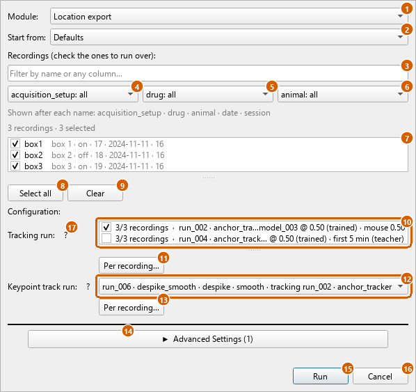
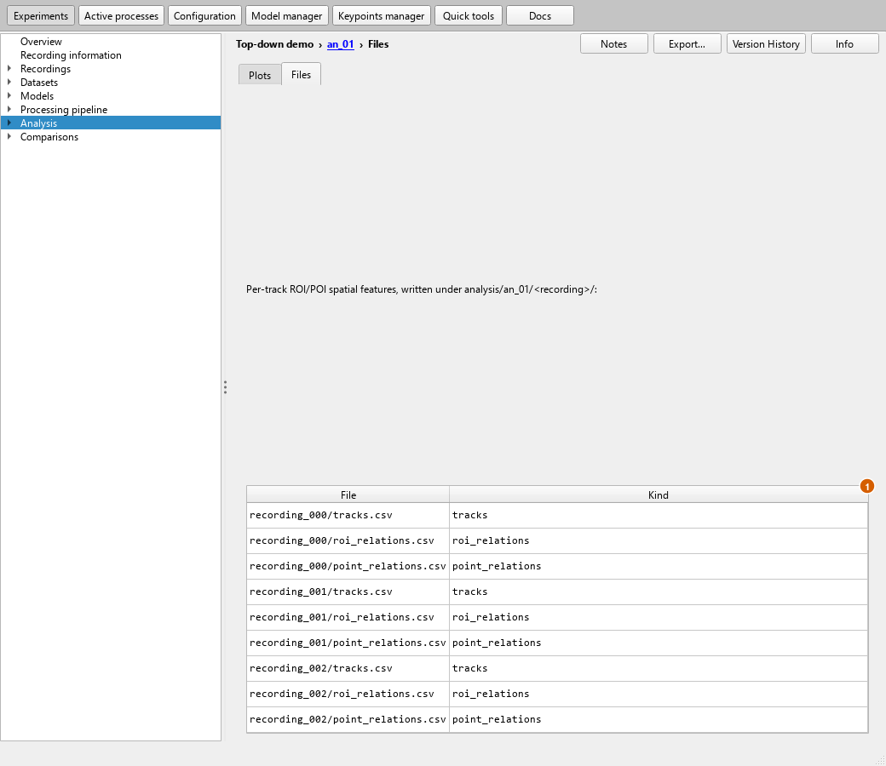

# 6. Location export

**Location export** writes where the animal is on every frame, as spreadsheet files: its
position, its size, how long and wide its body is, whether it is inside each region you drew,
and how far it is from each point. Every row carries its time, so the files line up with other data you recorded, such as
lever presses or drug infusions.

It needs only the tracking from chapter 3, and the regions and points from chapter 2. It does
not need keypoints or an embedding, so it can come as soon as tracking is done.

## The steps at a glance

Each box is one step on this page. Click a box to go to that step. The first tag says where
the step is in DETAIL.

1. [Check the regions and points](#1-check-the-regions-and-points) a recording › Edit scene geometry What the export measures against.
2. [Run the export](#2-run-the-export) Experiments › Analysis › New analysis About 2 minutes for the three demo videos, on the processor.
3. [Open the files](#3-open-the-files) Experiments › Analysis › the run's page › Files Spreadsheets per recording.
4. [Look at the plots](#4-look-at-the-plots) the run's page › Plots Paths, heat maps, speed and body shape, per recording or by group.
5. [Optional: export the body points](#5-optional-export-the-body-points) the keypoint track run's page › Export… Where each keypoint is, per frame.

## 1. Check the regions and points

The export measures the animal against the **regions** and **points** drawn on each
recording, in [chapter 2, step 4](set-up-recordings.md#4-optional-mark-regions-and-points).
Without any, it still writes the animal's position and size, but no region or point rows.

The demo has one of each in every box:

- **Right wall**, a region: the third of the floor nearest the operant panel.
- **Port**, a point: the round port on the panel.

Each box's camera sits differently, so each recording has its own, drawn on its own frame.
Name them the same in every recording: the files use the name, so results from different
boxes can be put together.

??? info "About this step: what to draw"
    - **A region** for any zone where the time spent matters: a wall, a corner, the centre of
      an open field, the side of a place-preference box.
    - **A point** for anything the animal goes to: a lever, a port, a food hopper, an
      object.
    - **Only what you will analyse.** Every region and point adds a row per frame to its
      file. You can add more later and run the export again; nothing else needs re-running.

## 2. Run the export

Click **Analysis** in the list on the left, then **New analysis**. In the **Launch an
analysis run** dialog:

1. **Module:** **Location export**.
2. Click **Select all**.
3. **Tracking run:** check that the tracking from chapter 3 is ticked. With one tracking, it
   is ticked for you.
4. Leave **Rows per second** at **every frame** and **Remove thin parts** unticked. *About
   this step*, below, says when to change them.
5. Click **Run**.

??? info "What everything on this screen does"
    1. **Module**: what to run, here **Location export**.
    2. **Start from**: fills the form from a previous run's settings.
    3. **Recordings**: the recordings to export.
    4. **Select all**: ticks every recording.
    5. **Clear**: unticks them.
    6. **Tracking run**: which tracking to read the animal's position from, with how many
       of the ticked recordings have it. Tick more than one only when different recordings
       were tracked in different ways.
    7. **Run**: starts the export.
    8. **Cancel**: closes the dialog without starting anything.
    9. **?**: a short explanation of the setting beside it.

The picture was taken before **Rows per second** and **Remove thin parts** were added. They
sit under **Tracking run**, each with a **?** beside it.

??? info "About this step: rows per second and thin parts"
    - **Rows per second.** Left at **every frame**, the export writes a row for every frame
      the animal was tracked on. Set it to a number, such as 5, and it writes about that many
      rows a second: the tracked frame nearest each tick of a clock. Nothing is filled in
      between, so a stretch where the animal was lost has no rows. A few rows a second is
      enough for distance travelled, speed and body shape, and the export finishes many times
      sooner. On a 30-minute video at 1920 x 1080, 5 rows a second took about half a minute
      on a desktop computer, and a minute and a half with thin parts removed.
    - **Remove thin parts.** Ticked, the body is measured without its thin parts: a tail, a
      limb, an antenna. Tick it for rats and mice. A rat's tail moves the centre of its
      outline and makes it read far longer than its body is: 260 mm against 180 mm, on one
      rat seen from above. Leave it unticked for an
      animal whose thin parts are its body, such as a fish or a snake. Only the `body_`
      columns change; the `mask_` columns and the region and point files are still the
      whole outline.
    - **Thin part scale**, under **Advanced Settings**: how thick a part must be to count as
      body. It is a share of the animal's own size in the picture, so it does not depend on
      the distance calibration. The default, 0.12, removes a rat's tail seen from above and
      from the side. Raise it if a tail survives; lower it if the head or the legs are
      being cut off.

??? warning "Check which tracking run is ticked"
    When nothing was ticked before, the list ticks the tracking that covers the most of the
    ticked recordings. If you tracked the same recordings twice, with different settings,
    check it ticked the one you want. Ticking two that both cover one recording is refused.

The run's page opens. On the demo, the three 5-minute videos took about 2 minutes, on the
processor.

## 3. Open the files

When the run's **Status** says **complete**, its page has two cards under **Results**:
**Plots ›** (step 4) and **Files ›**. The pictures in this step were taken before the
**Plots** card was added, when **Files ›** was called **Results ›**.

??? info "What everything on this screen does"
    1. **Results ›**, now **Files ›**: the files the run wrote. Click it to list them.
    2. **Open output folder**: opens the folder that holds them, to copy them or open them
       in a spreadsheet, R or Python.
    3. **Delete analysis**: deletes the run and its files, after asking.
    4. **Start new analysis**: opens **New analysis** again.

    The **Notes** button at the top of the window opens a notes box for the run.

Click **Files ›** for the files it wrote: three for each recording. To go back to the run's
page, click its id, here **an_01**, in the line at the top.

??? info "What everything on this screen does"
    1. **The files**: every file the run wrote, by recording, and what kind each is.

Back on the run's page, click **Open output folder**. There is one folder per recording,
named by its id (`recording_000` is box1). Every file has one row per frame, numbered by
`frame_idx`, timed by `t_ns` (nanoseconds from the start of the video), and `object_id`, the
tracked animal (0 with one animal).

**`tracks.csv`**: where the animal is.

| Column | What it is |
|---|---|
| `bbox_x1`, `bbox_y1`, `bbox_x2`, `bbox_y2` | The corners of the box around the animal. |
| `bbox_cx`, `bbox_cy` | The centre of that box. |
| `mask_cx`, `mask_cy` | The centre of the animal's outline, which follows the body more closely than the box. |
| `bbox_area`, `mask_area` | The size of the box and of the outline. |
| `body_cx`, `body_cy` | The centre of the body. The same as `mask_cx`, `mask_cy` unless **Remove thin parts** was ticked; then it is the centre without the tail. |
| `body_area` | The size of the body. |
| `body_length`, `body_width` | How long and how wide the body is, along and across its long axis. Their ratio says how stretched out or balled up the animal is. |
| `body_angle_deg` | Which way the long axis points in the picture, from 0 to 180 degrees: 0 is left to right, 90 is up and down. It does not say which end is the head. |

**`roi_relations.csv`**: the animal and each region, one row per region per frame.

| Column | What it is |
|---|---|
| `roi_id`, `roi_name` | The region's id and name, such as `Right wall`. A region keeps its id when you rename it, edit its shape or delete other regions, and a new region never takes a deleted one's id, so two runs can be joined on `roi_id`. |
| `centroid_in_roi` | 1 if the centre of the animal's box is inside the region, 0 if not. |
| `mask_centroid_in_roi` | The same, for the centre of its outline. |
| `bbox_frac_in_roi`, `mask_frac_in_roi` | How much of the box, or of the outline, is inside the region, from 0 to 1. |
| `bbox_fully_in_roi`, `mask_fully_in_roi` | 1 if all of it is inside. |
| `signed_dist` | How far the centre of the box is from the region's edge: positive inside, negative outside. |

**`point_relations.csv`**: the animal and each point, one row per point per frame.

| Column | What it is |
|---|---|
| `point_id`, `point_name` | The point's id and name, such as `Port`. Point ids stay the same across edits, as region ids do. |
| `centroid_dist`, `mask_centroid_dist` | How far the centre of the box, or of the outline, is from the point. |
| `point_in_bbox`, `point_in_mask` | 1 if the point is inside the box, or inside the outline itself. |

Positions, sizes and distances come in up to three units, at the end of each name:

- `_norm`: a fraction of the video frame's width and height, from 0 to 1.
- `_px`: pixels.
- `_mm` (and `_mm2` for areas): millimetres, from the calibration in chapter 2. Blank for a
  recording with no calibration.

`body_length` and `body_width` come in `_px` and `_mm` only. The folder also holds
`locations.yaml`, which records how the files were made: the rows per second, whether thin
parts were removed, and how big a part counted as thin for each animal.

**Check:** each recording has a row for nearly every frame, and the `_mm` columns are filled
in. On the demo, box1's `tracks.csv` has 8,854 rows, one for each tracked frame.

??? info "About this step: using the files"
    Each row is one frame, so a mean of a 0-or-1 column is the share of time.

    To line the files up with other data, join on `t_ns`: it is the same clock as every
    other DETAIL time, counted from the start of the video. The recording's **Recording
    information** (chapter 1) goes alongside by its folder name.

??? warning "If this doesn't work"
    - **No `roi_relations.csv` rows:** the recording has no regions. Draw them (chapter 2)
      and run the export again.
    - **The `_mm` columns are blank:** the recording has no distance calibration. Add one
      (chapter 2, step 3) and run the export again.
    - **Far fewer rows than frames:** the tracking lost the animal for those frames (see
      chapter 3), or **Rows per second** was set, which writes that many rows a second and
      no more.
    - **"thin parts cannot be removed from these masks":** the outlines are too coarse for
      the size of part you asked to remove. Raise **Thin part scale**, or untick **Remove
      thin parts**.

## 4. Look at the plots

On the run's page, click **Plots ›**. It draws the run's files: one panel per recording, or
one per group of recordings. Every change to the controls on the left redraws it, and
scrolling on the picture zooms.

1. **Plot:** what to draw:
    - **trace**: the path the animal took, light to dark as time goes on.
    - **heatmap**: where it spent its time, darker for more.
    - **speed**: how fast it moved, over time.
    - **trace3d**: the path with time going up, so a place visited twice shows as two
      layers.
    - **body**: a measure of its body over time: its length, its width, its area, how
      stretched out it is (**elongation**, length ÷ width), or the area of its whole
      outline, tail and all.
    - **body_hist**: how often the body measured each value of that measure.
2. **Position:** the point a path follows: the centre of the **body** (without the tail
   when **Remove thin parts** was ticked), of the whole outline (**mask**), or of its box
   (**bbox**).
3. **Group by:** leave **(each recording)** for a panel per recording, or choose a column of
   the **Recording information** (chapter 1), such as **drug**, for one panel or line per
   value.
4. **Body outline every (s):** on a **trace**, draws the body's outline every so many
   seconds: an ellipse as long and as wide as the body, turned along its long axis. It
   shows where the animal was stretched out and where it was balled up.

Speed is measured the way a [comparison](../../gui.md#comparisons) between groups measures
it: on the body's path averaged over a second, and broken where tracking was lost or the
position jumped further than the animal could move. A jump is drawn as a break in the path, not as a line across the arena.

With **Group by** set, each animal counts the same, however long it was tracked: on a heat
map its time is shared out to 1 before the animals of a group are averaged, and a speed or
body line is the mean across animals, with a band for the standard error. A **trace** or
**trace3d** has no average: paths of different animals cannot be averaged into one, so a
group's panel draws every animal's path over the others. For where a group spent its time,
use **heatmap**. The title gives how many animals are in each group.

**Export image…** saves the plot as a picture (PNG), a drawing that stays sharp at any size
(SVG or PDF), or **Interactive HTML**: one page that opens in any web browser, with no
internet needed. On that page you can hover over a point to read it, zoom, and turn a 3-D
plot with the mouse; every 3-D panel turns together.

??? warning "If this doesn't work"
    - **"exported before the body was measured":** the run was made before the export
      measured the body. Run the export again for **body** plots and outlines; the other
      plots work on it as it is.
    - **"N animals … location plots show one animal per recording":** the recording's
      tracking followed more than one animal. Plots draw one animal per recording.
    - **"mm needs a distance calibration":** a ticked recording has no calibration. Add one
      (chapter 2, step 3) and run the export again, or set **Units** to **px**.

## 5. Optional: export the body points

The location export does not include keypoints. To get where each body point is on every
frame, export them from the keypoint track run instead: open it (**Processing pipeline** ›
the keypoint track run), click **Export…** at the top right, and tick **Keypoints**. It
writes one spreadsheet per recording, with a row per frame per body point. [Chapter
4](keypoints.md#optional-take-the-keypoints-to-deeplabcut-sleap-or-nwb) shows the dialog.

## Next

[7. Behavior scan](behavior-scan.md).
