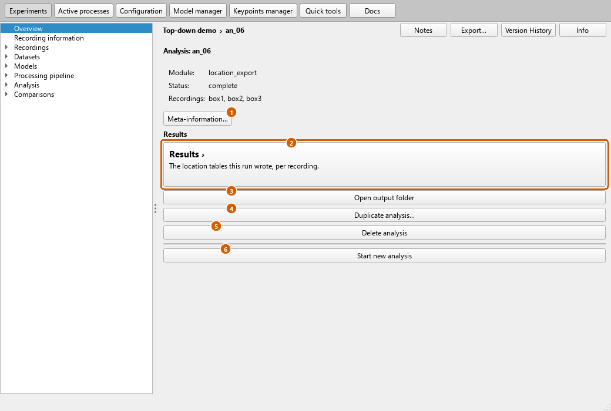
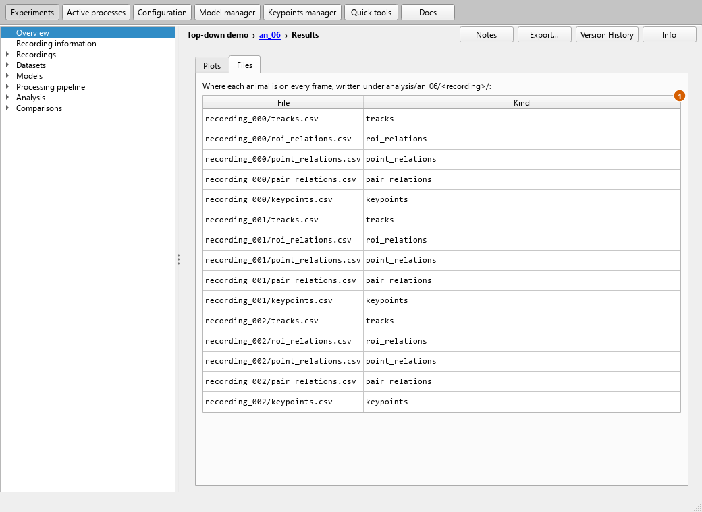
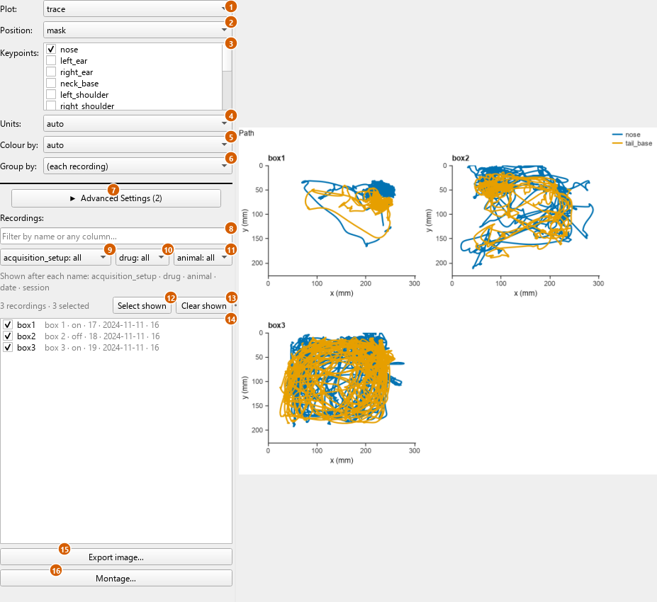
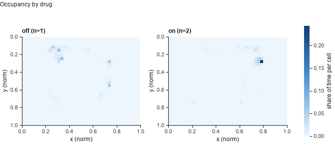
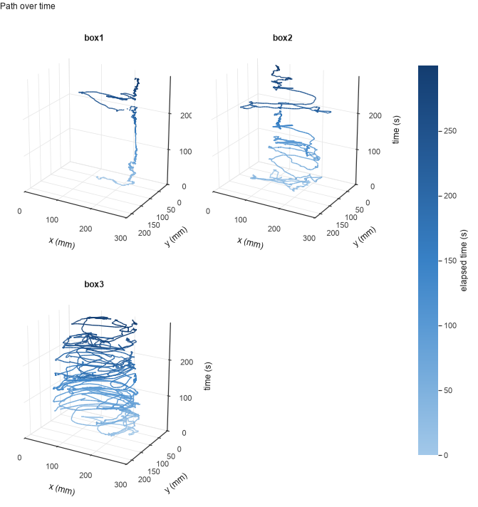
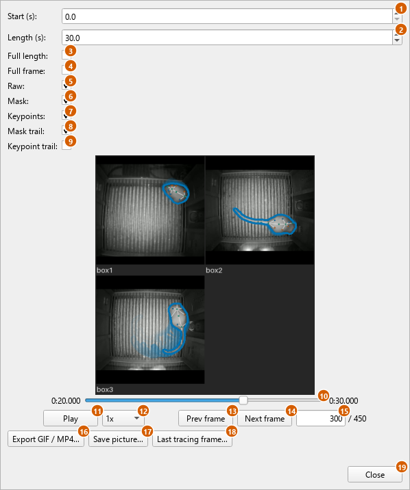
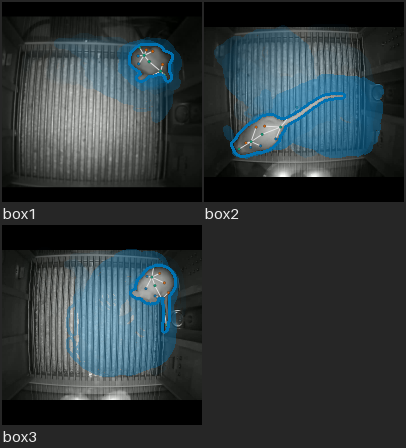

# 6. Location export

**Location export** writes where the animal is on every frame, as spreadsheet files: its
position, its size, whether it is inside each region you drew, and how far it is from each
point. Every row carries its time, so the files line up with other data you recorded, such as
lever presses or drug infusions.

It needs only the tracking from chapter 3, and the regions and points from chapter 2. The
keypoints from chapter 4 are optional: with them, the files also hold where each body point
is. It does not need an embedding.

The run's page then draws the paths, heat maps and speed as plots, and plays the recordings
side by side with each path drawn on the video.

## The steps at a glance

Each box is one step on this page. Click a box to go to that step. The first tag says where
the step is in DETAIL.

<div class="guide-flow" markdown>

1. [Check the regions and points](#1-check-the-regions-and-points) <span class="where where-app">a recording › Edit scene geometry</span> <span class="note">What the export measures against.</span>
2. [Run the export](#2-run-the-export) <span class="where where-app">Experiments › Analysis › New analysis</span> <span class="note">Under a minute per 5-minute video, on the processor.</span>
3. [Open the files](#3-open-the-files) <span class="where where-app">Experiments › Analysis › the run › Results › Files</span> <span class="note">Spreadsheets per recording.</span>
4. [Look at the plots](#4-look-at-the-plots) <span class="where where-app">the run › Results › Plots</span> <span class="note">Paths, heat maps, speed, per recording or by group.</span>
5. [Play the recordings side by side](#5-play-the-recordings-side-by-side) <span class="where where-app">Plots › Montage…</span> <span class="note">Each path drawn on the video.</span>

</div>

## 1. Check the regions and points

The export measures the animal against the **regions** and **points** drawn on each
recording, in [chapter 2, step 4](set-up-recordings.md#4-optional-mark-regions-and-points).
Without any, it still writes the animal's position and size, but no region or point columns.

The demo has one of each in every box:

- **Right wall**, a region: the third of the floor nearest the operant panel.
- **Port**, a point: the round port on the panel.

Each box's camera sits differently, so each recording has its own, drawn on its own frame.
Name them the same in every recording: the files use the name, so results from different
boxes can be put together.

??? info "About this step: what to draw"
    - **A region** for any zone where the time spent matters: a wall, a corner, the centre of
      an open field, the side of a place-preference box.
    - **A point** for anything the animal goes to: a lever, a port, a food hopper, an
      object.
    - **Only what you will analyse.** Every region and point adds a row per frame to its
      file. You can add more later and run the export again; nothing else needs re-running.

## 2. Run the export

Click **Analysis** in the list on the left, then **New analysis**. In the **Launch an
analysis run** dialog:

1. **Module:** **Location export**.
2. Click **Select all**.
3. **Tracking run:** tick the tracking from chapter 3, here **run_002**, and untick the
   others.
4. **Keypoint track run:** the keypoint tracking from chapter 4, here **run_006**, to also
   write where each body point is. Leave it on **(none)** if you have no keypoints. The list
   offers only keypoint runs made on the ticked tracking.
5. Click **Run**.


??? info "What everything on this screen does"
    1. **Module**: what to run, here **Location export**.
    2. **Start from**: fills the form from a previous run's settings.
    3. **Filter**: shows only recordings whose name or information contains what you type.
    4. **acquisition_setup**: shows only recordings with the value you pick.
    5. **drug**: the same, for the drug column.
    6. **animal**: the same, for the animal column.
    7. **Recordings**: the recordings to export.
    8. **Select all**: ticks every recording the filters show.
    9. **Clear**: unticks them.
    10. **Tracking run**: which tracking to read the animal's position from, with how many
        of the ticked recordings have it. Tick more than one only when different recordings
        were tracked in different ways.
    11. **Per recording…**: names the exact tracking run one recording reads (see below).
    12. **Keypoint track run**: the keypoint tracking to read body points from, with how many
        of the ticked recordings have it, or **(none)**.
    13. **Per recording…**: the same, for the keypoint tracking.
    14. **Advanced Settings**: opens **Distance between mask edges**, which only matters with
        two or more animals in a video. Leave it.
    15. **Run**: starts the export.
    16. **Cancel**: closes the dialog without starting anything.
    17. **?**: a short explanation of the setting beside it.

??? info "About Per recording…: a recording whose tracking was redone"
    Sometimes one recording's tracking goes wrong and you track it again with different
    settings, for example with a field of view drawn to keep out a reflection. That recording
    then has two tracking runs: the bad one with the settings every other recording used, and
    the good one with its own settings. Ticking the shared settings reads the bad run there,
    and ticking both is refused.

    Click **Per recording…** under the list. A window lists every recording, those with more
    than one run first. Choose the redone run for that recording and leave the others on
    **(as the chosen settings resolve)**. The line beside the button names the recordings you
    chose a run for. A recording given its own tracking run needs keypoints made on that run,
    so the keypoint **Per recording…** offers it only those.

    The same button sits under the run lists of the other analyses, such as the clustering in
    chapter 8.

??? warning "Check which tracking run is ticked"
    The list ticks one run for you, and when two cover the same recordings it ticks the newer.
    On the demo that is **run_004**, the tracking the keypoint setup made of each video's
    **first 5 minutes** (its label ends **first 5 min (teacher)**). Exporting it would give
    5 minutes of each video. Tick the full tracking instead.

The run's page opens. On the demo, the three 5-minute videos took under 2 minutes, on the
processor.

## 3. Open the files

When the run's **Status** says **complete**, its page has one card, **Results**. Click it.



??? info "What everything on this screen does"
    1. **Meta-information…**: shows the settings the run was made with.
    2. **Results**: the plots and the files, filling the window.
    3. **Open output folder**: opens the folder that holds the files, to copy them or open
       them in a spreadsheet, R or Python.
    4. **Duplicate analysis…**: makes a copy of the run.
    5. **Delete analysis**: deletes the run and its files, after asking.
    6. **Start new analysis**: opens **New analysis** again.

**Results** has two tabs: **Plots** (step 4) and **Files**. Click **Files** for the files the
run wrote: five for each recording. The run's name in the line at the top (**an_06**) goes
back to the run's page.



??? info "What everything on this screen does"
    1. **The files**: every file the run wrote, by recording.

Go back to the run's page and click **Open output folder**. There is one folder per recording, named by its id
(`recording_000` is box1). Every file has one row per frame, numbered by `frame_idx`, timed
by `t_ns` (nanoseconds from the start of the video), and `object_id`, the tracked animal (0
with one animal). `pair_relations.csv`, the distance between two tracks (see the [mouse and object example](detect-and-track.md#example-a-mouse-and-a-novel-object)), has only its
column names with one animal.

**`tracks.csv`**: where the animal is.

| Column | What it is |
|---|---|
| `bbox_x1`, `bbox_y1`, `bbox_x2`, `bbox_y2` | The corners of the box around the animal. |
| `bbox_cx`, `bbox_cy` | The centre of that box. |
| `mask_cx`, `mask_cy` | The centre of the animal's outline, which follows the body more closely than the box. |
| `bbox_area`, `mask_area` | The size of the box and of the outline. |

**`roi_relations.csv`**: the animal and each region, one row per region per frame.

| Column | What it is |
|---|---|
| `roi_name` | The region's name, such as `Right wall`. |
| `centroid_in_roi` | 1 if the centre of the animal's box is inside the region, 0 if not. |
| `mask_centroid_in_roi` | The same, for the centre of its outline. |
| `bbox_frac_in_roi`, `mask_frac_in_roi` | How much of the box, or of the outline, is inside the region, from 0 to 1. |
| `bbox_fully_in_roi`, `mask_fully_in_roi` | 1 if all of it is inside. |
| `signed_dist` | How far the centre of the box is from the region's edge: positive inside, negative outside. |

**`point_relations.csv`**: the animal and each point, one row per point per frame.

| Column | What it is |
|---|---|
| `point_name` | The point's name, such as `Port`. |
| `centroid_dist`, `mask_centroid_dist` | How far the centre of the box, or of the outline, is from the point. |
| `point_in_bbox`, `point_in_mask` | 1 if the point is inside the box, or inside the outline itself. |

**`keypoints.csv`**: where each body point is, one row per body point per frame. Only when a
keypoint track run was chosen.

| Column | What it is |
|---|---|
| `keypoint` | The body point's name, such as `nose` or `tail_base`. |
| `x`, `y` | Where it is. |
| `score` | How sure the keypoint method was. Compare scores only within one run. |
| `visible` | 1 if the point was placed with a score at or above the keypoint run's cut-off, 0 if not. A point that was not placed has blank `x`, `y` and `score`. |

Positions, sizes and distances come in up to three units, at the end of each name:

- `_norm`: a fraction of the video frame's width and height, from 0 to 1.
- `_px`: pixels.
- `_mm` (and `_mm2` for areas): millimetres, from the calibration in chapter 2. Blank for a
  recording with no calibration.

**Check:** each recording has a row for nearly every frame, and the `_mm` columns are filled
in. On the demo, box1's `tracks.csv` has 8,810 rows, one for each tracked frame, and its
`keypoints.csv` 12 rows for each of those frames, one per body point.

??? info "About this step: using the files"
    Each row is one frame, so a mean of a 0-or-1 column is the share of time. On the demo,
    from `roi_relations.csv` and `point_relations.csv`:

    | | In Right wall | Within 50 mm of Port | Median distance to Port |
    |---|---|---|---|
    | box1 | 95.2% of frames | 1.1% | 73 mm |
    | box2 | 29.1% | 8.9% | 160 mm |
    | box3 | 56.0% | 5.7% | 89 mm |

    To line the files up with other data, join on `t_ns`: it is the same clock as every
    other DETAIL time, counted from the start of the video. The recording's **Recording
    information** (chapter 1) goes alongside by its folder name.

??? warning "If this doesn't work"
    - **No `roi_relations.csv` rows:** the recording has no regions. Draw them (chapter 2)
      and run the export again.
    - **The `_mm` columns are blank:** the recording has no distance calibration. Add one
      (chapter 2, step 3) and run the export again.
    - **Far fewer rows than frames:** the tracking lost the animal for those frames (see
      chapter 3, step 4), or the wrong tracking run was ticked (see above).
    - **No `keypoints.csv`:** no keypoint track run was chosen. Run the export again with one.

## 4. Look at the plots

Click the **Plots** tab in the run's **Results**. It draws the run's files as plots: one panel per
recording, or one per group of recordings. Every change to the controls redraws it.

1. **Plot:** what to draw:
    - **trace**: the path the animal took.
    - **heatmap**: where it spent its time, darker for more.
    - **speed**: how fast it moved, over time.
    - **trace3d**: the path with time going up, so a place visited twice shows as two
      layers.
2. **Position:** the point the plot follows: the centre of the animal's outline (**mask**),
   of its box (**bbox**), or any body point from the keypoints.
3. **Keypoints:** on a path, tick body points to draw each as its own path in its own colour.
4. **Group by:** leave **(each recording)** for a panel per recording, or choose a column of
   the **Recording information** (chapter 1), such as **drug**, for a panel per value.



??? info "What everything on this screen does"
    1. **Plot**: what to draw: **trace**, **heatmap**, **speed** or **trace3d**.
    2. **Position**: the point a plot follows: **mask**, **bbox**, or a body point.
    3. **Keypoints**: body points to draw as paths, one colour each. Ticking none draws the
       **Position**.
    4. **Units**: millimetres, pixels or fractions of the frame. **auto** uses millimetres
       when every recording is calibrated.
    5. **Colour by**: on a path, **auto** colours each body point its own colour, or the
       path by **time** or **speed** when no body point is ticked.
    6. **Group by**: a panel per recording, or per value of a **Recording information**
       column.
    7. **Advanced Settings**: the speed colour cap and how many points a path draws. Leave
       them.
    8. **Filter**: shows only recordings whose name or information contains what you type.
    9. **acquisition_setup**: shows only recordings with the value you pick.
    10. **drug**: the same, for the drug column.
    11. **animal**: the same, for the animal column.
    12. **Select shown**: ticks every recording the filters show.
    13. **Clear shown**: unticks them.
    14. **Recordings**: the recordings to plot. Untick one to leave it out.
    15. **Export image…**: saves the plot (see below).
    16. **Montage…**: plays the ticked recordings side by side (step 5).

The other plot kinds show other controls in the same place: **Heat-map bins** for a heat
map, **Speed bin (s)** for speed, and **Elevation** and **Rotation** for trace3d. Scroll on
the picture to zoom.

With **Group by** set to **drug**, a heat map pools the recordings of each value. Each animal
counts the same, however long it was tracked: its time is shared out to 1 before the
animals of a group are averaged. The panel title gives how many animals are in it.



On **trace3d**, every panel shares one camera and one set of axes, so the recordings line up
and can be compared directly. **Elevation** and **Rotation** turn all of them together.



**Export image…** saves the plot as a picture (PNG), a drawing that stays sharp at any size
(SVG or PDF), or **Interactive HTML**: one page that opens in any web browser, with no
internet needed. On that page you can hover over a point to read it, zoom, and turn a 3-D
plot with the mouse; every 3-D panel turns together.

??? info "About this step: plots from the command line"
    The same plots come from the `detail locations plot` command, for many runs at once or
    for a script. In the terminal you use for DETAIL:

    ```bash
    detail locations plot --experiment "<your experiment folder>" --run an_06 --out plots/heatmap --kind heatmap --group-by drug --format png --format html
    ```

    `detail locations plot --help` lists every option. See [the command
    reference](../../cli.md).

## 5. Play the recordings side by side

Click **Montage…** under the plots. A window plays the ticked recordings side by side, one
tile per recording, all in step. Tick a single recording first for a closer look at one.

1. **Start (s)** and **Length (s)**: the stretch of video every recording plays, from the
   same moment. Tick **Full length** to play each recording to its end instead.
2. Tick the layers to draw: **Raw** (the video itself), **Mask** (the animal's outline),
   **Keypoints**, and the trails that follow where they went, **Mask trail** and **Keypoint
   trail**.
3. **Full frame** shows the whole video frame. Untick it for a close crop on the animal.



??? info "What everything on this screen does"
    1. **Start (s)**: where in each video the montage starts.
    2. **Length (s)**: how many seconds it plays.
    3. **Full length**: plays each recording to its end instead.
    4. **Full frame**: the whole frame, not a crop on the animal.
    5. **Raw**: the video.
    6. **Mask**: the animal's outline, in its colour.
    7. **Keypoints**: the body points.
    8. **Mask trail**: where the animal's outline has been, fading with time.
    9. **Keypoint trail**: the same, for the body points.
    10. **The slider**: where in the stretch you are. Drag it to move.
    11. **Play**: plays and pauses.
    12. **Speed**: slower or faster than real time, for playing and for **Export GIF /
        MP4…**.
    13. **Prev frame**: one step back.
    14. **Next frame**: one step forward.
    15. **The step**: the step shown, out of how many. Type a number to go there.
    16. **Export GIF / MP4…**: saves the montage as a moving picture. For an MP4, pick the
        file type **MP4 video, H.264**: it plays in PowerPoint.
    17. **Save picture…**: saves the picture on screen.
    18. **Last tracing frame…**: saves the last picture with each trail covering the whole
        stretch, one picture of where each animal went.
    19. **Close**: closes the window.

**Last tracing frame…** gives one picture of the whole stretch:



??? warning "If this doesn't work"
    - **A plot says a recording was not plotted:** the note under the title names it and
      says why, such as no tracked rows, or no keypoints in that recording.
    - **The heat map uses fractions of the frame, not millimetres:** grouped recordings are
      pooled on fractions of the frame, so that differently placed cameras line up.
    - **The montage tiles are black:** tick **Raw** to draw the video.

## Next

[7. Behavior scan](behavior-scan.md).
