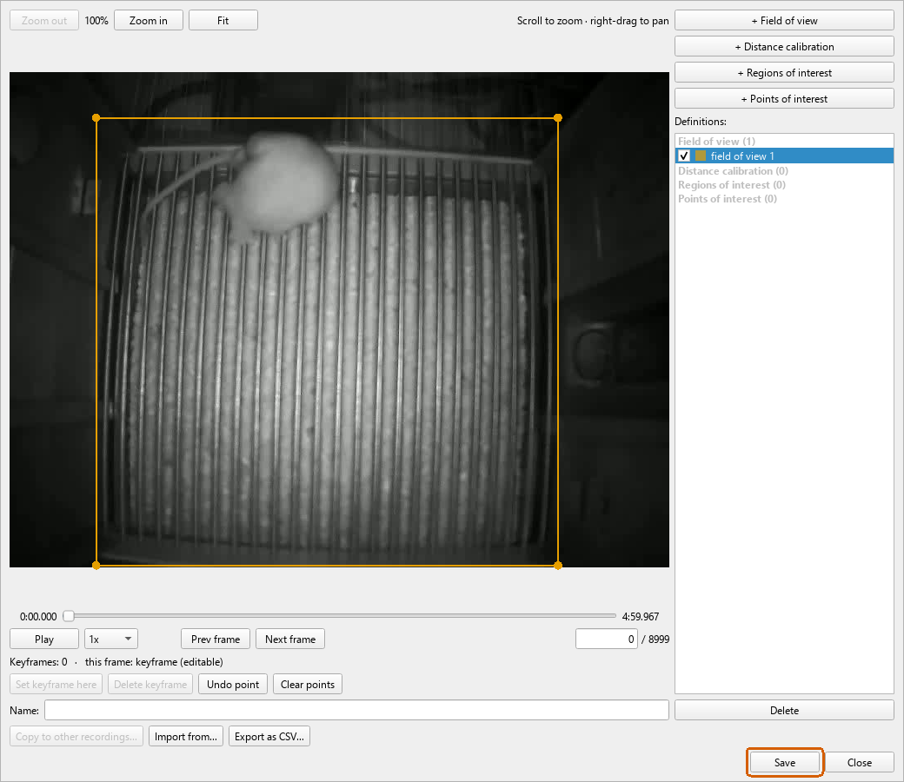
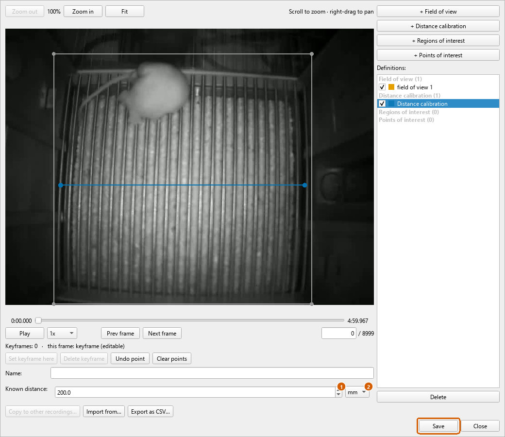
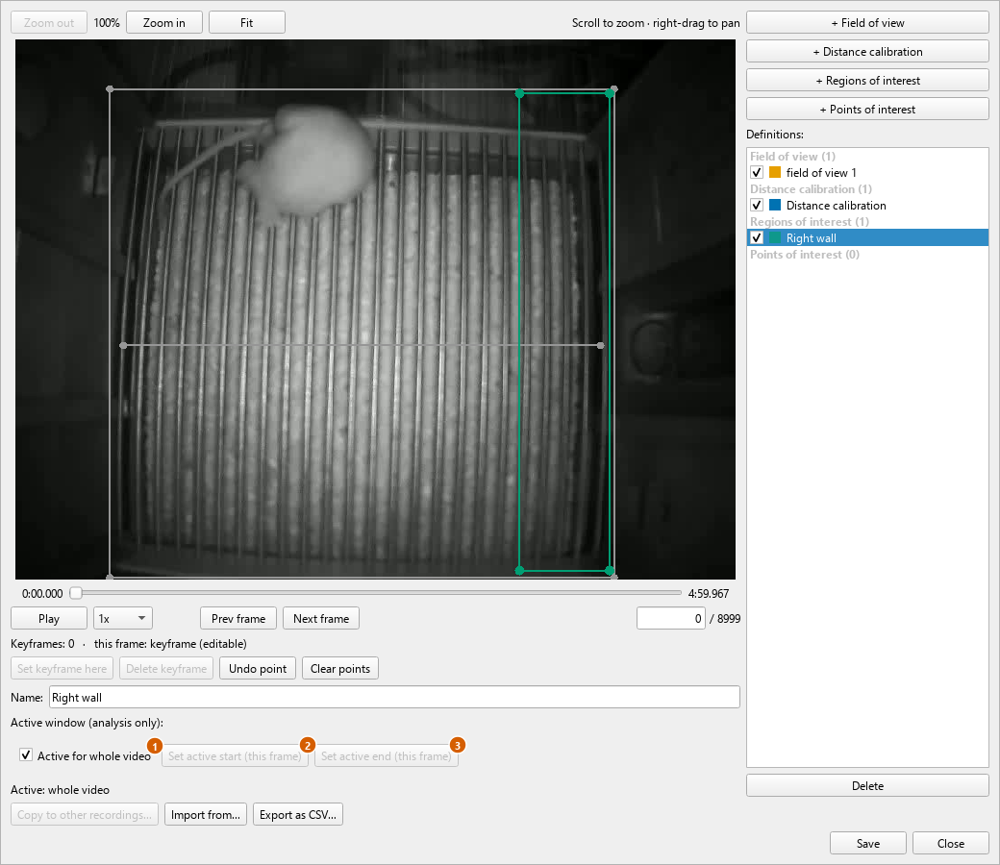
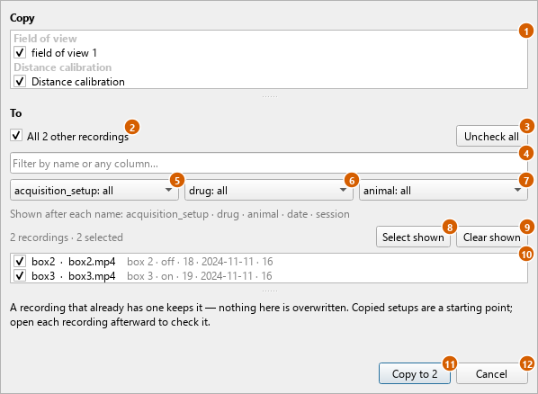
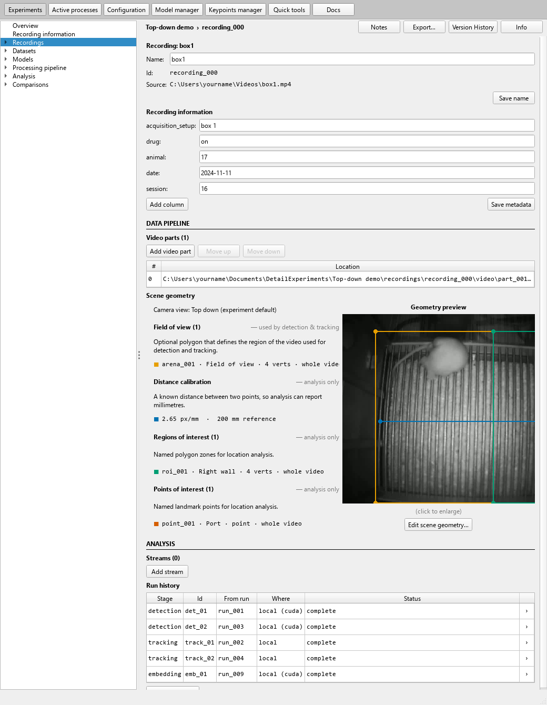
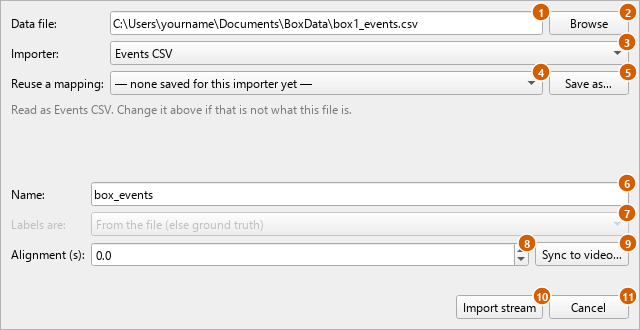
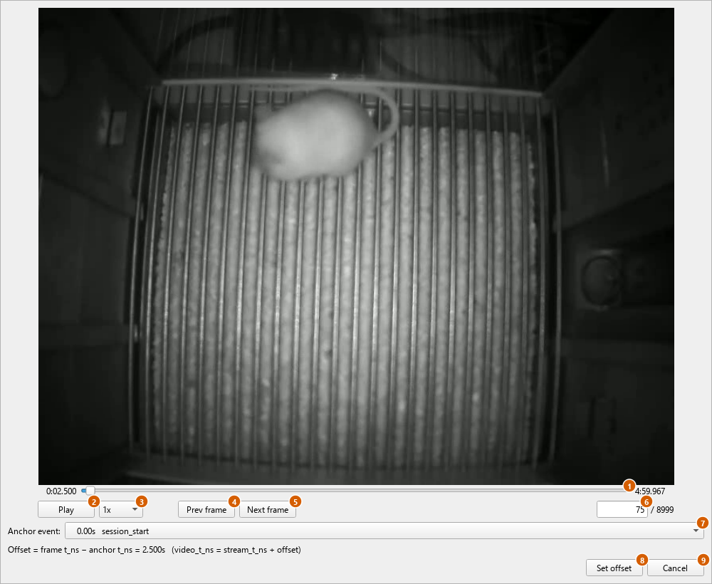
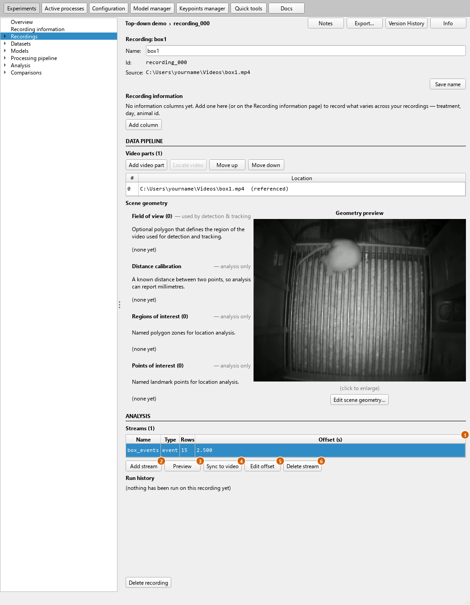

# 2. Set up each recording

Each recording has its own page. On it, the **scene geometry** tells DETAIL about the picture:
where in it the animal can be (the **field of view**), and how big things are (the **distance
calibration**). You can also mark zones and spots you want to measure the animal against.

You do this once per camera position. The example sets up box1 of the top-down experiment.

## The steps at a glance

Each box is one step on this page. Click a box to go to that step. The tag says where the
step is in DETAIL: the button along the top, then the page in the list on the left, then
what you click on it.

1. [Open a recording](#1-open-a-recording) Experiments › Recordings › a recording Its page holds everything about that one video.
2. [Draw the field of view](#2-draw-the-field-of-view) a recording › Edit scene geometry › + Field of view Where the animal can be.
3. [Calibrate distance](#3-calibrate-distance) a recording › Edit scene geometry › + Distance calibration Two points a known distance apart, so results come in millimetres.
4. [Optional: mark regions and points](#4-optional-mark-regions-and-points) a recording › Edit scene geometry › + Regions of interest Zones and spots to measure against, such as a lever.
5. [Set up the other recordings](#5-set-up-the-other-recordings) a recording › Edit scene geometry › Copy to other recordings Copy to recordings from the same camera, or repeat steps 2 and 3.
6. [Optional: add streams](#6-optional-add-streams) a recording › Streams › Add stream Data recorded beside the video, such as operant-box events, lined up with it.

## 1. Open a recording

Click **Recordings** in the list on the left, then double-click a recording's row, here
**box1**. Its page opens.

??? info "What everything on this screen does"
    1. **Name**: the recording's name. Change it here, then click **Save name**.
    2. **Save name**: saves a changed name.
    3. **Recording information**: one box per column of [Recording
       information](create-an-experiment.md#3-fill-in-recording-information). Change a
       value here, then click **Save metadata**.
    4. **Add column**: adds a Recording information column. It appears on every recording.
    5. **Save metadata**: saves the values in the boxes above.
    6. **Add video part**: adds another video file to this recording, for a session saved as
       several files. The parts play in order, as one video.
    7. **Locate video**: for a video referenced in place that has moved, points the
       recording at its new location. For a copied video that is not on this computer, as
       after importing an experiment without its video, copies the original file back in.
       It is greyed out while the video is where it should be.
    8. **Move up**: moves the selected video part earlier. It locks once anything has run
       on the recording.
    9. **Move down**: moves the selected video part later. It locks the same way.
    10. **Video parts**: each video file in the recording and where it is. **(referenced)**
        means it is used in place rather than copied.
    11. **Geometry preview**: the first frame with every scene geometry definition drawn on
        it. Click it to see it full size.
    12. **Edit scene geometry…**: opens the editor. Steps 2 to 5.
    13. **Add stream**: adds data recorded alongside the video and lines it up with it, such
        as operant-box events, a sensor trace, or behavior you scored by hand. Step 6.
    14. **Delete recording**: deletes this recording and its results, after asking.

    The page also lists each scene geometry kind with what is set (**none yet** at first),
    and, under **Run history**, every run made on this recording. The **Notes** button at the
    top of the window opens a notes box for this recording.

## 2. Draw the field of view

The field of view is the part of the picture where the animal can be. DETAIL ignores
anything it finds outside it: a hand above the box, a reflection, a second cage at the edge
of the picture.

Click **Edit scene geometry…**. The editor opens on the recording's first frame.

??? info "What everything on this screen does"
    1. **Zoom out**: shows more of the frame. You can also scroll over the frame to zoom.
    2. **Zoom in**: shows the frame bigger, to place a point precisely. Drag with the right
       mouse button to move around a zoomed frame.
    3. **Fit**: shows the whole frame again.
    4. **The frame**: where you draw. With a definition selected, click to add a point, drag
       a point to move it, and right-click a point to remove it. With nothing selected it
       shows every definition, each in its own colour.
    5. **+ Field of view**: starts a field of view.
    6. **+ Distance calibration**: starts a distance calibration.
    7. **+ Regions of interest**: starts a region, a zone you will measure the animal
       against.
    8. **+ Points of interest**: starts a point, a single spot you will measure the animal
       against.
    9. **Definitions**: everything defined so far, grouped by kind. Click one to edit it.
       Its tick box shows or hides it on the frame.
    10. **Delete**: deletes the selected definition.
    11. **The slider**: moves through the video, to find a frame to draw on.
    12. **Play**: plays the video.
    13. **Speed**: how fast **Play** plays.
    14. **Prev frame**: steps one frame back.
    15. **Next frame**: steps one frame forward.
    16. **Frame number**: the frame shown. Type a number and press ++enter++ to go there.
    17. **Set keyframe here**: for a camera that moves during the recording. Makes this frame
        a keyframe, so you can place the selected shape where it is on this frame.
    18. **Delete keyframe**: removes this frame's keyframe.
    19. **Undo point**: removes the last point you added.
    20. **Clear points**: removes every point of the selected definition, to start it again.
    21. **Name**: the selected definition's name. Analysis results use it, so name regions
        and points for what they are.
    22. **Copy to other recordings…**: copies this recording's setup to others. Step 5.
    23. **Import from…**: brings in a setup from another recording, or from a file made by
        **Export as CSV…**.
    24. **Export as CSV…**: saves this recording's whole setup to one file, to share or
        reuse.
    25. **Save**: saves every change. The editor stays open. **Save** lights up after any
        change and is greyed out when there is nothing to save.
    26. **Close**: closes the editor. It asks first if there are changes you have not saved.

Draw the field of view:

1. Click **+ Field of view**.
2. Click each corner of the area the animal can reach, going around it in order. For a
   rectangular arena, that is four clicks. Include a little of each wall, so the animal is
   still inside when it rears up against one.
3. To move a corner, drag it. To remove one, right-click it.
4. Click **Save**.

??? info "About this step"
    DETAIL names it **field of view 1**. Chapter 3 picks it by that name. You can type
    another in **Name**.

    The field of view affects detection and tracking: DETAIL keeps only what it finds inside
    it. Draw it generously. An animal that leaves it, by climbing or rearing past its edge,
    is lost for that time.

    Every frame of the recording uses the same field of view. If your camera moves during a
    recording, go to a frame where the arena has moved, drag the corners to where it is now,
    and click **Set keyframe here**. DETAIL moves the shape smoothly between keyframes.

    Once a tracking run has used a field of view, it is locked: the run recorded it. To
    change it, delete that run first.

## 3. Calibrate distance

The distance calibration tells DETAIL how many pixels make a millimetre, so speeds and
distances come out in millimetres rather than pixels. You need two points in the picture
whose real distance apart you know.

1. Click **+ Distance calibration**.
2. Click the two points. In the example, the left and right walls at floor level, which are
   20 cm (200 mm) apart.
3. Type the distance in **Known distance**, and choose **mm** or **cm**.
4. Click **Save**.

??? info "What the new controls do"
    1. **Known distance**: the real distance between the two points you clicked.
    2. **Unit**: **mm** or **cm**, for the number in **Known distance**.

??? info "About this step"
    Use the longest distance you know, measured on the floor. A longer distance makes the
    calibration more accurate, because a click a few pixels off matters less. From above,
    things higher up look bigger, so a distance measured at the top of the walls would make
    the floor's measurements wrong.

    The calibration is for this video's size. It can be copied only to recordings whose
    videos are the same size (step 5).

    The calibration is optional. Without it, everything DETAIL measures is in pixels, which
    cannot be compared between cameras.

## 4. Optional: mark regions and points

Regions and points are only for analysis: they do not change what DETAIL detects. Mark them
if you want to measure where the animal goes, such as the time it spends near a lever or in
a corner.

- **A region** is a zone. Click **+ Regions of interest**, click its corners, and type a
  name in **Name**, such as `Right wall`.
- **A point** is one spot, such as a lever or a food port. Click **+ Points of interest**,
  click the spot once, and name it.

Click **Save** when you are done.

??? info "What the new controls do"
    Regions and points can count for only part of the video, such as the minutes a lever was
    out.

    1. **Active for whole video**: ticked, the region or point counts for the whole video.
       Untick it to choose a start and an end.
    2. **Set active start (this frame)**: the region or point starts counting at the frame
       shown.
    3. **Set active end (this frame)**: the region or point stops counting at the frame
       shown.

## 5. Set up the other recordings

Every recording needs its own setup. How you get it there depends on the camera:

- **Recordings from the same camera, in the same place:** set up one, then copy it. In the
  editor, click **Copy to other recordings…**, tick what to copy and which recordings to
  copy to, and click **Copy to**.
- **Recordings from different cameras or boxes:** the arena sits in a different place in
  each picture, so repeat steps 1 to 3 on one recording of each. In the example, each box has
  its own camera, so box2 and box3 each get their own field of view and calibration.

??? info "What everything on this screen does"
    1. **Copy**: this recording's definitions. Tick each one to copy.
    2. **All other recordings**: ticks every other recording as a place to copy to.
    3. **Uncheck all**: unticks every recording.
    4. **To**: the recordings to copy to, each with its video file. Tick each one to copy to.
    5. **Copy to**: copies to the ticked recordings. It says how many.
    6. **Cancel**: closes without copying anything.

??? info "About this step: what copying does and does not do"
    Copying never replaces anything. A recording that already has a field of view or a
    calibration keeps its own, and its row says so before you copy. To change one, delete it
    on that recording first.

    A calibration copies only to recordings whose videos are the same size, because another
    size means another camera. A region limited to part of the video does not copy, because
    its frame numbers mean something else in another video.

    A copied setup is a starting point. Open each recording afterward and check that the
    shapes sit where they should.

**Check:** each recording's page shows its field of view and its calibration (in pixels per
millimetre) under **Scene geometry**, and the geometry preview draws them on the frame.

The **Field of view** and **Distance calibration** tick boxes on **Recording information**
fill in too, so you can see at a glance which recordings still need setting up.

## 6. Optional: add streams

A **stream** is data that something other than the camera recorded during the session: an
operant box's events, a sensor log, a controller that switched a light, or behavior you
scored by hand. DETAIL keeps it with the recording and lines it up with the video, so each
event sits on the frame it happened.

No analysis reads a stream yet: today a stream is kept with the recording and shown against
the video in **Preview**.

!!! note "The demo has no streams"
    The demo has only its videos, so the pictures in this step use two small files made up
    for this guide: `box1_events.csv`, a light switched on and off every 30 seconds and a tone
    between, from a controller whose clock started 2.5 seconds after box1's video; and
    `box1_sensor.csv`, a temperature and light log. They are not real data.

1. On the recording's page, under **Streams**, click **Add stream**. The **Add stream** dialog
   opens.
2. **Data file:** click **Browse** and choose the file. DETAIL reads it and picks the
   **Importer**; the line under **Reuse a mapping** says what it read the file as.
3. **Name:** a name for the stream, such as `box_events`.
4. **Alignment (s):** how many seconds after the video started the stream's own clock
   started. Type it if you know it, or click **Sync to video…** to find it on the video
   (below).
5. Click **Import stream**.

??? info "What everything on this screen does"
    1. **Data file**: the file to bring in.
    2. **Browse**: chooses the file.
    3. **Importer**: what kind of file it is (see *Which importer*, below). DETAIL picks it from
       the file; change it if it picked wrong.
    4. **Reuse a mapping**: fills the form with a mapping you saved from an earlier import,
       for the next recording's file of the same kind.
    5. **Save as…**: saves this form's mapping under a name, for **Reuse a mapping**. The name
       becomes the stream's name on every recording you use it on, so it takes letters,
       numbers, `_` and `-`, and no spaces.
    6. **Name**: the stream's name on this recording.
    7. **Labels are**: for behavior labels only, whether a person scored them (**Ground
       truth**) or a method produced them (**Predicted**). **From the file** uses what the
       file says, and ground truth if it says nothing. Greyed out for other streams.
    8. **Alignment (s)**: seconds to add to the stream's times to put them on the video's
       time. Positive when the stream started after the video.
    9. **Sync to video…**: opens the video to find the alignment by eye (below).
    10. **Import stream**: brings the stream in. It is greyed out, with the reason under the
        form, until the form is complete.
    11. **Cancel**: closes the dialog without adding anything.

??? info "About this step: which importer"
    - **Events CSV**: your own log of events: a time column named `seconds`, `frame` or
      `t_ns`, and a `label` column (and, if you have one, a number `code` column).
    - **Time-series CSV (sensor data)**: readings taken over and over, such as temperature
      or a photometry signal, one column per reading. A file with its own column names is
      shown in *A CSV with its own column names*, below.
    - **MED-PC (Med Associates)**: an operant box's data file (`.txt`). The dialog then asks
      for **MED-PC program (.MPC)** too: the program the box ran, which names each event code.
      If the file holds several boxes, a **Session** list asks which one this recording is.
      The importer reads programs that log event codes in `E` and their times in seconds in
      `T`.
    - **Behavior labels (interval CSV)**: behavior you scored by hand, one row per bout:
      `start_frame`, `end_frame` and `label`.
    - **Behavior labels (BORIS tabular events export)**: the same, from BORIS's **Export
      events** table. If the export holds several observations or animals, **Observation**
      and **Subject** lists ask which one this recording is.

    Behavior labels are counted in video frames or video seconds, so they are on the video's
    time already: **Alignment** and **Sync to video…** are greyed out for them, and for an
    Events or Time-series CSV whose time column is a frame index. To bring in
    behavior labels for many recordings at once, use **Import behavior labels** on the
    **Recordings** page (chapter 1).

### Line the stream up with the video

A device's clock starts when the device starts, which is rarely the moment the camera did.
**Sync to video…** lets you find the difference by eye: you pick an event in the stream that
you can see in the video, go to the frame where it happens, and DETAIL works out the
alignment.

1. In the **Add stream** dialog, click **Sync to video…**. The **Sync stream to video** window
   opens on the video.
2. **Anchor event:** an event you can see on the video. It starts on the stream's first row,
   here `session_start`.
3. Move to the frame where that event happens, with the slider, **Prev frame** and **Next
   frame**, or by typing the frame number. In the example, the controller started at frame
   75, 2.5 seconds in.
4. Check the line under **Anchor event**: here `Offset = … = 2.500s`. Click **Set offset**. The
   window closes and the number is in **Alignment (s)**.

??? info "What everything on this screen does"
    The picture can be zoomed with the mouse wheel, to read a small light or lever.

    1. **The slider**: moves through the video. The time is at its left.
    2. **Play**: plays the video, to find roughly where the event is.
    3. **Speed**: how fast **Play** plays.
    4. **Prev frame**: steps one frame back.
    5. **Next frame**: steps one frame forward.
    6. **Frame number**: the frame shown. Type a number and press ++enter++ to go there.
    7. **Anchor event**: the stream's event to line up with the frame shown, with its time on
       the stream's own clock.
    8. **Set offset**: keeps the alignment worked out from the frame and the anchor, and
       closes.
    9. **Cancel**: closes without changing the alignment.

After **Import stream**, the stream is listed under **Streams** on the recording's page.

??? info "What everything on this screen does"
    1. **The streams table**: one row per stream: its **Name**, its **Type** (here **event**),
       how many **Rows** it has, and its **Offset (s)**, the alignment. **Rows** fills in a
       moment after the page opens, and says **missing** if the stream's file is gone. Click a
       row to choose it for the buttons.
    2. **Add stream**: adds another stream.
    3. **Preview**: shows the stream against the video (below).
    4. **Sync to video**: opens the same window as in the dialog, to change the alignment.
    5. **Edit offset**: type the alignment in seconds instead.
    6. **Delete stream**: deletes the stream and its files, after asking. It cannot be
       undone.

### Check the stream: Preview

Choose the stream's row and click **Preview**. The video is at the top and the stream is
under it: one lane for each kind of event, with a mark at each event's time, already moved
by the alignment.

**Check:** go to a frame where an event happens and see that it is on the video. In the
example, at 0:32.5 the line **now** says `32.50s light_on`. If the events sit early or late
on the video, change the alignment with **Sync to video**.

??? info "What everything on this screen does"
    Under the video, the first line gives the stream's type, its number of rows and its
    alignment. The second, **now**, lists the events within half a second of the frame shown.

    1. **The slider**: moves through the video. The black line on the timeline moves with it.
    2. **Play**: plays the video.
    3. **Speed**: how fast **Play** plays.
    4. **Prev frame**: steps one frame back.
    5. **Next frame**: steps one frame forward.
    6. **Frame number**: the frame shown. Type a number and press ++enter++ to go there.
    7. **The timeline**: one lane per kind of event (for a sensor stream, one lane of
       readings), the whole stream from left to right. The shaded band is where the video
       is. Click it to go to that time.
    8. **Close**: closes the window.

### A CSV with its own column names

A sensor log or another program's export usually has its own column names, such as
`Time (s)`. DETAIL does not recognise one, so it sets it up as **Time-series CSV (sensor
data)** and shows the file's own columns, for you to say what each one is:

1. **Time column:** the column that holds the time.
2. **Time is:** what that time counts. The line under it says what each choice means:
    - **frame**: the video's frame number, counting from 0; the stream is then on the
      video's time already;
    - **seconds** or **t_ns**: seconds, or nanoseconds, since the stream's own start;
    - **utc**: a date and time on the clock (such as `2026-09-04T14:00:38Z`), where the first
      row is the start.
3. Tick each column to bring in. Each becomes a **channel** of one stream, with the name in
   **Channel**, which you can change.
4. Then **Name**, **Alignment** and **Import stream**, as above.

??? info "What everything on this screen does"
    1. **Data file**: the file to bring in.
    2. **Browse**: chooses the file.
    3. **Importer**: here **Time-series CSV (sensor data)**, which DETAIL chose because no
       importer recognised the file.
    4. **Reuse a mapping**: fills the time column, what it holds and the ticked columns from
       a mapping you saved, for the next recording's file. It says so if the file is missing
       a column the mapping names; choose another file and the mapping is applied to that one
       too, or choose another mapping.
    5. **Save as…**: saves this mapping under a name, for **Reuse a mapping**.
    6. **Time column**: the column that holds the time.
    7. **Time is**: what the time column counts.
    8. **The columns**: every other column, with its first value. Tick a column to bring it
       in; **Channel** is its name in DETAIL, letters, numbers, `-` and `_` only.
    9. **Name**: the stream's name on this recording.
    10. **Labels are**: for behavior labels only. Greyed out here.
    11. **Alignment (s)**: seconds to add to the stream's times to put them on the video's
        time.
    12. **Sync to video…**: finds the alignment by eye, as above.
    13. **Import stream**: brings the stream in.
    14. **Cancel**: closes the dialog without adding anything.

??? tip "Many recordings with the same kind of file"
    Set up the first recording's file, click **Save as…** and name the mapping, then import.
    On each next recording, choose its file, pick the mapping in **Reuse a mapping**, and
    check the alignment: each recording's device started at its own moment.

## Next

[3. Detect and track](detect-and-track.md).
