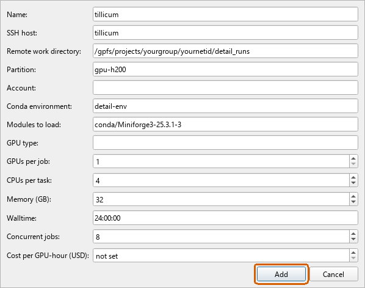
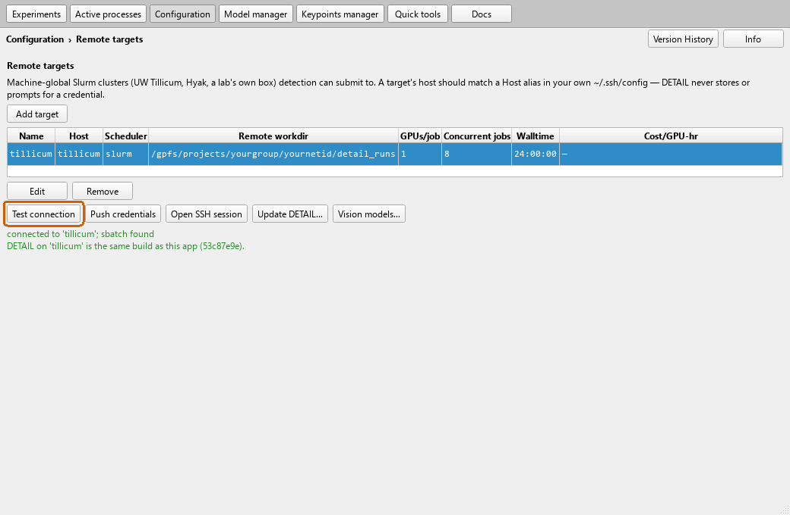

# Set up Tillicum

Tillicum is the University of Washington's GPU cluster. This page connects DETAIL to it, so
the work that needs an NVIDIA GPU runs there while you keep using DETAIL on your own computer.
It takes about an hour once your account exists, most of it waiting for installs.

You need DETAIL installed and configured on your computer first: one of the install pages that
uses Tillicum ([Windows with WSL](install-windows-wsl.md), [Linux](install-linux.md) or
[macOS](install-macos.md)), then [Configure DETAIL](configure.md).

## The steps at a glance

Each box is one step on this page. Click a box to go to that step. The tags say where the step happens.

<div class="guide-flow" markdown>

1. [Request access and storage](#1-request-access-and-storage) <span class="where where-web">Email</span> <span class="note">Can take a few days. Do the rest of your install page while you wait.</span>
1. [Log in to Tillicum for the first time](#2-log-in-to-tillicum-for-the-first-time) <span class="where where-wsl">WSL terminal (Mac or Linux: Terminal)</span> <span class="where where-tillicum">Tillicum's terminal</span> <span class="note">Find your project storage while you are there.</span>
1. [Set up SSH so Duo asks only once](#3-set-up-ssh-so-duo-asks-only-once) <span class="where where-wsl">WSL terminal (Mac or Linux: Terminal)</span>
1. [Install DETAIL on Tillicum](#4-install-detail-on-tillicum) <span class="where where-wsl">WSL terminal (Mac or Linux: Terminal)</span> <span class="where where-tillicum">Tillicum's terminal</span> <span class="note">Log in, then every command is in Tillicum's terminal.</span>
1. [Add Tillicum to DETAIL](#5-add-tillicum-to-detail) <span class="where where-detail">DETAIL window</span>
1. [Download the models on Tillicum](#6-download-the-models-on-tillicum) <span class="where where-detail">DETAIL window</span> <span class="where where-tillicum">Tillicum's terminal</span>

</div>

## Before you start: two places to type commands

This page types commands in two places, and every command says which:

| Where | On Windows | On a Mac or Linux | Its prompt looks like |
|-------|------------|-------------------|-----------------------|
| **The WSL terminal** | The window named **Ubuntu**, which you installed DETAIL in. **Not PowerShell.** | The **Terminal** app, which you installed DETAIL in. | `yourname@computer:~$`, or `yourname@Mac ~ %` on a Mac |
| **Tillicum's terminal** | The same Ubuntu window, after you log in to Tillicum with `ssh`. | The same Terminal window, after you log in to Tillicum with `ssh`. | `[yournetid@tillicum-login01 ~]$` |

Commands typed in Tillicum's terminal run on Tillicum. Typing `exit` there logs out, and the
window is the WSL terminal (Mac or Linux: Terminal) again.

!!! warning "On Windows, never PowerShell"
    Every command on this page that is not on Tillicum goes in the **WSL terminal**, the
    window named **Ubuntu**. PowerShell cannot keep the Tillicum login open, and the DETAIL
    that sends runs to Tillicum is the one installed in WSL. If the prompt starts with `PS`,
    you are in PowerShell: close it and open **Ubuntu** from the Start menu.

**Open a new window for this page.** The window DETAIL was launched from is busy while DETAIL
is open. On Windows, open a new WSL terminal: type `Ubuntu` in the Start menu and click it.
On Linux, press ++ctrl+alt+t++. On a Mac, press ++cmd+n++ in Terminal. This page's commands
do not need DETAIL's environment switched on.

??? info "About this: telling the two apart"
    Look at the prompt before you paste. If it starts with `[yournetid@tillicum`, you are on
    Tillicum. If it starts with `PS`, you are in PowerShell, which this page never uses.
    Anything else is the WSL terminal (Mac or Linux: Terminal). A command typed in the wrong place usually fails
    harmlessly with **command not found** or **No such file or directory**: type `exit` (if
    you are on Tillicum) or `ssh tillicum` (if you are not), and run it again.

??? info "About this page: how DETAIL uses Tillicum"
    DETAIL stays on your computer. When you send a run to Tillicum, DETAIL copies the
    recording there, asks Tillicum's scheduler (called **Slurm**) for a GPU, and runs the
    work on it. When the job ends, DETAIL copies the results back into your experiment. You
    watch its progress in DETAIL the same way as a run on your own computer.

    For that, Tillicum needs its own copy of DETAIL and of the AI models, which this page
    installs, and your computer needs a way to log in to Tillicum without asking you for
    your password and Duo every time, which step 3 sets up.

## 1. Request access and storage

Do this first, because UW-IT can take a few days. The rest of the software setup in your
install page can happen while you wait.

**If your lab already uses Tillicum,** ask your lab first: many labs already have shared
storage there, and then you only need an account. Otherwise, email
[help@uw.edu](mailto:help@uw.edu) and ask for both of these in one message:

- A Tillicum account for your UW NetID.
- Project storage on Tillicum. Say roughly how much video you will analyze. A few hundred
  gigabytes is a reasonable first request.

You also need Duo two-factor sign-in set up on your UW NetID, which most UW accounts already
have.

**Check:** UW-IT replies that your account is active. Then go on to step 2.

??? info "About this step: why storage matters"
    Your home folder on Tillicum is small (about 10 GB). DETAIL's environment, the AI models
    and the copies of your recordings are much larger, so they go in project storage. Step 4
    points everything there.

## 2. Log in to Tillicum for the first time

In the **WSL terminal** (Mac or Linux: **Terminal**), run this with `yournetid` replaced by your UW NetID:

```
ssh yournetid@tillicum.hyak.uw.edu
```

1. The first time, it asks **Are you sure you want to continue connecting?** Type `yes` and
   press ++enter++.
2. Type your UW NetID password and press ++enter++. Nothing appears while you type.
3. Approve the Duo push on your phone. If it asks you to choose a Duo option first, type the
   number of the push option and press ++enter++.

**Check:** the prompt changes to something like `[yournetid@tillicum-login01 ~]$`. This
window is now **Tillicum's terminal**.

### Find your project storage

In **Tillicum's terminal**, list the groups you belong to and the project folders:

```
groups
```

```
ls /gpfs/projects/
```

Look for a folder in the second list with the same name as one of your groups. That is your
project storage, and its full name is `/gpfs/projects/` followed by the folder name, such as
`/gpfs/projects/goldeninference`. Write it down. Step 4 needs it.

Log out of Tillicum. The window goes back to being the **WSL terminal** (Mac or Linux: **Terminal**):

```
exit
```

??? warning "If this doesn't work"
    - **"Permission denied" after the password and Duo:** your Tillicum account is not active
      yet, or the NetID or password is mistyped. Try again, and if it keeps failing, check
      with UW-IT that the account is set up.
    - **No folder matches any of your groups:** your storage is not set up yet, or it has a
      different name. Ask UW-IT or your lab which folder is yours.

## 3. Set up SSH so Duo asks only once

DETAIL logs in to Tillicum many times during a run. This step makes your computer keep one
login open and reuse it, so you approve Duo once rather than every time.

Every command in this step runs in the **WSL terminal** (Mac or Linux: **Terminal**), not on Tillicum. If the
prompt starts with `[yournetid@tillicum`, type `exit` first.

Type this line with `yournetid` replaced by your NetID, and press ++enter++. It prints
nothing:

```
NETID=yournetid
```

Then, in the same window, add the Tillicum settings to your SSH settings file. Copy this
whole block and paste it in one go. It prints nothing:

```
mkdir -p ~/.ssh/sockets
cat >> ~/.ssh/config <<EOF

Host tillicum
    HostName tillicum.hyak.uw.edu
    User $NETID
    ControlMaster auto
    ControlPath ~/.ssh/sockets/%r@%h-%p
    ControlPersist 4h
    ServerAliveInterval 60
    ServerAliveCountMax 10
EOF
```

Still in the **WSL terminal** (Mac or Linux: **Terminal**), log in once through the new settings. It asks for
your password and Duo one more time, then prints `ok` and comes straight back to your
computer:

```
ssh tillicum echo ok
```

**Check:** it prints `ok`. Run it again: this time it prints `ok` straight away, with no
password or Duo.

??? info "About this step: what the settings do"
    The settings give Tillicum a short name, `tillicum`, that DETAIL uses to reach it. The
    `Control` lines keep the first login open in the background and share it with every
    later connection, for up to 4 hours after the last time anything used it. A run that is
    checking on its job keeps it open for as long as the run lasts.

    The `ServerAlive` lines send a small signal every minute, so a quiet connection is not
    dropped by your network, and a connection that has really stopped is closed after about
    ten minutes instead of hanging.

    A Mac's Terminal and Ubuntu both understand these settings. Windows' own SSH program does
    not, which is why Windows uses DETAIL inside WSL for Tillicum.

??? warning "If this doesn't work"
    - **It asks for the password and Duo every time:** check the settings were added by
      running `cat ~/.ssh/config` in the WSL terminal (Mac or Linux: Terminal). The `User` line must show your
      NetID. If it shows an empty `User`, the `NETID=` line was not run first, or was run in
      a different window: open the file with `nano ~/.ssh/config`,
      type your NetID after `User`, and save with ++ctrl+o++, ++enter++, ++ctrl+x++.
    - **"Bad configuration option" or a duplicate `Host tillicum`:** the block was added
      twice. Open the file with `nano ~/.ssh/config` and delete the second copy.

## 4. Install DETAIL on Tillicum

Tillicum needs its own copy of DETAIL. In the **WSL terminal** (Mac or Linux: **Terminal**), log in to Tillicum
(it reuses the login from step 3, so no Duo):

```
ssh tillicum
```

The prompt changes to `[yournetid@tillicum-login01 ~]$`. **Every command from here to the
end of step 4 runs in Tillicum's terminal**, in this same window.

### Point the installs at your project storage

In **Tillicum's terminal**, make a folder of your own in the project storage from step 2. Replace the two parts of the
path: the project folder you wrote down, and your NetID.

```
PROJECT=/gpfs/projects/yourgroup/yournetid
```

```
mkdir -p $PROJECT
```

Tell conda, the tool that makes environments on Tillicum, to put them in that folder:

```
mkdir -p $PROJECT/conda-envs $PROJECT/conda-pkgs
printf 'envs_dirs:\n  - %s/conda-envs\npkgs_dirs:\n  - %s/conda-pkgs\n' "$PROJECT" "$PROJECT" >> ~/.condarc
```

Tell DETAIL to keep its AI models there too:

```
mkdir -p ~/.config/detail $PROJECT/models
printf 'schema_version: 1\nstorage:\n  default:\n    model_cache: %s/models\n' "$PROJECT" > ~/.config/detail/storage.yaml
```

**Check:**

```
cat ~/.condarc ~/.config/detail/storage.yaml
```

Both files show your project folder, not `yourgroup` or `yournetid`.

??? info "About this step"
    `PROJECT=` saves the folder's path under a short name, `$PROJECT`, for the commands that
    follow. It lasts only until you log out, and only in this window, so if you log out
    partway through this step, run the `PROJECT=` line again when you log back in.

    Without these two files, conda and DETAIL put everything in your small home folder, and
    the install stops partway with **Disk quota exceeded**.

### Create the environment

In **Tillicum's terminal**:

```
module load conda/Miniforge3-25.3.1-3
```

```
conda create -y -n detail-env python=3.12
```

```
conda activate detail-env
```

**Check:** the prompt now starts with `(detail-env)`.

### Download and install DETAIL

In **Tillicum's terminal**, sign in to GitHub. Tillicum is a separate computer, so it needs
its own sign-in:

```
gh auth login --hostname github.com --git-protocol https --web
```

It prints a one-time code. Tillicum cannot open a browser, so open
[GitHub device sign-in](https://github.com/login/device) in a browser on your computer, type
the code, and click **Authorize**. Then press ++enter++ in Tillicum's terminal, and ignore
any message that it could not open a browser.

Still in **Tillicum's terminal**, download DETAIL into your home folder on Tillicum, the same
version as on your computer:

```
gh repo clone mlurbur/detail ~/detail -- --branch remote-detail
```

```
cd ~/detail
```

Install it. This downloads a few gigabytes and can take 15 minutes or more:

```
pip install --no-cache-dir -e ".[yolo,torch,gui,analysis,sam3]"
```

Then install SAM 3's software, the same way as the SAM 3 step in Configure DETAIL:

```
git clone https://github.com/facebookresearch/sam3 ~/sam3
```

```
pip install --no-cache-dir -e ~/sam3 --no-deps
```

```
pip install --no-cache-dir "setuptools<81"
```

**Check:**

```
detail --help
```

A list of DETAIL commands prints.

??? info "About this step"
    `module load` makes conda available, because Tillicum keeps most software switched off
    until you ask for it. DETAIL's runs on Tillicum switch on the same module and environment,
    so the names here, `conda/Miniforge3-25.3.1-3` and `detail-env`, go into DETAIL in step 5.

    `--no-cache-dir` stops the installer keeping a spare copy of every download in your home
    folder, which would fill it.

??? warning "If this doesn't work"
    - **`gh: command not found`:** install it into the environment with
      `conda install -y -c conda-forge gh`, then run the sign-in again.
    - **`Disk quota exceeded`:** conda or pip is still using your home folder. Check that
      `conda config --show envs_dirs` lists your project folder first. If it does not, fix
      `~/.condarc`, then remove the environment with `conda env remove -n detail-env` and
      create it again.
    - **"destination path already exists" when downloading:** it was downloaded before. Run
      `cd ~/detail` and carry on.

### Find the GPU partition

Tillicum's GPUs are grouped into *partitions*. In **Tillicum's terminal**, list them:

```
sinfo -o "%P %G %l"
```

Write down the name in the first column of a row that lists GPUs, such as `gpu-h200`. The one
marked `*` is the default. Step 5 needs it.

Log out of Tillicum. The window goes back to being the **WSL terminal** (Mac or Linux: **Terminal**):

```
exit
```

## 5. Add Tillicum to DETAIL

This step is in the DETAIL window on your computer. If DETAIL is not open, launch it with
the three commands under **Launch it again later** on your install page. Click
**Configuration**, then **Open** on the **Remote targets** row, then
**Add target**.



Fill in these fields, and leave the others as they are:

| Field | What to type |
|-------|--------------|
| Name | `tillicum` |
| SSH host | `tillicum` |
| Remote work directory | your project folder from step 4 followed by `/detail_runs`, such as `/gpfs/projects/yourgroup/yournetid/detail_runs` |
| Partition | the partition from step 4, such as `gpu-h200` |
| Conda environment | `detail-env` |
| Modules to load | `conda/Miniforge3-25.3.1-3` |

Click **Add**. Then click the **tillicum** row in the table and click **Test connection**.



**Check:** the line under the buttons is green and says **connected to 'tillicum'; sbatch
found**, and that DETAIL on tillicum is the same build as this app.

??? info "About this step: what the fields mean"
    - **SSH host** is the short name from step 3. It has to match exactly.
    - **Remote work directory** is where DETAIL copies your recordings and runs its jobs on
      Tillicum. DETAIL makes the folder.
    - **Partition**, **Conda environment** and **Modules to load** tell each job where to run
      and how to switch on DETAIL there.
    - **Walltime** is the longest a job may run before Tillicum stops it. It is already set to
      Tillicum's limit, 24 hours. A lower walltime gives your jobs higher priority in
      Tillicum's queue, so they start sooner. Once you know how long your runs take, set it
      a little above that: if each recording finishes in an hour or so, `4:00:00` or even
      `2:00:00` may be right. Each recording is its own job, so the walltime is the time one
      recording may take, not the whole run. A recording that runs past it is stopped and
      recorded as failed. To change it later, select **tillicum** on the Remote targets
      screen and click **Edit**. Then open the run and click **Retry N incomplete
      recordings**: each job reads the walltime when it is sent, so the retried recordings
      get the new one.
    - **Concurrent jobs** is how many recordings run on Tillicum at once. Leave it at 8:
      Tillicum allows only a few connections at a time, and DETAIL needs the rest.

??? warning "If this doesn't work"
    - **"your ssh session to tillicum has expired":** the 4-hour login from step 3 ended.
      Click **Open SSH session**, approve Duo in the window that opens, then click **Test
      connection** again. If **Open SSH session** is greyed out, run `ssh tillicum echo ok`
      in the WSL terminal (Mac or Linux: Terminal) instead.
    - **It says DETAIL on tillicum is behind this app:** click **Update DETAIL…** and confirm.
    - **"sbatch is not on its PATH":** the SSH host reaches a computer that is not Tillicum.
      Check the `HostName` line with `cat ~/.ssh/config` in the WSL terminal (Mac or Linux: Terminal).

## 6. Download the models on Tillicum

Tillicum needs its own copy of the AI models, and your Hugging Face token to download them.

On the Remote targets screen, with **tillicum** selected, click **Push credentials**. It
copies the Hugging Face token you saved in [Configure DETAIL](configure.md) to Tillicum.

**Check:** the status line says **pushed to 'tillicum'**.

Then, in the **WSL terminal** (Mac or Linux: **Terminal**), log in to Tillicum:

```
ssh tillicum
```

The prompt changes to `[yournetid@tillicum-login01 ~]$`. The rest of this step runs in
**Tillicum's terminal**. Switch on DETAIL's environment there and download the models:

```
module load conda/Miniforge3-25.3.1-3
```

```
conda activate detail-env
```

```
detail model install sam3
```

```
detail model install dinov3_vit
```

Each shows its download progress, about 3.4 GB and 1.2 GB.

**Check:** in **Tillicum's terminal**:

```
detail doctor
```

The **Hugging Face token**, **SAM 3 backend package**, **SAM 3 weights** and **DINOv3
weights** rows start with `+`. The **CUDA (GPU)** and **NVIDIA GPU (driver)** rows say there
is no GPU. That is expected: you are on Tillicum's login computer, which has none. The jobs
run on its GPU computers.

Log out. The window goes back to being the **WSL terminal** (Mac or Linux: **Terminal**):

```
exit
```

??? info "About this step: checking a GPU computer (optional)"
    To see PyTorch find a GPU on Tillicum, log in (`ssh tillicum` in the WSL terminal,
    or Terminal on a Mac or Linux), then in **Tillicum's terminal** ask for a GPU for ten minutes, with your
    partition from step 4:

    ```
    srun --partition=gpu-h200 --gpus=1 --time=0:10:00 --pty bash
    ```

    When the prompt comes back, it names a GPU computer instead of `tillicum-login01`. Switch
    on the environment there and ask:

    ```
    module load conda/Miniforge3-25.3.1-3
    conda activate detail-env
    python -c "import torch; print(torch.cuda.is_available())"
    ```

    It prints `True`. Type `exit` once to give the GPU back, and again to log out of
    Tillicum. If no GPU is free, `srun` waits until one is.

??? warning "If this doesn't work"
    - **A download fails with 403 or "access":** your Hugging Face request for that model has
      not been approved, or the token was not pushed. See step 2 of
      [Configure DETAIL](configure.md#2-set-up-hugging-face-access), then click **Push
      credentials** again.

## Every day: log in before you run

The shared login from step 3 closes 4 hours after it was last used, and when your computer
sleeps. Before sending runs to Tillicum, log in once:

- On the Remote targets screen, select **tillicum** and click **Open SSH session**, then
  approve Duo, or
- in the **WSL terminal** (Mac or Linux: **Terminal**), run `ssh tillicum echo ok`.

DETAIL never sees your password or Duo approval. It reuses the login you made.

!!! warning "Keep your computer awake during a run"
    The job runs on Tillicum, but DETAIL on your computer watches it and copies the results
    back. If your computer sleeps or shuts down, DETAIL can record the run as failed even
    though the job carries on there. Turn off sleep while a run is going. A short drop in the
    network is fine: DETAIL waits, and carries on once you log in again.

    If it happened: log in again (above), open the run, and click **Retry N incomplete
    recordings**. The recordings that did not finish run again from the start; finished ones
    are left alone. A distill that stopped this way has **Resume distill** on its page.

## Update DETAIL on Tillicum

Whenever you update DETAIL on your computer (**Update DETAIL** on your install page), update
the copy on Tillicum too: on the Remote targets screen, select **tillicum**, click **Update
DETAIL…**, and confirm. Do it when no run is going.

**Update DETAIL…** only downloads the new version. If you reinstalled on your computer after
updating, reinstall on Tillicum too. In the **WSL terminal** (Mac or Linux: **Terminal**), log in:

```
ssh tillicum
```

Then in **Tillicum's terminal**, switch on the environment and reinstall:

```
module load conda/Miniforge3-25.3.1-3
```

```
conda activate detail-env
```

```
cd ~/detail
```

```
pip install --no-cache-dir -e ".[yolo,torch,gui,analysis,sam3]"
```

Then type `exit` to log out.

## Next

[Single animal](single-animal/index.md). Each chapter says which steps can run on Tillicum.
