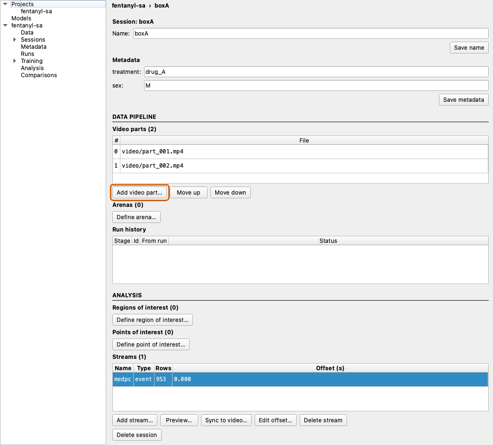

# Add a multi-part recording

A recording can hold several video parts recorded back to back, joined into one
timeline. Every part shares the same resolution and frame rate. This guide builds
a two-part recording.

## Before you start

[Create a experiment](create-a-experiment.md). You need two or more clips from one
recording (the examples use `boxA_am.mp4` and `boxA_pm.mp4`).

## Add the parts

=== "GUI"

    Create the recording from the first clip ([Add a recording](add-a-recording.md)),
    open it, then click **Add video part** (highlighted) and choose the next clip.
    Repeat for each part.

    

    The parts share one timeline in the order shown. Use **Move up** and **Move
    down** to reorder them, until the recording has its first run.

=== "CLI"

    Create the recording, then run `add-video` once per part, in order:

    ```
    detail recording create --experiment ~/Documents/DetailExperiments/operant-study --name boxA
    ```

    ```
    detail recording add-video --experiment ~/Documents/DetailExperiments/operant-study --recording boxA --video boxA_am.mp4
    ```

    ```
    detail recording add-video --experiment ~/Documents/DetailExperiments/operant-study --recording boxA --video boxA_pm.mp4
    ```

!!! tip
    The **Add recordings** dialog makes one recording per video, so parts are added
    after the recording exists. To declare every part up front instead, list them in
    a [YAML manifest](import-recordings-from-yaml.md) (`video: [part_1, part_2]`).

## Next

- [Add stream data and metadata](add-stream-data-and-metadata.md): attach events and grouping variables.
