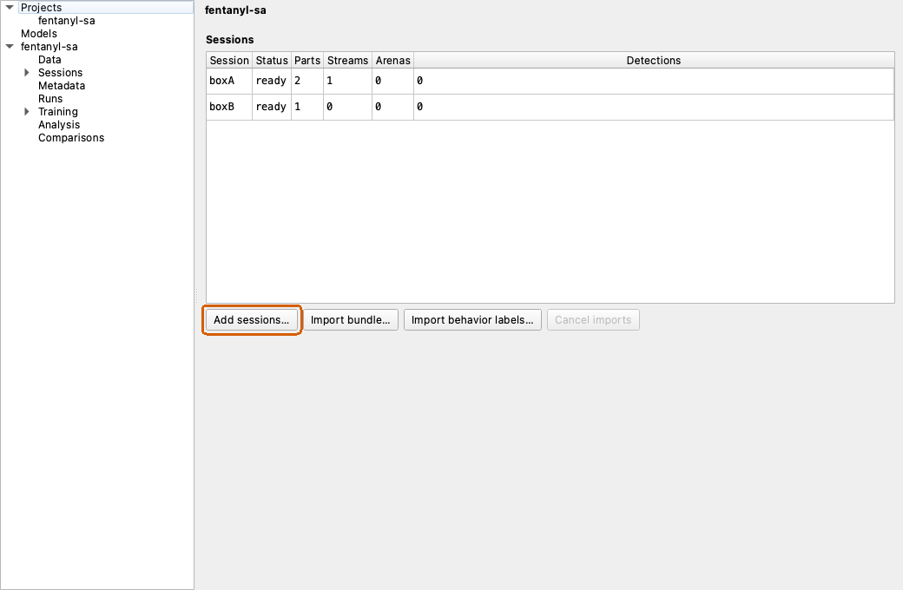
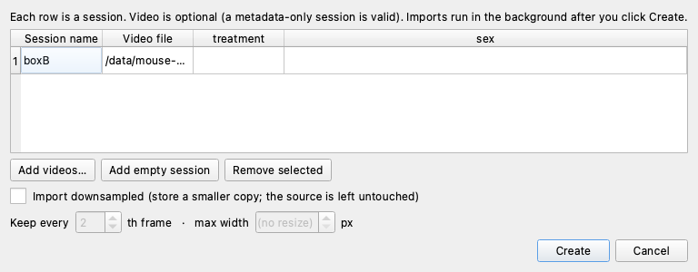

# Add a recording

A recording holds the video for one recording, plus any streams and metadata. This
guide adds a recording from a single video file.

## Before you start

[Create a experiment](create-a-experiment.md) first. The examples use the sample clips
in `docs/assets/sample-data/`, but any video works.

## Add the recording

=== "GUI"

    In the experiment, open **Recordings** and click **Add recordings** (highlighted).

    

    Click **Add videos** and choose a video. The recording name is filled from the
    file name; edit it if you like. Click **Create**.

    

    The import runs in the background; the recording appears when it finishes.

=== "CLI"

    Create the recording, then add its video:

    ```
    detail recording create --experiment ~/Documents/DetailExperiments/operant-study --name boxB
    ```

    ```
    detail recording add-video --experiment ~/Documents/DetailExperiments/operant-study --recording boxB --video boxB.mp4
    ```

    `add-video` needs a recording that already exists.

## Next

- [Add a multi-part recording](add-a-multi-part-recording.md): split a recording across several files.
