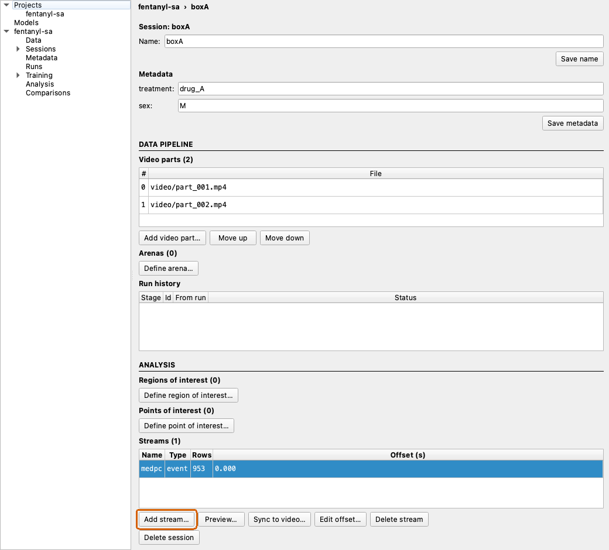
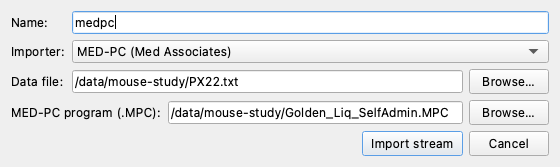
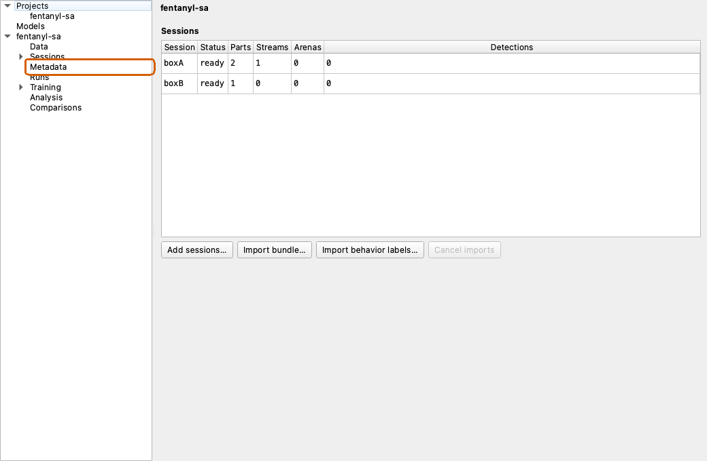
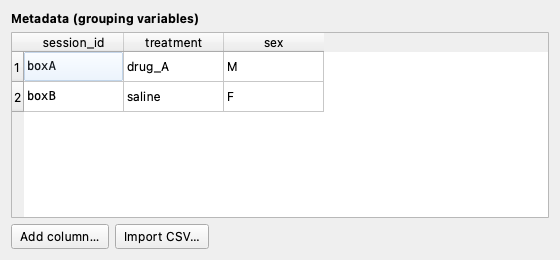

# Add stream data and metadata

A stream is a time-series recorded alongside the video, such as MED-PC operant
events. Metadata are grouping variables (treatment, sex, cohort) you tag recordings
with. This guide adds one of each.

## Before you start

[Add a recording](add-a-recording.md) to attach these to. The stream example uses a
MED-PC data file (`.txt`) and its program (`.MPC`).

## Add a stream

=== "GUI"

    Open the recording and, in the **Streams** section, click **Add stream…**
    (highlighted).

    

    Choose the **MED-PC** importer, select the data file and the `.MPC` program,
    then click **Import stream**.

    

=== "CLI"

    ```
    detail recording add-stream --experiment ~/Documents/DetailExperiments/operant-study --recording boxA --name medpc --importer medpc --data PX22.txt --program Golden_Liq_SelfAdmin.MPC
    ```

## Tag metadata

=== "GUI"

    Open the experiment's **Metadata** page from the sidebar (highlighted).

    

    Add a column per grouping variable and fill each recording's row, or use
    **Import CSV…** to set them in bulk.

    

=== "CLI"

    Set grouping variables in bulk from a CSV with a `recording_id` column:

    ```
    detail experiment import-metadata --experiment ~/Documents/DetailExperiments/operant-study --csv metadata.csv
    ```

## Next

- [Import recordings from YAML](import-recordings-from-yaml.md): create many recordings at once.
