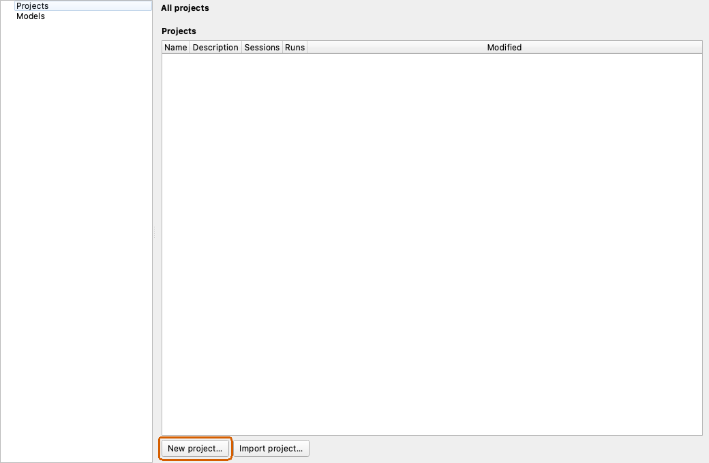
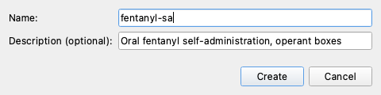

# Create a experiment

A experiment is the top-level container for your videos, runs, and analysis. This
guide creates an empty one.

## Before you start

Install the tool ([Getting started](../getting-started.md)). The steps below work
from the desktop app or the CLI.

## Create the experiment

=== "GUI"

    Launch the app:

    ```
    detail-gui
    ```

    On the experiments screen, click **New experiment** (highlighted).

    

    Enter a name (the description is optional) and click **Create**.

    

    The experiment opens, empty and ready for its first recording.

=== "CLI"

    ```
    detail experiment create operant-study --dir ~/Documents/DetailExperiments
    ```

    The experiment is created at `<dir>/<name>` and its path is printed.

## Next

- [Add a recording](add-a-recording.md): import your first video.
