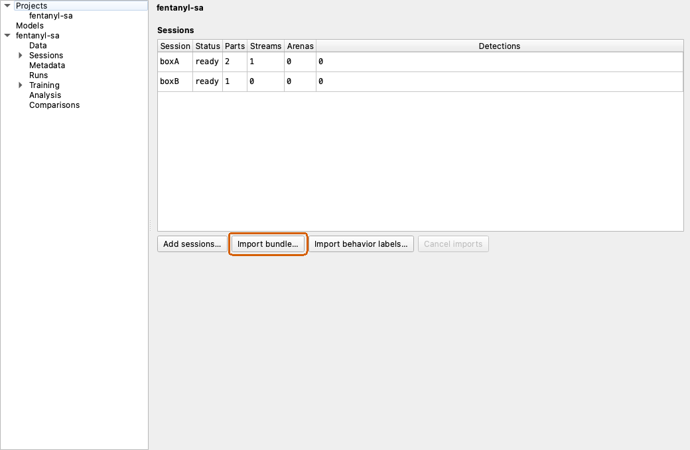

# Import recordings from YAML

Instead of adding recordings one at a time, describe them all in a single manifest
and import them in one batch, with video parts, streams, and metadata included.

## Before you start

[Create a experiment](create-a-experiment.md) to import into. Gather the video and
stream files in one folder next to a `manifest.yaml`.

## Write the manifest

A bundle is a folder holding a `manifest.yaml` plus the files it references (paths
are relative to the folder). Each recording needs an `id`; everything else is
optional.

```yaml
recordings:
  - id: boxA
    video:
      - boxA_am.mp4
      - boxA_pm.mp4
    metadata:
      treatment: drug_A
      sex: M
    streams:
      - name: medpc
        importer: medpc
        raw: PX22.txt
        aux:
          program: Golden_Liq_SelfAdmin.MPC
  - id: boxB
    video: [boxB.mp4]
    metadata:
      treatment: saline
      sex: F
```

Every field, and each importer's required files, is in the
[Manifest reference](../reference/manifest.md).

## Import

=== "GUI"

    In the experiment, open **Recordings** and click **Import bundle** (highlighted). Choose the bundle
    folder (the one holding `manifest.yaml`). The manifest is validated; confirm to
    create the recordings.

    

=== "CLI"

    Validate first, then import:

    ```
    detail recording import --experiment ~/Documents/DetailExperiments/operant-study --bundle ./bundle --dry-run
    detail recording import --experiment ~/Documents/DetailExperiments/operant-study --bundle ./bundle
    ```

    The whole manifest is validated before anything is created: a duplicate id, an
    unknown importer, a missing file, or parts that disagree on resolution or frame
    rate abort the import, leaving the experiment untouched.

## Next

- [Concepts](../concepts.md): how recordings, parts, and streams fit together.
